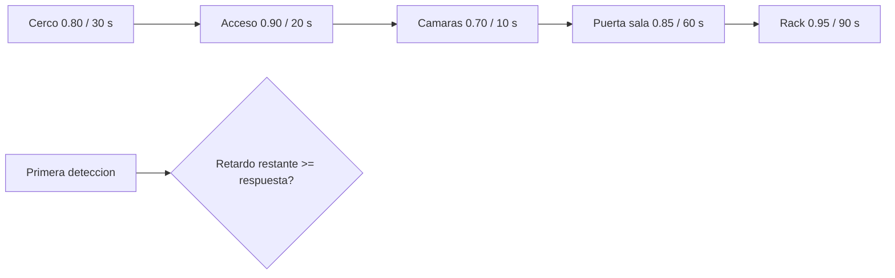

# B96-C25 — Seguridad física y control de acceso de estaciones terrestres

<!-- nav:top -->
[🏠 Programa](../../../../README.md) · [📚 Bloque B96](../../../tronco-comun/B96-control-y-operacion-de-misiones-espaciales.md) · [← Anterior: B96-C24 — Operación remota y automatizada de estaciones](../B96-C24-operacion-remota-y-automatizada-de-estaciones/CLASE.md) · [Siguiente: B96-C26 — Gestión de incidentes en la operación de estaciones →](../B96-C26-gestion-de-incidentes-en-la-operacion-de-estaciones/CLASE.md)
<!-- /nav -->

## 1. Ubicación, nivel y alcance

Clase 25 del bloque B96. Nivel N3. Una estación terrena es infraestructura crítica y se protege por **capas** (cerco, control de acceso, cámaras, puerta de sala, rack). Aquí haces un análisis **defensivo y abstracto**: cada capa tiene una probabilidad de detección y un retardo; el objetivo es que la primera detección ocurra con tiempo de retardo restante suficiente para que llegue la respuesta. Calculas la probabilidad de **interrupción a tiempo** y la verificas por Monte Carlo. Las capas, probabilidades y tiempos son **sintéticos**; la clase no describe cómo vulnerar ninguna instalación. Todos los datos son **sintéticos** salvo los que se rotulan como consultados.

## 2. Por qué esta clase existe

Una alarma que llega tarde no sirve: lo que importa es si el retardo restante supera el tiempo de respuesta cuando se detecta. La decisión central: **¿qué capas y qué tiempo de respuesta dan una probabilidad de interrupción aceptable?**

## 3. Lo que podrás hacer al terminar

1. Describir una estación como capas con probabilidad de detección y retardo.
2. Calcular la probabilidad de detección en alguna capa.
3. Calcular la probabilidad de interrupción a tiempo con el retardo restante.
4. Verificar el resultado con un Monte Carlo.
5. Estudiar la sensibilidad al tiempo de respuesta y a una capa adicional.
6. Separar lo consultado de lo sintético.

La evidencia es la **evaluación de capas con margen de tiempo** del ejercicio 12 (sección 20).

## 4. Con qué llegas y cómo comprobarlo

1. ¿Qué es la defensa en profundidad?
2. ¿Qué es la probabilidad de detección?
3. ¿Qué es un retardo?
4. ¿Qué es el tiempo de respuesta?
5. ¿Qué es una interrupción a tiempo?

<details>
<summary>Ver respuestas</summary>

1. Varias capas independientes de protección. 2. La probabilidad de que una capa detecte un evento. 3. El tiempo que una capa añade a quien intenta atravesarla. 4. El tiempo hasta que llega la respuesta tras la primera detección. 5. Que la detección ocurra con más retardo restante que tiempo de respuesta.
</details>

Con cuatro o cinco aciertos, sigue; si no, repasa los prerrequisitos.

## 5. Un caso de contexto y casos de referencia

Las cinco capas **sintéticas** (detección 0,80; 0,90; 0,70; 0,85; 0,95 y retardos 30, 20, 10, 60 y 90 s) suman 210 s de retardo; la probabilidad de detectar en alguna capa es 0,999955. Con un tiempo de respuesta de 180 s, solo las dos primeras capas dejan suficiente retardo restante: la probabilidad de interrupción es **0,98**. Con respuesta de 240 s o más, es 0.

## 6. Vocabulario

**Capa de protección:** medida física con detección y retardo. **Detección:** probabilidad de advertir un evento. **Retardo:** tiempo que añade la capa. **Tiempo de respuesta:** tiempo hasta la llegada de la respuesta. **Interrupción:** respuesta que llega antes de que el evento se complete.

## 7. Modelo mental



*Descripción textual:* cinco capas en orden con su detección y retardo; la primera detección ocurre en una capa; si el retardo restante desde esa capa es mayor o igual que el tiempo de respuesta, hay interrupción a tiempo.

Analogía: es como un castillo con varias murallas y un guardia que tarda en llegar: sirve si la alarma suena antes de que falten menos minutos de los que el guardia necesita. Límite: aquí cada capa detecta de forma independiente.

## 8. La explicación, paso a paso

### 8.1 Qué dicen las fuentes

No se consultó ninguna fuente de seguridad física: ni normas de infraestructura crítica ni reglamentos de la UIT. El método es una versión simplificada del análisis de capas por probabilidad y tiempo y lo verifica el laboratorio. Los números son **sintéticos**.

### 8.2 Detección

`P(detectar en alguna capa) = 1 − Π(1 − pᵢ) = 0,999955`. La primera detección ocurre en la capa `i` con probabilidad `pᵢ Π_{j<i}(1 − pⱼ)`.

### 8.3 Interrupción

El retardo restante desde cada capa es: 210, 180, 160, 150 y 90 s. Con respuesta de 180 s solo la primera y la segunda capa dejan retardo suficiente: `P = 0,80 + 0,20 × 0,90 = 0,98`.

| Respuesta (s) | P(interrupción) |
|---|---|
| 300 | 0 |
| 240 | 0 |
| 180 | 0,980000 |
| 120 | 0,999100 |
| 60 | 0,999955 |

El Monte Carlo de 400 000 repeticiones da 0,979845.

### 8.4 Lectura

Detectar no basta: con respuesta de 240 s la probabilidad de interrupción es cero aunque la de detección sea 0,999955. Una capa adicional de 45 s (guardia en sitio) sube la interrupción a 0,9991 para la respuesta de 180 s. La mejora más eficaz es **detectar más temprano o acortar la respuesta**.

## 9. Magnitudes, símbolos y unidades

| Símbolo | Qué es | Unidad | Valor / nota |
|---|---|---|---|
| `p` | probabilidad de detección por capa | — | 0,70 a 0,95 |
| `d` | retardo de la capa | s | 10 a 90 |
| `T` | tiempo de respuesta | s | 60 a 300 |
| `P_det` | detección en alguna capa | — | 0,999955 |
| `P_int` | interrupción a tiempo | — | 0 a 0,999955 |

## 10. Convenciones y referencias

Capas independientes en serie; la detección se evalúa de afuera hacia adentro; el retardo restante incluye el de la capa donde se detecta; tiempo en segundos. Todo **sintético** y abstracto. Semilla 96, 400 000 repeticiones. Tolerancia: interrupción `≤` detección; Monte Carlo dentro de 4σ.

## 11. De dónde sale lo que afirmamos

| ID | Fuente | Localizador | Respalda | Estado |
|---|---|---|---|---|
| — | Reglamento de Radiocomunicaciones de la UIT y normas de licencia nacionales | — | — | No consultada |
| — | Libros de texto de operaciones de misión, comunicaciones espaciales y mecánica orbital (p. ej., Wertz y Larson, Montenbruck y Gill, Vallado) | — | — | No consultada |
| — | Relaciones y algoritmos estándar usados por el laboratorio (probabilidad de primera detección y comparación de tiempos) | — | los verifica el laboratorio con una segunda vía o con pruebas | No consultada en una fuente concreta |

Límites: no se consultó ninguna fuente de seguridad física; el modelo ignora rutas alternativas, fallas de los sistemas de detección y la gravedad del evento. Lo simulado no se presenta como dato de vuelo ni como medición.

## 12. Cómo ver los resultados

| Respuesta (s) | P(interrupción) |
|---|---|
| 300 | 0 |
| 180 | 0,980 |
| 120 | 0,9991 |
| 60 | 0,999955 |

Descripción larga: la probabilidad de interrupción sube a medida que la respuesta se acorta, y cae a cero cuando la respuesta supera el retardo total (210 s).

## 13. Ejemplo trabajado

**Paso 1 · Retardo restante.** 210, 180, 160, 150 y 90 s.

**Paso 2 · Capas válidas.** Las dos primeras (≥ 180 s).

**Paso 3 · Probabilidad.** `0,80 + 0,20 × 0,90 = 0,98`.

**Paso 4 · Monte Carlo.** 0,979845.

**Paso 5 · Mejora.** Con una capa más: 0,9991.

## 14. Distintas formas de describir el problema

**Por tabla:** capas (esta clase). **Por árbol:** secuencia de detecciones. **Por registro:** bitácora de accesos (C30). **Por continuidad:** estación de respaldo (C23).

## 15. Práctica guiada

**Ejercicio 1 · con los pasos indicados.** Suma los retardos de las cinco capas.

<details><summary>Solución comentada</summary>

`30 + 20 + 10 + 60 + 90 = 210 s`.
</details>

**Ejercicio 2 · con una pista.** Calcula la probabilidad de no detectar en ninguna capa.

<details><summary>Solución comentada</summary>

`0,2 × 0,1 × 0,3 × 0,15 × 0,05 = 4,5×10⁻⁵`.
</details>

**Ejercicio 3 · casi autónomo.** Calcula la detección en alguna capa.

<details><summary>Solución comentada</summary>

`1 − 4,5×10⁻⁵ = 0,999955`.
</details>

## 16. Práctica autónoma, transferencia e integrador

**Ejercicio 4 · autónomo.** ¿Cuál es el retardo restante desde la capa 3?

<details><summary>Solución comentada</summary>

`10 + 60 + 90 = 160 s`.
</details>

**Ejercicio 5 · autónomo.** ¿Por qué la interrupción con respuesta de 180 s es 0,98 y no 0,999955?

<details><summary>Solución comentada</summary>

Si se detecta solo desde la tercera capa, quedan menos de 180 s: no hay tiempo.
</details>

**Ejercicio 6 · autónomo.** ¿Qué ocurre con respuesta de 250 s?

<details><summary>Solución comentada</summary>

Es mayor que el retardo total (210 s): la interrupción es 0.
</details>

**Ejercicio 7 · autónomo.** ¿Cuál es la interrupción con respuesta de 150 s?

<details><summary>Solución comentada</summary>

Las capas 1 a 4: `1 − 0,2 × 0,1 × 0,3 × 0,15 = 0,9991`.
</details>

**Ejercicio 8 · autónomo.** ¿Qué prefieres: bajar la respuesta de 180 a 120 s o subir la detección de la capa 4?

<details><summary>Solución comentada</summary>

Bajar la respuesta (0,98 → 0,9991); subir la capa 4 no ayuda si el retardo restante ya es insuficiente.
</details>

**Ejercicio 9 · transferencia.** **Transferencia.** Un colega afirma que '99,99 % de detección es seguridad suficiente'. ¿Qué respondes?

<details><summary>Solución comentada</summary>

Falta comparar el momento de la detección con el tiempo de respuesta.
</details>

**Ejercicio 10 · transferencia.** **Transferencia.** ¿Por qué conviene que las capas sean independientes?

<details><summary>Solución comentada</summary>

Para que una falla de una no anule las demás y la probabilidad conjunta sea mayor.
</details>

**Ejercicio 11 · transferencia.** **Transferencia.** ¿Qué no modela este análisis?

<details><summary>Solución comentada</summary>

Rutas alternativas, fallas del sistema de alarmas, colusión interna y la gravedad del evento.
</details>

**Ejercicio 12 · integrador.** **Integrador.** Elabora tu *evaluación de capas con margen de tiempo*: capas, probabilidad de detección, retardo restante, interrupción, sensibilidad y lista de lo consultado, sintético y no consultado.

<details><summary>Solución comentada</summary>

Secciones 8.2–8.4 y la salida del laboratorio.
</details>

## 17. Laboratorio: interrupción a tiempo con capas de protección

El script [proteccion_por_capas.py](proteccion_por_capas.py) calcula la probabilidad de detección y de interrupción a tiempo para cinco capas, la verifica con un Monte Carlo y estudia la sensibilidad al tiempo de respuesta y a una capa adicional; **comprueba** que la interrupción nunca supera a la detección y que el Monte Carlo coincide.

**Datos:** capas, probabilidades y tiempos **sintéticos**; semilla 96; análisis defensivo y abstracto. **Predice antes de ejecutar:** ¿cuál es la probabilidad de interrupción con respuesta de 180 s? (0,98). **Ejecución del 2026-11-10 (Python 3.12.9):**

```text
Python 3.12.9
Datos SINTETICOS: capas, probabilidades y tiempos de retardo ficticios; analisis defensivo abstracto; semilla 96
Retardo total = 210 s ; respuesta = 180 s
Probabilidad de detectar en alguna capa = 0.999955
Probabilidad de interrupcion a tiempo = 0.980000
  retardo restante desde 'Cerco perimetral con sensores' = 210 s
  retardo restante desde 'Control de acceso del recinto' = 180 s
  retardo restante desde 'Camaras con analisis' = 160 s
  retardo restante desde 'Puerta de la sala de equipos' = 150 s
  retardo restante desde 'Rack cerrado con alarma' = 90 s
Monte Carlo (400000): interrupcion = 0.979845 ; analitica = 0.980000
  respuesta   300 s -> P(interrupcion) = 0.000000
  respuesta   240 s -> P(interrupcion) = 0.000000
  respuesta   180 s -> P(interrupcion) = 0.980000
  respuesta   120 s -> P(interrupcion) = 0.999100
  respuesta    60 s -> P(interrupcion) = 0.999955
Con una capa adicional: P(interrupcion) = 0.999100
Pruebas superadas.
```

```bash
python programa/clases/B96/B96-C25-seguridad-fisica-y-control-de-acceso-de-estaciones-terrestres/proteccion_por_capas.py
```

**Límites:** capas independientes, una sola ruta, sin fallas de los sistemas de detección.

## 18. Errores frecuentes y cómo corregirlos

**Medir solo la detección.** Compara con el tiempo de respuesta (8.3)

**Suponer capas con detección perfecta.** Usa probabilidades (8.2)

**Tomar los números como reales.** Revisa la sección 10

## 19. Cómo sabrás que vas bien

Tras 8.3: ¿cuándo la interrupción es cero? Si dudas, repasa el ejercicio 6. Tras el laboratorio: ¿qué comprueba el Monte Carlo? (ver sección 17).

## 20. Qué entregas y cómo se evalúa

El producto es tu **evaluación de capas con margen de tiempo** (ejercicio 12).

| Criterio | Inicial | En desarrollo | Logrado | Destacado |
|---|---|---|---|---|
| Conceptos | Los confunde | Parciales | Explica el método y su dominio | Explica los límites y las alternativas |
| Cálculo | Sin unidades | Con errores | Resultados con unidades y comprobados | Resuelve casos nuevos |
| Numérico | Sin comprobar | Un caso | Verifica con una segunda vía en varios casos | Interpreta las diferencias y los fallos |
| Fuentes | Sin fuente | Sin fecha | Fuentes con fecha y estado | Declara lo sintético y lo no consultado |
| Límites | No los nombra | Uno | Tres | Discute qué falta del modelo |

**Condiciones críticas (no se compensan con promedio):** rotular los datos como sintéticos; comprobar cada resultado con una segunda vía; citar solo lo consultado.

## 21. Ética, seguridad y límites

Clase educativa: los modelos son simplificados y los datos son sintéticos; ningún resultado describe una misión real, certifica conformidad con una norma ni sustituye la revisión de especialistas.  Accesibilidad: tablas equivalentes a las gráficas, fórmulas en texto, ejercicios sin conexión.

## 22. Para cerrar y seguir

Con cinco capas sintéticas la detección es 0,999955, pero la interrupción a tiempo con respuesta de 180 s es 0,98 y desaparece si la respuesta supera 210 s. Queda una pregunta: ¿qué hacer cuando ocurre un incidente en pleno contacto?

**Glosario español–inglés.** defensa en profundidad · *defense in depth*; probabilidad de detección · *probability of detection*; retardo · *delay*; tiempo de respuesta · *response time*; infraestructura crítica · *critical infrastructure*.

**Continuidad.** [B96-C26](../B96-C26-gestion-de-incidentes-en-la-operacion-de-estaciones/CLASE.md) trata la gestión de incidentes en la operación de estaciones.

**Referencias:** ver sección 11.

<!-- nav:bottom -->
---

[← Anterior: B96-C24 — Operación remota y automatizada de estaciones](../B96-C24-operacion-remota-y-automatizada-de-estaciones/CLASE.md) · [📚 Bloque B96](../../../tronco-comun/B96-control-y-operacion-de-misiones-espaciales.md) · [Siguiente: B96-C26 — Gestión de incidentes en la operación de estaciones →](../B96-C26-gestion-de-incidentes-en-la-operacion-de-estaciones/CLASE.md)
<!-- /nav -->
