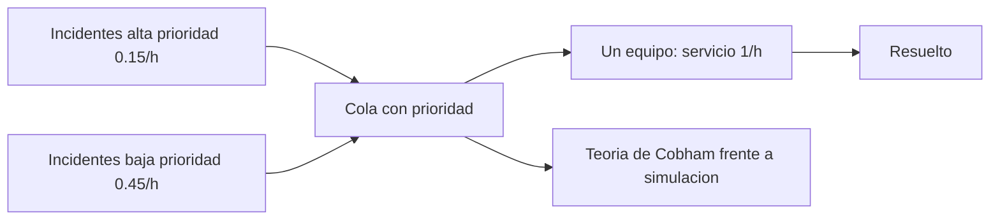

# B96-C26 — Gestión de incidentes en la operación de estaciones

<!-- nav:top -->
[🏠 Programa](../../../../README.md) · [📚 Bloque B96](../../../tronco-comun/B96-control-y-operacion-de-misiones-espaciales.md) · [← Anterior: B96-C25 — Seguridad física y control de acceso de estaciones terrestres](../B96-C25-seguridad-fisica-y-control-de-acceso-de-estaciones-terrestres/CLASE.md) · [Siguiente: B96-C27 — Operación de equipos de radiofrecuencia en la estación →](../B96-C27-operacion-de-equipos-de-radiofrecuencia-en-la-estacion/CLASE.md)
<!-- /nav -->

## 1. Ubicación, nivel y alcance

Clase 26 del bloque B96. Nivel N3. Cuando algo falla en la estación en pleno contacto, los incidentes llegan al azar y un equipo los atiende de a uno. Aquí modelas la **gestión de incidentes** como una cola **M/M/1** con dos prioridades: calculas el tiempo de espera con la teoría y lo contrastas con una simulación de 400 000 incidentes, con y sin prioridad. Las tasas de llegada y de atención son **sintéticas**. Todos los datos son **sintéticos** salvo los que se rotulan como consultados.

## 2. Por qué esta clase existe

Sin un procedimiento de priorización, un incidente leve puede retrasar a uno grave. La decisión central: **¿cuánto esperan los incidentes de alta y de baja prioridad y cuánto mejora la priorización al grave sin colapsar al leve?**

## 3. Lo que podrás hacer al terminar

1. Calcular la utilización y la espera media de una cola M/M/1.
2. Calcular las esperas con prioridad no expropiativa.
3. Verificar la ley de conservación entre FIFO y prioridad.
4. Simular la cola con una cola de prioridad y comparar con la teoría.
5. Calcular el tiempo medio hasta resolver por clase.
6. Separar lo consultado de lo sintético.

La evidencia es la **indicadores de gestión de incidentes** del ejercicio 12 (sección 20).

## 4. Con qué llegas y cómo comprobarlo

1. ¿Qué es una cola M/M/1?
2. ¿Qué es la utilización `ρ`?
3. ¿Qué es la prioridad no expropiativa?
4. ¿Qué es la espera media `Wq`?
5. ¿Qué es una simulación de eventos?

<details>
<summary>Ver respuestas</summary>

1. Llegadas de Poisson, servicio exponencial y un servidor. 2. `λ/μ`: la fracción del tiempo que el servidor está ocupado. 3. El servicio en curso no se interrumpe, pero el siguiente se elige por prioridad. 4. El tiempo medio en cola antes de ser atendido. 5. Un modelo que avanza evento por evento con aleatoriedad.
</details>

Con cuatro o cinco aciertos, sigue; si no, repasa los prerrequisitos.

## 5. Un caso de contexto y casos de referencia

Con llegadas de 0,15 incidentes/h de alta prioridad y 0,45/h de baja y una tasa de servicio de 1/h, la utilización es 0,60. La teoría da una espera de 1,50 h en FIFO; con prioridad, 0,706 h para la alta y 1,765 h para la baja. La simulación da 1,491 h (FIFO) y 0,708 h y 1,752 h (con prioridad). El tiempo medio hasta resolver es 102,4 min (alta) y 165,9 min (baja).

## 6. Vocabulario

**Incidente:** evento que interrumpe la operación normal. **M/M/1:** cola con llegadas y servicios exponenciales y un servidor. **Utilización:** `ρ = λ/μ`. **Espera `Wq`:** tiempo en cola. **Prioridad no expropiativa:** no interrumpe al que se atiende. **Tiempo hasta resolver:** espera más servicio.

## 7. Modelo mental



*Descripción textual:* los incidentes de dos prioridades entran a una sola cola y un equipo los atiende de a uno; la teoría de colas da la espera por clase y la simulación la verifica.

Analogía: es como una sala de urgencias con un solo médico: quien llega grave pasa primero, pero quien espera por algo leve aguarda más. Límite: en una estación real el equipo puede crecer o escalar.

## 8. La explicación, paso a paso

### 8.1 Qué dicen las fuentes

No se consultó ninguna fuente sobre gestión de incidentes y esta clase no se apoya en ninguna fuente consultada. Las fórmulas de la teoría de colas (M/M/1 y la de Cobham para prioridad no expropiativa) son estándar y las verifica el laboratorio. Las tasas son **sintéticas**.

### 8.2 Teoría

`ρ = (λ₁ + λ₂)/μ = 0,60`. FIFO: `Wq = ρ/(μ − λ) = 1,5000 h`. Con prioridad no expropiativa y servicio exponencial: `W₀ = (λ₁ + λ₂)/μ² = 0,60`, `Wq₁ = W₀/(1 − ρ₁) = 0,7059 h` y `Wq₂ = W₀/((1 − ρ₁)(1 − ρ)) = 1,7647 h`.

### 8.3 Conservación

La ley de conservación de Kleinrock exige `Σρᵢ Wqᵢ = ρ Wq_FIFO`: `0,15 × 0,7059 + 0,45 × 1,7647 = 0,9000 = 0,60 × 1,5000`. El laboratorio lo comprueba a `10⁻¹²`.

### 8.4 Simulación y lectura

| Política | Alta (h) | Baja (h) | Global (h) |
|---|---|---|---|
| FIFO simulado | 1,499 | 1,488 | 1,491 |
| Prioridad simulada | 0,708 | 1,752 | 1,492 |
| Teoría FIFO | — | — | 1,500 |
| Teoría prioridad | 0,706 | 1,765 | — |

La prioridad **no reduce la espera global** (1,491 y 1,492 h); la redistribuye: la alta espera la mitad y la baja espera 17 % más. Tiempo medio hasta resolver: 102,4 min (alta) y 165,9 min (baja).

## 9. Magnitudes, símbolos y unidades

| Símbolo | Qué es | Unidad | Valor / nota |
|---|---|---|---|
| `λ₁, λ₂` | llegadas | 1/h | 0,15; 0,45 |
| `μ` | tasa de servicio | 1/h | 1 |
| `ρ` | utilización | — | 0,60 |
| `Wq` | espera en cola | h | 0,706 a 1,765 |
| `T` | tiempo hasta resolver | min | 102,4 y 165,9 |

## 10. Convenciones y referencias

Tiempo en horas; llegadas de Poisson y servicio exponencial (con semilla 96 y 400 000 incidentes); prioridad no expropiativa; un solo equipo. Todo **sintético**. Tolerancias: simulado frente a teoría `< 8 %`; conservación a `10⁻¹²`.

## 11. De dónde sale lo que afirmamos

| ID | Fuente | Localizador | Respalda | Estado |
|---|---|---|---|---|
| — | Libros de texto de operaciones de misión, comunicaciones espaciales y mecánica orbital (p. ej., Wertz y Larson, Montenbruck y Gill, Vallado) | — | — | No consultada |
| — | Relaciones y algoritmos estándar usados por el laboratorio (teoría de colas M/M/1, fórmula de Cobham y simulación de eventos) | — | los verifica el laboratorio con una segunda vía o con pruebas | No consultada en una fuente concreta |

Límites: no se consultó ninguna fuente de incidentes; el modelo ignora tiempos de escalamiento, equipos múltiples y el costo de una espera larga. Lo simulado no se presenta como dato de vuelo ni como medición.

## 12. Cómo ver los resultados

| Clase | Espera teórica (h) | Espera simulada (h) |
|---|---|---|
| Alta | 0,706 | 0,708 |
| Baja | 1,765 | 1,752 |
| FIFO | 1,500 | 1,491 |

Descripción larga: la prioridad acorta la espera de la clase alta a menos de la mitad y alarga la de la clase baja, sin cambiar el promedio global.

## 13. Ejemplo trabajado

**Paso 1 · Utilización.** `0,15 + 0,45 = 0,60`.

**Paso 2 · FIFO.** `0,60/(1 − 0,60) = 1,5 h`.

**Paso 3 · Alta.** `0,60/(1 − 0,15) = 0,706 h`.

**Paso 4 · Baja.** `0,60/(0,85 × 0,40) = 1,765 h`.

**Paso 5 · Resolver.** `0,706 + 1 = 1,706 h = 102 min`.

## 14. Distintas formas de describir el problema

**Por fórmula:** teoría de colas (esta clase). **Por simulación:** 400 000 incidentes. **Por procedimiento:** pasos de recuperación (C14). **Por continuidad:** disponibilidad de la estación (C23).

## 15. Práctica guiada

**Ejercicio 1 · con los pasos indicados.** Calcula `ρ` con `λ = 0,5` y `μ = 1`.

<details><summary>Solución comentada</summary>

`0,5`.
</details>

**Ejercicio 2 · con una pista.** Calcula `Wq` FIFO con `λ = 0,5` y `μ = 1`.

<details><summary>Solución comentada</summary>

`ρ/(μ − λ) = 0,5/0,5 = 1,0 h`.
</details>

**Ejercicio 3 · casi autónomo.** ¿Qué pasa con `Wq` si `ρ` tiende a 1?

<details><summary>Solución comentada</summary>

Crece sin límite: la cola se satura.
</details>

## 16. Práctica autónoma, transferencia e integrador

**Ejercicio 4 · autónomo.** Calcula `Wq₁` con `W₀ = 0,6` y `ρ₁ = 0,15`.

<details><summary>Solución comentada</summary>

`0,6/0,85 = 0,706 h`.
</details>

**Ejercicio 5 · autónomo.** ¿Qué comprueba la ley de conservación?

<details><summary>Solución comentada</summary>

Que la prioridad redistribuye la espera sin cambiar el promedio ponderado.
</details>

**Ejercicio 6 · autónomo.** Calcula el tiempo hasta resolver de la clase baja.

<details><summary>Solución comentada</summary>

`1,765 + 1 = 2,765 h = 165,9 min`.
</details>

**Ejercicio 7 · autónomo.** Si la tasa de incidentes de baja prioridad sube a 0,70, ¿cuál es `ρ`?

<details><summary>Solución comentada</summary>

`0,85`: la cola está casi saturada.
</details>

**Ejercicio 8 · autónomo.** ¿Por qué la prioridad no baja el promedio global?

<details><summary>Solución comentada</summary>

Porque la espera total es la misma; solo cambia quién espera.
</details>

**Ejercicio 9 · transferencia.** **Transferencia.** Un colega quiere priorizar todo como 'alta'. ¿Qué respondes?

<details><summary>Solución comentada</summary>

Si todo es alta, la prioridad no distingue nada y se vuelve FIFO.
</details>

**Ejercicio 10 · transferencia.** **Transferencia.** ¿Qué haces si la espera de la clase baja es inaceptable?

<details><summary>Solución comentada</summary>

Añadir un segundo equipo o reducir la tasa de llegadas con prevención.
</details>

**Ejercicio 11 · transferencia.** **Transferencia.** ¿Qué no modela este análisis?

<details><summary>Solución comentada</summary>

Escalamiento, equipos múltiples, incidentes que se resuelven solos y costos por espera.
</details>

**Ejercicio 12 · integrador.** **Integrador.** Elabora tus *indicadores de gestión de incidentes*: utilización, esperas teóricas y simuladas, conservación, tiempo hasta resolver y lista de lo consultado, sintético y no consultado.

<details><summary>Solución comentada</summary>

Secciones 8.2–8.4 y la salida del laboratorio.
</details>

## 17. Laboratorio: cola de incidentes con prioridades

El script [cola_de_incidentes.py](cola_de_incidentes.py) calcula la espera teórica FIFO y con prioridad, verifica la ley de conservación, simula 400 000 incidentes con y sin prioridad y compara con la teoría; **comprueba** el acuerdo `< 8 %` y el orden alta < FIFO < baja.

**Datos:** llegadas y servicios **sintéticos**; semilla 96. **Predice antes de ejecutar:** ¿cuál es la espera de la clase alta con prioridad? (≈ 0,71 h). **Ejecución del 2026-11-10 (Python 3.12.9):**

```text
Python 3.12.9
Datos SINTETICOS: llegadas de incidentes y tiempos de atencion ficticios; semilla 96
lambda1 = 0.15/h (alta) ; lambda2 = 0.45/h (baja) ; mu = 1.0/h ; rho = 0.60
Teoria: FIFO Wq = 1.5000 h ; prioridad: alta Wq1 = 0.7059 h ; baja Wq2 = 1.7647 h
Conservacion: sum(rho_i Wq_i) = 0.90000 ; rho Wq_fifo = 0.90000
FIFO       simulado: Wq alta = 1.4990 h ; baja = 1.4883 h ; global = 1.4910 h
Prioridad  simulado: Wq alta = 0.7078 h ; baja = 1.7523 h ; global = 1.4921 h
Tiempo medio hasta resolver (alta prioridad) = 1.7059 h = 102.4 min
Tiempo medio hasta resolver (baja prioridad) = 2.7647 h = 165.9 min
Pruebas superadas.
```

```bash
python programa/clases/B96/B96-C26-gestion-de-incidentes-en-la-operacion-de-estaciones/cola_de_incidentes.py
```

**Límites:** un servidor, servicio exponencial, prioridad no expropiativa y sin escalamiento.

## 18. Errores frecuentes y cómo corregirlos

**Creer que la prioridad reduce el promedio.** Aplica la conservación (8.3)

**Ignorar la saturación.** Vigila `ρ` (ejercicio 3)

**Tomar las tasas como medidas.** Revisa la sección 10

## 19. Cómo sabrás que vas bien

Tras 8.3: ¿qué conserva la prioridad? Si dudas, repasa el ejercicio 5. Tras el laboratorio: ¿qué se compara con la simulación? (ver sección 17).

## 20. Qué entregas y cómo se evalúa

El producto es tu **indicadores de gestión de incidentes** (ejercicio 12).

| Criterio | Inicial | En desarrollo | Logrado | Destacado |
|---|---|---|---|---|
| Conceptos | Los confunde | Parciales | Explica el método y su dominio | Explica los límites y las alternativas |
| Cálculo | Sin unidades | Con errores | Resultados con unidades y comprobados | Resuelve casos nuevos |
| Numérico | Sin comprobar | Un caso | Verifica con una segunda vía en varios casos | Interpreta las diferencias y los fallos |
| Fuentes | Sin fuente | Sin fecha | Fuentes con fecha y estado | Declara lo sintético y lo no consultado |
| Límites | No los nombra | Uno | Tres | Discute qué falta del modelo |

**Condiciones críticas (no se compensan con promedio):** rotular los datos como sintéticos; comprobar cada resultado con una segunda vía; citar solo lo consultado.

## 21. Ética, seguridad y límites

Clase educativa: los modelos son simplificados y los datos son sintéticos; ningún resultado describe una misión real, certifica conformidad con una norma ni sustituye la revisión de especialistas.  Accesibilidad: tablas equivalentes a las gráficas, fórmulas en texto, ejercicios sin conexión.

## 22. Para cerrar y seguir

La prioridad reduce la espera de los incidentes graves de 1,5 h a 0,71 h y la sube a 1,76 h para los leves, sin cambiar el promedio. Queda una pregunta: ¿cómo se opera con seguridad el equipo de radiofrecuencia?

**Glosario español–inglés.** incidente · *incident*; cola · *queue*; utilización · *utilization*; prioridad · *priority*; tiempo hasta resolver · *time to resolve*.

**Continuidad.** [B96-C27](../B96-C27-operacion-de-equipos-de-radiofrecuencia-en-la-estacion/CLASE.md) trata la operación de equipos de radiofrecuencia en la estación.

**Referencias:** ver sección 11.

<!-- nav:bottom -->
---

[← Anterior: B96-C25 — Seguridad física y control de acceso de estaciones terrestres](../B96-C25-seguridad-fisica-y-control-de-acceso-de-estaciones-terrestres/CLASE.md) · [📚 Bloque B96](../../../tronco-comun/B96-control-y-operacion-de-misiones-espaciales.md) · [Siguiente: B96-C27 — Operación de equipos de radiofrecuencia en la estación →](../B96-C27-operacion-de-equipos-de-radiofrecuencia-en-la-estacion/CLASE.md)
<!-- /nav -->
