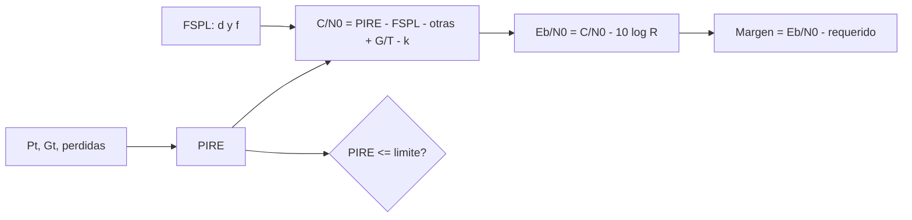

# B96-C27 — Operación de equipos de radiofrecuencia en la estación

<!-- nav:top -->
[🏠 Programa](../../../../README.md) · [📚 Bloque B96](../../../tronco-comun/B96-control-y-operacion-de-misiones-espaciales.md) · [← Anterior: B96-C26 — Gestión de incidentes en la operación de estaciones](../B96-C26-gestion-de-incidentes-en-la-operacion-de-estaciones/CLASE.md) · [Siguiente: B96-C28 — Control y seguimiento de la antena de estación →](../B96-C28-control-y-seguimiento-de-la-antena-de-estacion/CLASE.md)
<!-- /nav -->

## 1. Ubicación, nivel y alcance

Clase 27 del bloque B96. Nivel N3. Operar un transmisor y un receptor exige conocer cuánta potencia se radia (**PIRE**), cuánto se pierde en el espacio y cuánto margen queda, además de respetar un **límite de potencia** autorizado. Aquí calculas un enlace de subida **sintético** a 2 GHz con tres elevaciones, lo verificas en escala lineal y obtienes la potencia mínima para un margen de 3 dB. Todos los equipos y límites son **ficticios**. Todos los datos son **sintéticos** salvo los que se rotulan como consultados.

## 2. Por qué esta clase existe

Un transmisor con potencia de más interfiere con otros y viola la licencia; con potencia de menos, no cierra el enlace. La decisión central: **¿qué potencia hace falta para un margen suficiente sin exceder el límite autorizado?**

## 3. Lo que podrás hacer al terminar

1. Calcular la PIRE y compararla con un límite.
2. Calcular la pérdida en espacio libre y la relación `C/N₀`.
3. Calcular `Eb/N₀` y el margen de enlace.
4. Verificar los cálculos en escala lineal.
5. Obtener la potencia mínima para un margen dado.
6. Separar lo consultado de lo sintético.

La evidencia es la **hoja de operación de RF con margen** del ejercicio 12 (sección 20).

## 4. Con qué llegas y cómo comprobarlo

1. ¿Qué es un decibelio?
2. ¿Qué es la PIRE?
3. ¿Qué es la pérdida en espacio libre?
4. ¿Qué es `Eb/N₀`?
5. ¿Qué es el margen de enlace?

<details>
<summary>Ver respuestas</summary>

1. `10 log₁₀` de una razón de potencias. 2. Potencia isotrópica radiada equivalente: potencia del transmisor más ganancia de antena menos pérdidas, en dBW. 3. `(4π d f/c)²`, en dB. 4. Energía por bit sobre densidad de ruido. 5. `Eb/N₀` disponible menos el requerido.
</details>

Con cuatro o cinco aciertos, sigue; si no, repasa los prerrequisitos.

## 5. Un caso de contexto y casos de referencia

Con 5 W (6,99 dBW), antena de 22 dBi y 1,5 dB de pérdidas, la PIRE sintética es 27,49 dBW (límite ficticio: 55 dBW). A 2 GHz y 256 kbit/s, con 3 dBi y 600 K en el satélite y 2 dB de otras pérdidas, el margen es 5,58 dB a 10° de elevación (1 815,7 km), 10,82 dB a 30° y 15,95 dB al cenit. Para un margen de 3 dB a 10° basta una potencia de 2,763 W. El capítulo de la NASA cita un margen típico de 3 dB para LEO a 1 500 km.

## 6. Vocabulario

**PIRE:** potencia isotrópica radiada equivalente. **Pérdida en espacio libre (FSPL):** atenuación por distancia y frecuencia. **`C/N₀`:** portadora sobre densidad de ruido. **`Eb/N₀`:** energía por bit sobre densidad de ruido. **Margen:** `Eb/N₀` disponible menos requerido. **`G/T`:** ganancia sobre temperatura de ruido.

## 7. Modelo mental



*Descripción textual:* la potencia, la ganancia y las pérdidas dan la PIRE; con la pérdida en espacio libre y el ruido del receptor se obtiene `C/N₀`; restando la tasa en dB da `Eb/N₀` y el margen; la PIRE se compara con el límite autorizado.

Analogía: el enlace es como una linterna y un observador lejano: la PIRE es la fuerza de la linterna, la pérdida es la distancia y el margen es cuánta luz sobra. Límite: aquí el límite autorizado evita que la linterna encandile a otros.

## 8. La explicación, paso a paso

### 8.1 Qué dicen las fuentes

El capítulo de la NASA sobre sistemas terrestres (S1) indica que las bandas habituales son UHF, S, X y Ka, que la licencia con la FCC o la NTIA puede tomar varios meses y que un margen de 3 dB es típico para el retorno de datos en LEO a 1 500 km de distancia oblicua. No se consultó el Reglamento de Radiocomunicaciones de la UIT ni normas de licencia. La ecuación de enlace es estándar y la verifica el laboratorio; todos los valores de equipos son **sintéticos**.

### 8.2 Ecuación de enlace

En dB: `PIRE = P_t + G_t − L_t`; `FSPL = 20 log₁₀(4π d f/c)`; `C/N₀ = PIRE − FSPL − L_otras + G/T − 10 log₁₀ k`; `Eb/N₀ = C/N₀ − 10 log₁₀ R`; `margen = Eb/N₀ − (Eb/N₀)_req`. Con `G/T = 3 − 10 log₁₀ 600 = −24,78 dB/K` y `k = 1,380649×10⁻²³ J/K`.

### 8.3 Resultados

| Elevación (°) | Distancia (km) | FSPL (dB) | `C/N₀` (dB·Hz) | `Eb/N₀` (dB) | Margen (dB) |
|---|---|---|---|---|---|
| 10 | 1 815,7 | 163,65 | 65,66 | 11,58 | 5,58 |
| 30 | 992,9 | 158,41 | 70,90 | 16,82 | 10,82 |
| 90 | 550,0 | 153,28 | 76,03 | 21,95 | 15,95 |

La comprobación en escala lineal (`C/N₀ = PIRE·G_r/(FSPL·L·k·T)`) coincide a `10⁻⁹` dB y `(4π d/λ)²` reproduce la FSPL a `10⁻⁹`.

### 8.4 Decisión

El peor caso es 10° (margen 5,58 dB, sobre el criterio de lectura de 3 dB). La potencia que da exactamente 3 dB a 10° es `5 × 10^((3 − 5,58)/10) = 2,763 W`: se puede **reducir** la potencia y seguir cumpliendo, lo que ayuda con el límite de PIRE y con la interferencia. 3 dB equivalen a ×1,995; 10 dB, a ×10; 20 dB, a ×100.

## 9. Magnitudes, símbolos y unidades

| Símbolo | Qué es | Unidad | Valor / nota |
|---|---|---|---|
| `P_t` | potencia del transmisor | W | 5 (sintética) |
| `G_t, G_r` | ganancias | dBi | 22; 3 (sintéticas) |
| `f` | frecuencia | Hz | 2,0×10⁹ (sintética) |
| `R` | tasa | bit/s | 256 000 |
| `M` | margen | dB | 5,58 a 15,95 |

## 10. Convenciones y referencias

Escala de decibelios con `dB(x) = 10 log₁₀ x`; `c = 299 792 458 m/s` y `k = 1,380649×10⁻²³ J/K` (valores exactos del SI); distancias oblicuas de C01 con `h = 550 km`; temperatura de ruido de 600 K y otras pérdidas de 2 dB (sintéticas); `(Eb/N₀)_req = 6 dB` ficticio; límite de PIRE de 55 dBW ficticio. Tolerancias: verificación lineal y de FSPL a `10⁻⁹` dB; margen en 3 dB exacto a `10⁻⁹`.

## 11. De dónde sale lo que afirmamos

| ID | Fuente | Localizador | Respalda | Estado |
|---|---|---|---|---|
| S1 | NASA, «Ground Data Systems and Mission Operations», en State-of-the-Art of Small Spacecraft Technology — https://www.nasa.gov/smallsat-institute/sst-soa/ground-data-systems-and-mission-operations/ (consultada 2026-11-10; leídos los primeros 100 000 caracteres de 215 453) | capítulo (parte inicial) | un centro de operaciones de misión (MOC) comanda la nave y un centro de operaciones científicas (SOC) genera productos; enlaces directos a la Tierra frente a relevos; bandas UHF, S, X y Ka; la licencia tarda meses; las antenas suelen adquirir el satélite con 5–10° de elevación; margen típico de 3 dB para retorno de datos en LEO a 1 500 km de distancia oblicua | Consultada (parte del capítulo) |
| — | Reglamento de Radiocomunicaciones de la UIT y normas de licencia nacionales | — | — | No consultada |
| — | Libros de texto de operaciones de misión, comunicaciones espaciales y mecánica orbital (p. ej., Wertz y Larson, Montenbruck y Gill, Vallado) | — | — | No consultada |
| — | Relaciones y algoritmos estándar usados por el laboratorio (ecuación de enlace (Friis) en decibelios) | — | los verifica el laboratorio con una segunda vía o con pruebas | No consultada en una fuente concreta |

Límites: el capítulo se leyó solo en parte; no se consultó la UIT; el modelo ignora la modulación y codificación reales, el Doppler, la lluvia y la polarización más allá de una pérdida fija. Lo simulado no se presenta como dato de vuelo ni como medición.

## 12. Cómo ver los resultados

| Elevación (°) | Margen (dB) |
|---|---|
| 10 | 5,58 |
| 30 | 10,82 |
| 90 | 15,95 |

Descripción larga: el margen crece con la elevación porque la distancia baja de 1 816 km a 550 km; la diferencia entre 10° y 90° es de 10,4 dB.

## 13. Ejemplo trabajado

**Paso 1 · PIRE.** `6,99 + 22 − 1,5 = 27,49 dBW`.

**Paso 2 · FSPL a 10°.** `163,65 dB`.

**Paso 3 · `C/N₀`.** `27,49 − 163,65 − 2 − 24,78 + 228,60 = 65,66`.

**Paso 4 · `Eb/N₀`.** `65,66 − 54,08 = 11,58 dB`.

**Paso 5 · Margen.** `11,58 − 6 = 5,58 dB`.

## 14. Distintas formas de describir el problema

**Por decibelios:** ecuación de enlace (esta clase). **Por lineal:** razones de potencia. **Por diagnóstico:** residuos del enlace (C29). **Por seguimiento:** pérdida por apuntamiento (C28).

## 15. Práctica guiada

**Ejercicio 1 · con los pasos indicados.** Convierte 5 W a dBW.

<details><summary>Solución comentada</summary>

`10 log₁₀ 5 = 6,99 dBW`.
</details>

**Ejercicio 2 · con una pista.** Convierte 3 dB a razón de potencias.

<details><summary>Solución comentada</summary>

`10^0,3 = 1,995`.
</details>

**Ejercicio 3 · casi autónomo.** Calcula la PIRE de 10 W, 25 dBi y 2 dB de pérdidas.

<details><summary>Solución comentada</summary>

`10 + 25 − 2 = 33 dBW`.
</details>

## 16. Práctica autónoma, transferencia e integrador

**Ejercicio 4 · autónomo.** ¿Cuánto cambia la FSPL si la distancia se duplica?

<details><summary>Solución comentada</summary>

`+6,02 dB`.
</details>

**Ejercicio 5 · autónomo.** ¿Y si la frecuencia se duplica?

<details><summary>Solución comentada</summary>

`+6,02 dB`.
</details>

**Ejercicio 6 · autónomo.** ¿Cuánto vale `10 log₁₀ 256 000`?

<details><summary>Solución comentada</summary>

`54,08 dB`.
</details>

**Ejercicio 7 · autónomo.** Calcula el margen si `Eb/N₀ = 8 dB` y el requerido 6 dB.

<details><summary>Solución comentada</summary>

`2 dB`: por debajo del criterio de lectura de 3 dB.
</details>

**Ejercicio 8 · autónomo.** ¿Qué potencia da margen de 3 dB a 10° con `P = 5 W` y margen actual 5,58 dB?

<details><summary>Solución comentada</summary>

`5 × 10^(−0,258) = 2,76 W`.
</details>

**Ejercicio 9 · transferencia.** **Transferencia.** Un colega sube la potencia para ganar margen sin revisar la licencia. ¿Qué respondes?

<details><summary>Solución comentada</summary>

La PIRE debe respetar el límite autorizado; y más potencia puede interferir con otros.
</details>

**Ejercicio 10 · transferencia.** **Transferencia.** ¿Por qué el peor caso es 10°?

<details><summary>Solución comentada</summary>

Es la mayor distancia oblicua: mayor FSPL.
</details>

**Ejercicio 11 · transferencia.** **Transferencia.** ¿Qué efectos no incluye el modelo?

<details><summary>Solución comentada</summary>

Lluvia, desvanecimientos, modulación real y Doppler.
</details>

**Ejercicio 12 · integrador.** **Integrador.** Elabora tu *hoja de operación de RF con margen*: PIRE y límite, FSPL, `C/N₀`, `Eb/N₀`, margen por elevación, potencia mínima y lista de lo consultado, sintético y no consultado.

<details><summary>Solución comentada</summary>

Secciones 8.2–8.4 y la salida del laboratorio.
</details>

## 17. Laboratorio: enlace de subida con margen

El script [radiofrecuencia_de_estacion.py](radiofrecuencia_de_estacion.py) calcula la PIRE, la FSPL, `C/N₀`, `Eb/N₀` y el margen para tres elevaciones, los verifica en escala lineal y calcula la potencia mínima para un margen de 3 dB; **comprueba** el límite de PIRE, la FSPL por `(4πd/λ)²` y el orden de los márgenes.

**Datos:** equipos, frecuencia, tasa y límite de PIRE **sintéticos**. **Predice antes de ejecutar:** ¿cuál es el margen a 10° de elevación? (≈ 5,6 dB). **Ejecución del 2026-11-10 (Python 3.12.9):**

```text
Python 3.12.9
Datos SINTETICOS: potencias, ganancias, tasas y limite de PIRE ficticios; c = 299792458 m/s; k = 1.380649e-23 J/K (exacta en el SI)
PIRE = 6.99 dBW + 22.0 - 1.5 = 27.49 dBW ; limite = 55.0 dBW ; cumple: True
elev[gr]  d[km]   FSPL[dB]  C/N0[dB-Hz]  Eb/N0[dB]  margen[dB]
   10.0  1815.7    163.65        65.66      11.58       5.58
   30.0   992.9    158.41        70.90      16.82      10.82
   90.0   550.0    153.28        76.03      21.95      15.95
Margen peor caso (elevacion 10 grados) = 5.58 dB ; el capitulo de la NASA cita ~3 dB como margen tipico en LEO a 1500 km: cumple el criterio de lectura
Potencia de transmisor para margen exactamente 3 dB a 10 grados = 2.763 W (actual 5.0 W)
3 dB = x1.9953 ; 10 dB = x10.0 ; 20 dB = x100
Pruebas superadas.
```

```bash
python programa/clases/B96/B96-C27-operacion-de-equipos-de-radiofrecuencia-en-la-estacion/radiofrecuencia_de_estacion.py
```

**Límites:** sin lluvia, modulación real, Doppler ni polarización variable; temperatura de ruido y pérdidas fijas.

## 18. Errores frecuentes y cómo corregirlos

**Sumar potencias en dB.** Convierte a lineal para sumar (ejercicio 1)

**Ignorar el límite de PIRE.** Compara con el límite (8.2)

**Usar la distancia vertical en todo el pase.** Calcula el rango oblicuo (C01)

## 19. Cómo sabrás que vas bien

Tras 8.3: ¿por qué el margen sube con la elevación? Si dudas, repasa el ejercicio 4. Tras el laboratorio: ¿qué comprueba la escala lineal? (ver sección 17).

## 20. Qué entregas y cómo se evalúa

El producto es tu **hoja de operación de RF con margen** (ejercicio 12).

| Criterio | Inicial | En desarrollo | Logrado | Destacado |
|---|---|---|---|---|
| Conceptos | Los confunde | Parciales | Explica el método y su dominio | Explica los límites y las alternativas |
| Cálculo | Sin unidades | Con errores | Resultados con unidades y comprobados | Resuelve casos nuevos |
| Numérico | Sin comprobar | Un caso | Verifica con una segunda vía en varios casos | Interpreta las diferencias y los fallos |
| Fuentes | Sin fuente | Sin fecha | Fuentes con fecha y estado | Declara lo sintético y lo no consultado |
| Límites | No los nombra | Uno | Tres | Discute qué falta del modelo |

**Condiciones críticas (no se compensan con promedio):** rotular los datos como sintéticos; comprobar cada resultado con una segunda vía; citar solo lo consultado.

## 21. Ética, seguridad y límites

Clase educativa: los modelos son simplificados y los datos son sintéticos; ningún resultado describe una misión real, certifica conformidad con una norma ni sustituye la revisión de especialistas.  Accesibilidad: tablas equivalentes a las gráficas, fórmulas en texto, ejercicios sin conexión.

## 22. Para cerrar y seguir

Con 5 W, el margen sintético va de 5,58 dB a 10° a 15,95 dB en el cenit; para 3 dB a 10° bastan 2,76 W, lo que alivia el límite de PIRE (27,49 de 55 dBW). Queda una pregunta: ¿cómo se apunta la antena durante la pasada?

**Glosario español–inglés.** PIRE · *equivalent isotropically radiated power (EIRP)*; pérdida en espacio libre · *free-space path loss (FSPL)*; margen de enlace · *link margin*; decibelio · *decibel*; relación portadora-ruido · *carrier-to-noise density ratio (C/N0)*.

**Continuidad.** [B96-C28](../B96-C28-control-y-seguimiento-de-la-antena-de-estacion/CLASE.md) trata el control y seguimiento de la antena de estación.

**Referencias:** ver sección 11.

<!-- nav:bottom -->
---

[← Anterior: B96-C26 — Gestión de incidentes en la operación de estaciones](../B96-C26-gestion-de-incidentes-en-la-operacion-de-estaciones/CLASE.md) · [📚 Bloque B96](../../../tronco-comun/B96-control-y-operacion-de-misiones-espaciales.md) · [Siguiente: B96-C28 — Control y seguimiento de la antena de estación →](../B96-C28-control-y-seguimiento-de-la-antena-de-estacion/CLASE.md)
<!-- /nav -->
