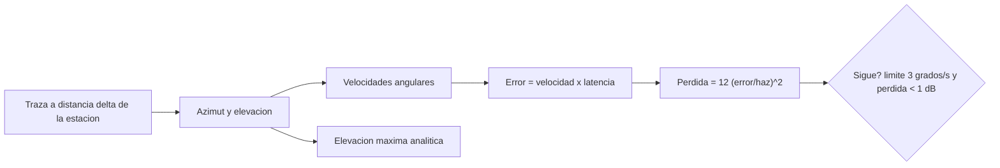

# B96-C28 — Control y seguimiento de la antena de estación

<!-- nav:top -->
[🏠 Programa](../../../../README.md) · [📚 Bloque B96](../../../tronco-comun/B96-control-y-operacion-de-misiones-espaciales.md) · [← Anterior: B96-C27 — Operación de equipos de radiofrecuencia en la estación](../B96-C27-operacion-de-equipos-de-radiofrecuencia-en-la-estacion/CLASE.md) · [Siguiente: B96-C29 — Diagnóstico de fallas de enlace →](../B96-C29-diagnostico-de-fallas-de-enlace/CLASE.md)
<!-- /nav -->

## 1. Ubicación, nivel y alcance

Clase 28 del bloque B96. Nivel N3. Seguir un satélite exige que la antena gire en azimut y elevación con la velocidad que impone la geometría. Aquí calculas, para cinco pasadas **sintéticas** que se distinguen por la distancia de su traza a la estación, la elevación máxima, las velocidades angulares máximas y la pérdida de ganancia por error de apuntamiento con una latencia de seguimiento. La pasada casi cenital supera cualquier límite razonable (**paso por el cenit**). Antena, límites y órbita son **sintéticos**. Todos los datos son **sintéticos** salvo los que se rotulan como consultados.

## 2. Por qué esta clase existe

Una antena que no alcanza la velocidad angular pierde el satélite justo en la mejor parte de la pasada. La decisión central: **¿qué pasadas puede seguir la antena y cuándo se necesita otra estrategia (predicción, giro previo o limitar la elevación)?**

## 3. Lo que podrás hacer al terminar

1. Calcular azimut y elevación de una pasada con geometría esférica.
2. Calcular las velocidades angulares máximas por diferencias centrales.
3. Verificar la elevación máxima con una fórmula cerrada.
4. Calcular el error de seguimiento por latencia y la pérdida por apuntamiento.
5. Identificar el paso por el cenit como un caso crítico.
6. Separar lo consultado de lo sintético.

La evidencia es la **informe de seguimiento de antena** del ejercicio 12 (sección 20).

## 4. Con qué llegas y cómo comprobarlo

1. ¿Qué es el paso por el cenit?
2. ¿Qué es el ancho de haz?
3. ¿Qué es la pérdida por apuntamiento?
4. ¿Qué es la latencia de seguimiento?
5. ¿Qué es una diferencia central?

<details>
<summary>Ver respuestas</summary>

1. Una pasada que cruza casi sobre la estación: el azimut cambia casi 180° en pocos segundos. 2. El ángulo en que la ganancia cae 3 dB respecto del máximo. 3. `L ≈ 12 (Δθ/θ₃dB)²` dB para un error `Δθ`. 4. El retraso entre el movimiento del satélite y la respuesta de la antena. 5. `(f(t+h) − f(t−h))/(2h)`.
</details>

Con cuatro o cinco aciertos, sigue; si no, repasa los prerrequisitos.

## 5. Un caso de contexto y casos de referencia

Con una antena **sintética** de haz de 4° y límite de 3°/s, y una latencia de 0,5 s, la pasada que cruza a 0,2° de la estación llega a 87,5° de elevación con velocidad de azimut de 17,9°/s: error de 8,96° y pérdida de 60 dB; **no se sigue**. La de 1,0° (77,6°) llega a 3,59°/s y 2,4 dB: tampoco. Las de 3°, 8° y 12° (56,1°, 26,6° y 15,5°) se siguen con 1,20, 0,45 y 0,30°/s. El capítulo de la NASA indica que las antenas suelen adquirir el satélite entre 5° y 10° de elevación.

## 6. Vocabulario

**Azimut/elevación:** ángulos de apuntamiento. **Velocidad angular de azimut:** `|dAz/dt|`. **Paso por el cenit (keyhole):** pasada casi vertical con giro rápido de azimut. **Ancho de haz:** ángulo de media potencia. **Error de seguimiento:** `velocidad × latencia`. **Pérdida por apuntamiento:** disminución de ganancia por error de ángulo.

## 7. Modelo mental



*Descripción textual:* la geometría de la pasada da azimut y elevación; sus derivadas dan las velocidades; la latencia las convierte en error y el error en pérdida; se decide si la antena sigue y se compara la elevación máxima con la fórmula cerrada.

Analogía: seguir un satélite cenital es como girar la cabeza para seguir un avión que pasa justo encima: casi no giras mientras se acerca y luego debes girar rápido al pasar. Límite: la antena tiene inercia y límite de velocidad.

## 8. La explicación, paso a paso

### 8.1 Qué dicen las fuentes

El capítulo de la NASA sobre sistemas terrestres (S1) indica que las antenas suelen adquirir el satélite con 5–10° de elevación, y que el enlace directo ofrece contactos frecuentes y cortos. No se consultó ninguna especificación de controladores de antena. La geometría esférica y la pérdida `12(Δθ/θ₃dB)²` son estándar y las verifica el laboratorio; los parámetros de antena son **sintéticos**.

### 8.2 Geometría

La estación está en `(R, 0, 0)`; el satélite sigue un círculo máximo cuyo punto más cercano está a un ángulo `δ` de la estación: `s(θ) = a(cos δ cos θ, sen δ cos θ, sen θ)` con `a = R + h`. Con ENU (este = y, norte = z, arriba = x): `az = atan2(E, N)`, `el = asen(U/ρ)`. La elevación máxima es `tan ε_máx = (cos δ − R/a)/sen δ`.

### 8.3 Resultados

| δ (°) | Elev. máx. (°) | Az máx. (°/s) | El máx. (°/s) | Error (°) | Pérdida (dB) | ¿Sigue? |
|---|---|---|---|---|---|---|
| 0,2 | 87,48 | 17,93 | 0,75 | 8,96 | 60,27 | no |
| 1,0 | 77,58 | 3,59 | 0,59 | 1,80 | 2,42 | no |
| 3,0 | 56,14 | 1,20 | 0,32 | 0,60 | 0,27 | sí |
| 8,0 | 26,59 | 0,45 | 0,10 | 0,23 | 0,04 | sí |
| 12,0 | 15,47 | 0,30 | 0,06 | 0,15 | 0,02 | sí |

La elevación máxima numérica coincide con la analítica a menos de 0,2°; la velocidad de azimut no cambia entre pasos de 0,25 s y 0,05 s (1,199°/s).

### 8.4 Qué hacer en el cenit

Para pasadas por encima de unos 70° de elevación la antena no puede seguir con un eje azimut–elevación: se usan una montura de tres ejes, seguimiento por predicción con giro previo, o se limita la elevación y se pierde la parte alta de la pasada. La velocidad angular orbital es 0,0627°/s; la de azimut puede multiplicarla por cientos cerca del cenit.

## 9. Magnitudes, símbolos y unidades

| Símbolo | Qué es | Unidad | Valor / nota |
|---|---|---|---|
| `δ` | distancia de la traza a la estación | ° | 0,2 a 12 |
| `ε_máx` | elevación máxima | ° | 15,47 a 87,48 |
| `ω_az` | velocidad de azimut máxima | °/s | 0,30 a 17,93 |
| `θ₃dB` | ancho de haz | ° | 4 (sintético) |
| `τ` | latencia de seguimiento | s | 0,5 (sintética) |

## 10. Convenciones y referencias

Órbita circular de 550 km, Tierra esférica sin rotación (la rotación terrestre se ignora en esta clase), ENU de la estación en `(R, 0, 0)`; azimut desde el norte hacia el este; elevación mínima de 10° para el cálculo. Todo **sintético**. Tolerancias: elevación máxima numérica frente a analítica `< 0,2°`; velocidad de azimut frente a paso fino `< 3 %`.

## 11. De dónde sale lo que afirmamos

| ID | Fuente | Localizador | Respalda | Estado |
|---|---|---|---|---|
| S1 | NASA, «Ground Data Systems and Mission Operations», en State-of-the-Art of Small Spacecraft Technology — https://www.nasa.gov/smallsat-institute/sst-soa/ground-data-systems-and-mission-operations/ (consultada 2026-11-10; leídos los primeros 100 000 caracteres de 215 453) | capítulo (parte inicial) | un centro de operaciones de misión (MOC) comanda la nave y un centro de operaciones científicas (SOC) genera productos; enlaces directos a la Tierra frente a relevos; bandas UHF, S, X y Ka; la licencia tarda meses; las antenas suelen adquirir el satélite con 5–10° de elevación; margen típico de 3 dB para retorno de datos en LEO a 1 500 km de distancia oblicua | Consultada (parte del capítulo) |
| — | Libros de texto de operaciones de misión, comunicaciones espaciales y mecánica orbital (p. ej., Wertz y Larson, Montenbruck y Gill, Vallado) | — | — | No consultada |
| — | Relaciones y algoritmos estándar usados por el laboratorio (geometría esférica, diferencias centrales y pérdida cuadrática por apuntamiento) | — | los verifica el laboratorio con una segunda vía o con pruebas | No consultada en una fuente concreta |

Límites: el capítulo se leyó solo en parte; no se modelan la rotación terrestre, la inercia de la antena, el seguimiento en lazo cerrado ni la refracción. Lo simulado no se presenta como dato de vuelo ni como medición.

## 12. Cómo ver los resultados

| δ (°) | Az máx. (°/s) | Veredicto |
|---|---|---|
| 0,2 | 17,93 | no sigue |
| 1,0 | 3,59 | no sigue |
| 3,0 | 1,20 | sigue |
| 8,0 | 0,45 | sigue |
| 12,0 | 0,30 | sigue |

Descripción larga: la velocidad de azimut crece de forma pronunciada al acercarse el paso al cenit, de 0,30°/s a 17,93°/s.

## 13. Ejemplo trabajado

**Paso 1 · Elevación máxima.** `δ = 3°`: `56,14°`.

**Paso 2 · Velocidad.** `1,20°/s` en azimut.

**Paso 3 · Error.** `1,20 × 0,5 = 0,60°`.

**Paso 4 · Pérdida.** `12 × (0,60/4)² = 0,27 dB`.

**Paso 5 · Veredicto.** Sigue (≤ 3°/s, < 1 dB).

## 14. Distintas formas de describir el problema

**Por geometría:** azimut y elevación (esta clase y C05). **Por control:** lazo con latencia. **Por enlace:** pérdida de margen (C27). **Por diagnóstico:** apuntamiento como causa de falla (C29).

## 15. Práctica guiada

**Ejercicio 1 · con los pasos indicados.** Calcula la pérdida de un error de 1° con haz de 4°.

<details><summary>Solución comentada</summary>

`12 × (1/4)² = 0,75 dB`.
</details>

**Ejercicio 2 · con una pista.** Calcula el error con 2°/s y 0,5 s de latencia.

<details><summary>Solución comentada</summary>

`1,0°`.
</details>

**Ejercicio 3 · casi autónomo.** ¿Cuál es la pérdida de ese error con haz de 4°?

<details><summary>Solución comentada</summary>

`0,75 dB`.
</details>

## 16. Práctica autónoma, transferencia e integrador

**Ejercicio 4 · autónomo.** ¿Qué relación hay entre `δ` y la elevación máxima?

<details><summary>Solución comentada</summary>

A menor `δ`, mayor elevación máxima.
</details>

**Ejercicio 5 · autónomo.** ¿Por qué la velocidad de azimut es tan alta cerca del cenit?

<details><summary>Solución comentada</summary>

El satélite pasa casi sobre la antena y el ángulo cambia rápido en un instante.
</details>

**Ejercicio 6 · autónomo.** ¿Cuántas veces mayor es 17,93°/s que la velocidad orbital de 0,0627°/s?

<details><summary>Solución comentada</summary>

`≈ 286` veces.
</details>

**Ejercicio 7 · autónomo.** Si el haz fuera de 8°, ¿cuál sería la pérdida para 1,80° de error?

<details><summary>Solución comentada</summary>

`12 × (1,80/8)² = 0,61 dB`.
</details>

**Ejercicio 8 · autónomo.** ¿Qué pasa si la latencia se reduce a 0,1 s en la pasada de 1°?

<details><summary>Solución comentada</summary>

Error de `0,36°` y pérdida de `0,10 dB`: la pasada se sigue en pérdida (pero la velocidad de 3,59°/s sigue superando el límite de 3°/s).
</details>

**Ejercicio 9 · transferencia.** **Transferencia.** Un colega propone seguir cualquier pasada con un haz más ancho. ¿Qué cuesta?

<details><summary>Solución comentada</summary>

Menor ganancia: el ancho de haz es inversamente proporcional a la ganancia.
</details>

**Ejercicio 10 · transferencia.** **Transferencia.** ¿Qué estrategias hay para el paso por el cenit?

<details><summary>Solución comentada</summary>

Montura de tres ejes, predicción con giro previo o limitar la elevación.
</details>

**Ejercicio 11 · transferencia.** **Transferencia.** ¿Qué efectos no modela esta clase?

<details><summary>Solución comentada</summary>

Rotación terrestre, inercia, lazo cerrado, refracción y error de la efeméride.
</details>

**Ejercicio 12 · integrador.** **Integrador.** Elabora tu *informe de seguimiento de antena*: pasadas, elevaciones, velocidades, error de seguimiento, pérdida, veredicto y lista de lo consultado, sintético y no consultado.

<details><summary>Solución comentada</summary>

Secciones 8.2–8.4 y la salida del laboratorio.
</details>

## 17. Laboratorio: velocidades de antena y pérdida por apuntamiento

El script [seguimiento_de_antena.py](seguimiento_de_antena.py) calcula azimut y elevación de cinco pasadas, sus velocidades máximas, el error de seguimiento y la pérdida por apuntamiento, y **comprueba** la elevación máxima analítica, el orden de las velocidades y la insensibilidad al paso de integración.

**Datos:** órbita, antena, latencia y límites **sintéticos**. **Predice antes de ejecutar:** ¿qué pasadas no se pueden seguir? (δ = 0,2° y 1,0°). **Ejecución del 2026-11-10 (Python 3.12.9):**

```text
Python 3.12.9
Datos SINTETICOS: orbita circular de 550 km, Tierra esferica sin rotacion, estacion en (R, 0, 0); antena con haz de 4 grados y limite de 3 grados/s
delta[gr] el_max[gr] az_rate_max[gr/s] el_rate_max[gr/s] error_lag[gr] perdida[dB] veredicto
     0.2      87.48             17.93              0.75          8.96      60.268 NO SIGUE
     1.0      77.58              3.59              0.59          1.80       2.422 NO SIGUE
     3.0      56.14              1.20              0.32          0.60       0.269 SIGUE
     8.0      26.59              0.45              0.10          0.23       0.038 SIGUE
    12.0      15.47              0.30              0.06          0.15       0.017 SIGUE
Control del paso: az_rate dt=0.25 s = 1.199 ; dt=0.05 s = 1.199 grados/s
Velocidad angular orbital n = 0.0627 grados/s
Pruebas superadas.
```

```bash
python programa/clases/B96/B96-C28-control-y-seguimiento-de-la-antena-de-estacion/seguimiento_de_antena.py
```

**Límites:** Tierra sin rotación, órbita circular, antena ideal sin inercia y sin lazo cerrado.

## 18. Errores frecuentes y cómo corregirlos

**Seguir el azimut con una derivada sin tratar el salto de 360°.** Normaliza la diferencia (8.2)

**Olvidar la latencia.** Calcula el error (8.3)

**Ignorar el cenit.** Evalúa la pasada de menor δ (8.4)

## 19. Cómo sabrás que vas bien

Tras 8.3: ¿qué pasadas no se siguen? Si dudas, repasa el ejercicio 6. Tras el laboratorio: ¿qué comprueba la elevación analítica? (ver sección 17).

## 20. Qué entregas y cómo se evalúa

El producto es tu **informe de seguimiento de antena** (ejercicio 12).

| Criterio | Inicial | En desarrollo | Logrado | Destacado |
|---|---|---|---|---|
| Conceptos | Los confunde | Parciales | Explica el método y su dominio | Explica los límites y las alternativas |
| Cálculo | Sin unidades | Con errores | Resultados con unidades y comprobados | Resuelve casos nuevos |
| Numérico | Sin comprobar | Un caso | Verifica con una segunda vía en varios casos | Interpreta las diferencias y los fallos |
| Fuentes | Sin fuente | Sin fecha | Fuentes con fecha y estado | Declara lo sintético y lo no consultado |
| Límites | No los nombra | Uno | Tres | Discute qué falta del modelo |

**Condiciones críticas (no se compensan con promedio):** rotular los datos como sintéticos; comprobar cada resultado con una segunda vía; citar solo lo consultado.

## 21. Ética, seguridad y límites

Clase educativa: los modelos son simplificados y los datos son sintéticos; ningún resultado describe una misión real, certifica conformidad con una norma ni sustituye la revisión de especialistas.  Accesibilidad: tablas equivalentes a las gráficas, fórmulas en texto, ejercicios sin conexión.

## 22. Para cerrar y seguir

La antena sintética sigue pasadas a partir de 3° de distancia de traza (56° de elevación máxima, 1,2°/s) pero no las que pasan a menos de 1° (hasta 17,9°/s y 60 dB de pérdida). Queda una pregunta: cuando un enlace no cierra, ¿cómo se encuentra la causa?

**Glosario español–inglés.** seguimiento de antena · *antenna tracking*; azimut · *azimuth*; elevación · *elevation*; paso por el cenit · *keyhole*; error de apuntamiento · *pointing error*.

**Continuidad.** [B96-C29](../B96-C29-diagnostico-de-fallas-de-enlace/CLASE.md) trata el diagnóstico de fallas de enlace.

**Referencias:** ver sección 11.

<!-- nav:bottom -->
---

[← Anterior: B96-C27 — Operación de equipos de radiofrecuencia en la estación](../B96-C27-operacion-de-equipos-de-radiofrecuencia-en-la-estacion/CLASE.md) · [📚 Bloque B96](../../../tronco-comun/B96-control-y-operacion-de-misiones-espaciales.md) · [Siguiente: B96-C29 — Diagnóstico de fallas de enlace →](../B96-C29-diagnostico-de-fallas-de-enlace/CLASE.md)
<!-- /nav -->
