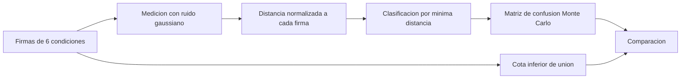

# B96-C29 — Diagnóstico de fallas de enlace

<!-- nav:top -->
[🏠 Programa](../../../../README.md) · [📚 Bloque B96](../../../tronco-comun/B96-control-y-operacion-de-misiones-espaciales.md) · [← Anterior: B96-C28 — Control y seguimiento de la antena de estación](../B96-C28-control-y-seguimiento-de-la-antena-de-estacion/CLASE.md) · [Siguiente: B96-C30 — Registro y auditoría de operaciones →](../B96-C30-registro-y-auditoria-de-operaciones/CLASE.md)
<!-- /nav -->

## 1. Ubicación, nivel y alcance

Clase 29 del bloque B96. Nivel N3. Cuando un enlace no cierra, cada causa deja una **firma**: una combinación de desviaciones de la portadora, de la polarización, de la frecuencia y del ruido respecto del enlace nominal. Aquí construyes un diccionario **sintético** de seis condiciones, clasificas medidas ruidosas por mínima distancia (normalizada por el ruido) y mides la exactitud con Monte Carlo y una cota teórica. Firmas y ruidos son ficticios. Todos los datos son **sintéticos** salvo los que se rotulan como consultados.

## 2. Por qué esta clase existe

Perder tiempo de contacto buscando la causa equivocada es caro. La decisión central: **¿qué medidas distinguen las causas y cuáles se confunden entre sí?**

## 3. Lo que podrás hacer al terminar

1. Definir firmas de falla como vectores de desviación.
2. Clasificar una medida por la firma más cercana, normalizada por el ruido.
3. Calcular la matriz de confusión por Monte Carlo.
4. Comparar el acierto con una cota inferior de unión.
5. Identificar el par de fallas más difícil de distinguir y qué medición lo resolvería.
6. Separar lo consultado de lo sintético.

La evidencia es la **árbol de diagnóstico de enlace con exactitud medida** del ejercicio 12 (sección 20).

## 4. Con qué llegas y cómo comprobarlo

1. ¿Qué es una firma de falla?
2. ¿Qué es la distancia normalizada?
3. ¿Qué es una matriz de confusión?
4. ¿Qué es una cota de unión?
5. ¿Qué es `Q(x)`?

<details>
<summary>Ver respuestas</summary>

1. El patrón de desviaciones que produce una causa. 2. La distancia con cada componente dividida por su desviación de ruido. 3. Una tabla de lo clasificado frente a lo verdadero. 4. Una cota de probabilidad que suma las de cada alternativa. 5. La cola de la gaussiana estándar.
</details>

Con cuatro o cinco aciertos, sigue; si no, repasa los prerrequisitos.

## 5. Un caso de contexto y casos de referencia

Seis condiciones **sintéticas** (nominal, error de apuntamiento, polarización, corrimiento de frecuencia, interferencia y potencia de transmisión baja) se miden con cuatro componentes (ΔC/N₀, polarización, residuo de frecuencia y exceso de ruido). El acierto medio es 93,25 %: la interferencia y el corrimiento de frecuencia se reconocen casi siempre (99,5 % y 99,7 %), pero el **error de apuntamiento** (−6 dB) y la **potencia baja** (−8 dB) se confunden entre sí (81,6 % y 84,3 %), a 2,00σ de distancia. Medir mejor la polarización (de 1,0 a 0,3 dB de ruido) sube el acierto de polarización de 96,2 % a 100 %.

## 6. Vocabulario

**Firma:** vector de desviaciones de una causa. **Diccionario de fallas:** conjunto de firmas. **Mínima distancia:** clasificar por la firma más cercana. **Matriz de confusión:** frecuencia de cada clasificación por causa verdadera. **Cota de unión:** `1 − Σ Q(dᵢⱼ/2)`.

## 7. Modelo mental



*Descripción textual:* cada causa tiene una firma; una medida con ruido se compara con todas; se elige la más cercana; la matriz de confusión mide el acierto y la cota teórica lo verifica; el par más confundible indica qué medida añadir.

Analogía: es como identificar el idioma de una frase por palabras clave: dos idiomas con vocabulario parecido se confunden. Límite: aquí las firmas son ideales y los ruidos, gaussianos.

## 8. La explicación, paso a paso

### 8.1 Qué dicen las fuentes

El capítulo de la NASA sobre sistemas terrestres (S1) indica que el margen típico de enlace para LEO a 1 500 km es 3 dB, lo que da una idea del orden de magnitud de las desviaciones que importan. No se consultó ninguna fuente de diagnóstico de enlaces. El método es estándar (clasificación por mínima distancia) y lo verifica el laboratorio; las firmas y los ruidos son **sintéticos**.

### 8.2 Diccionario

| Condición | ΔC/N₀ (dB) | Polarización (dB) | Frecuencia (kHz) | Ruido (dB) |
|---|---|---|---|---|
| Nominal | 0 | 0 | 0 | 0 |
| Error de apuntamiento | −6 | 0 | 0 | 0 |
| Polarización | −3 | −3 | 0 | 0 |
| Corrimiento de frecuencia | −2 | 0 | +8 | 0 |
| Interferencia | −4 | 0 | 0 | +5 |
| Potencia baja | −8 | 0 | 0 | 0 |

Ruidos de medición (desviación): 1,0; 1,0; 1,5 y 1,0.

### 8.3 Matriz de confusión (20 000 medidas por causa)

| Verdadera | Acierto |
|---|---|
| Nominal | 98,18 % |
| Error de apuntamiento | 81,59 % (16,14 % como potencia baja) |
| Polarización | 96,23 % |
| Corrimiento de frecuencia | 99,75 % |
| Interferencia | 99,52 % |
| Potencia baja | 84,27 % (15,69 % como apuntamiento) |

Exactitud media 93,25 %. La cota de unión `1 − Σ Q(d/2)` queda por debajo de cada acierto simulado (por ejemplo, 0,8191 frente a 0,8159 en apuntamiento, dentro de 0,01).

### 8.4 Qué decide el diagnóstico

El par más difícil es apuntamiento–potencia baja (distancia 2,00σ): ambos solo bajan ΔC/N₀. Se resuelve con una medición adicional: por ejemplo, la telemetría de potencia del transmisor o el error de seguimiento de la antena. Con una mejor medición de la polarización, el acierto del desajuste sube de 96,23 % a 100 %.

## 9. Magnitudes, símbolos y unidades

| Símbolo | Qué es | Unidad | Valor / nota |
|---|---|---|---|
| `ΔC/N₀` | desviación de la portadora | dB | 0 a −8 |
| `Δpol` | desajuste de polarización | dB | 0 a −3 |
| `Δf` | residuo de frecuencia | kHz | 0 a +8 |
| `σ` | ruido de medida | dB, kHz | 1,0; 1,0; 1,5; 1,0 |
| `d` | distancia entre firmas | σ | 2,00 (mínima) |

## 10. Convenciones y referencias

Firmas deterministas y ruido gaussiano independiente por componente, con semilla 96 y 20 000 medidas por causa; clasificación por mínima distancia normalizada. Todo **sintético**. Tolerancias: acierto simulado `≥` cota de unión `− 0,01`; con una medida mejor el acierto no baja.

## 11. De dónde sale lo que afirmamos

| ID | Fuente | Localizador | Respalda | Estado |
|---|---|---|---|---|
| S1 | NASA, «Ground Data Systems and Mission Operations», en State-of-the-Art of Small Spacecraft Technology — https://www.nasa.gov/smallsat-institute/sst-soa/ground-data-systems-and-mission-operations/ (consultada 2026-11-10; leídos los primeros 100 000 caracteres de 215 453) | capítulo (parte inicial) | un centro de operaciones de misión (MOC) comanda la nave y un centro de operaciones científicas (SOC) genera productos; enlaces directos a la Tierra frente a relevos; bandas UHF, S, X y Ka; la licencia tarda meses; las antenas suelen adquirir el satélite con 5–10° de elevación; margen típico de 3 dB para retorno de datos en LEO a 1 500 km de distancia oblicua | Consultada (parte del capítulo) |
| — | Libros de texto de operaciones de misión, comunicaciones espaciales y mecánica orbital (p. ej., Wertz y Larson, Montenbruck y Gill, Vallado) | — | — | No consultada |
| — | Relaciones y algoritmos estándar usados por el laboratorio (clasificación por mínima distancia, matriz de confusión y cota de unión) | — | los verifica el laboratorio con una segunda vía o con pruebas | No consultada en una fuente concreta |

Límites: el capítulo se leyó solo en parte y no trata el diagnóstico; las firmas son ideales, sin fallas simultáneas ni efectos dependientes del tiempo. Lo simulado no se presenta como dato de vuelo ni como medición.

## 12. Cómo ver los resultados

| Par | Distancia (σ) | Confusión |
|---|---|---|
| Apuntamiento – potencia baja | 2,00 | 16 % |
| Nominal – polarización | 4,24 | 1,5–1,8 % |
| Apuntamiento – polarización | 4,24 | 1,8 % |
| Resto | ≥ 5,4 | < 0,5 % |

Descripción larga: las causas que alteran un solo componente de forma parecida se confunden; las que dejan huellas en componentes distintos se reconocen casi siempre.

## 13. Ejemplo trabajado

**Paso 1 · Medida.** `x = (−7,1; 0,3; −0,4; 0,8)`.

**Paso 2 · Distancias.** Normalizadas a cada firma.

**Paso 3 · Mínima.** Potencia baja a `1,27σ`, apuntamiento a `1,42σ`.

**Paso 4 · Diagnóstico.** Potencia baja.

**Paso 5 · Confusión.** El 16 % de apuntamientos se clasifican así.

## 14. Distintas formas de describir el problema

**Por diccionario:** firmas (esta clase). **Por margen:** presupuesto de enlace (C27). **Por antena:** error de apuntamiento (C28). **Por explicación:** diagnóstico bayesiano (C21).

## 15. Práctica guiada

**Ejercicio 1 · con los pasos indicados.** Calcula la distancia normalizada entre apuntamiento (−6) y potencia baja (−8) con σ = 1.

<details><summary>Solución comentada</summary>

`2/1 = 2,0σ`.
</details>

**Ejercicio 2 · con una pista.** ¿Qué componente distingue el corrimiento de frecuencia?

<details><summary>Solución comentada</summary>

El residuo de frecuencia (+8 kHz).
</details>

**Ejercicio 3 · casi autónomo.** ¿Por qué se normaliza por el ruido?

<details><summary>Solución comentada</summary>

Para que un componente muy ruidoso no domine la distancia.
</details>

## 16. Práctica autónoma, transferencia e integrador

**Ejercicio 4 · autónomo.** Calcula `Q(1)`.

<details><summary>Solución comentada</summary>

`0,1587`.
</details>

**Ejercicio 5 · autónomo.** ¿Qué fracción se espera que se confunda de un par a 2σ?

<details><summary>Solución comentada</summary>

`Q(1) = 15,9 %`.
</details>

**Ejercicio 6 · autónomo.** ¿Qué medida añadirías para separar apuntamiento de potencia baja?

<details><summary>Solución comentada</summary>

La telemetría de potencia del transmisor o el error de seguimiento de la antena.
</details>

**Ejercicio 7 · autónomo.** ¿Qué efecto tiene reducir el ruido de polarización a 0,3 dB?

<details><summary>Solución comentada</summary>

La firma de polarización queda a más σ de las demás y el acierto sube a 100 %.
</details>

**Ejercicio 8 · autónomo.** ¿Qué pasa si dos fallas ocurren a la vez?

<details><summary>Solución comentada</summary>

La firma es una combinación que no está en el diccionario y se clasifica mal.
</details>

**Ejercicio 9 · transferencia.** **Transferencia.** Un colega diagnostica por la primera firma que coincide. ¿Qué respondes?

<details><summary>Solución comentada</summary>

Hay que comparar con todas y estimar la confusión; una coincidencia aislada puede ser casualidad.
</details>

**Ejercicio 10 · transferencia.** **Transferencia.** ¿Para qué sirve la cota de unión?

<details><summary>Solución comentada</summary>

Para verificar que la simulación no sobreestima el acierto.
</details>

**Ejercicio 11 · transferencia.** **Transferencia.** ¿Qué no modela esta clase?

<details><summary>Solución comentada</summary>

Fallas simultáneas, dependencia temporal y firmas variables.
</details>

**Ejercicio 12 · integrador.** **Integrador.** Elabora tu *árbol de diagnóstico de enlace con exactitud medida*: diccionario, matriz de confusión, cota, par más confundible y medición adicional, y lista de lo consultado, sintético y no consultado.

<details><summary>Solución comentada</summary>

Secciones 8.2–8.4 y la salida del laboratorio.
</details>

## 17. Laboratorio: clasificación de fallas de enlace

El script [diagnostico_de_enlace.py](diagnostico_de_enlace.py) clasifica 20 000 medidas ruidosas por causa con mínima distancia normalizada, construye la matriz de confusión, la compara con la cota de unión y mide el efecto de una medida mejor; **comprueba** el acuerdo con la cota y que la mejora no empeora.

**Datos:** firmas y ruidos **sintéticos**; semilla 96. **Predice antes de ejecutar:** ¿qué par de fallas se confunde más? (apuntamiento y potencia baja). **Ejecución del 2026-11-10 (Python 3.12.9):**

```text
Python 3.12.9
Datos SINTETICOS: firmas y ruidos ficticios; semilla 96
Matriz de confusion (filas = verdadera; porcentaje clasificado como...):
                                 Nominal Error de  Desajuste Corrimien Interfere Potencia 
Nominal                            98.18      0.07      1.47      0.23      0.06      0.00
Error de apuntamiento               0.09     81.59      1.77      0.04      0.37     16.14
Desajuste de polarizacion           1.77      1.76     96.23      0.07      0.17      0.00
Corrimiento de frecuencia           0.14      0.03      0.07     99.75      0.01      0.00
Interferencia                       0.03      0.33      0.12      0.01     99.52      0.00
Potencia de transmision baja        0.00     15.69      0.02      0.00      0.03     84.27
Exactitud media = 93.25 %
  Nominal                        acierto simulado = 0.9818 ; cota inferior de union = 0.9788
  Error de apuntamiento          acierto simulado = 0.8159 ; cota inferior de union = 0.8191
  Desajuste de polarizacion      acierto simulado = 0.9623 ; cota inferior de union = 0.9618
  Corrimiento de frecuencia      acierto simulado = 0.9974 ; cota inferior de union = 0.9963
  Interferencia                  acierto simulado = 0.9951 ; cota inferior de union = 0.9935
  Potencia de transmision baja   acierto simulado = 0.8427 ; cota inferior de union = 0.8388
Par de fallas mas dificil de distinguir: Error de apuntamiento y Potencia de transmision baja (distancia = 2.00 sigma)
Si se mide mejor la polarizacion (sd 0.3 dB):
  acierto del desajuste de polarizacion = 1.0000 (antes 0.9623)
Pruebas superadas.
```

```bash
python programa/clases/B96/B96-C29-diagnostico-de-fallas-de-enlace/diagnostico_de_enlace.py
```

**Límites:** firmas ideales, una falla a la vez, ruido gaussiano independiente y sin dependencia temporal.

## 18. Errores frecuentes y cómo corregirlos

**Elegir la primera coincidencia.** Compara con todas (8.3)

**No normalizar por el ruido.** Divide por σ (8.2)

**Ignorar las confusiones.** Mide la matriz (8.3)

## 19. Cómo sabrás que vas bien

Tras 8.3: ¿qué par se confunde? Si dudas, repasa el ejercicio 5. Tras el laboratorio: ¿qué comprueba la cota? (ver sección 17).

## 20. Qué entregas y cómo se evalúa

El producto es tu **árbol de diagnóstico de enlace con exactitud medida** (ejercicio 12).

| Criterio | Inicial | En desarrollo | Logrado | Destacado |
|---|---|---|---|---|
| Conceptos | Los confunde | Parciales | Explica el método y su dominio | Explica los límites y las alternativas |
| Cálculo | Sin unidades | Con errores | Resultados con unidades y comprobados | Resuelve casos nuevos |
| Numérico | Sin comprobar | Un caso | Verifica con una segunda vía en varios casos | Interpreta las diferencias y los fallos |
| Fuentes | Sin fuente | Sin fecha | Fuentes con fecha y estado | Declara lo sintético y lo no consultado |
| Límites | No los nombra | Uno | Tres | Discute qué falta del modelo |

**Condiciones críticas (no se compensan con promedio):** rotular los datos como sintéticos; comprobar cada resultado con una segunda vía; citar solo lo consultado.

## 21. Ética, seguridad y límites

Clase educativa: los modelos son simplificados y los datos son sintéticos; ningún resultado describe una misión real, certifica conformidad con una norma ni sustituye la revisión de especialistas.  Accesibilidad: tablas equivalentes a las gráficas, fórmulas en texto, ejercicios sin conexión.

## 22. Para cerrar y seguir

El diccionario sintético acierta el 93,25 % de las veces; apuntamiento y potencia baja se confunden (16 %) y una medición adicional sería lo más eficaz. Queda una pregunta: ¿cómo se deja constancia de todo lo que se hizo?

**Glosario español–inglés.** firma de falla · *fault signature*; matriz de confusión · *confusion matrix*; mínima distancia · *minimum distance*; diagnóstico de enlace · *link diagnosis*; cota de unión · *union bound*.

**Continuidad.** [B96-C30](../B96-C30-registro-y-auditoria-de-operaciones/CLASE.md) trata el registro y la auditoría de operaciones.

**Referencias:** ver sección 11.

<!-- nav:bottom -->
---

[← Anterior: B96-C28 — Control y seguimiento de la antena de estación](../B96-C28-control-y-seguimiento-de-la-antena-de-estacion/CLASE.md) · [📚 Bloque B96](../../../tronco-comun/B96-control-y-operacion-de-misiones-espaciales.md) · [Siguiente: B96-C30 — Registro y auditoría de operaciones →](../B96-C30-registro-y-auditoria-de-operaciones/CLASE.md)
<!-- /nav -->
