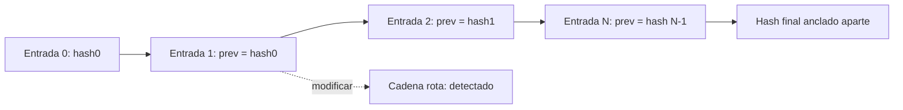

# B96-C30 — Registro y auditoría de operaciones

<!-- nav:top -->
[🏠 Programa](../../../../README.md) · [📚 Bloque B96](../../../tronco-comun/B96-control-y-operacion-de-misiones-espaciales.md) · [← Anterior: B96-C29 — Diagnóstico de fallas de enlace](../B96-C29-diagnostico-de-fallas-de-enlace/CLASE.md) · [Siguiente: B97-C01 — Robots rover y orbitadores →](../../B97/B97-C01-robots-rover-y-orbitadores/CLASE.md)
<!-- /nav -->

## 1. Ubicación, nivel y alcance

Clase 30 del bloque B96. Nivel N3. Las operaciones de una estación exigen una **bitácora** que diga quién hizo qué y cuándo, y que permita detectar si alguien la alteró. Aquí construyes una bitácora **sintética** de 60 entradas encadenadas con **SHA-256** (cada entrada incluye el hash de la anterior), pruebas 350 manipulaciones (modificar, borrar, reordenar) y calculas el tamaño de una muestra de auditoría. Operadores, acciones y marcas de tiempo son ficticios. Todos los datos son **sintéticos** salvo los que se rotulan como consultados.

## 2. Por qué esta clase existe

Sin registro verificable no se puede reconstruir un incidente ni demostrar quién aprobó un comando. La decisión central: **¿cómo se registra para que una alteración se detecte y cuánto hay que revisar en una auditoría?**

## 3. Lo que podrás hacer al terminar

1. Diseñar una entrada de bitácora con marca de tiempo, actor, acción y hash previo.
2. Encadenar entradas con SHA-256 y verificar la cadena.
3. Probar la detección de modificaciones, borrados y reordenamientos.
4. Reconocer el límite: el borrado de la última entrada requiere un hash anclado aparte.
5. Consultar la bitácora y calcular una muestra de auditoría.
6. Separar lo consultado de lo sintético.

La evidencia es la **bitácora verificable con prueba de manipulación** del ejercicio 12 (sección 20).

## 4. Con qué llegas y cómo comprobarlo

1. ¿Qué es una cadena de hashes?
2. ¿Qué es una marca de tiempo UTC?
3. ¿Qué es un registro de solo anexado?
4. ¿Qué es una muestra de auditoría?
5. ¿Qué es un hash anclado?

<details>
<summary>Ver respuestas</summary>

1. Cada registro incluye el hash del anterior, de modo que cambiar uno rompe todos los siguientes. 2. La hora en tiempo universal coordinado, sin zona local. 3. Uno al que solo se añaden entradas. 4. Un subconjunto de entradas que se revisa. 5. Un hash final guardado en otro lugar para detectar truncamientos.
</details>

Con cuatro o cinco aciertos, sigue; si no, repasa los prerrequisitos.

## 5. Un caso de contexto y casos de referencia

La bitácora **sintética** tiene 60 entradas (13 comandos, 8 aprobaciones y 4 actores) y su cadena es válida. De las 350 manipulaciones probadas (modificar actor, acción, detalle y marca de tiempo de cada entrada; borrar cada una salvo la última; intercambiar cada par contiguo) **se detectan las 350**. Borrar la última entrada deja una cadena válida: solo el hash final anclado aparte lo delata. Para detectar un defecto del 5 % con 95 % de confianza, la muestra mínima es de 59 entradas.

## 6. Vocabulario

**Bitácora:** registro de operaciones. **Cadena de hashes:** cada entrada incluye el hash de la anterior. **Anexado solo:** no se editan entradas previas. **Hash anclado:** hash final guardado aparte. **Muestra de auditoría:** entradas revisadas. **UTC:** tiempo universal coordinado.

## 7. Modelo mental



*Descripción textual:* cada entrada contiene el hash de la anterior; modificar, borrar o reordenar rompe la cadena; el hash final anclado aparte detecta el truncamiento de las últimas entradas.

Analogía: es como un cuaderno con las páginas selladas y numeradas, donde cada sello depende del anterior: arrancar una página del medio se nota; arrancar la última, no, a menos que alguien haya anotado cuántas había. Límite: el sello detecta alteraciones, no mentiras al escribirlo.

## 8. La explicación, paso a paso

### 8.1 Qué dicen las fuentes

No se consultó ninguna fuente sobre registros de auditoría. ECSS-E-ST-70-32C (S1), consultada solo en su resumen, trata el lenguaje de procedimientos de operación y no un registro; por eso se cita como contexto y no como respaldo del método. SHA-256 y el encadenamiento de hashes son estándar y los verifica el laboratorio; operadores, acciones y tiempos son **sintéticos**.

### 8.2 La entrada y la cadena

Cada entrada es `{n, ts, actor, accion, detalle, prev, hash}` con `hash = SHA-256(JSON canónico de los demás campos)` y `prev` igual al hash anterior (ceros en la primera). La verificación recorre la cadena y recalcula cada hash.

### 8.3 Manipulaciones

| Manipulación | Pruebas | Detectadas |
|---|---|---|
| Modificar actor, acción, detalle o ts (por entrada) | 232 | 232 |
| Borrar una entrada (salvo la última) | 59 | 59 |
| Intercambiar dos contiguas | 59 | 59 |
| **Total** | **350** | **350** |

Las 232 modificaciones son las efectivas (de 240 posibles, 8 ya tenían el valor nuevo).

### 8.4 El límite y la auditoría

Borrar la última entrada deja una cadena válida (el hash final cambia pero no hay entrada posterior que lo contradiga): la defensa es **anclar el hash final** fuera de la bitácora. Las consultas por acción dan 13 comandos y 8 aprobaciones, y se comprueba que las marcas de tiempo no decrecen. Muestra mínima `n = ⌈ln 0,05/ln(1 − d)⌉`: 29 (10 %), 59 (5 %) y 149 (2 %).

## 9. Magnitudes, símbolos y unidades

| Símbolo | Qué es | Unidad | Valor / nota |
|---|---|---|---|
| `N` | entradas | — | 60 |
| `hash` | SHA-256 | bits | 256 |
| `ts` | marca de tiempo | s (UTC) | época Unix |
| `d` | tasa de defecto | — | 0,10; 0,05; 0,02 |
| `n` | muestra de auditoría | entradas | 29; 59; 149 |

## 10. Convenciones y referencias

Marcas de tiempo en segundos desde la época Unix (UTC), JSON canónico con claves ordenadas, hash SHA-256 de Python; datos con semilla 96. Todo **sintético**. Tolerancias: 100 % de las manipulaciones detectadas excepto el borrado de la última; marcas de tiempo no decrecientes.

## 11. De dónde sale lo que afirmamos

| ID | Fuente | Localizador | Respalda | Estado |
|---|---|---|---|---|
| S1 | ECSS, «ECSS-E-ST-70-32C — Test and operations procedure language», 31 jul 2008 — https://ecss.nl/standard/ecss-e-st-70-32c-test-and-operations-procedure-language/ (consultada 2026-11-10) | página de la norma (solo el resumen) | define las capacidades del lenguaje con que se escriben procedimientos de prueba y de operación y especifica el lenguaje PLUTO | Consultada (solo la página) |
| — | Libros de texto de operaciones de misión, comunicaciones espaciales y mecánica orbital (p. ej., Wertz y Larson, Montenbruck y Gill, Vallado) | — | — | No consultada |
| — | Relaciones y algoritmos estándar usados por el laboratorio (cadena de hashes SHA-256 y tamaño de muestra `n = ln(1 − c)/ln(1 − d)`) | — | los verifica el laboratorio con una segunda vía o con pruebas | No consultada en una fuente concreta |

Límites: no hay firma digital ni autenticación del escritor: quien controla la bitácora puede recalcular toda la cadena; la fuente consultada no respalda el método. Lo simulado no se presenta como dato de vuelo ni como medición.

## 12. Cómo ver los resultados

| Prueba | Resultado |
|---|---|
| Cadena de 60 entradas | válida |
| 350 manipulaciones | 350 detectadas |
| Borrado de la última | no detectado por la cadena |
| Muestra para defecto 5 % | 59 entradas |

Descripción larga: la cadena detecta cualquier cambio interno; el truncamiento final exige un hash anclado aparte.

## 13. Ejemplo trabajado

**Paso 1 · Entrada.** `{n: 12, actor, accion, detalle, prev}`.

**Paso 2 · Hash.** `SHA-256(JSON)`.

**Paso 3 · Cambio.** Modificar el actor cambia el hash.

**Paso 4 · Cadena.** Todas las siguientes dejan de coincidir.

**Paso 5 · Anclaje.** El hash final guardado aparte detecta el truncamiento.

## 14. Distintas formas de describir el problema

**Por cadena:** hashes (esta clase). **Por muestra:** auditoría. **Por consulta:** filtros por actor y acción. **Por autorización:** quién aprobó (C07).

## 15. Práctica guiada

**Ejercicio 1 · con los pasos indicados.** ¿Cuántos campos entran en el hash de una entrada?

<details><summary>Solución comentada</summary>

Seis: `n`, `ts`, `actor`, `accion`, `detalle` y `prev`.
</details>

**Ejercicio 2 · con una pista.** ¿Qué pasa con el hash de la entrada 10 si cambia el detalle de la 5?

<details><summary>Solución comentada</summary>

Cambia, porque `prev` encadena todos los hashes anteriores.
</details>

**Ejercicio 3 · casi autónomo.** ¿Cuántas permutaciones contiguas se probaron?

<details><summary>Solución comentada</summary>

`N − 1 = 59`.
</details>

## 16. Práctica autónoma, transferencia e integrador

**Ejercicio 4 · autónomo.** ¿Qué deja sin detectar la cadena sola?

<details><summary>Solución comentada</summary>

El borrado de la última entrada.
</details>

**Ejercicio 5 · autónomo.** ¿Cómo se detecta ese borrado?

<details><summary>Solución comentada</summary>

Anclando el hash final fuera de la bitácora.
</details>

**Ejercicio 6 · autónomo.** Calcula la muestra para un defecto de 5 % con confianza 95 %.

<details><summary>Solución comentada</summary>

`⌈ln 0,05/ln 0,95⌉ = 59`.
</details>

**Ejercicio 7 · autónomo.** Calcula la muestra para un defecto de 2 %.

<details><summary>Solución comentada</summary>

`⌈ln 0,05/ln 0,98⌉ = 149`.
</details>

**Ejercicio 8 · autónomo.** ¿Por qué se usa JSON canónico?

<details><summary>Solución comentada</summary>

Para que el mismo contenido produzca siempre el mismo hash.
</details>

**Ejercicio 9 · transferencia.** **Transferencia.** Un colega afirma que una cadena de hashes impide el fraude. ¿Qué respondes?

<details><summary>Solución comentada</summary>

Solo detecta alteraciones; quien puede reescribir toda la cadena (sin firma ni ancla) puede falsificarla.
</details>

**Ejercicio 10 · transferencia.** **Transferencia.** ¿Por qué las marcas de tiempo deben ser UTC y no decrecientes?

<details><summary>Solución comentada</summary>

Para ordenar eventos entre sistemas y detectar relojes mal ajustados.
</details>

**Ejercicio 11 · transferencia.** **Transferencia.** ¿Qué agregarías para identificar al autor de una entrada?

<details><summary>Solución comentada</summary>

Una firma digital por operador.
</details>

**Ejercicio 12 · integrador.** **Integrador.** Elabora tu *bitácora verificable con prueba de manipulación*: entrada, cadena, manipulaciones probadas, límite del truncamiento, muestra de auditoría y lista de lo consultado, sintético y no consultado.

<details><summary>Solución comentada</summary>

Secciones 8.2–8.4 y la salida del laboratorio.
</details>

## 17. Laboratorio: cadena de hashes y detección de manipulación

El script [bitacora_verificable.py](bitacora_verificable.py) construye una bitácora de 60 entradas con cadena SHA-256, prueba 350 manipulaciones, muestra el límite del borrado de la última entrada, hace consultas y calcula muestras de auditoría; **comprueba** que se detectan todas las manipulaciones y que las marcas de tiempo no decrecen.

**Datos:** operadores, acciones y marcas de tiempo **sintéticos**; semilla 96. **Predice antes de ejecutar:** ¿cuántas manipulaciones se detectan? (todas las 350 probadas). **Ejecución del 2026-11-10 (Python 3.12.9):**

```text
Python 3.12.9
Datos SINTETICOS: operadores, acciones y marcas de tiempo ficticios (UTC fijo); semilla 96
Registro de 60 entradas ; verificacion = True ; hash final = 8a32048de2a063a6...
Manipulaciones probadas = 350 ; detectadas = 350
Borrar la ultima entrada: cadena valida = True ; hash final distinto del anclado = True
Comandos = 13 ; aprobaciones = 8 ; actores distintos = 4
Marcas de tiempo no decrecientes = True
  defecto 10.0 % -> muestra minima = 29 entradas
  defecto  5.0 % -> muestra minima = 59 entradas
  defecto  2.0 % -> muestra minima = 149 entradas
Pruebas superadas.
```

```bash
python programa/clases/B96/B96-C30-registro-y-auditoria-de-operaciones/bitacora_verificable.py
```

**Límites:** sin firma digital ni anclaje real; un solo escritor; sin sincronización de relojes.

## 18. Errores frecuentes y cómo corregirlos

**Confiar en la cadena sin anclar el hash final.** Ancla el hash fuera de la bitácora (8.4)

**Hash de campos sin orden fijo.** Usa JSON canónico (ejercicio 8)

**Auditar sin tamaño de muestra.** Calcula `n` (8.4)

## 19. Cómo sabrás que vas bien

Tras 8.4: ¿qué no detecta la cadena sola? Si dudas, repasa el ejercicio 4. Tras el laboratorio: ¿qué comprueba la prueba de manipulaciones? (ver sección 17).

## 20. Qué entregas y cómo se evalúa

El producto es tu **bitácora verificable con prueba de manipulación** (ejercicio 12).

| Criterio | Inicial | En desarrollo | Logrado | Destacado |
|---|---|---|---|---|
| Conceptos | Los confunde | Parciales | Explica el método y su dominio | Explica los límites y las alternativas |
| Cálculo | Sin unidades | Con errores | Resultados con unidades y comprobados | Resuelve casos nuevos |
| Numérico | Sin comprobar | Un caso | Verifica con una segunda vía en varios casos | Interpreta las diferencias y los fallos |
| Fuentes | Sin fuente | Sin fecha | Fuentes con fecha y estado | Declara lo sintético y lo no consultado |
| Límites | No los nombra | Uno | Tres | Discute qué falta del modelo |

**Condiciones críticas (no se compensan con promedio):** rotular los datos como sintéticos; comprobar cada resultado con una segunda vía; citar solo lo consultado.

## 21. Ética, seguridad y límites

Clase educativa: los modelos son simplificados y los datos son sintéticos; ningún resultado describe una misión real, certifica conformidad con una norma ni sustituye la revisión de especialistas.  Accesibilidad: tablas equivalentes a las gráficas, fórmulas en texto, ejercicios sin conexión.

## 22. Para cerrar y seguir

La bitácora sintética detecta las 350 manipulaciones probadas, pero no el borrado de la última entrada sin un hash anclado; auditar un defecto del 5 % exige 59 entradas. Con este cierre el bloque recorre el control de misión desde el segmento espacial hasta el registro de cada operación.

**Glosario español–inglés.** bitácora · *operations log*; cadena de hashes · *hash chain*; auditoría · *audit*; anexado solo · *append-only*; trazabilidad · *traceability*.

**Continuidad.** cierra el bloque B96.

**Referencias:** ver sección 11.

<!-- nav:bottom -->
---

[← Anterior: B96-C29 — Diagnóstico de fallas de enlace](../B96-C29-diagnostico-de-fallas-de-enlace/CLASE.md) · [📚 Bloque B96](../../../tronco-comun/B96-control-y-operacion-de-misiones-espaciales.md) · [Siguiente: B97-C01 — Robots rover y orbitadores →](../../B97/B97-C01-robots-rover-y-orbitadores/CLASE.md)
<!-- /nav -->
