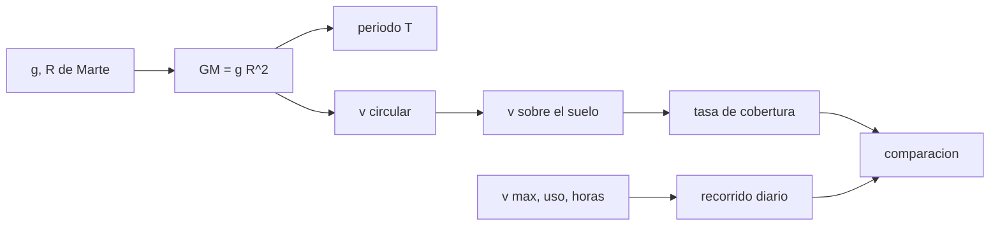

# B97-C01 — Robots rover y orbitadores

<!-- nav:top -->
[🏠 Programa](../../../../README.md) · [📚 Bloque B97](../../../tronco-comun/B97-robotica-y-construccion-extraterrestre.md) · [← Anterior: B96-C30 — Registro y auditoría de operaciones](../../B96/B96-C30-registro-y-auditoria-de-operaciones/CLASE.md) · [Siguiente: B97-C02 — Cinemática de manipuladores →](../B97-C02-cinematica-de-manipuladores/CLASE.md)
<!-- /nav -->

## 1. Ubicación, nivel y alcance

Clase 1 del bloque B97. Nivel N3. Un robot de superficie y un robot en órbita resuelven problemas distintos: el rover llega a un lugar concreto y se mueve despacio, el orbitador cubre mucha área y no puede tocar nada. Aquí comparas ambos con un presupuesto numérico: cuánto recorre un rover en un día de operación y cuánta área cubre un orbitador en un minuto. El caso es **sintético**: ninguna cifra describe una misión concreta, salvo la gravedad, el radio y los datos publicados de Perseverance.

## 2. Por qué esta clase existe

Elegir entre «ir con un rover» y «mirar desde órbita» es la primera decisión de una misión robótica, y se toma con órdenes de magnitud. Sin ellos, se prometen traslados que tardan meses o coberturas que una órbita no entrega. La decisión central: **¿qué parte del problema resuelve cada plataforma, y cuánto tarda cada una en cubrir la misma tarea?**

## 3. Lo que podrás hacer al terminar

1. Derivar `GM = g R²` desde la gravedad y el radio de un cuerpo y reconocer su aproximación.
2. Calcular el periodo, la velocidad orbital y la velocidad sobre el suelo de un orbitador circular.
3. Calcular la tasa de cobertura de una cámara de franja `w`.
4. Calcular el recorrido diario de un rover a partir de su velocidad máxima y de un factor de uso.
5. Comparar el tiempo de un traslado con el de una cobertura orbital.
6. Separar lo consultado (gravedad, radio, masa y velocidad de Perseverance) de lo ilustrativo (altitud, franja, uso).

La evidencia es la **ficha comparativa rover frente a orbitador** del ejercicio 12 (sección 20).

## 4. Con qué llegas y cómo comprobarlo

1. ¿Qué es una órbita circular?
2. ¿Qué relaciona el periodo con el radio orbital?
3. ¿Qué es una velocidad en m/s y cómo se convierte desde m/h?
4. ¿Qué es un dato sintético?
5. ¿Qué es una segunda vía de cálculo?

<details>
<summary>Ver respuestas</summary>

1. Una trayectoria de radio constante alrededor de un cuerpo. 2. La tercera ley de Kepler: `T² ∝ a³`. 3. Se divide por 3600: 152 m/h = 0,0422 m/s. 4. Un dato generado para el ejemplo, no medido. 5. Calcular lo mismo con otro método y comparar.
</details>

Con cuatro o cinco aciertos, sigue; si no, repasa los prerrequisitos.

## 5. Un caso de contexto y casos de referencia

Se quiere reconocer una región de `100 × 100 km`. Un orbitador ilustrativo a `300 km` con una franja de `12 km` la cubre con 4,44 min de imagen continua; un rover que debe recorrer `5 km` con un factor de uso `0,5` tarda 16,45 días de operación. Es el **ejemplo conductor**. El orbitador mira mucho y no toca; el rover toca y mira poco.

## 6. Vocabulario

Un **rover** es un robot móvil de superficie; un **orbitador** es una nave robótica en órbita. La **velocidad sobre el suelo** es la de la proyección del orbitador sobre la superficie. La **franja** es el ancho que cubre la cámara. La **tasa de cobertura** es franja por velocidad sobre el suelo. El **factor de uso** es la fracción de la velocidad máxima que se aprovecha en promedio. `GM` es el parámetro gravitacional del cuerpo.

## 7. Modelo mental



*Descripción textual:* de la gravedad y el radio se obtiene `GM`, de ahí la órbita y la tasa de cobertura; de la velocidad máxima y el uso sale el recorrido diario; ambas se comparan.

Analogía: el orbitador es un dron que barre un campo desde arriba y el rover es una persona que camina entre los surcos. Límite: aquí el orbitador no tiene rotación del planeta, geometría de revisita ni limitaciones de enlace.

## 8. La explicación, paso a paso

### 8.1 Del radio y la gravedad al parámetro `GM`

Con `g = 3,73 m/s²` y `R = 3389,5 km`: `GM = g R² = 42852889232500,0000` m³/s² (≈ `42852889232500,0000`). Es una aproximación: `g` de la ficha incluye el efecto de la rotación y del achatamiento, y aquí se ignoran. El valor de `GM` de Marte de una tabla de constantes **no se consultó**.

### 8.2 Órbita y cobertura

A `300 km` de altitud, `a = 3689,5` km, `T = 113,37` min y `v = 3408,1` m/s. La velocidad sobre el suelo es `v R/a = 3130,9` m/s. Con una franja de `12 km`, la tasa es `37,57` km²/s y `100 × 100 km` se cubren en `4,44` min de imagen continua (sin contar rotación del planeta ni revisitas).

### 8.3 El rover

La velocidad máxima de Perseverance es `152 m/h`. Con un factor de uso de `0,5` y `4 h` de conducción, el recorrido es `304,0` m por día de operación, y `5 km` llevan `16,45` días. El peso de `1025 kg` en Marte es `m g = 3823,2` N.

### 8.4 Dos vías para la órbita

La segunda vía integra numéricamente una órbita con velocidad-Verlet durante un periodo: el error de cierre es `5,17e-08` del radio orbital, por debajo de `10⁻⁶`. Eso valida el periodo de Kepler con ese `GM`, no el valor de `GM` ni la geometría de cobertura.

## 9. Magnitudes, símbolos y unidades

| Símbolo | Qué es | Unidad | Valor / nota |
|---|---|---|---|
| `g` | gravedad media de Marte | m/s² | 3,73 (consultada) |
| `R` | radio medio de Marte | m | 3 389 500 (consultado) |
| `GM` | parámetro gravitacional | m³/s² | 42852889232500,0000 (derivado) |
| `T` | periodo orbital | min | 113,37 |
| `w` | franja de la cámara | m | 12 000 (ilustrativa) |
| `u` | recorrido diario del rover | m | 304,0 |

## 10. Convenciones y referencias

Marco inercial centrado en Marte, órbita circular en un plano, sin rotación del planeta ni perturbaciones; el rover se mueve sobre terreno plano y duro. SI. Altitud, franja, factor de uso y horas de conducción son ilustrativos.

## 11. De dónde sale lo que afirmamos

| ID | Fuente | Localizador | Respalda | Estado |
|---|---|---|---|---|
| S1 | NASA/NSSDC, Mars Fact Sheet — https://nssdc.gsfc.nasa.gov/planetary/factsheet/marsfact.html (consultada 2026-11-10) | ficha completa leída | gravedad media 3,73 m/s²; radio medio 3389,5 km; distancia a la Tierra de 54,6 a 401,4 × 10⁶ km; presión 4,0–8,7 mb | Consultada |
| S2 | NASA, Mars 2020 Perseverance Rover Components — https://science.nasa.gov/mission/mars-2020-perseverance/rover-components/ (consultada 2026-11-10) | página completa leída | masa 1025 kg; seis ruedas de 52,5 cm con un motor cada una; brazo de 2,1 m; velocidad máxima ~152 m/h sobre terreno plano y duro | Consultada |
| — | Relaciones estándar usadas en el laboratorio | — | las verifica el laboratorio con una segunda vía | No consultada en una fuente concreta |

Límites: la altitud, la franja, el uso y las horas de conducción no se consultaron; no se describe ninguna misión real ni el valor publicado de `GM` de Marte.

## 12. Cómo ver el resultado

| Magnitud | Valor |
|---|---|
| Periodo orbital | 113,37 min |
| Velocidad sobre el suelo | 3130,9 m/s |
| Región 100 × 100 km | 4,44 min |
| Recorrido diario del rover | 304,0 m |
| 5 km del rover | 16,45 días |

Descripción larga: el orbitador cubre la región en minutos y el rover tarda semanas en recorrer unos kilómetros; la razón entre ambos tiempos es de 1,87e-04, es decir, ambas plataformas no compiten sino que se complementan.

## 13. Ejemplo trabajado

**Paso 1 · Parámetro gravitacional.** `GM = 3,73 × (3 389 500)² = 42852889232500,0000` m³/s².

**Paso 2 · Velocidad circular.** `v = √(GM/a) = 3408,1` m/s con `a = 3689,5` km.

**Paso 3 · Velocidad sobre el suelo.** `v R/a = 3130,9` m/s.

**Paso 4 · Cobertura.** `12 km × 3130,9 m/s = 37,57` km²/s; `10⁴ km² / 37,57 = 266` s.

## 14. Distintas formas de describir el problema

**Por física:** `GM`, `T`, `v`. **Por cobertura:** franja y tasa en km²/s. **Por tiempo:** minutos de imagen o días de traslado. **Por misión:** qué decisión toma cada plataforma. **Por incertidumbre:** qué parámetros son ilustrativos.

## 15. Práctica guiada

**Ejercicio 1 · con los pasos indicados.** Calcula el recorrido diario de un rover con `152 m/h`, uso `0,5` y `4 h` de conducción. *Pasos:* multiplica los tres factores.

<details><summary>Solución comentada</summary>

`152 × 0,5 × 4 = 304 m`; el laboratorio da 304,0 m.
</details>

**Ejercicio 2 · con una pista.** Predice el tiempo de cobertura si la franja se duplica a `24 km`. *Pista:* la tasa es proporcional a la franja.

<details><summary>Solución comentada</summary>

Se reduce a la mitad: 4,44/2 min.
</details>

**Ejercicio 3 · casi autónomo.** ¿Cuánto vale `T` si la altitud sube a `600 km`?

<details><summary>Solución comentada</summary>

`T` crece con `a^(3/2)`: pasa de 113,37 min a 127,47 min.
</details>

## 16. Práctica autónoma, transferencia e integrador

**Ejercicio 4 · autónomo.** Calcula el peso del rover (1025 kg) en Marte.

<details><summary>Solución comentada</summary>

`1025 × 3,73 = 3823,2` N.
</details>

**Ejercicio 5 · autónomo.** Calcula cuántos días tarda el rover en recorrer 2 km con uso 0,5.

<details><summary>Solución comentada</summary>

`2000/304 = 6,58` días.
</details>

**Ejercicio 6 · autónomo.** ¿Qué factor de uso hace falta para recorrer 5 km en 10 días con 4 h al día?

<details><summary>Solución comentada</summary>

`5000/(10 × 4 × 152) = 0,82`: está por encima del uso ilustrativo, a costa de mayor riesgo.
</details>

**Ejercicio 7 · autónomo.** Con la franja de `12 km`, ¿cuántos minutos de imagen hacen falta para `500 × 500 km`?

<details><summary>Solución comentada</summary>

`2,5 × 10⁵ km² / 37,57 km²/s` ≈ 111 min; en la práctica, más por revisitas.
</details>

**Ejercicio 8 · autónomo.** ¿Cuál es la velocidad angular orbital en rad/s?

<details><summary>Solución comentada</summary>

`2π/T = 2π/(113,37 × 60) = 0,00108 rad/s`.
</details>

**Ejercicio 9 · transferencia.** Un colega propone cubrir con el rover una región de `100 × 100 km`. ¿Qué respondes? **Transferencia.**

<details><summary>Solución comentada</summary>

No es viable: a 304 m por día harían falta décadas; el rover sirve para sitios concretos, el orbitador para la cobertura.
</details>

**Ejercicio 10 · transferencia.** Un orbitador no puede muestrear roca. ¿Qué decisión de la misión depende de eso? **Transferencia.**

<details><summary>Solución comentada</summary>

La necesidad de un rover o de una sonda de superficie para análisis in situ.
</details>

**Ejercicio 11 · transferencia.** Un enlace limita el volumen de datos del orbitador. ¿Cómo cambia el presupuesto de cobertura? **Transferencia.**

<details><summary>Solución comentada</summary>

El tiempo de imagen útil se reduce al volumen que cabe en el enlace; hay que priorizar regiones (ver C21).
</details>

**Ejercicio 12 · integrador.** Elabora tu *ficha comparativa rover frente a orbitador*: tabla de `GM`, `T`, tasa, tiempo de cobertura, recorrido diario y días de traslado, con lo consultado y lo ilustrativo rotulados. **Integrador.**

<details><summary>Solución comentada</summary>

Secciones 8.1–8.4 y la salida del laboratorio.
</details>

## 17. Laboratorio

El script [rover_orbitador.py](rover_orbitador.py) deriva `GM`, calcula la órbita y la tasa de cobertura, el recorrido diario del rover y la razón de tiempos, y contrasta el periodo con una integración numérica (**comprueba** error de cierre < 1e-6).

**Datos:** gravedad y radio de Marte (NASA, consultados); masa y velocidad máxima de Perseverance (NASA, consultadas); altitud, franja, uso y horas **ilustrativos**. **Predice antes de ejecutar:** ¿Cuántos minutos tarda el orbitador en cubrir `100 × 100 km`? (unos 4,4.) **Ejecución del 2026-11-10 (Python 3.12.9):**

```text
Python 3.12.9 (biblioteca estandar)
GM = g R^2 = 4.2853e+13 m3/s2 (derivado, aproximado); a = 3689.5 km
Orbitador ILUSTRATIVO a 300 km: T = 113.37 min; v_circ = 3408.1 m/s; v_suelo = 3130.9 m/s
Franja 12 km -> tasa de cobertura = 37.57 km2/s; region 100 x 100 km en 4.44 min de imagen continua
Rover (1025 kg, peso en Marte 3823.2 N): 304.0 m por dia de operacion con uso 0.5; 5 km en 16.45 dias
Error de cierre de la orbita integrada (Verlet) = 5.17e-08 del radio orbital
Pruebas superadas.
```

```bash
python programa/clases/B97/B97-C01-robots-rover-y-orbitadores/rover_orbitador.py
```

**Límites:** órbita circular sin rotación del planeta, `GM` derivado de `g`, sin geometría de revisita ni limitaciones de enlace; el rover se supone en terreno plano y duro.

## 18. Errores frecuentes y cómo corregirlos

**Comparar tiempos sin decir qué se mide.** Una plataforma cubre área y la otra llega a un punto; compara cada magnitud con su propósito (8.2 y 8.3)

**Usar la velocidad máxima como promedio.** El factor de uso lo corrige (8.3)

**Tomar `GM = g R²` como el valor publicado.** Es una aproximación (8.1)

**Presentar los números como una misión real.** Son ilustrativos; ver la sección 10

## 19. Cómo sabrás que vas bien

Tras la sección 8: ¿qué tiempo esperabas para la cobertura y cuál obtuviste? Si dudas, repasa el ejemplo 13. Tras el laboratorio: ¿qué comprueba? (ver la sección 17).

## 20. Qué entregas y cómo se evalúa

El producto es tu **ficha comparativa rover frente a orbitador** (ejercicio 12).

| Criterio | Inicial | En desarrollo | Logrado | Destacado |
|---|---|---|---|---|
| Conceptos | Los confunde | Parciales | Explica el modelo y sus supuestos | Explica los límites |
| Cálculo | Sin unidades | Con errores | Tablas completas con unidades | Calcula casos nuevos |
| Numérico | Sin comprobar | Un caso | Contraste con una segunda vía | Interpreta las diferencias |
| Fuentes | Sin fuente | Sin fecha | Fuentes con fecha y estado | Declara lo ilustrativo y lo no consultado |
| Límites | No los nombra | Uno | Tres | Discute qué falta del modelo |

**Condiciones críticas (no se compensan con promedio):** rotular los datos sintéticos e ilustrativos; no presentar un resultado simulado como observado o medido; citar solo lo consultado.

## 21. Ética, seguridad y límites

Clase educativa: los modelos son simplificados y sus datos son sintéticos o ilustrativos; ningún resultado describe una misión real, certifica un diseño ni sustituye a las normas aplicables ni a las pruebas de hardware.  Accesibilidad: tablas equivalentes a las gráficas, fórmulas en texto, ejercicios sin conexión.

## 22. Para cerrar y seguir

Un orbitador cubre `100 × 100 km` en unos 4,4 min; un rover tarda 16,4 días en recorrer `5 km`. Queda una pregunta: ¿cómo se calcula el movimiento de un brazo robótico que debe alcanzar un objetivo?

**Glosario español–inglés.** rover · *rover*; orbitador · *orbiter*; franja · *swath*; tasa de cobertura · *coverage rate*; parámetro gravitacional · *gravitational parameter*.

**Continuidad.** [B97-C02](../B97-C02-cinematica-de-manipuladores/CLASE.md) estudia la cinemática de manipuladores; la movilidad sobre regolito llega en la clase C06.

**Referencias:** ver sección 11.

<!-- nav:bottom -->
---

[← Anterior: B96-C30 — Registro y auditoría de operaciones](../../B96/B96-C30-registro-y-auditoria-de-operaciones/CLASE.md) · [📚 Bloque B97](../../../tronco-comun/B97-robotica-y-construccion-extraterrestre.md) · [Siguiente: B97-C02 — Cinemática de manipuladores →](../B97-C02-cinematica-de-manipuladores/CLASE.md)
<!-- /nav -->
