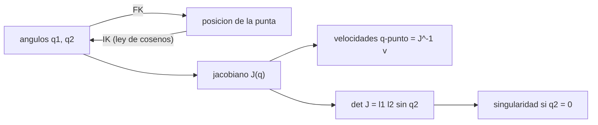

# B97-C02 — Cinemática de manipuladores

<!-- nav:top -->
[🏠 Programa](../../../../README.md) · [📚 Bloque B97](../../../tronco-comun/B97-robotica-y-construccion-extraterrestre.md) · [← Anterior: B97-C01 — Robots rover y orbitadores](../B97-C01-robots-rover-y-orbitadores/CLASE.md) · [Siguiente: B97-C03 — Sensores y percepción robótica →](../B97-C03-sensores-y-percepcion-robotica/CLASE.md)
<!-- /nav -->

## 1. Ubicación, nivel y alcance

Clase 2 del bloque B97. Nivel N3. Un brazo robótico convierte ángulos de articulación en la posición de su punta (cinemática directa) y, al revés, decide qué ángulos alcanzan un objetivo (cinemática inversa). Aquí lo haces con el caso mínimo: un brazo plano de dos eslabones, suficiente para ver las dos soluciones de la inversa, el jacobiano y por qué cerca de una singularidad las articulaciones deben girar muy rápido. El brazo es **ilustrativo**; solo la longitud total de `17 m` proviene de la ficha consultada de Canadarm2.

## 2. Por qué esta clase existe

Cada vez que un brazo coge una carga o una herramienta alguien resolvió una cinemática inversa y comprobó que el movimiento no pasa por una singularidad. Sin esa comprobación, un movimiento pequeño de la punta exige velocidades articulares enormes. La decisión central: **¿qué configuración de codo se usa para alcanzar un objetivo, y a qué distancia de una singularidad se puede trabajar con velocidades articulares razonables?**

## 3. Lo que podrás hacer al terminar

1. Escribir la cinemática directa de un brazo plano de dos eslabones.
2. Resolver la cinemática inversa con la ley de cosenos e identificar las dos soluciones.
3. Calcular el jacobiano y su determinante `l₁ l₂ sin q₂`.
4. Calcular las velocidades articulares para una velocidad deseada de la punta.
5. Reconocer la singularidad en el borde del espacio de trabajo y su efecto.
6. Separar lo consultado (longitud de 17 m) de lo ilustrativo (división en dos eslabones, objetivo y velocidad).

La evidencia es la **ficha cinemática de un brazo de dos eslabones** del ejercicio 12 (sección 20).

## 4. Con qué llegas y cómo comprobarlo

1. ¿Qué es un ángulo en radianes?
2. ¿Qué dice la ley de cosenos?
3. ¿Qué es una matriz y su determinante?
4. ¿Qué es un dato sintético?
5. ¿Qué es una segunda vía de cálculo?

<details>
<summary>Ver respuestas</summary>

1. La medida de un arco dividida por el radio; `π` rad = 180°. 2. `c² = a² + b² − 2ab cos γ`. 3. Un arreglo de números; el determinante de una matriz 2×2 es `ad − bc`. 4. Un dato generado para el ejemplo, no medido. 5. Calcular lo mismo con otro método y comparar.
</details>

Con cuatro o cinco aciertos, sigue; si no, repasa los prerrequisitos.

## 5. Un caso de contexto y casos de referencia

Un brazo con `l₁ = l₂ = 8,5 m` (alcance total `17 m`, la longitud consultada de Canadarm2 repartida en dos eslabones **ilustrativos**) debe llevar su punta a `(10, 6) m`, a 11,662 m de la base. Hay dos soluciones: codo abajo (`q₁ = 77,65°`, `q₂ = -93,37°`) y codo arriba (`q₁ = -15,72°`, `q₂ = 93,37°`). Es el **ejemplo conductor**.

## 6. Vocabulario

La **cinemática directa** calcula la posición de la punta a partir de los ángulos. La **cinemática inversa** calcula los ángulos para una posición. El **espacio de trabajo** es el conjunto de puntos alcanzables. El **jacobiano** `J` relaciona las velocidades articulares con la velocidad de la punta: `v = J q̇`. Una **singularidad** es una configuración en que `det J = 0` y se pierde una dirección de movimiento.

## 7. Modelo mental



*Descripción textual:* los ángulos dan la posición por cinemática directa y se recuperan por la inversa; el jacobiano relaciona velocidades y su determinante anuncia las singularidades.

Analogía: tu brazo estirado no puede alejar la mano más en línea recta, aunque el hombro gire rápido. Límite: aquí no hay límites articulares, colisiones, dinámica ni una tercera articulación.

## 8. La explicación, paso a paso

### 8.1 Cinemática directa

`x = l₁ cos q₁ + l₂ cos(q₁+q₂)`, `y = l₁ sin q₁ + l₂ sin(q₁+q₂)`. Para llegar a `(10, 6)`, `r² = 136` y el coseno del codo es `c₂ = (r² − l₁² − l₂²)/(2 l₁ l₂) = (136 − 144,5)/144,5 = −0,0588`.

### 8.2 Cinemática inversa

La ley de cosenos da `q₂ = ± arccos c₂` y `q₁ = atan2(y, x) − atan2(l₂ sin q₂, l₁ + l₂ cos q₂)`. Las dos soluciones son `(q₁, q₂) = (77,65°, -93,37°)` y `(-15,72°, 93,37°)`. Al aplicar la cinemática directa a ambas se recupera el objetivo con error `1,78e-15` m.

### 8.3 Jacobiano y singularidad

`det J = l₁ l₂ sin q₂ = -72,1249` m² en la configuración de codo abajo. Para mover la punta `0,10 m/s` en `x`, hacen falta `-0,6500` y `0,7944` °/s en las articulaciones. Con `q₁ = 0,5 rad`, la velocidad articular combinada para `0,10 m/s` es `0,762` °/s con `q₂ = 1 rad` y `26,013` °/s con `q₂ = 0,05 rad`: crece sin límite al acercarse a la singularidad `q₂ = 0`.

### 8.4 Dos vías

El jacobiano analítico coincide con diferencias finitas centradas con diferencia máxima `8,23e-10`. Eso valida el código del jacobiano, no la geometría del brazo real.

## 9. Magnitudes, símbolos y unidades

| Símbolo | Qué es | Unidad | Valor / nota |
|---|---|---|---|
| `l₁`, `l₂` | longitudes de los eslabones | m | 8,5 (ilustrativos) |
| `q₁`, `q₂` | ángulos articulares | rad (°) | ver 8.2 |
| `J` | jacobiano | m | ver 8.3 |
| `det J` | determinante | m² | -72,1249 |
| `q̇` | velocidad articular | rad/s (°/s) | -0,6500; 0,7944 |
| `v` | velocidad de la punta | m/s | 0,10 (ilustrativa) |

## 10. Convenciones y referencias

Brazo plano 2R; base en el origen, `x` hacia delante, `y` hacia arriba; ángulos en rad con `q₂` positivo = codo arriba; sin límites articulares ni dinámica. Dimensiones, objetivo y velocidad ilustrativos.

## 11. De dónde sale lo que afirmamos

| ID | Fuente | Localizador | Respalda | Estado |
|---|---|---|---|---|
| S1 | Agencia Espacial Canadiense, Canadarm2 — https://www.asc-csa.gc.ca/eng/iss/canadarm2/about.asp (consultada 2026-11-10) | página completa leída | brazo de 17 m; capacidad de carga de 116 000 kg (la página no indica masa propia ni número de articulaciones) | Consultada |
| — | Relaciones estándar usadas en el laboratorio | — | las verifica el laboratorio con una segunda vía | No consultada en una fuente concreta |

Límites: la división de 17 m en dos eslabones es ilustrativa: el número de articulaciones de Canadarm2 no figura en la página consultada y no se infiere nada del brazo real.

## 12. Cómo ver el resultado

| Magnitud | Valor |
|---|---|
| Soluciones de la inversa | 2 (codo arriba y abajo) |
| `det J` (codo abajo) | -72,1249 m² |
| Error de la FK | 1,78e-15 m |
| `q̇` con `q₂ = 1 rad` | 0,762 °/s |
| `q̇` con `q₂ = 0,05 rad` | 26,013 °/s |

Descripción larga: la velocidad articular necesaria se multiplica por más de treinta entre `q₂ = 1 rad` y `q₂ = 0,05 rad` y seguiría creciendo hacia `q₂ = 0`, mientras que el alcance máximo de 17 m se alcanza con el brazo estirado, que es justamente la singularidad.

## 13. Ejemplo trabajado

**Paso 1 · Distancia.** `r = √(10² + 6²) = 11,662` m, dentro del alcance de 17 m.

**Paso 2 · Codo.** `c₂ = (136 − 144,5)/144,5 = −0,0588`; `q₂ = ±93,37°` (el laboratorio da `93,37°` para el codo arriba).

**Paso 3 · Hombro.** `q₁ = atan2(6, 10) − atan2(l₂ sin q₂, l₁ + l₂ cos q₂)`.

**Paso 4 · Comprobación.** La cinemática directa reproduce `(10, 6)` con error `1,78e-15` m.

## 14. Distintas formas de describir el problema

**Por ángulos:** `q₁`, `q₂`. **Por posición:** `(x, y)`. **Por velocidades:** `J`. **Por condición:** distancia a la singularidad (`sin q₂`). **Por geometría:** alcance exterior `l₁+l₂` e interior `|l₁−l₂|`.

## 15. Práctica guiada

**Ejercicio 1 · con los pasos indicados.** Calcula `r` para `(10, 6)` y comprueba que está dentro del alcance. *Pasos:* `√(x²+y²)`.

<details><summary>Solución comentada</summary>

`r = 11,662` m < 17 m.
</details>

**Ejercicio 2 · con una pista.** Predice el signo de `q₂` en la solución de codo arriba. *Pista:* en la convención, codo arriba es positivo.

<details><summary>Solución comentada</summary>

Positivo: 93,37°.
</details>

**Ejercicio 3 · casi autónomo.** ¿Por qué `det J = 0` cuando `q₂ = 0`?

<details><summary>Solución comentada</summary>

Con el brazo estirado, `sin q₂ = 0`: ambos eslabones están alineados y la punta no puede moverse en la dirección radial por las articulaciones.
</details>

## 16. Práctica autónoma, transferencia e integrador

**Ejercicio 4 · autónomo.** Calcula el alcance interior de un brazo con `l₁ = 8,5` y `l₂ = 5` m.

<details><summary>Solución comentada</summary>

`|8,5 − 5| = 3,5` m: no se alcanza el interior de ese disco.
</details>

**Ejercicio 5 · autónomo.** Calcula `det J` si `q₂ = 90°` y `l₁ = l₂ = 8,5`.

<details><summary>Solución comentada</summary>

`8,5 × 8,5 × 1 = 72,25` m².
</details>

**Ejercicio 6 · autónomo.** ¿Qué ángulos corresponden al objetivo `(17, 0)`?

<details><summary>Solución comentada</summary>

`q₁ = 0`, `q₂ = 0`: el brazo estirado, en la singularidad.
</details>

**Ejercicio 7 · autónomo.** ¿Qué pasa con la IK si el objetivo está a `18 m`?

<details><summary>Solución comentada</summary>

`|c₂| > 1`: no hay solución (fuera del espacio de trabajo); el código lanza una excepción.
</details>

**Ejercicio 8 · autónomo.** ¿Cuántas soluciones tiene la IK en el borde exterior?

<details><summary>Solución comentada</summary>

Una (`q₂ = 0`), las dos coinciden.
</details>

**Ejercicio 9 · transferencia.** Un operador pide pasar por una configuración cerca de la singularidad. ¿Qué respondes? **Transferencia.**

<details><summary>Solución comentada</summary>

Que las velocidades articulares se disparan (26,0 °/s para `q₂ = 0,05 rad`) y que conviene replanificar o limitar la velocidad.
</details>

**Ejercicio 10 · transferencia.** Un brazo real tiene 7 articulaciones. ¿Qué se pierde al modelarlo con 2? **Transferencia.**

<details><summary>Solución comentada</summary>

La redundancia, la orientación de la herramienta, los límites articulares y la dinámica.
</details>

**Ejercicio 11 · transferencia.** ¿Cómo se usa el jacobiano para comprobar la fuerza en la punta? **Transferencia.**

<details><summary>Solución comentada</summary>

Por dualidad: `τ = Jᵀ F`; las singularidades también limitan qué fuerzas se pueden aplicar.
</details>

**Ejercicio 12 · integrador.** Elabora tu *ficha cinemática de un brazo de dos eslabones*: ángulos de ambas soluciones, `det J`, velocidades articulares y distancia a la singularidad, con lo consultado y lo ilustrativo rotulados. **Integrador.**

<details><summary>Solución comentada</summary>

Secciones 8.1–8.4 y la salida del laboratorio.
</details>

## 17. Laboratorio

El script [brazo_dos_eslabones.py](brazo_dos_eslabones.py) resuelve la cinemática directa e inversa de un brazo de dos eslabones, calcula el jacobiano y las velocidades articulares y las contrasta con diferencias finitas (**comprueba** error de FK < 1e-9 y jacobiano < 1e-6).

**Datos:** longitud total de Canadarm2 (Agencia Espacial Canadiense, consultada); eslabones, objetivo y velocidad **ilustrativos**. **Predice antes de ejecutar:** ¿Crecerá o decrecerá la velocidad articular al acercarse a `q₂ = 0`? (Crece, ver el laboratorio.) **Ejecución del 2026-11-10 (Python 3.12.9):**

```text
Python 3.12.9 (biblioteca estandar)
Brazo ILUSTRATIVO 2R: l1 = l2 = 8.5 m (alcance 17.0 m); objetivo = (10.0, 6.0) m a 11.662 m de la base
IK codo abajo : q1 = 77.650 deg, q2 = -93.372 deg
IK codo arriba: q1 = -15.722 deg, q2 = 93.372 deg
Error de la FK frente al objetivo = 1.78e-15 m; jacobiano analitico frente a numerico = 8.23e-10
det J = -72.1249 m2 (l1 l2 sin q2 = -72.1249); velocidades articulares para 0.10 m/s en x: -0.6500 y 0.7944 deg/s
Velocidad articular combinada para 0.10 m/s de punta, q1 = 0.5 rad:
  q2 = 1.00 rad -> 0.762 deg/s ; q2 = 0.30 rad -> 3.927 deg/s ; q2 = 0.05 rad -> 26.013 deg/s
Pruebas superadas.
```

```bash
python programa/clases/B97/B97-C02-cinematica-de-manipuladores/brazo_dos_eslabones.py
```

**Límites:** brazo plano de dos eslabones sin límites articulares, dinámica ni colisiones; no representa al brazo real.

## 18. Errores frecuentes y cómo corregirlos

**Dar una sola solución de la inversa.** Hay dos configuraciones de codo salvo en el borde (8.2)

**Ignorar el jacobiano cerca del borde.** La velocidad articular crece sin límite (8.3)

**Mezclar grados y radianes.** El laboratorio usa radianes y convierte para presentar

**Presentar el brazo de dos eslabones como Canadarm2.** Es ilustrativo; ver la sección 10

## 19. Cómo sabrás que vas bien

Tras la sección 8: ¿qué dos configuraciones esperabas y cuáles obtuviste? Si dudas, repasa el ejemplo 13. Tras el laboratorio: ¿qué comprueba? (ver la sección 17).

## 20. Qué entregas y cómo se evalúa

El producto es tu **ficha cinemática de un brazo de dos eslabones** (ejercicio 12).

| Criterio | Inicial | En desarrollo | Logrado | Destacado |
|---|---|---|---|---|
| Conceptos | Los confunde | Parciales | Explica el modelo y sus supuestos | Explica los límites |
| Cálculo | Sin unidades | Con errores | Tablas completas con unidades | Calcula casos nuevos |
| Numérico | Sin comprobar | Un caso | Contraste con una segunda vía | Interpreta las diferencias |
| Fuentes | Sin fuente | Sin fecha | Fuentes con fecha y estado | Declara lo ilustrativo y lo no consultado |
| Límites | No los nombra | Uno | Tres | Discute qué falta del modelo |

**Condiciones críticas (no se compensan con promedio):** rotular los datos sintéticos e ilustrativos; no presentar un resultado simulado como observado o medido; citar solo lo consultado.

## 21. Ética, seguridad y límites

Clase educativa: los modelos son simplificados y sus datos son sintéticos o ilustrativos; ningún resultado describe una misión real, certifica un diseño ni sustituye a las normas aplicables ni a las pruebas de hardware.  Accesibilidad: tablas equivalentes a las gráficas, fórmulas en texto, ejercicios sin conexión.

## 22. Para cerrar y seguir

Un brazo de `17 m` alcanza `(10, 6) m` de dos maneras, y cerca de `q₂ = 0` la velocidad articular se dispara. Queda una pregunta: ¿cómo se sostiene una herramienta con la fuerza necesaria en cada gravedad?

**Glosario español–inglés.** cinemática directa · *forward kinematics*; cinemática inversa · *inverse kinematics*; jacobiano · *Jacobian*; singularidad · *singularity*; espacio de trabajo · *workspace*.

**Continuidad.** [B97-C03](../B97-C03-sensores-y-percepcion-robotica/CLASE.md) estudia los sensores y la percepción; la fuerza de agarre de una herramienta llega en la clase C10.

**Referencias:** ver sección 11.

<!-- nav:bottom -->
---

[← Anterior: B97-C01 — Robots rover y orbitadores](../B97-C01-robots-rover-y-orbitadores/CLASE.md) · [📚 Bloque B97](../../../tronco-comun/B97-robotica-y-construccion-extraterrestre.md) · [Siguiente: B97-C03 — Sensores y percepción robótica →](../B97-C03-sensores-y-percepcion-robotica/CLASE.md)
<!-- /nav -->
