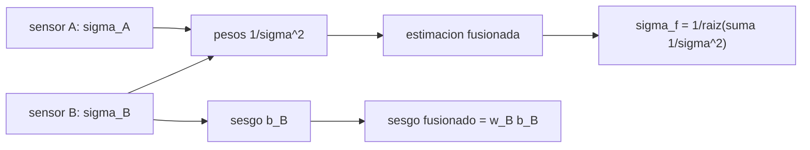

# B97-C03 — Sensores y percepción robótica

<!-- nav:top -->
[🏠 Programa](../../../../README.md) · [📚 Bloque B97](../../../tronco-comun/B97-robotica-y-construccion-extraterrestre.md) · [← Anterior: B97-C02 — Cinemática de manipuladores](../B97-C02-cinematica-de-manipuladores/CLASE.md) · [Siguiente: B97-C04 — Visión estereoscópica →](../B97-C04-vision-estereoscopica/CLASE.md)
<!-- /nav -->

## 1. Ubicación, nivel y alcance

Clase 3 del bloque B97. Nivel N3. Un robot nunca mide una distancia: la estima a partir de lecturas con ruido. Aquí fusionas dos sensores de distinta calidad con el estimador de varianza inversa, calculas cuánto mejora la incertidumbre y descubres qué pasa cuando uno de ellos tiene un sesgo que nadie ha detectado. Todos los datos son **sintéticos**: sin ninguna medición real.

## 2. Por qué esta clase existe

Un sensor con ruido bajo parece suficiente hasta que se ensucia, se descalibra o falla; entonces el robot necesita saber cuánto confiar en cada lectura. La fusión da la respuesta de forma cuantitativa, y también muestra su punto débil. La decisión central: **¿cuánto peso se da a cada sensor, cuánta incertidumbre se gana al fusionarlos y qué error aparece si uno está sesgado?**

## 3. Lo que podrás hacer al terminar

1. Calcular el peso de cada sensor por varianza inversa.
2. Calcular la desviación típica de la estimación fusionada.
3. Comprobar el resultado por Monte Carlo con semilla fija.
4. Calcular el sesgo que un sensor sesgado transmite a la fusión.
5. Comparar la fusión con promediar lecturas repetidas de un solo sensor.
6. Separar lo sintético (todo el caso) de lo consultado (nada).

La evidencia es la **ficha de presupuesto de ruido de un conjunto de sensores** del ejercicio 12 (sección 20).

## 4. Con qué llegas y cómo comprobarlo

1. ¿Qué es una desviación típica?
2. ¿Qué es una varianza?
3. ¿Qué es un sesgo frente a un ruido aleatorio?
4. ¿Qué es una semilla fija?
5. ¿Qué es una segunda vía de cálculo?

<details>
<summary>Ver respuestas</summary>

1. Una medida de la dispersión de los valores. 2. El cuadrado de la desviación típica. 3. El sesgo desplaza todas las lecturas en el mismo sentido; el ruido las dispersa. 4. Un valor inicial que hace repetible una secuencia aleatoria. 5. Calcular lo mismo con otro método y comparar.
</details>

Con cuatro o cinco aciertos, sigue; si no, repasa los prerrequisitos.

## 5. Un caso de contexto y casos de referencia

Un lidar con `σ = 0,05 m` y una cámara de tiempo de vuelo con `σ = 0,20 m` miden una distancia verdadera de `12,0 m`. Su fusión tiene `σ = 0,048507` m, mejor que cualquiera de los dos. Si la cámara tiene un sesgo de `0,10 m`, la fusión hereda un sesgo de `0,00588` m. Es el **ejemplo conductor**; todas las cifras son sintéticas.

## 6. Vocabulario

El **ruido** es la parte aleatoria del error y el **sesgo** la sistemática. La **fusión por varianza inversa** pondera cada medida por `1/σ²`. La **incertidumbre fusionada** es `1/√(Σ 1/σᵢ²)`. **Monte Carlo** es repetir un experimento aleatorio muchas veces con una semilla fija.

## 7. Modelo mental



*Descripción textual:* cada sensor aporta un peso inverso a su varianza; la fusión tiene menos incertidumbre que cualquiera de los dos, pero un sesgo de un sensor se transmite con su peso.

Analogía: preguntar la hora a dos relojes, uno muy preciso y otro mediocre; te fías más del preciso, pero si el mediocre va adelantado, algo de ese error se cuela. Límite: aquí los errores son gaussianos e independientes.

## 8. La explicación, paso a paso

### 8.1 Pesos y varianza fusionada

`w_A = (1/0,05²)/(1/0,05² + 1/0,20²) = 0,9412`; `w_B = 0,0588`. La desviación fusionada es `σ_f = 1/√(1/0,05² + 1/0,20²) = 0,048507` m, es decir `1,0308` veces menor que la de A.

### 8.2 Monte Carlo

Se necesitarían `2` lecturas de A para igualar la fusión (por `σ/√N`). Con `200 000` muestras y semilla fija, la desviación empírica es `0,048523` m; la diferencia relativa con la teórica es `3,19e-04`.

### 8.3 Sesgo

Un sesgo de `0,10 m` en B se transmite como `w_B × 0,10 = 0,00588` m; el Monte Carlo da `0,00597` m. La fusión reduce el ruido pero no detecta el sesgo: para eso hace falta una tercera referencia o una calibración.

### 8.4 Promediar frente a fusionar

Promediar 16 lecturas de A da `0,01250` m; fusionar con B da `0,04851` m con una sola lectura de cada uno. Promediar no corrige ningún sesgo.

## 9. Magnitudes, símbolos y unidades

| Símbolo | Qué es | Unidad | Valor / nota |
|---|---|---|---|
| `σ_A`, `σ_B` | desviaciones típicas | m | 0,05; 0,20 (sintéticas) |
| `w_A`, `w_B` | pesos | — | 0,9412; 0,0588 |
| `σ_f` | desviación fusionada | m | 0,048507 |
| `b` | sesgo | m | 0,10 (sintético) |
| `N` | número de muestras | — | 200 000 |

## 10. Convenciones y referencias

Medidas independientes, errores gaussianos, distancia verdadera de 12,0 m, sensores sin retardo. Todo el caso es sintético.

## 11. De dónde sale lo que afirmamos

| ID | Fuente | Localizador | Respalda | Estado |
|---|---|---|---|---|
| — | Relaciones estándar usadas en el laboratorio | — | las verifica el laboratorio con una segunda vía | No consultada en una fuente concreta |

Límites: no se consultó ninguna fuente para el caso, que es sintético; las ecuaciones son estándar y las verifica el laboratorio.

## 12. Cómo ver el resultado

| Magnitud | Valor |
|---|---|
| Peso de A | 0,9412 |
| `σ_f` teórica | 0,048507 m |
| `σ_f` empírica | 0,048523 m |
| Sesgo fusionado | 0,00597 m |
| Mejora frente a A | × 1,031 |

Descripción larga: la fusión mejora un poco al mejor sensor, y un sesgo del peor se transmite con su peso.

## 13. Ejemplo trabajado

**Paso 1 · Pesos.** `1/σ²`: `400` y `25`; `w_A = 400/425 = 0,9412`.

**Paso 2 · Varianza fusionada.** `1/(400 + 25) = 0,002353 m²`; `σ_f = 0,048507` m.

**Paso 3 · Sesgo.** `0,0588 × 0,10 = 0,00588` m.

## 14. Distintas formas de describir el problema

**Por pesos:** `w_A`, `w_B`. **Por incertidumbre:** `σ_f`. **Por repetición:** `σ/√N`. **Por sesgo:** `w_B b`. **Por simulación:** desviación empírica.

## 15. Práctica guiada

**Ejercicio 1 · con los pasos indicados.** Calcula `1/σ²` para `σ = 0,05` y `σ = 0,20`. *Pasos:* eleva al cuadrado y haz el inverso.

<details><summary>Solución comentada</summary>

`400` y `25` m⁻².
</details>

**Ejercicio 2 · con una pista.** Predice `σ_f` si ambos sensores tuvieran `σ = 0,10`. *Pista:* son iguales.

<details><summary>Solución comentada</summary>

`0,10/√2 = 0,0707` m.
</details>

**Ejercicio 3 · casi autónomo.** ¿Por qué la fusión siempre mejora al mejor sensor?

<details><summary>Solución comentada</summary>

Porque `1/σ_f² = 1/σ_A² + 1/σ_B² > 1/σ_A²`.
</details>

## 16. Práctica autónoma, transferencia e integrador

**Ejercicio 4 · autónomo.** Calcula cuántas lecturas de A igualan la fusión.

<details><summary>Solución comentada</summary>

`N = (σ_A/σ_f)² ≈ 2` por la fórmula del laboratorio.
</details>

**Ejercicio 5 · autónomo.** Si B tuviera `σ = 0,05` y sesgo `0,10`, ¿qué sesgo fusionado habría?

<details><summary>Solución comentada</summary>

`0,5 × 0,10 = 0,05` m.
</details>

**Ejercicio 6 · autónomo.** ¿Cómo cambia `w_B` si su `σ` se duplica a `0,40`?

<details><summary>Solución comentada</summary>

`w_B = 6,25/406,25 = 0,0154`.
</details>

**Ejercicio 7 · autónomo.** Calcula `σ_f` con un tercer sensor de `σ = 0,10`.

<details><summary>Solución comentada</summary>

`1/√(400+25+100) = 0,0436` m.
</details>

**Ejercicio 8 · autónomo.** ¿Qué diferencia hay entre `σ_f` y la exactitud?

<details><summary>Solución comentada</summary>

La precisión es la dispersión; la exactitud incluye el sesgo.
</details>

**Ejercicio 9 · transferencia.** Una cámara se ensucia y su sesgo crece. ¿Qué detecta la fusión? **Transferencia.**

<details><summary>Solución comentada</summary>

Nada por sí sola; hay que comparar con una referencia independiente o con una prueba de consistencia.
</details>

**Ejercicio 10 · transferencia.** ¿Cómo usarías el laboratorio para decidir si añadir un tercer sensor? **Transferencia.**

<details><summary>Solución comentada</summary>

Calculando `σ_f` con y sin él y comparando la mejora con su costo y su masa.
</details>

**Ejercicio 11 · transferencia.** Un robot promedia 100 lecturas de A y cree haber eliminado el error. ¿Qué falta? **Transferencia.**

<details><summary>Solución comentada</summary>

El sesgo no se promedia: queda intacto.
</details>

**Ejercicio 12 · integrador.** Elabora tu *ficha de presupuesto de ruido de un conjunto de sensores*: pesos, `σ_f`, comprobación Monte Carlo y efecto del sesgo, rotulando todo como sintético. **Integrador.**

<details><summary>Solución comentada</summary>

Secciones 8.1–8.4 y la salida del laboratorio.
</details>

## 17. Laboratorio

El script [fusion_sensores.py](fusion_sensores.py) fusiona dos sensores por varianza inversa, calcula la incertidumbre y el sesgo fusionados y los contrasta con Monte Carlo con semilla fija (**comprueba** diferencia relativa < 1 % y sesgo teórico).

**Datos:** **sintéticos** (distancia, desviaciones, sesgo y semilla); no se usa ningún dato publicado. **Predice antes de ejecutar:** ¿Será `σ_f` menor que 0,05 m? (Sí, 0,0485 m.) **Ejecución del 2026-11-10 (Python 3.12.9):**

```text
Python 3.12.9 (biblioteca estandar)
Datos SINTETICOS: d = 12.0 m; sigma_A = 0.05 m; sigma_B = 0.2 m; semilla 20261110; N = 200000
Pesos: w_A = 0.9412, w_B = 0.0588
sigma fusionada teorica = 48.507 mm; empirica = 48.523 mm (diferencia relativa 3.19e-04)
Sesgo sin sesgo de B = 0.088 mm; con sesgo de B = 100 mm -> 5.970 mm (teorico 5.882 mm)
Promediar 16 lecturas de A da 12.50 mm; mejora de la fusion respecto de A solo = x1.0308
Pruebas superadas.
```

```bash
python programa/clases/B97/B97-C03-sensores-y-percepcion-robotica/fusion_sensores.py
```

**Límites:** errores gaussianos e independientes, sin retardo ni correlación entre sensores; el sesgo es constante.

## 18. Errores frecuentes y cómo corregirlos

**Creer que la fusión elimina el sesgo.** Solo reduce el ruido (8.3)

**Dar el mismo peso a ambos sensores.** Se pondera por `1/σ²` (8.1)

**Promediar y olvidar el sesgo.** Ver 8.4

**Presentar el caso como una medición.** Es sintético; ver la sección 10

## 19. Cómo sabrás que vas bien

Tras la sección 8: ¿qué `σ_f` esperabas y cuál obtuviste? Si dudas, repasa el ejemplo 13. Tras el laboratorio: ¿qué comprueba? (ver la sección 17).

## 20. Qué entregas y cómo se evalúa

El producto es tu **ficha de presupuesto de ruido de un conjunto de sensores** (ejercicio 12).

| Criterio | Inicial | En desarrollo | Logrado | Destacado |
|---|---|---|---|---|
| Conceptos | Los confunde | Parciales | Explica el modelo y sus supuestos | Explica los límites |
| Cálculo | Sin unidades | Con errores | Tablas completas con unidades | Calcula casos nuevos |
| Numérico | Sin comprobar | Un caso | Contraste con una segunda vía | Interpreta las diferencias |
| Fuentes | Sin fuente | Sin fecha | Fuentes con fecha y estado | Declara lo ilustrativo y lo no consultado |
| Límites | No los nombra | Uno | Tres | Discute qué falta del modelo |

**Condiciones críticas (no se compensan con promedio):** rotular los datos sintéticos e ilustrativos; no presentar un resultado simulado como observado o medido; citar solo lo consultado.

## 21. Ética, seguridad y límites

Clase educativa: los modelos son simplificados y sus datos son sintéticos o ilustrativos; ningún resultado describe una misión real, certifica un diseño ni sustituye a las normas aplicables ni a las pruebas de hardware.  Accesibilidad: tablas equivalentes a las gráficas, fórmulas en texto, ejercicios sin conexión.

## 22. Para cerrar y seguir

Fusionar un lidar de `5 cm` y una cámara de `20 cm` da `0,0485` m y hereda `0,0059` m de sesgo si la cámara está descalibrada. Queda una pregunta: ¿cómo se obtiene la profundidad de una escena con dos cámaras?

**Glosario español–inglés.** ruido · *noise*; sesgo · *bias*; varianza inversa · *inverse variance*; fusión de sensores · *sensor fusion*; Monte Carlo · *Monte Carlo*.

**Continuidad.** [B97-C04](../B97-C04-vision-estereoscopica/CLASE.md) estudia la visión estereoscópica y el error de profundidad.

**Referencias:** ver sección 11.

<!-- nav:bottom -->
---

[← Anterior: B97-C02 — Cinemática de manipuladores](../B97-C02-cinematica-de-manipuladores/CLASE.md) · [📚 Bloque B97](../../../tronco-comun/B97-robotica-y-construccion-extraterrestre.md) · [Siguiente: B97-C04 — Visión estereoscópica →](../B97-C04-vision-estereoscopica/CLASE.md)
<!-- /nav -->
