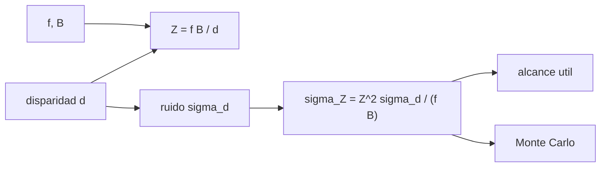

# B97-C04 — Visión estereoscópica

<!-- nav:top -->
[🏠 Programa](../../../../README.md) · [📚 Bloque B97](../../../tronco-comun/B97-robotica-y-construccion-extraterrestre.md) · [← Anterior: B97-C03 — Sensores y percepción robótica](../B97-C03-sensores-y-percepcion-robotica/CLASE.md) · [Siguiente: B97-C05 — Localización y mapeo SLAM →](../B97-C05-localizacion-y-mapeo-slam/CLASE.md)
<!-- /nav -->

## 1. Ubicación, nivel y alcance

Clase 4 del bloque B97. Nivel N3. Dos cámaras separadas una base `B` ven un mismo punto en posiciones distintas de la imagen; esa diferencia, la disparidad, da la profundidad. Aquí calculas la profundidad `Z = f B/d` y, sobre todo, cuánto crece su error con el cuadrado de la distancia. El par de cámaras es **sintético**: ninguna cifra describe una cámara real.

## 2. Por qué esta clase existe

Un rover decide si un obstáculo está a 3 m o a 8 m con estas cámaras. Sin saber cómo crece el error con la distancia, se confía en una profundidad de 30 m que puede tener varios metros de incertidumbre. La decisión central: **¿hasta qué distancia es útil un par estéreo con un error relativo dado, y qué base o qué ruido hace falta para llegar más lejos?**

## 3. Lo que podrás hacer al terminar

1. Calcular la disparidad de un punto a una profundidad dada.
2. Calcular la profundidad a partir de la disparidad.
3. Propagar el ruido de la disparidad al error de profundidad `σ_Z = Z² σ_d/(f B)`.
4. Calcular el alcance para un error relativo máximo y la base necesaria.
5. Comprobar el resultado por Monte Carlo con semilla fija.
6. Separar lo sintético (todo el par) de lo consultado (nada).

La evidencia es la **ficha de error de profundidad de un par estéreo** del ejercicio 12 (sección 20).

## 4. Con qué llegas y cómo comprobarlo

1. ¿Qué es una distancia focal y en qué unidades se mide en una imagen digital?
2. ¿Qué es un píxel como unidad de longitud en la imagen?
3. ¿Qué es una propagación de errores?
4. ¿Qué es un dato sintético?
5. ¿Qué es una segunda vía de cálculo?

<details>
<summary>Ver respuestas</summary>

1. La distancia del centro óptico al plano de la imagen; en visión se expresa en píxeles. 2. La longitud de un elemento del sensor. 3. Calcular cómo un error en la entrada se convierte en error de la salida. 4. Un dato generado para el ejemplo, no medido. 5. Calcular lo mismo con otro método y comparar.
</details>

Con cuatro o cinco aciertos, sigue; si no, repasa los prerrequisitos.

## 5. Un caso de contexto y casos de referencia

Un par de cámaras con `f = 1000 px`, `B = 0,42 m` y ruido de disparidad `σ_d = 0,25 px` mide un punto a `10 m` con disparidad `42,00` px y `σ_Z = 0,0595` m; a `20 m` el error es `0,238` m, cuatro veces mayor. Es el **ejemplo conductor**; todo es sintético.

## 6. Vocabulario

La **disparidad** `d` es la diferencia de posición del punto en las dos imágenes, en píxeles. La **base** `B` es la separación entre las cámaras. La **profundidad** `Z` es la distancia a lo largo del eje óptico. La **propagación de errores** convierte `σ_d` en `σ_Z` con la derivada de `Z(d)`.

## 7. Modelo mental



*Descripción textual:* de la disparidad y la geometría sale la profundidad; el ruido de disparidad produce un error que crece con `Z²`, y eso define el alcance útil.

Analogía: cierra un ojo y luego el otro ante tu dedo; el salto del dedo es la disparidad y es grande si el dedo está cerca. Límite: aquí las cámaras son ideales, rectificadas y sin distorsión.

## 8. La explicación, paso a paso

### 8.1 Profundidad y disparidad

`Z = f B/d`. A `10 m`, `d = 1000 × 0,42/10 = 42,00` px.

### 8.2 Propagación del error

`dZ/dd = −f B/d² = −Z²/(f B)`, de modo que `σ_Z = Z² σ_d/(f B)`. A `10 m`, `σ_Z = 0,05952` m; a `5 m`, `0,01488` m; a `20 m`, `0,2381` m. El error **relativo** crece linealmente con `Z`.

### 8.3 Alcance y base

El alcance con error relativo de 5 % es `Z = 0,05 f B/σ_d = 84,00` m. Para llegar a `20 m` con 5 % hace falta una base de `0,100` m. Duplicar la base reduce el error a la mitad: a 10 m, `0,02976` m.

### 8.4 Dos vías

Con `200 000` muestras de disparidad ruidosa (semilla fija), la desviación de `Z` es `0,05944` m frente a `0,05952` m teóricos (diferencia relativa `1,37e-03`). La linealización es buena porque `σ_d ≪ d`; cerca de `d → 0` dejaría de serlo.

## 9. Magnitudes, símbolos y unidades

| Símbolo | Qué es | Unidad | Valor / nota |
|---|---|---|---|
| `f` | distancia focal | px | 1000 (sintética) |
| `B` | base | m | 0,42 (sintética) |
| `d` | disparidad | px | 42,00 a 10 m |
| `σ_d` | ruido de disparidad | px | 0,25 (sintético) |
| `Z`, `σ_Z` | profundidad y su error | m | ver 8.2 |

## 10. Convenciones y referencias

Cámaras paralelas rectificadas (pinhole), sin distorsión ni error de calibración; ruido de disparidad gaussiano. Todos los datos son sintéticos.

## 11. De dónde sale lo que afirmamos

| ID | Fuente | Localizador | Respalda | Estado |
|---|---|---|---|---|
| — | Relaciones estándar usadas en el laboratorio | — | las verifica el laboratorio con una segunda vía | No consultada en una fuente concreta |

Límites: no se consultó ninguna fuente para el par de cámaras, que es sintético; no se describe ningún instrumento real.

## 12. Cómo ver el resultado

| Magnitud | Valor |
|---|---|
| `d` a 10 m | 42,00 px |
| `σ_Z` a 10 m | 0,05952 m |
| `σ_Z` a 20 m | 0,2381 m |
| Alcance al 5 % | 84,00 m |
| Base para 5 % a 20 m | 0,100 m |

Descripción larga: el error de profundidad crece con el cuadrado de la distancia y baja con la base; por eso un alcance doble exige base doble o mitad de ruido.

## 13. Ejemplo trabajado

**Paso 1 · Disparidad.** `d = 1000 × 0,42/10 = 42,00` px.

**Paso 2 · Error.** `σ_Z = 10² × 0,25/(1000 × 0,42) = 0,05952` m.

**Paso 3 · Alcance.** `0,05 × 420/0,25 = 84,00` m.

## 14. Distintas formas de describir el problema

**Por geometría:** `Z = f B/d`. **Por error:** `σ_Z`. **Por error relativo:** `σ_Z/Z = Z σ_d/(f B)`. **Por alcance:** `Z` máximo para un error dado. **Por simulación:** Monte Carlo.

## 15. Práctica guiada

**Ejercicio 1 · con los pasos indicados.** Calcula la disparidad de un punto a `5 m`. *Pasos:* `f B/Z`.

<details><summary>Solución comentada</summary>

`420/5 = 84` px.
</details>

**Ejercicio 2 · con una pista.** Predice la razón `σ_Z(20)/σ_Z(10)`. *Pista:* cuadrado.

<details><summary>Solución comentada</summary>

`4`; el laboratorio da 4,000.
</details>

**Ejercicio 3 · casi autónomo.** ¿Por qué el error relativo crece linealmente con `Z`?

<details><summary>Solución comentada</summary>

`σ_Z/Z = Z σ_d/(f B)`.
</details>

## 16. Práctica autónoma, transferencia e integrador

**Ejercicio 4 · autónomo.** Calcula `σ_Z` a `30 m`.

<details><summary>Solución comentada</summary>

`900 × 0,25/420 = 0,536` m.
</details>

**Ejercicio 5 · autónomo.** ¿Qué base da 2 % de error relativo a `10 m`?

<details><summary>Solución comentada</summary>

`B = Z σ_d/(0,02 f) = 10 × 0,25/20 = 0,125 m`.
</details>

**Ejercicio 6 · autónomo.** Si `σ_d` pasa a `0,1 px`, ¿cuál es el alcance al 5 %?

<details><summary>Solución comentada</summary>

`0,05 × 420/0,1 = 210` m.
</details>

**Ejercicio 7 · autónomo.** ¿Qué disparidad mínima distingue `Z = 30 m` de `31 m`?

<details><summary>Solución comentada</summary>

`d(30) − d(31) = 14 − 13,55 = 0,45` px: apenas por encima del ruido.
</details>

**Ejercicio 8 · autónomo.** ¿Cómo cambia `Z` si `f` se duplica a 2000 px?

<details><summary>Solución comentada</summary>

`d` se duplica y `σ_Z` se divide por 2 (si `σ_d` no cambia).
</details>

**Ejercicio 9 · transferencia.** Un obstáculo parece estar a `25 m` con `σ_Z = 0,8` m. ¿Qué haces con la planificación? **Transferencia.**

<details><summary>Solución comentada</summary>

Tratar la profundidad como una distribución y dejar margen de seguridad; no tomarla como exacta.
</details>

**Ejercicio 10 · transferencia.** Una cámara se desalinea un píxel. ¿Qué errores aparecen? **Transferencia.**

<details><summary>Solución comentada</summary>

Un sesgo de disparidad, no un ruido: `Z` queda sesgado y el Monte Carlo no lo refleja.
</details>

**Ejercicio 11 · transferencia.** ¿Qué compromiso hay al aumentar la base? **Transferencia.**

<details><summary>Solución comentada</summary>

Menos error de profundidad, pero más masa, menos solapamiento cercano y más sensibilidad a la deformación térmica.
</details>

**Ejercicio 12 · integrador.** Elabora tu *ficha de error de profundidad de un par estéreo*: tabla de `Z`, `d`, `σ_Z`, alcance y base necesaria, con la comprobación por Monte Carlo y todo rotulado como sintético. **Integrador.**

<details><summary>Solución comentada</summary>

Secciones 8.1–8.4 y la salida del laboratorio.
</details>

## 17. Laboratorio

El script [estereo_profundidad.py](estereo_profundidad.py) calcula la disparidad, el error de profundidad y el alcance de un par estéreo y contrasta con Monte Carlo (**comprueba** diferencia relativa < 2 % y razón 4).

**Datos:** **sintéticos** (distancia focal, base, ruido y semilla); no se usa ningún dato publicado. **Predice antes de ejecutar:** ¿Qué razón habrá entre el error a 20 m y a 10 m? (4.) **Ejecución del 2026-11-10 (Python 3.12.9):**

```text
Python 3.12.9 (biblioteca estandar)
Par estereo SINTETICO: f = 1000 px; B = 0.42 m; sigma_d = 0.25 px
  Z [m]   d [px]   sigma_Z [m]   error relativo [%]
   2.0   210.00       0.0024           0.12
   5.0    84.00       0.0149           0.30
  10.0    42.00       0.0595           0.60
  20.0    21.00       0.2381           1.19
  30.0    14.00       0.5357           1.79
Z = 10 m: sigma_Z teorica = 0.05952 m; Monte Carlo = 0.05944 m (diferencia relativa 1.37e-03); sesgo MC = 0.068 mm
Alcance con error relativo <= 5 %: Z = 84.00 m; base necesaria para 5 % a 20 m: B = 0.100 m
sigma_Z(20 m)/sigma_Z(10 m) = 4.000 (teoria 4)
Pruebas superadas.
```

```bash
python programa/clases/B97/B97-C04-vision-estereoscopica/estereo_profundidad.py
```

**Límites:** cámaras ideales rectificadas, sin distorsión, error de calibración ni de correspondencia; ruido gaussiano.

## 18. Errores frecuentes y cómo corregirlos

**Creer que el error de profundidad es constante.** Crece con `Z²` (8.2)

**Confundir disparidad con profundidad.** Son inversas (8.1)

**Ignorar el sesgo de calibración.** No lo cubre el modelo; ver 8.4

**Presentar el par como una cámara real.** Es sintético; ver la sección 10

## 19. Cómo sabrás que vas bien

Tras la sección 8: ¿qué error esperabas a 20 m y cuál obtuviste? Si dudas, repasa el ejemplo 13. Tras el laboratorio: ¿qué comprueba? (ver la sección 17).

## 20. Qué entregas y cómo se evalúa

El producto es tu **ficha de error de profundidad de un par estéreo** (ejercicio 12).

| Criterio | Inicial | En desarrollo | Logrado | Destacado |
|---|---|---|---|---|
| Conceptos | Los confunde | Parciales | Explica el modelo y sus supuestos | Explica los límites |
| Cálculo | Sin unidades | Con errores | Tablas completas con unidades | Calcula casos nuevos |
| Numérico | Sin comprobar | Un caso | Contraste con una segunda vía | Interpreta las diferencias |
| Fuentes | Sin fuente | Sin fecha | Fuentes con fecha y estado | Declara lo ilustrativo y lo no consultado |
| Límites | No los nombra | Uno | Tres | Discute qué falta del modelo |

**Condiciones críticas (no se compensan con promedio):** rotular los datos sintéticos e ilustrativos; no presentar un resultado simulado como observado o medido; citar solo lo consultado.

## 21. Ética, seguridad y límites

Clase educativa: los modelos son simplificados y sus datos son sintéticos o ilustrativos; ningún resultado describe una misión real, certifica un diseño ni sustituye a las normas aplicables ni a las pruebas de hardware.  Accesibilidad: tablas equivalentes a las gráficas, fórmulas en texto, ejercicios sin conexión.

## 22. Para cerrar y seguir

Con una base de `0,42 m` el par llega a `84,0` m con 5 % de error, y a `20 m` el error ya es de `0,24` m. Queda una pregunta: ¿cómo se corrige la deriva de un robot que se mueve con estas medidas?

**Glosario español–inglés.** disparidad · *disparity*; base · *baseline*; profundidad · *depth*; distancia focal · *focal length*; propagación de errores · *error propagation*.

**Continuidad.** [B97-C05](../B97-C05-localizacion-y-mapeo-slam/CLASE.md) estudia la localización y el mapeo simultáneos.

**Referencias:** ver sección 11.

<!-- nav:bottom -->
---

[← Anterior: B97-C03 — Sensores y percepción robótica](../B97-C03-sensores-y-percepcion-robotica/CLASE.md) · [📚 Bloque B97](../../../tronco-comun/B97-robotica-y-construccion-extraterrestre.md) · [Siguiente: B97-C05 — Localización y mapeo SLAM →](../B97-C05-localizacion-y-mapeo-slam/CLASE.md)
<!-- /nav -->
