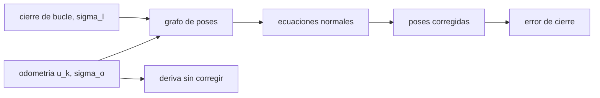

# B97-C05 — Localización y mapeo SLAM

<!-- nav:top -->
[🏠 Programa](../../../../README.md) · [📚 Bloque B97](../../../tronco-comun/B97-robotica-y-construccion-extraterrestre.md) · [← Anterior: B97-C04 — Visión estereoscópica](../B97-C04-vision-estereoscopica/CLASE.md) · [Siguiente: B97-C06 — Control de movilidad sobre regolito →](../B97-C06-control-de-movilidad-sobre-regolito/CLASE.md)
<!-- /nav -->

## 1. Ubicación, nivel y alcance

Clase 5 del bloque B97. Nivel N3. Un robot que se mueve calculando solo cuánto avanza acumula error: la deriva. Cuando reconoce un lugar ya visitado, puede corregir toda la trayectoria a la vez. Aquí lo haces con el caso más simple de localización y mapeo simultáneos: un grafo de poses lineal resuelto por mínimos cuadrados, con una trayectoria cuadrada y un cierre de bucle. Los datos son **sintéticos**.

## 2. Por qué esta clase existe

Sin una corrección, el error de la odometría crece con el recorrido y el mapa se deforma. El cierre de bucle reparte ese error por toda la trayectoria; entender cuánto y cómo evita fiarse de un mapa que se «cierra» solo en apariencia. La decisión central: **¿cuánto error de posición queda tras un cierre de bucle y cuánto depende de la confianza que se le da?**

## 3. Lo que podrás hacer al terminar

1. Plantear un grafo de poses con restricciones de odometría y de cierre.
2. Resolver el problema por mínimos cuadrados lineales.
3. Calcular el error de cierre con y sin corrección.
4. Comprobar la solución con la expresión analítica del caso simétrico.
5. Interpretar el efecto del cociente entre la incertidumbre del cierre y la de la odometría.
6. Separar lo sintético (toda la trayectoria) de lo consultado (nada).

La evidencia es la **ficha de deriva y cierre de bucle de una trayectoria** del ejercicio 12 (sección 20).

## 4. Con qué llegas y cómo comprobarlo

1. ¿Qué es la odometría?
2. ¿Qué es un residuo y un mínimo cuadrado?
3. ¿Qué es una ecuación normal?
4. ¿Qué es un dato sintético?
5. ¿Qué es una segunda vía de cálculo?

<details>
<summary>Ver respuestas</summary>

1. Estimar el movimiento acumulando los avances medidos. 2. La diferencia entre lo medido y lo predicho; el criterio minimiza la suma de sus cuadrados ponderados. 3. El sistema `AᵀA x = Aᵀb` que da el mínimo de los cuadrados. 4. Un dato generado para el ejemplo, no medido. 5. Calcular lo mismo con otro método y comparar.
</details>

Con cuatro o cinco aciertos, sigue; si no, repasa los prerrequisitos.

## 5. Un caso de contexto y casos de referencia

Un robot recorre un cuadrado de `10 m` de lado en `40` pasos de `1 m` con ruido de `0,05 m` y un sesgo de `0,01 m` por paso en `x`. La odometría pura termina a `0,856` m del punto de partida; con el cierre de bucle (σ = `0,02 m`) queda a `0,003` m. Es el **ejemplo conductor**; todo es sintético.

## 6. Vocabulario

La **deriva** es el error acumulado de la odometría. Un **grafo de poses** une poses con restricciones de movimiento relativo. Un **cierre de bucle** es la restricción entre dos poses que representan el mismo lugar. La **solución de mínimos cuadrados** minimiza la suma de los residuos ponderados por `1/σ²`.

## 7. Modelo mental



*Descripción textual:* la odometría y el cierre forman un grafo; sus ecuaciones normales dan las poses corregidas, que se comparan con la deriva sin corregir.

Analogía: caminas con los ojos cerrados un cuadrado y al volver tocas la pared de partida; el desfase que notas lo repartes sobre todo el camino. Límite: aquí el problema es lineal y sin rotaciones.

## 8. La explicación, paso a paso

### 8.1 Deriva

Cada paso suma ruido y sesgo; tras `40` pasos el error de cierre es `0,8556` m (`e₀ₓ = 0,7333`, `e₀ᵧ = 0,4407` m).

### 8.2 Grafo y mínimos cuadrados

Por eje: `x_{k+1} − x_k = u_k` con peso `1/σ_o²`, `x₀ = 0` y `x_N − x₀ = 0` con peso `1/σ_l²`. Las ecuaciones normales se resuelven por eliminación de Gauss. El error de cierre baja a `0,0034` m y el RMS de toda la trayectoria de `0,5022` m a `0,1701` m.

### 8.3 Solución analítica

Por simetría cada paso se corrige `δ = −e₀ σ_o²/(σ_l² + N σ_o²)` y el error final es `e₀ σ_l²/(σ_l² + N σ_o²)`: el factor es `0,00398`. La diferencia con la solución numérica es `3,76e-16` m.

### 8.4 Qué cambia con la confianza en el cierre

Si `σ_l → 0`, el cierre se impone y el error final se anula; si `σ_l` es grande, la corrección se diluye. Un cierre falso (dos lugares parecidos) con `σ_l` pequeño deforma el mapa: la ayuda es la verificación de la correspondencia, que este modelo no incluye.

## 9. Magnitudes, símbolos y unidades

| Símbolo | Qué es | Unidad | Valor / nota |
|---|---|---|---|
| `u_k` | paso medido | m | 1 + ruido |
| `σ_o` | ruido de odometría | m | 0,05 (sintético) |
| `σ_l` | incertidumbre del cierre | m | 0,02 (sintética) |
| `N` | pasos | — | 40 |
| `e₀` | error de cierre sin corrección | m | 0,8556 |

## 10. Convenciones y referencias

Plano, origen en el punto de partida, trayectoria cuadrada de 10 m, pasos de 1 m, sin rotaciones ni ruido de orientación; ejes independientes. Todos los datos son sintéticos.

## 11. De dónde sale lo que afirmamos

| ID | Fuente | Localizador | Respalda | Estado |
|---|---|---|---|---|
| — | Relaciones estándar usadas en el laboratorio | — | las verifica el laboratorio con una segunda vía | No consultada en una fuente concreta |

Límites: no se consultó ninguna fuente para la trayectoria, que es sintética; el problema se plantea lineal y sin orientación.

## 12. Cómo ver el resultado

| Magnitud | Valor |
|---|---|
| Error de cierre sin corregir | 0,8556 m |
| Error de cierre corregido | 0,0034 m |
| RMS sin corregir | 0,5022 m |
| RMS corregido | 0,1701 m |
| Factor del cierre | 0,00398 |

Descripción larga: el cierre de bucle reduce el error de cierre en un factor de 251,0 y el RMS de la trayectoria en 2,95.

## 13. Ejemplo trabajado

**Paso 1 · Factor.** `σ_l² = 4 × 10⁻⁴`, `N σ_o² = 40 × 0,0025 = 0,1`; `factor = 4 × 10⁻⁴/(0,1004) = 0,00398`.

**Paso 2 · Error final en x.** `e₀ₓ × factor = 0,7333 × 0,00398`.

**Paso 3 · Comparación.** El laboratorio da la misma cifra con diferencia `3,76e-16` m.

## 14. Distintas formas de describir el problema

**Por grafo:** poses y restricciones. **Por mínimos cuadrados:** ecuaciones normales. **Por reparto:** `δ` por paso. **Por factor:** `σ_l²/(σ_l² + N σ_o²)`. **Por RMS:** error medio de la trayectoria.

## 15. Práctica guiada

**Ejercicio 1 · con los pasos indicados.** Calcula `N σ_o²` con `N = 40` y `σ_o = 0,05`. *Pasos:* `40 × 0,0025`.

<details><summary>Solución comentada</summary>

`0,1 m²`.
</details>

**Ejercicio 2 · con una pista.** Predice qué pasa con el factor si `σ_l` baja a `0,01`. *Pista:* `σ_l²` baja a `10⁻⁴`.

<details><summary>Solución comentada</summary>

`10⁻⁴/(0,1001) = 0,001`: el cierre se impone.
</details>

**Ejercicio 3 · casi autónomo.** ¿Por qué un sesgo no se detecta por sí solo en la odometría?

<details><summary>Solución comentada</summary>

Se suma a cada paso y parece un movimiento real; solo el cierre lo evidencia.
</details>

## 16. Práctica autónoma, transferencia e integrador

**Ejercicio 4 · autónomo.** ¿Cuál es el error final si `σ_l = 0,05`?

<details><summary>Solución comentada</summary>

`e₀ × 0,0025/(0,0025 + 0,1) = 0,0244 e₀`.
</details>

**Ejercicio 5 · autónomo.** ¿Qué `σ_l` da un factor de 0,5 con `N = 40`?

<details><summary>Solución comentada</summary>

`σ_l² = N σ_o² = 0,1`, de modo que `σ_l = 0,316 m`.
</details>

**Ejercicio 6 · autónomo.** ¿Qué pasa con la deriva si el recorrido se duplica a 80 pasos?

<details><summary>Solución comentada</summary>

El ruido crece con `√N` y el sesgo con `N`: el sesgo ilustrativo aporta `0,4 m` con 40 pasos y `0,8 m` con 80.
</details>

**Ejercicio 7 · autónomo.** ¿Qué mide el RMS de la trayectoria que no mida el error de cierre?

<details><summary>Solución comentada</summary>

El error de todas las poses, no solo la última.
</details>

**Ejercicio 8 · autónomo.** ¿Cómo cambia la corrección en el punto medio de la trayectoria?

<details><summary>Solución comentada</summary>

Es proporcional al número de pasos recorridos: `k δ`.
</details>

**Ejercicio 9 · transferencia.** Dos pasillos parecidos provocan un cierre de bucle falso. ¿Qué ocurre? **Transferencia.**

<details><summary>Solución comentada</summary>

El mapa se deforma si se le da peso alto; hay que verificar la correspondencia antes de usar el cierre.
</details>

**Ejercicio 10 · transferencia.** Un robot gira y su odometría tiene error angular. ¿Qué no cubre este modelo? **Transferencia.**

<details><summary>Solución comentada</summary>

El problema deja de ser lineal: la orientación acopla los ejes y se necesita una optimización iterativa.
</details>

**Ejercicio 11 · transferencia.** ¿Cómo usarías el factor para decidir cuántos cierres de bucle poner? **Transferencia.**

<details><summary>Solución comentada</summary>

Calculando el error final esperado para distintos `σ_l` y `N` y eligiendo el compromiso con el costo de computación.
</details>

**Ejercicio 12 · integrador.** Elabora tu *ficha de deriva y cierre de bucle de una trayectoria*: errores con y sin corrección, factor analítico, RMS y límites del modelo, todo rotulado como sintético. **Integrador.**

<details><summary>Solución comentada</summary>

Secciones 8.1–8.4 y la salida del laboratorio.
</details>

## 17. Laboratorio

El script [deriva_cierre_bucle.py](deriva_cierre_bucle.py) genera una trayectoria con deriva, resuelve el grafo de poses por mínimos cuadrados y compara con la solución analítica (**comprueba** diferencia < 1e-9 y error de cierre menor que sin corregir).

**Datos:** **sintéticos** (trayectoria, ruido, sesgo y semilla); no se usa ningún dato publicado. **Predice antes de ejecutar:** ¿Quedará el error de cierre corregido por debajo de 0,01 m? (Ver el laboratorio: 0,0034 m.) **Ejecución del 2026-11-10 (Python 3.12.9):**

```text
Python 3.12.9 (biblioteca estandar)
Datos SINTETICOS: cuadrado de 10.0 m, 40 pasos de 1.0 m; sigma_o = 0.05 m; sesgo 0.01 m/paso en x; sigma_l = 0.02 m; semilla 20261110
Odometria pura: error de cierre = 0.8556 m (e0x = 0.7333, e0y = 0.4407); RMS de la trayectoria = 0.5022 m
Con cierre de bucle: error de cierre = 0.0034 m; RMS de la trayectoria = 0.1701 m
Factor analitico del cierre = 0.00398; diferencia con la solucion numerica = 3.76e-16 m
Mejora del error de cierre: x251.0; mejora del RMS: x2.95
Pruebas superadas.
```

```bash
python programa/clases/B97/B97-C05-localizacion-y-mapeo-slam/deriva_cierre_bucle.py
```

**Límites:** problema lineal sin orientación, un único cierre y errores gaussianos independientes; no incluye falsos cierres de bucle.

## 18. Errores frecuentes y cómo corregirlos

**Creer que el cierre elimina el error.** Lo reparte y lo reduce según `σ_l` (8.3)

**Medir solo la última pose.** El RMS completo muestra el efecto (8.2)

**Dar peso alto a un cierre dudoso.** Ver 8.4

**Presentar la trayectoria como real.** Es sintética; ver la sección 10

## 19. Cómo sabrás que vas bien

Tras la sección 8: ¿qué error de cierre esperabas y cuál obtuviste? Si dudas, repasa el ejemplo 13. Tras el laboratorio: ¿qué comprueba? (ver la sección 17).

## 20. Qué entregas y cómo se evalúa

El producto es tu **ficha de deriva y cierre de bucle de una trayectoria** (ejercicio 12).

| Criterio | Inicial | En desarrollo | Logrado | Destacado |
|---|---|---|---|---|
| Conceptos | Los confunde | Parciales | Explica el modelo y sus supuestos | Explica los límites |
| Cálculo | Sin unidades | Con errores | Tablas completas con unidades | Calcula casos nuevos |
| Numérico | Sin comprobar | Un caso | Contraste con una segunda vía | Interpreta las diferencias |
| Fuentes | Sin fuente | Sin fecha | Fuentes con fecha y estado | Declara lo ilustrativo y lo no consultado |
| Límites | No los nombra | Uno | Tres | Discute qué falta del modelo |

**Condiciones críticas (no se compensan con promedio):** rotular los datos sintéticos e ilustrativos; no presentar un resultado simulado como observado o medido; citar solo lo consultado.

## 21. Ética, seguridad y límites

Clase educativa: los modelos son simplificados y sus datos son sintéticos o ilustrativos; ningún resultado describe una misión real, certifica un diseño ni sustituye a las normas aplicables ni a las pruebas de hardware.  Accesibilidad: tablas equivalentes a las gráficas, fórmulas en texto, ejercicios sin conexión.

## 22. Para cerrar y seguir

El cierre de bucle redujo el error de `0,856` m a `0,003` m en una trayectoria sintética. Queda una pregunta: ¿cómo avanza una rueda sobre un suelo blando sin patinar?

**Glosario español–inglés.** odometría · *odometry*; deriva · *drift*; cierre de bucle · *loop closure*; grafo de poses · *pose graph*; mínimos cuadrados · *least squares*.

**Continuidad.** [B97-C06](../B97-C06-control-de-movilidad-sobre-regolito/CLASE.md) estudia el control de movilidad sobre regolito.

**Referencias:** ver sección 11.

<!-- nav:bottom -->
---

[← Anterior: B97-C04 — Visión estereoscópica](../B97-C04-vision-estereoscopica/CLASE.md) · [📚 Bloque B97](../../../tronco-comun/B97-robotica-y-construccion-extraterrestre.md) · [Siguiente: B97-C06 — Control de movilidad sobre regolito →](../B97-C06-control-de-movilidad-sobre-regolito/CLASE.md)
<!-- /nav -->
