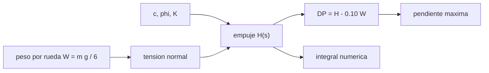

# B97-C06 — Control de movilidad sobre regolito

<!-- nav:top -->
[🏠 Programa](../../../../README.md) · [📚 Bloque B97](../../../tronco-comun/B97-robotica-y-construccion-extraterrestre.md) · [← Anterior: B97-C05 — Localización y mapeo SLAM](../B97-C05-localizacion-y-mapeo-slam/CLASE.md) · [Siguiente: B97-C07 — Teleoperación con latencia →](../B97-C07-teleoperacion-con-latencia/CLASE.md)
<!-- /nav -->

## 1. Ubicación, nivel y alcance

Clase 6 del bloque B97. Nivel N3. Una rueda avanza porque el suelo resiste al corte; si lo vence, patina. En un suelo suelto la resistencia al corte tiene una parte que no depende del peso (cohesión) y otra que sí (fricción). Por eso la gravedad cambia la tracción disponible respecto del peso. Aquí lo calculas con un modelo de suelo de Mohr–Coulomb con deformación de corte exponencial, aplicado a un rover de seis ruedas en la Tierra, Marte y la Luna. Los parámetros del suelo son **ilustrativos**: no son propiedades de ningún regolito.

## 2. Por qué esta clase existe

Un rover que se atasca puede perder la misión. Estimar cuánta tracción hay disponible en cada gravedad, y cómo varía con el deslizamiento, permite limitar pendientes y planear rutas. La decisión central: **¿qué pendiente puede subir un rover en cada cuerpo con un deslizamiento dado, y a partir de qué deslizamiento deja de convenir seguir empujando?**

## 3. Lo que podrás hacer al terminar

1. Calcular la tensión normal bajo una rueda a partir del peso y del área de contacto.
2. Calcular el empuje con el modelo de corte exponencial en forma cerrada.
3. Verificar el empuje con una integración numérica (Simpson).
4. Calcular la tracción neta y la pendiente máxima aproximada.
5. Comparar la tracción relativa al peso en tres cuerpos.
6. Separar lo consultado (gravedades, masa y diámetro de rueda) de lo ilustrativo (suelo y geometría de contacto).

La evidencia es la **ficha de tracción y pendiente máxima en regolito** del ejercicio 12 (sección 20).

## 4. Con qué llegas y cómo comprobarlo

1. ¿Qué es la cohesión y qué es el ángulo de fricción?
2. ¿Qué es una tensión normal y en qué unidades se mide?
3. ¿Qué es el deslizamiento de una rueda?
4. ¿Qué es un dato ilustrativo?
5. ¿Qué es una segunda vía de cálculo?

<details>
<summary>Ver respuestas</summary>

1. La resistencia al corte sin carga y la inclinación del criterio de fricción. 2. Una fuerza por unidad de área, en Pa. 3. La fracción de la velocidad de giro que no se convierte en avance. 4. Un dato inventado de forma verosímil para el ejemplo, no medido. 5. Calcular lo mismo con otro método y comparar.
</details>

Con cuatro o cinco aciertos, sigue; si no, repasa los prerrequisitos.

## 5. Un caso de contexto y casos de referencia

Un rover de `1025 kg` con seis ruedas, sobre un suelo ilustrativo (`c = 1 kPa`, `φ = 35°`, `K = 0,018 m`) y deslizamiento `0,20`, tiene `DP/W = 0,226` en la Tierra, `0,247` en Marte y `0,291` en la Luna: baja la gravedad y sube la tracción relativa al peso. Es el **ejemplo conductor**.

## 6. Vocabulario

El **empuje** `H` es la fuerza de corte total que el suelo ejerce sobre la rueda. La **tracción neta** `DP` es el empuje menos la resistencia a la rodadura. El **deslizamiento** `s` compara la velocidad de giro y la de avance. La **cohesión** `c` es la resistencia al corte sin carga y `φ` el **ángulo de fricción**. `K` es el **módulo de deformación de corte**.

## 7. Modelo mental



*Descripción textual:* el peso y los parámetros del suelo dan el empuje; restando la rodadura se tiene la tracción neta y la pendiente máxima; el empuje se verifica integrando numéricamente.

Analogía: caminar sobre arena seca y sobre arena húmeda; la húmeda tiene cohesión y la seca solo fricción. Límite: el modelo usa tensión normal uniforme, suelo plano y una resistencia a la rodadura fija.

## 8. La explicación, paso a paso

### 8.1 Peso y tensión normal

`W = m g/6`: `1677,6` N en la Tierra, `637,2` N en Marte y `276,8` N en la Luna por rueda. El área de contacto es `b L = 0,048 m²`.

### 8.2 Empuje

`H = (c A + W tan φ)(1 − (K/(s L))(1 − e^(−s L/K)))`. Con `s = 0,20`, en Marte `H = 221,24` N por rueda y la tracción neta es `157,52` N. El término de cohesión `c A = 48,0` N no depende de la gravedad.

### 8.3 Tres cuerpos

`DP/W` vale `0,2263` (Tierra), `0,2472` (Marte) y `0,2911` (Luna); la pendiente máxima aproximada es `13,08°`, `14,31°` y `16,93°`. En la Luna, `DP/W` es `1,29` veces el terrestre. La pendiente máxima es solo una cota aproximada: no incluye la componente normal ni el hundimiento.

### 8.4 Deslizamiento y segunda vía

`DP/W` en Marte sube con el deslizamiento y se va saturando (de `0,0160` con `s = 0,05` a `0,5308` con `s = 0,8`, ver el laboratorio): cada punto de deslizamiento adicional rinde menos y consume energía y suelo. La integración numérica de Simpson reproduce el empuje con diferencia relativa `2,10e-15`; esto valida la expresión cerrada, no el modelo de suelo.

## 9. Magnitudes, símbolos y unidades

| Símbolo | Qué es | Unidad | Valor / nota |
|---|---|---|---|
| `W` | peso por rueda | N | 637,2 (Marte) |
| `c` | cohesión | Pa | 1000 (ilustrativa) |
| `φ` | ángulo de fricción | ° | 35 (ilustrativo) |
| `K` | módulo de corte | m | 0,018 (ilustrativo) |
| `s` | deslizamiento | — | 0,20 |
| `DP` | tracción neta | N | 157,52 (Marte) |

## 10. Convenciones y referencias

Suelo plano, tensión normal uniforme, reparto de carga igual entre las seis ruedas, resistencia a la rodadura del 10 % del peso. Gravedades medias de las fichas NASA/NSSDC; masa y diámetro de rueda de Perseverance (NASA). Parámetros del suelo y de contacto ilustrativos.

## 11. De dónde sale lo que afirmamos

| ID | Fuente | Localizador | Respalda | Estado |
|---|---|---|---|---|
| S1 | NASA/NSSDC, Moon Fact Sheet — https://nssdc.gsfc.nasa.gov/planetary/factsheet/moonfact.html (consultada 2026-11-10) | ficha completa leída | gravedad media 1,62 m/s²; radio medio 1737,4 km; distancia media a la Tierra 384,4 × 10³ km; rango diurno ecuatorial 95–390 K | Consultada |
| S2 | NASA/NSSDC, Mars Fact Sheet — https://nssdc.gsfc.nasa.gov/planetary/factsheet/marsfact.html (consultada 2026-11-10) | ficha completa leída | gravedad media 3,73 m/s²; radio medio 3389,5 km; distancia a la Tierra de 54,6 a 401,4 × 10⁶ km; presión 4,0–8,7 mb | Consultada |
| S3 | NASA, Mars 2020 Perseverance Rover Components — https://science.nasa.gov/mission/mars-2020-perseverance/rover-components/ (consultada 2026-11-10) | página completa leída | masa 1025 kg; seis ruedas de 52,5 cm con un motor cada una; brazo de 2,1 m; velocidad máxima ~152 m/h sobre terreno plano y duro | Consultada |
| S4 | NASA/NSSDC, Earth Fact Sheet — https://nssdc.gsfc.nasa.gov/planetary/factsheet/earthfact.html (consultada 2026-11-10) | ficha completa leída | gravedad media 9,820 m/s²; radio medio 6371,0 km | Consultada |
| — | Relaciones estándar usadas en el laboratorio | — | las verifica el laboratorio con una segunda vía | No consultada en una fuente concreta |

Límites: no se consultaron propiedades de regolito (Apolo, simulantes ni datos de rovers); el suelo, la longitud y el ancho de contacto, la resistencia a la rodadura y el deslizamiento son ilustrativos.

## 12. Cómo ver el resultado

| Magnitud | Valor |
|---|---|
| `DP/W` Tierra | 0,2263 |
| `DP/W` Marte | 0,2472 |
| `DP/W` Luna | 0,2911 |
| Pendiente máx. Marte | 14,31° |
| Diferencia con la integral | 2,10e-15 |

Descripción larga: la tracción relativa al peso crece al bajar la gravedad porque la cohesión aporta una fuerza fija; la pendiente máxima aproximada crece también.

## 13. Ejemplo trabajado

**Paso 1 · Peso.** `1025 × 3,73/6 = 637,2` N.

**Paso 2 · Empuje.** `H = 221,24` N con `s = 0,20`.

**Paso 3 · Tracción.** `DP = H − 0,10 W = 157,52` N.

**Paso 4 · Pendiente.** `θ ≈ asin(DP/W) = 14,31°`.

## 14. Distintas formas de describir el problema

**Por fuerzas:** `H`, `DP`. **Por razón:** `DP/W`. **Por pendiente:** `θ`. **Por deslizamiento:** curva `DP/W(s)`. **Por integral:** esfuerzo de corte a lo largo del contacto.

## 15. Práctica guiada

**Ejercicio 1 · con los pasos indicados.** Calcula `W` por rueda en la Luna. *Pasos:* `m g/6`.

<details><summary>Solución comentada</summary>

`1025 × 1,62/6 = 276,8` N.
</details>

**Ejercicio 2 · con una pista.** Predice si `DP/W` será mayor en la Luna o en Marte. *Pista:* la cohesión no depende de `g`.

<details><summary>Solución comentada</summary>

Mayor en la Luna: 0,291 frente a 0,247.
</details>

**Ejercicio 3 · casi autónomo.** ¿Por qué una cohesión alta ayuda más en gravedad baja?

<details><summary>Solución comentada</summary>

Porque aporta una fuerza fija que pesa más al comparar con un peso menor.
</details>

## 16. Práctica autónoma, transferencia e integrador

**Ejercicio 4 · autónomo.** Calcula el área de contacto `b L`.

<details><summary>Solución comentada</summary>

`0,40 × 0,12 = 0,048 m²`.
</details>

**Ejercicio 5 · autónomo.** ¿Cuánto vale la tracción neta por rueda en la Tierra?

<details><summary>Solución comentada</summary>

`379,62` N.
</details>

**Ejercicio 6 · autónomo.** ¿Qué pasa con `H` si `s → ∞`?

<details><summary>Solución comentada</summary>

El factor tiende a 1: `H → c A + W tan φ`, el máximo.
</details>

**Ejercicio 7 · autónomo.** ¿Qué pasa con la tracción si la resistencia a la rodadura sube al 30 %?

<details><summary>Solución comentada</summary>

Se resta `0,20 W` más: `DP/W` baja en `0,20` en cada cuerpo.
</details>

**Ejercicio 8 · autónomo.** ¿Qué ocurre con la pendiente máxima si la masa se duplica?

<details><summary>Solución comentada</summary>

Baja un poco: el término `c A/W` se reduce a la mitad y el de fricción `tan φ` no cambia.
</details>

**Ejercicio 9 · transferencia.** Un rover real se hunde y la resistencia a la rodadura sube. ¿Qué hace el planificador? **Transferencia.**

<details><summary>Solución comentada</summary>

Reduce la pendiente admisible, lleva un margen y usa la telemetría de deslizamiento para frenar el avance.
</details>

**Ejercicio 10 · transferencia.** ¿Por qué no basta una prueba en la Tierra para certificar la tracción en Marte? **Transferencia.**

<details><summary>Solución comentada</summary>

El peso es distinto y el suelo también; hay que escalar la carga o descargar el rover (ver C18).
</details>

**Ejercicio 11 · transferencia.** ¿Qué dato falta para pasar del modelo a un caso real? **Transferencia.**

<details><summary>Solución comentada</summary>

Propiedades medidas del suelo del sitio y de la rueda; aquí son ilustrativas.
</details>

**Ejercicio 12 · integrador.** Elabora tu *ficha de tracción y pendiente máxima en regolito*: tabla de `W`, `H`, `DP`, `DP/W` y `θ` en los tres cuerpos, curva `DP/W(s)` y los parámetros rotulados como consultados o ilustrativos. **Integrador.**

<details><summary>Solución comentada</summary>

Secciones 8.1–8.4 y la salida del laboratorio.
</details>

## 17. Laboratorio

El script [traccion_regolito.py](traccion_regolito.py) calcula el empuje y la tracción de un rover en tres cuerpos y barre el deslizamiento, contrastando la forma cerrada con una integración numérica (**comprueba** diferencia relativa < 1e-9 y orden Luna > Marte > Tierra).

**Datos:** gravedades, masa y diámetro de rueda (NASA, consultados); parámetros del suelo y contacto **ilustrativos**. **Predice antes de ejecutar:** ¿En qué cuerpo es mayor `DP/W`? (En la Luna.) **Ejecución del 2026-11-10 (Python 3.12.9):**

```text
Python 3.12.9 (biblioteca estandar)
Rover 1025 kg, 6 ruedas; suelo ILUSTRATIVO c = 1000 Pa, phi = 35 deg, K = 0.018 m; deslizamiento 0.2
 cuerpo   W/rueda [N]   empuje [N]   DP [N]   DP/W    pendiente max [deg]
Tierra       1677.58       547.38    379.62  0.2263        13.08
Marte         637.21       221.24    157.52  0.2472        14.31
Luna          276.75       108.25     80.57  0.2911        16.93
DP/W en Marte segun el deslizamiento: s=0.05: 0.0160; s=0.1: 0.1095; s=0.2: 0.2472; s=0.4: 0.4049; s=0.8: 0.5308
Diferencia relativa maxima entre forma cerrada e integral numerica = 2.10e-15
Pruebas superadas.
```

```bash
python programa/clases/B97/B97-C06-control-de-movilidad-sobre-regolito/traccion_regolito.py
```

**Límites:** suelo plano de propiedades constantes, tensión normal uniforme y rodadura fija; sin hundimiento, sin efecto de las grousers ni dinámica del vehículo.

## 18. Errores frecuentes y cómo corregirlos

**Comparar fuerzas absolutas y no `DP/W`.** Lo que importa es la razón con el peso (8.3)

**Usar los parámetros del suelo como reales.** Son ilustrativos; ver la sección 10

**Tomar la pendiente aproximada como garantía.** Es una cota; ver 8.3

**Perseguir deslizamientos altos.** Rinden cada vez menos tracción y desgastan el suelo y la rueda (8.4)

## 19. Cómo sabrás que vas bien

Tras la sección 8: ¿cómo esperabas que cambiara `DP/W` con la gravedad y qué obtuviste? Si dudas, repasa el ejemplo 13. Tras el laboratorio: ¿qué comprueba? (ver la sección 17).

## 20. Qué entregas y cómo se evalúa

El producto es tu **ficha de tracción y pendiente máxima en regolito** (ejercicio 12).

| Criterio | Inicial | En desarrollo | Logrado | Destacado |
|---|---|---|---|---|
| Conceptos | Los confunde | Parciales | Explica el modelo y sus supuestos | Explica los límites |
| Cálculo | Sin unidades | Con errores | Tablas completas con unidades | Calcula casos nuevos |
| Numérico | Sin comprobar | Un caso | Contraste con una segunda vía | Interpreta las diferencias |
| Fuentes | Sin fuente | Sin fecha | Fuentes con fecha y estado | Declara lo ilustrativo y lo no consultado |
| Límites | No los nombra | Uno | Tres | Discute qué falta del modelo |

**Condiciones críticas (no se compensan con promedio):** rotular los datos sintéticos e ilustrativos; no presentar un resultado simulado como observado o medido; citar solo lo consultado.

## 21. Ética, seguridad y límites

Clase educativa: los modelos son simplificados y sus datos son sintéticos o ilustrativos; ningún resultado describe una misión real, certifica un diseño ni sustituye a las normas aplicables ni a las pruebas de hardware.  Accesibilidad: tablas equivalentes a las gráficas, fórmulas en texto, ejercicios sin conexión.

## 22. Para cerrar y seguir

Con un suelo ilustrativo, `DP/W` pasa de `0,23` (Tierra) a `0,29` (Luna). Queda una pregunta: ¿qué pasa con el control del rover cuando las órdenes tardan minutos en llegar?

**Glosario español–inglés.** empuje · *thrust*; tracción neta · *drawbar pull*; deslizamiento · *slip*; cohesión · *cohesion*; regolito · *regolith*.

**Continuidad.** [B97-C07](../B97-C07-teleoperacion-con-latencia/CLASE.md) estudia la teleoperación con latencia.

**Referencias:** ver sección 11.

<!-- nav:bottom -->
---

[← Anterior: B97-C05 — Localización y mapeo SLAM](../B97-C05-localizacion-y-mapeo-slam/CLASE.md) · [📚 Bloque B97](../../../tronco-comun/B97-robotica-y-construccion-extraterrestre.md) · [Siguiente: B97-C07 — Teleoperación con latencia →](../B97-C07-teleoperacion-con-latencia/CLASE.md)
<!-- /nav -->
