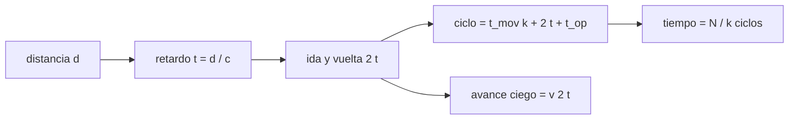

# B97-C07 — Teleoperación con latencia

<!-- nav:top -->
[🏠 Programa](../../../../README.md) · [📚 Bloque B97](../../../tronco-comun/B97-robotica-y-construccion-extraterrestre.md) · [← Anterior: B97-C06 — Control de movilidad sobre regolito](../B97-C06-control-de-movilidad-sobre-regolito/CLASE.md) · [Siguiente: B97-C08 — Planificación de trayectorias robóticas →](../B97-C08-planificacion-de-trayectorias-roboticas/CLASE.md)
<!-- /nav -->

## 1. Ubicación, nivel y alcance

Clase 7 del bloque B97. Nivel N3. La luz tarda en ir y volver, y ese retardo cambia cómo se opera un robot a distancia. Aquí calculas el retardo de ida y vuelta Tierra–Luna y Tierra–Marte con distancias publicadas y la velocidad de la luz, y ves cuánto tarda una misma tarea si el operador espera la confirmación después de cada paso o si el robot ejecuta bloques de varios pasos con autonomía supervisada. La tarea es **ilustrativa**.

## 2. Por qué esta clase existe

Con un retardo de unos segundos se puede teleoperar casi en vivo; con minutos, no. La diferencia se traduce en horas o días de tarea y en la necesidad de dar autonomía al robot. La decisión central: **¿qué tamaño de bloque de pasos por ciclo se acepta para que una tarea quepa en el tiempo disponible, y cuánto avanza el robot a ciegas?**

## 3. Lo que podrás hacer al terminar

1. Calcular el retardo de ida y vuelta de un enlace a partir de su distancia.
2. Calcular el tiempo de una tarea con el ciclo mover y esperar.
3. Calcular el ahorro de agrupar pasos en bloques supervisados.
4. Calcular la distancia que recorre un rover mientras espera una orden.
5. Comparar la Luna con el rango mínimo y máximo de Marte.
6. Separar lo consultado (distancias y `c`) de lo ilustrativo (tarea, tiempos y operador).

La evidencia es la **ficha de latencia y duración de una tarea teleoperada** del ejercicio 12 (sección 20).

## 4. Con qué llegas y cómo comprobarlo

1. ¿Qué es la velocidad de la luz y en qué unidades se mide?
2. ¿Qué es un retardo de ida y vuelta?
3. ¿Qué distancia hay entre la Tierra y la Luna, aproximadamente?
4. ¿Qué es un dato ilustrativo?
5. ¿Qué es una segunda vía de cálculo?

<details>
<summary>Ver respuestas</summary>

1. La velocidad de propagación de la luz en el vacío, `299 792 458 m/s`. 2. El tiempo que tarda una señal en ir y volver. 3. Unos 384 400 km. 4. Un dato inventado de forma verosímil para el ejemplo, no medido. 5. Calcular lo mismo con otro método y comparar.
</details>

Con cuatro o cinco aciertos, sigue; si no, repasa los prerrequisitos.

## 5. Un caso de contexto y casos de referencia

El retardo de ida Tierra–Luna es `1,282` s (`2,56` s ida y vuelta); el de Tierra–Marte va de `182,1` s (distancia mínima) a `1338,9` s (máxima). Una tarea de 40 pasos con ciclo de un paso tarda `1143` s en la Luna y `108154` s con Marte a la distancia máxima. Es el **ejemplo conductor**; la tarea es ilustrativa.

## 6. Vocabulario

El **retardo de ida** es `d/c`. El **ciclo mover y esperar** es: ejecutar, enviar telemetría, decidir y enviar la orden. La **autonomía supervisada** agrupa `k` pasos por orden. El **avance ciego** es la distancia que recorre el robot mientras no recibe nueva orden.

## 7. Modelo mental



*Descripción textual:* de la distancia sale el retardo y el ciclo; agrupar pasos reparte el retardo entre más pasos; el avance ciego mide el riesgo.

Analogía: una conversación por radio con retardo en la que debes esperar la respuesta antes de hablar; si te dan una lista de tareas, esperas menos veces. Límite: aquí se ignoran los retardos de procesamiento y de red, y las ventanas de comunicación.

## 8. La explicación, paso a paso

### 8.1 Retardo de luz

`t = d/c`. Luna: `384 400 000 m / 299 792 458 m/s = 1,282` s. Marte: `182,1` s a `54,6 × 10⁶ km` y `1338,9` s a `401,4 × 10⁶ km`; la ida y vuelta máxima es `44,6` min.

### 8.2 Tarea con ciclo de un paso

Con `N = 40` pasos de `6 s`, `20 s` de decisión y ciclo por paso: `T = N (t_mov + 2 t + t_op)`. Luna: `1143` s; Marte a la distancia máxima: `108154` s, es decir `450,6` veces el tiempo sin latencia (`240 s`).

### 8.3 Bloques supervisados

Con bloques de `10` pasos, Marte a la distancia máxima baja a `11031` s; con un bloque de `40`, a `2938` s: se paga el retardo una sola vez. A cambio, el robot actúa más tiempo sin orden nueva.

### 8.4 Avance ciego y segunda vía

Un rover a `152 m/h` recorre `113,1` m durante la ida y vuelta máxima a Marte. La línea de tiempo simulada coincide con la forma cerrada con diferencia `5,82e-11` s; es una comprobación del código, no de la física del enlace.

## 9. Magnitudes, símbolos y unidades

| Símbolo | Qué es | Unidad | Valor / nota |
|---|---|---|---|
| `c` | velocidad de la luz | m/s | 299 792 458 (consultada) |
| `d` | distancia del enlace | km | 384 400; 54,6 × 10⁶–401,4 × 10⁶ (consultadas) |
| `t` | retardo de ida | s | 1,282 (Luna) |
| `k` | pasos por orden | — | 1, 10, 40 (ilustrativos) |
| `t_op` | decisión del operador | s | 20 (ilustrativo) |

## 10. Convenciones y referencias

Propagación en el vacío en línea recta, sin retardos de procesamiento ni de red ni ventanas de comunicación; distancias medias o extremas de las fichas, no una geometría de misión. Tarea y tiempos ilustrativos.

## 11. De dónde sale lo que afirmamos

| ID | Fuente | Localizador | Respalda | Estado |
|---|---|---|---|---|
| S1 | NASA/NSSDC, Moon Fact Sheet — https://nssdc.gsfc.nasa.gov/planetary/factsheet/moonfact.html (consultada 2026-11-10) | ficha completa leída | gravedad media 1,62 m/s²; radio medio 1737,4 km; distancia media a la Tierra 384,4 × 10³ km; rango diurno ecuatorial 95–390 K | Consultada |
| S2 | NASA/NSSDC, Mars Fact Sheet — https://nssdc.gsfc.nasa.gov/planetary/factsheet/marsfact.html (consultada 2026-11-10) | ficha completa leída | gravedad media 3,73 m/s²; radio medio 3389,5 km; distancia a la Tierra de 54,6 a 401,4 × 10⁶ km; presión 4,0–8,7 mb | Consultada |
| S3 | NASA, Mars 2020 Perseverance Rover Components — https://science.nasa.gov/mission/mars-2020-perseverance/rover-components/ (consultada 2026-11-10) | página completa leída | masa 1025 kg; seis ruedas de 52,5 cm con un motor cada una; brazo de 2,1 m; velocidad máxima ~152 m/h sobre terreno plano y duro | Consultada |
| S4 | NIST, CODATA, velocidad de la luz en el vacío — https://physics.nist.gov/cgi-bin/cuu/Value?c (consultada 2026-11-10) | valor y unidad | c = 299 792 458 m/s (exacta por definición) | Consultada |
| — | Relaciones estándar usadas en el laboratorio | — | las verifica el laboratorio con una segunda vía | No consultada en una fuente concreta |

Límites: no se consultaron los retardos de procesamiento ni los de red, ni las ventanas de contacto reales; la tarea y los tiempos del operador son ilustrativos.

## 12. Cómo ver el resultado

| Magnitud | Valor |
|---|---|
| Retardo Tierra–Luna | 1,282 s |
| Retardo Marte (mín.) | 182,1 s |
| Retardo Marte (máx.) | 1338,9 s |
| Tarea, Marte máx., `k = 1` | 108154 s |
| Tarea, Marte máx., `k = 40` | 2938 s |

Descripción larga: a la distancia de Marte el retardo domina el ciclo y agrupar pasos reduce el tiempo de la tarea en más de un orden de magnitud.

## 13. Ejemplo trabajado

**Paso 1 · Retardo.** `54,6 × 10⁹ m/299 792 458 = 182,1` s.

**Paso 2 · Ciclo.** `6 + 2 × 182,1 + 20` s por paso.

**Paso 3 · Tarea.** `40 ×` el ciclo, y el laboratorio da el valor en minutos.

## 14. Distintas formas de describir el problema

**Por física:** `d/c`. **Por ciclo:** `t_mov k + 2t + t_op`. **Por tarea:** `N/k` ciclos. **Por riesgo:** avance ciego. **Por autonomía:** tamaño del bloque.

## 15. Práctica guiada

**Ejercicio 1 · con los pasos indicados.** Calcula el retardo de ida a `1 000 000 km`. *Pasos:* `d/c`.

<details><summary>Solución comentada</summary>

`10⁹ m/299 792 458 = 3,336 s`.
</details>

**Ejercicio 2 · con una pista.** Predice si la tarea de Marte cabe en 4 h con `k = 1` a la distancia máxima. *Pista:* el laboratorio da 108154 s.

<details><summary>Solución comentada</summary>

`4 h = 14 400 s`. Con `k = 1` la tarea tarda `108154` s (unas 30 h): no cabe. Con `k = 10` tarda `11031` s (unas 3,1 h): cabe.
</details>

**Ejercicio 3 · casi autónomo.** ¿Cuánto es el avance ciego del rover durante el ida y vuelta mínimo a Marte?

<details><summary>Solución comentada</summary>

`152/3600 × 2 × 182,1 = 15,4 m`.
</details>

## 16. Práctica autónoma, transferencia e integrador

**Ejercicio 4 · autónomo.** ¿Por qué agrupar pasos reduce el tiempo?

<details><summary>Solución comentada</summary>

Paga el retardo `2t` una vez por bloque.
</details>

**Ejercicio 5 · autónomo.** Calcula el tiempo de la tarea en la Luna con `k = 40`.

<details><summary>Solución comentada</summary>

`240 + 2 × 1,282 + 20 s`.
</details>

**Ejercicio 6 · autónomo.** ¿Cuál es el mínimo teórico de la tarea?

<details><summary>Solución comentada</summary>

`N t_mov = 240 s`.
</details>

**Ejercicio 7 · autónomo.** ¿Qué retardo ida y vuelta hace inviable el control manual continuo?

<details><summary>Solución comentada</summary>

Más de unos pocos segundos, cuando el operador cierra un lazo de visión y mando.
</details>

**Ejercicio 8 · autónomo.** ¿Qué factor tiene la tarea de `k = 1` respecto del ideal en la Luna?

<details><summary>Solución comentada</summary>

`1143/240`.
</details>

**Ejercicio 9 · transferencia.** Un operador pide aumentar `k` a 100. ¿Qué respondes? **Transferencia.**

<details><summary>Solución comentada</summary>

Que el avance ciego crece y hace falta que el robot detecte obstáculos y se detenga solo (ver C16 y C17).
</details>

**Ejercicio 10 · transferencia.** ¿Qué efecto tiene la conjunción solar en las comunicaciones? **Transferencia.**

<details><summary>Solución comentada</summary>

Puede interrumpir el enlace; no se modela aquí: depende de la geometría real que no se consultó.
</details>

**Ejercicio 11 · transferencia.** ¿Cómo cambia la decisión si el enlace pasa por un retransmisor en órbita? **Transferencia.**

<details><summary>Solución comentada</summary>

Se añade el retardo de cada tramo y el tiempo de espera del contacto.
</details>

**Ejercicio 12 · integrador.** Elabora tu *ficha de latencia y duración de una tarea teleoperada*: retardos, tiempos con distintos `k`, avance ciego y supuestos, con lo consultado y lo ilustrativo rotulados. **Integrador.**

<details><summary>Solución comentada</summary>

Secciones 8.1–8.4 y la salida del laboratorio.
</details>

## 17. Laboratorio

El script [latencia_teleoperacion.py](latencia_teleoperacion.py) calcula el retardo de tres enlaces, el tiempo de una tarea con distintos tamaños de bloque y el avance ciego, contrastando la forma cerrada con una línea de tiempo simulada (**comprueba** diferencia < 1e-9 s).

**Datos:** distancias (NASA/NSSDC) y `c` (NIST), consultadas; tarea y tiempos **ilustrativos**. **Predice antes de ejecutar:** ¿Cuánto tarda la luz de Marte a su distancia máxima? (Unos 22 minutos de ida.) **Ejecución del 2026-11-10 (Python 3.12.9):**

```text
Python 3.12.9 (biblioteca estandar)
c = 299792458 m/s; tarea ILUSTRATIVA: 40 pasos de 0.5 m, 6.0 s de movimiento por paso, 20.0 s de decision por ciclo; tiempo sin latencia = 240 s
 enlace              ida [s]   ida y vuelta [s]  k=1 [min]  k=10 [min]  k=40 [min]  avance ciego a 152 m/h [m]
Luna (media)          1.282             2.564      19.04        5.50        4.38             0.11
Marte (minima)      182.126           364.252     260.17       29.62       10.40            15.38
Marte (maxima)     1338.926          2677.853    1802.57      183.86       48.96           113.06
Diferencia maxima entre forma cerrada y linea de tiempo simulada = 5.82e-11 s
Pruebas superadas.
```

```bash
python programa/clases/B97/B97-C07-teleoperacion-con-latencia/latencia_teleoperacion.py
```

**Límites:** propagación sin procesamiento, sin ventanas de contacto y con una sola distancia por enlace; la simulación comprueba el código, no la física del enlace.

## 18. Errores frecuentes y cómo corregirlos

**Usar el retardo de ida como si fuera el de ida y vuelta.** El ciclo paga `2t` (8.2)

**Elegir `k` solo por el tiempo.** El avance ciego crece con `k` (8.4)

**Usar una distancia media para todo Marte.** Varía entre dos extremos (8.1)

**Presentar la tarea como una operación real.** Es ilustrativa; ver la sección 10

## 19. Cómo sabrás que vas bien

Tras la sección 8: ¿qué retardo esperabas para Marte y cuál obtuviste? Si dudas, repasa el ejemplo 13. Tras el laboratorio: ¿qué comprueba? (ver la sección 17).

## 20. Qué entregas y cómo se evalúa

El producto es tu **ficha de latencia y duración de una tarea teleoperada** (ejercicio 12).

| Criterio | Inicial | En desarrollo | Logrado | Destacado |
|---|---|---|---|---|
| Conceptos | Los confunde | Parciales | Explica el modelo y sus supuestos | Explica los límites |
| Cálculo | Sin unidades | Con errores | Tablas completas con unidades | Calcula casos nuevos |
| Numérico | Sin comprobar | Un caso | Contraste con una segunda vía | Interpreta las diferencias |
| Fuentes | Sin fuente | Sin fecha | Fuentes con fecha y estado | Declara lo ilustrativo y lo no consultado |
| Límites | No los nombra | Uno | Tres | Discute qué falta del modelo |

**Condiciones críticas (no se compensan con promedio):** rotular los datos sintéticos e ilustrativos; no presentar un resultado simulado como observado o medido; citar solo lo consultado.

## 21. Ética, seguridad y límites

Clase educativa: los modelos son simplificados y sus datos son sintéticos o ilustrativos; ningún resultado describe una misión real, certifica un diseño ni sustituye a las normas aplicables ni a las pruebas de hardware.  Accesibilidad: tablas equivalentes a las gráficas, fórmulas en texto, ejercicios sin conexión.

## 22. Para cerrar y seguir

El retardo de ida a Marte va de `182` s a `1339` s y una tarea de 40 pasos pasa de `108154` s a `2938` s al agrupar los pasos. Queda una pregunta: ¿cómo se planifica una ruta que el robot pueda ejecutar solo?

**Glosario español–inglés.** retardo · *latency*; ida y vuelta · *round trip*; autonomía supervisada · *supervised autonomy*; avance ciego · *blind travel*; teleoperación · *teleoperation*.

**Continuidad.** [B97-C08](../B97-C08-planificacion-de-trayectorias-roboticas/CLASE.md) estudia la planificación de trayectorias.

**Referencias:** ver sección 11.

<!-- nav:bottom -->
---

[← Anterior: B97-C06 — Control de movilidad sobre regolito](../B97-C06-control-de-movilidad-sobre-regolito/CLASE.md) · [📚 Bloque B97](../../../tronco-comun/B97-robotica-y-construccion-extraterrestre.md) · [Siguiente: B97-C08 — Planificación de trayectorias robóticas →](../B97-C08-planificacion-de-trayectorias-roboticas/CLASE.md)
<!-- /nav -->
