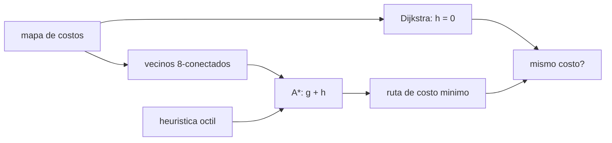

# B97-C08 — Planificación de trayectorias robóticas

<!-- nav:top -->
[🏠 Programa](../../../../README.md) · [📚 Bloque B97](../../../tronco-comun/B97-robotica-y-construccion-extraterrestre.md) · [← Anterior: B97-C07 — Teleoperación con latencia](../B97-C07-teleoperacion-con-latencia/CLASE.md) · [Siguiente: B97-C09 — Robótica colaborativa →](../B97-C09-robotica-colaborativa/CLASE.md)
<!-- /nav -->

## 1. Ubicación, nivel y alcance

Clase 8 del bloque B97. Nivel N3. Un robot que debe cruzar un terreno decide por dónde ir con un planificador de rutas. Aquí usas el algoritmo A* sobre una rejilla con obstáculos y celdas de costo distinto (por ejemplo, terreno rugoso), lo contrastas con Dijkstra, que explora sin heurística, y mides cuántos nodos se ahorra. El mapa es **sintético**: no representa ningún terreno real.

## 2. Por qué esta clase existe

Con retardo de comunicación y poca energía, la ruta debe salir buena a la primera. A* garantiza la ruta de costo mínimo si la heurística es admisible, y ahorra cómputo, que a bordo es escaso. La decisión central: **¿qué ruta cuesta menos en un mapa con obstáculos y terreno rugoso, y cuánto cómputo ahorra una heurística admisible?**

## 3. Lo que podrás hacer al terminar

1. Representar un terreno como rejilla de costos con obstáculos.
2. Calcular el costo de un movimiento con 8 conectividad.
3. Escribir una heurística admisible para A*.
4. Comprobar la ruta con Dijkstra y verificar que el costo coincide.
5. Medir el ahorro de nodos expandidos de A*.
6. Separar lo sintético (todo el mapa) de lo consultado (nada).

La evidencia es la **ficha de ruta planificada sobre un mapa sintético** del ejercicio 12 (sección 20).

## 4. Con qué llegas y cómo comprobarlo

1. ¿Qué es un grafo y qué es un camino en él?
2. ¿Qué es una heurística?
3. ¿Qué significa que una heurística sea admisible?
4. ¿Qué es un dato sintético?
5. ¿Qué es una segunda vía de cálculo?

<details>
<summary>Ver respuestas</summary>

1. Un conjunto de nodos unidos por aristas; un camino es una secuencia de aristas. 2. Una estimación del costo restante hasta la meta. 3. Que nunca sobreestima el costo real. 4. Un dato generado para el ejemplo, no medido. 5. Calcular lo mismo con otro método y comparar.
</details>

Con cuatro o cinco aciertos, sigue; si no, repasa los prerrequisitos.

## 5. Un caso de contexto y casos de referencia

En un mapa de `40 × 40` celdas con `355` obstáculos y celdas rugosas, A* encuentra una ruta de costo `79,113` y `70,28` m, y expande `801` nodos; Dijkstra obtiene el mismo costo con `1238`. Es el **ejemplo conductor**; el mapa es sintético.

## 6. Vocabulario

Una **rejilla de costos** asigna un costo a cada celda. **A\*** expande primero los nodos con menor `g + h`. La **heurística octil** estima el costo con movimientos ortogonales y diagonales. **Dijkstra** es A* con `h = 0`. Una ruta **óptima** tiene costo mínimo.

## 7. Modelo mental



*Descripción textual:* el mapa define los vecinos y los costos; A* usa una heurística y Dijkstra no; ambos deben dar el mismo costo, y A* expande menos nodos.

Analogía: buscar el camino en una ciudad con un mapa que te dice la dirección general de la meta; sin él, mirarías calles en todas direcciones. Límite: aquí no hay dinámica del vehículo ni incertidumbre.

## 8. La explicación, paso a paso

### 8.1 Costo de un movimiento

Un movimiento ortogonal mide `1`, uno diagonal `√2`; el costo es la longitud por el promedio de los costos de las dos celdas. No se permite cortar esquinas.

### 8.2 Heurística

`h = (Δx + Δy) + (√2 − 2) min(Δx, Δy)`. Es admisible porque el costo mínimo por celda es `1`: en el inicio vale `55,154` y el costo real es `79,113`.

### 8.3 Resultados

A* da costo `79,1127` con `63` celdas (`4` rugosas) y `70,28` m, que son `1,274` veces la línea recta de `55,15` m. Expande `801` nodos; Dijkstra, `1238`: un ahorro de `0,353` (como fracción de los nodos de Dijkstra).

### 8.4 Segunda vía

La diferencia de costo con Dijkstra es `0,00e+00`. Si la heurística no fuese admisible, A* podría devolver una ruta más cara. Esto verifica el algoritmo, no que el mapa sea el real.

## 9. Magnitudes, símbolos y unidades

| Símbolo | Qué es | Unidad | Valor / nota |
|---|---|---|---|
| `g` | costo acumulado | — | ver 8.3 |
| `h` | heurística | — | 55,154 en el inicio |
| `N` | tamaño de la rejilla | celdas | 40 |
| costo rugoso | costo de una celda rugosa | — | 3 (ilustrativo) |
| `n_exp` | nodos expandidos | — | 801 (A*) |

## 10. Convenciones y referencias

Rejilla de 40 × 40 celdas de 1 m, 8 conectividad sin cortar esquinas, costo de celda 1 o 3, obstáculos con probabilidad 22 %. Todos los datos son sintéticos.

## 11. De dónde sale lo que afirmamos

| ID | Fuente | Localizador | Respalda | Estado |
|---|---|---|---|---|
| — | Relaciones estándar usadas en el laboratorio | — | las verifica el laboratorio con una segunda vía | No consultada en una fuente concreta |

Límites: no se consultó ningún mapa ni dato de terreno; el mapa es sintético y los costos son ilustrativos.

## 12. Cómo ver el resultado

| Magnitud | Valor |
|---|---|
| Costo de A* | 79,1127 |
| Costo de Dijkstra | 79,1127 |
| Nodos A* | 801 |
| Nodos Dijkstra | 1238 |
| Longitud de la ruta | 70,28 m |

Descripción larga: ambos algoritmos dan el mismo costo; A* explora una fracción de los nodos.

## 13. Ejemplo trabajado

**Paso 1 · Heurística.** `Δx = Δy = 39`: `h = 78 + (√2 − 2) × 39 = 55,154`.

**Paso 2 · Búsqueda.** Se expanden nodos por `g + h` creciente hasta la meta.

**Paso 3 · Comprobación.** Dijkstra da el mismo costo, `79,1127`.

## 14. Distintas formas de describir el problema

**Por costo:** suma de costos de movimiento. **Por longitud:** metros. **Por expansión:** nodos explorados. **Por heurística:** admisible o no. **Por comparación:** A* frente a Dijkstra.

## 15. Práctica guiada

**Ejercicio 1 · con los pasos indicados.** Calcula el costo de un movimiento diagonal entre dos celdas de costo 1. *Pasos:* `√2 × 1`.

<details><summary>Solución comentada</summary>

`1,4142`.
</details>

**Ejercicio 2 · con una pista.** Predice si A* expande más o menos nodos que Dijkstra. *Pista:* la heurística guía la búsqueda.

<details><summary>Solución comentada</summary>

Menos: 801 frente a 1238.
</details>

**Ejercicio 3 · casi autónomo.** ¿Por qué la heurística octil es admisible?

<details><summary>Solución comentada</summary>

Porque no sobreestima: usa el costo mínimo por celda (1).
</details>

## 16. Práctica autónoma, transferencia e integrador

**Ejercicio 4 · autónomo.** Calcula `h` para `Δx = 10`, `Δy = 4`.

<details><summary>Solución comentada</summary>

`14 + (√2 − 2) × 4 = 11,657`.
</details>

**Ejercicio 5 · autónomo.** ¿Qué ocurre si se permite cortar esquinas?

<details><summary>Solución comentada</summary>

Las rutas pueden acortarse, pero pasan rozando obstáculos: es un riesgo real del vehículo.
</details>

**Ejercicio 6 · autónomo.** ¿Qué pasa con la ruta si las celdas rugosas pasan a costo 10?

<details><summary>Solución comentada</summary>

La ruta las evita más y se alarga.
</details>

**Ejercicio 7 · autónomo.** Si el costo mínimo por celda fuese 0,5, ¿qué heurística sería admisible?

<details><summary>Solución comentada</summary>

La octil multiplicada por 0,5.
</details>

**Ejercicio 8 · autónomo.** ¿Qué diferencia hay entre longitud y costo?

<details><summary>Solución comentada</summary>

La longitud es geométrica; el costo incluye la dificultad.
</details>

**Ejercicio 9 · transferencia.** El mapa cambia por una piedra no vista. ¿Qué hace el robot? **Transferencia.**

<details><summary>Solución comentada</summary>

Replanifica con el mapa actualizado; A* se reejecuta o se usa una variante incremental.
</details>

**Ejercicio 10 · transferencia.** ¿Por qué a bordo conviene gastar menos nodos? **Transferencia.**

<details><summary>Solución comentada</summary>

Por la limitación de cómputo y energía.
</details>

**Ejercicio 11 · transferencia.** ¿Qué falta para usar el planificador en un rover real? **Transferencia.**

<details><summary>Solución comentada</summary>

Un mapa de costos medido, la dinámica y la incertidumbre de localización.
</details>

**Ejercicio 12 · integrador.** Elabora tu *ficha de ruta planificada sobre un mapa sintético*: costo, longitud, nodos de A* y de Dijkstra, ahorro y supuestos, todo rotulado como sintético. **Integrador.**

<details><summary>Solución comentada</summary>

Secciones 8.1–8.4 y la salida del laboratorio.
</details>

## 17. Laboratorio

El script [planificador_astar.py](planificador_astar.py) genera un mapa de costos, busca con A* y con Dijkstra y compara el costo y los nodos (**comprueba** diferencia de costo < 1e-9 y heurística admisible).

**Datos:** **sintéticos** (mapa, obstáculos, costos y semilla); no se usa ningún dato publicado. **Predice antes de ejecutar:** ¿Coincidirá el costo de A* con el de Dijkstra? (Sí, por ser admisible.) **Ejecución del 2026-11-10 (Python 3.12.9):**

```text
Python 3.12.9 (biblioteca estandar)
Mapa SINTETICO 40 x 40 (semilla 20261111): 355 obstaculos de 1600 celdas; inicio (0, 0), meta (39, 39)
A*      : costo = 79.1127; longitud = 70.28 m en 63 celdas (4 rugosas); nodos expandidos = 801
Dijkstra: costo = 79.1127; nodos expandidos = 1238; ahorro de A* = 35.3 %
Diferencia de costo A* frente a Dijkstra = 0.00e+00; heuristica en el inicio = 55.154 <= costo
Distancia en linea recta = 55.15 m; la ruta es 1.274 veces mas larga
Pruebas superadas.
```

```bash
python programa/clases/B97/B97-C08-planificacion-de-trayectorias-roboticas/planificador_astar.py
```

**Límites:** rejilla 2D, vehículo puntual sin dinámica ni incertidumbre, costos constantes.

## 18. Errores frecuentes y cómo corregirlos

**Usar una heurística que sobreestima.** Pierde la garantía de optimalidad (8.2)

**Confundir costo con longitud.** Ver 8.3

**Creer que A* explora todo.** Explora menos por la heurística (8.3)

**Presentar el mapa como real.** Es sintético; ver la sección 10

## 19. Cómo sabrás que vas bien

Tras la sección 8: ¿qué costo esperabas y cuál obtuviste? Si dudas, repasa el ejemplo 13. Tras el laboratorio: ¿qué comprueba? (ver la sección 17).

## 20. Qué entregas y cómo se evalúa

El producto es tu **ficha de ruta planificada sobre un mapa sintético** (ejercicio 12).

| Criterio | Inicial | En desarrollo | Logrado | Destacado |
|---|---|---|---|---|
| Conceptos | Los confunde | Parciales | Explica el modelo y sus supuestos | Explica los límites |
| Cálculo | Sin unidades | Con errores | Tablas completas con unidades | Calcula casos nuevos |
| Numérico | Sin comprobar | Un caso | Contraste con una segunda vía | Interpreta las diferencias |
| Fuentes | Sin fuente | Sin fecha | Fuentes con fecha y estado | Declara lo ilustrativo y lo no consultado |
| Límites | No los nombra | Uno | Tres | Discute qué falta del modelo |

**Condiciones críticas (no se compensan con promedio):** rotular los datos sintéticos e ilustrativos; no presentar un resultado simulado como observado o medido; citar solo lo consultado.

## 21. Ética, seguridad y límites

Clase educativa: los modelos son simplificados y sus datos son sintéticos o ilustrativos; ningún resultado describe una misión real, certifica un diseño ni sustituye a las normas aplicables ni a las pruebas de hardware.  Accesibilidad: tablas equivalentes a las gráficas, fórmulas en texto, ejercicios sin conexión.

## 22. Para cerrar y seguir

A* encontró una ruta de costo `79,11` explorando `801` nodos frente a `1238` de Dijkstra. Queda una pregunta: ¿cómo se reparten las tareas cuando hay varios robots?

**Glosario español–inglés.** rejilla de costos · *cost grid*; heurística admisible · *admissible heuristic*; ruta óptima · *optimal path*; replanificación · *replanning*; conectividad · *connectivity*.

**Continuidad.** [B97-C09](../B97-C09-robotica-colaborativa/CLASE.md) estudia la robótica colaborativa.

**Referencias:** ver sección 11.

<!-- nav:bottom -->
---

[← Anterior: B97-C07 — Teleoperación con latencia](../B97-C07-teleoperacion-con-latencia/CLASE.md) · [📚 Bloque B97](../../../tronco-comun/B97-robotica-y-construccion-extraterrestre.md) · [Siguiente: B97-C09 — Robótica colaborativa →](../B97-C09-robotica-colaborativa/CLASE.md)
<!-- /nav -->
