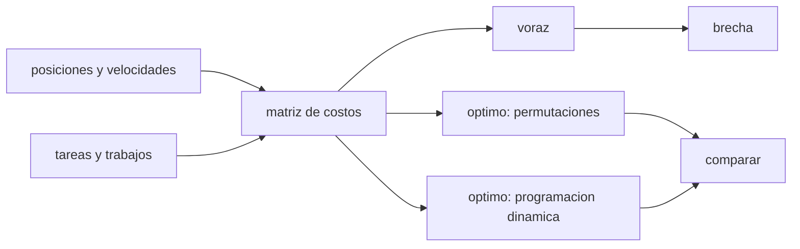

# B97-C09 — Robótica colaborativa

<!-- nav:top -->
[🏠 Programa](../../../../README.md) · [📚 Bloque B97](../../../tronco-comun/B97-robotica-y-construccion-extraterrestre.md) · [← Anterior: B97-C08 — Planificación de trayectorias robóticas](../B97-C08-planificacion-de-trayectorias-roboticas/CLASE.md) · [Siguiente: B97-C10 — Manipulación de herramientas →](../B97-C10-manipulacion-de-herramientas/CLASE.md)
<!-- /nav -->

## 1. Ubicación, nivel y alcance

Clase 9 del bloque B97. Nivel N3. Cuando varios robots comparten una obra o una exploración, alguien decide quién hace qué. Aquí resuelves el problema de asignación más simple, uno a uno, con costos de tiempo de viaje más trabajo; comparas una regla voraz con el óptimo exacto calculado de dos maneras independientes y mides la brecha en 300 instancias sintéticas. Todos los datos son **sintéticos**.

## 2. Por qué esta clase existe

Una regla simple de reparto es fácil de implementar a bordo, pero puede costar horas de trabajo de la flota; saber cuánto pierde frente al óptimo permite decidir si basta o hay que optimizar. La decisión central: **¿cuánto tiempo adicional cuesta repartir las tareas con una regla voraz en lugar de la asignación óptima?**

## 3. Lo que podrás hacer al terminar

1. Construir la matriz de costos de un reparto robot–tarea.
2. Resolver la asignación óptima por permutaciones y por programación dinámica.
3. Implementar la regla voraz y medir su brecha.
4. Interpretar la media y el peor caso de la brecha en muchas instancias.
5. Reconocer qué simplificaciones tiene el modelo (sin precedencias ni colisiones).
6. Separar lo sintético (todo el caso) de lo consultado (nada).

La evidencia es la **ficha de asignación de tareas de un equipo de robots** del ejercicio 12 (sección 20).

## 4. Con qué llegas y cómo comprobarlo

1. ¿Qué es una matriz y una permutación?
2. ¿Qué es una regla voraz?
3. ¿Qué es programación dinámica?
4. ¿Qué es un dato sintético?
5. ¿Qué es una segunda vía de cálculo?

<details>
<summary>Ver respuestas</summary>

1. Un arreglo de números; un reordenamiento de elementos. 2. Una regla que toma en cada paso la mejor opción local. 3. Resolver un problema reutilizando soluciones de subproblemas. 4. Un dato generado para el ejemplo, no medido. 5. Calcular lo mismo con otro método y comparar.
</details>

Con cuatro o cinco aciertos, sigue; si no, repasa los prerrequisitos.

## 5. Un caso de contexto y casos de referencia

Con 8 robots y 8 tareas, en la instancia 1 la regla voraz suma `2,446` h de trabajo total y el óptimo `2,236` h (brecha `0,094` en fracción). En 300 instancias, la brecha media del voraz es `0,0838` (en fracción) y la peor `0,327`. Es el **ejemplo conductor**; todo es sintético.

## 6. Vocabulario

Una **asignación** une cada robot con una tarea. El **costo** de un par es tiempo de viaje más trabajo. Una **regla voraz** asigna cada tarea al robot libre más barato. El **óptimo exacto** minimiza el costo total. La **brecha** es `(voraz − óptimo)/óptimo`.

## 7. Modelo mental



*Descripción textual:* la matriz de costos alimenta la regla voraz y dos métodos exactos independientes; la brecha mide lo que se pierde por usar la regla simple.

Analogía: repartir trabajos entre vecinos dando a cada uno lo más cercano a su casa; suele funcionar, pero a veces deja a otro con un viaje largo. Límite: aquí no hay tareas que dependan unas de otras ni robots que se estorben.

## 8. La explicación, paso a paso

### 8.1 Matriz de costos

`c(i, j) = dist(i, j)/vᵢ + wⱼ` en segundos. La asignación uno a uno elige una permutación de tareas que minimiza la suma.

### 8.2 Voraz y exacto

La regla voraz toma, en orden, cada tarea y le da el robot libre más barato. El óptimo se calcula por permutaciones (`8! = 40 320`) y por programación dinámica sobre subconjuntos (`2⁸ = 256` estados); ambos coinciden con diferencia máxima `9,09e-13` s en 20 instancias.

### 8.3 Brecha

En la instancia 1: voraz `8807,2` s, óptimo `8048,0` s. En las 300 instancias: brecha media `0,0838` (fracción), peor `0,327`, y el voraz es óptimo en `10` de ellas.

### 8.4 Qué no incluye

No hay precedencias, no hay carga de energía, no hay colisiones ni comunicación. El óptimo de la asignación uno a uno no es el de una misión con varias tareas por robot.

## 9. Magnitudes, símbolos y unidades

| Símbolo | Qué es | Unidad | Valor / nota |
|---|---|---|---|
| `c(i,j)` | costo robot–tarea | s | 300–900 + viaje |
| `vᵢ` | velocidad del robot | m/s | 0,05–0,15 (sintética) |
| `wⱼ` | trabajo de la tarea | s | 300–900 (sintético) |
| brecha | (voraz − óptimo)/óptimo | — | 0,0838 (media) |
| `N` | robots y tareas | — | 8 |

## 10. Convenciones y referencias

Área de 100 × 100 m, robots y tareas en posiciones aleatorias con semilla fija, asignación uno a uno, costo = viaje + trabajo. Todos los datos son sintéticos.

## 11. De dónde sale lo que afirmamos

| ID | Fuente | Localizador | Respalda | Estado |
|---|---|---|---|---|
| — | Relaciones estándar usadas en el laboratorio | — | las verifica el laboratorio con una segunda vía | No consultada en una fuente concreta |

Límites: no se consultó ninguna fuente para el caso, que es sintético; el problema no incluye precedencias, colisiones ni energía.

## 12. Cómo ver el resultado

| Magnitud | Valor |
|---|---|
| Voraz, instancia 1 | 2,446 h |
| Óptimo, instancia 1 | 2,236 h |
| Brecha media | 0,0838 (fracción) |
| Peor brecha | 0,327 (fracción) |
| Voraz óptimo en | 10 de 300 |

Descripción larga: la regla voraz suele quedar cerca del óptimo, pero en el peor caso pierde una fracción apreciable del tiempo total.

## 13. Ejemplo trabajado

**Paso 1 · Costo de un par.** Robot a `0,10 m/s`, `50 m` de la tarea y trabajo de `600 s`: `50/0,10 + 600 = 1100 s`.

**Paso 2 · Voraz.** Se asigna cada tarea al robot libre más barato.

**Paso 3 · Óptimo.** Dos métodos independientes dan el mismo valor: `8048,0` s en la instancia 1.

## 14. Distintas formas de describir el problema

**Por matriz:** costos `c(i,j)`. **Por permutación:** asignación completa. **Por subconjuntos:** programación dinámica. **Por brecha:** relativa. **Por instancias:** media y peor caso.

## 15. Práctica guiada

**Ejercicio 1 · con los pasos indicados.** Calcula el costo de un par con `v = 0,05 m/s`, `d = 20 m` y `w = 300 s`. *Pasos:* `d/v + w`.

<details><summary>Solución comentada</summary>

`400 + 300 = 700 s`.
</details>

**Ejercicio 2 · con una pista.** Predice si el voraz puede ser mejor que el óptimo. *Pista:* el óptimo es el mínimo.

<details><summary>Solución comentada</summary>

No: la brecha es siempre `≥ 0`.
</details>

**Ejercicio 3 · casi autónomo.** ¿Cuántas permutaciones hay para 10 robots?

<details><summary>Solución comentada</summary>

`10! = 3 628 800`.
</details>

## 16. Práctica autónoma, transferencia e integrador

**Ejercicio 4 · autónomo.** ¿Cuántos estados tiene la programación dinámica para 10 robots?

<details><summary>Solución comentada</summary>

`2¹⁰ = 1024`.
</details>

**Ejercicio 5 · autónomo.** ¿Por qué comprobar con dos métodos exactos?

<details><summary>Solución comentada</summary>

Porque cada uno puede tener un error de código; que coincidan da confianza.
</details>

**Ejercicio 6 · autónomo.** ¿Qué pasa con la brecha si todos los robots son iguales?

<details><summary>Solución comentada</summary>

Baja: el costo depende solo de la distancia y el voraz se acerca al óptimo.
</details>

**Ejercicio 7 · autónomo.** ¿Qué mide el peor caso que no mida la media?

<details><summary>Solución comentada</summary>

El riesgo de una instancia desfavorable.
</details>

**Ejercicio 8 · autónomo.** Si añades un robot, ¿cómo cambia la matriz?

<details><summary>Solución comentada</summary>

Pasa a ser rectangular: hay más robots que tareas y se elige un subconjunto.
</details>

**Ejercicio 9 · transferencia.** Dos robots necesitan la misma zona a la vez. ¿Qué no cubre el modelo? **Transferencia.**

<details><summary>Solución comentada</summary>

Colisiones y coordinación de espacio: se necesitan reglas de prioridad.
</details>

**Ejercicio 10 · transferencia.** Una tarea necesita terminar antes que otra. ¿Cómo se modela? **Transferencia.**

<details><summary>Solución comentada</summary>

Con precedencias, y el problema pasa a ser de planificación (ver C13).
</details>

**Ejercicio 11 · transferencia.** ¿Cómo usarías la brecha para decidir si implementar un optimizador a bordo? **Transferencia.**

<details><summary>Solución comentada</summary>

Si la media es pequeña y el peor caso tolerable, la regla simple basta; si no, el óptimo compensa.
</details>

**Ejercicio 12 · integrador.** Elabora tu *ficha de asignación de tareas de un equipo de robots*: costos, óptimo, voraz, brecha media y peor caso, con todo rotulado como sintético. **Integrador.**

<details><summary>Solución comentada</summary>

Secciones 8.1–8.4 y la salida del laboratorio.
</details>

## 17. Laboratorio

El script [asignacion_tareas.py](asignacion_tareas.py) genera 300 instancias, resuelve la asignación con la regla voraz y con dos métodos exactos independientes y mide la brecha (**comprueba** diferencia entre exactos < 1e-9 y brecha no negativa).

**Datos:** **sintéticos** (posiciones, velocidades, trabajos y semilla); no se usa ningún dato publicado. **Predice antes de ejecutar:** ¿Será la brecha media del voraz mayor del 10 %? (Ver el laboratorio.) **Ejecución del 2026-11-10 (Python 3.12.9):**

```text
Python 3.12.9 (biblioteca estandar)
Datos SINTETICOS: 8 robots y 8 tareas; 300 instancias; semilla 20261110
Instancia 1: voraz = 8807.2 s (2.446 h); optimo = 8048.0 s (2.236 h); brecha = 9.43 %
Brecha media del voraz = 8.38 %; peor caso = 32.72 %; instancias en que el voraz es optimo = 10 de 300 (3.3 %)
Diferencia maxima entre permutaciones y programacion dinamica (20 instancias) = 9.09e-13 s
Pruebas superadas.
```

```bash
python programa/clases/B97/B97-C09-robotica-colaborativa/asignacion_tareas.py
```

**Límites:** asignación uno a uno sin precedencias, energía, colisiones ni comunicación; las instancias son aleatorias, no tareas reales.

## 18. Errores frecuentes y cómo corregirlos

**Creer que el voraz es óptimo.** Tiene brecha (8.3)

**Fiarse de un solo método exacto.** Se contrasta con otro (8.2)

**Evaluar con una sola instancia.** Se usan muchas (8.3)

**Presentar las instancias como reales.** Son sintéticas; ver la sección 10

## 19. Cómo sabrás que vas bien

Tras la sección 8: ¿qué brecha media esperabas y cuál obtuviste? Si dudas, repasa el ejemplo 13. Tras el laboratorio: ¿qué comprueba? (ver la sección 17).

## 20. Qué entregas y cómo se evalúa

El producto es tu **ficha de asignación de tareas de un equipo de robots** (ejercicio 12).

| Criterio | Inicial | En desarrollo | Logrado | Destacado |
|---|---|---|---|---|
| Conceptos | Los confunde | Parciales | Explica el modelo y sus supuestos | Explica los límites |
| Cálculo | Sin unidades | Con errores | Tablas completas con unidades | Calcula casos nuevos |
| Numérico | Sin comprobar | Un caso | Contraste con una segunda vía | Interpreta las diferencias |
| Fuentes | Sin fuente | Sin fecha | Fuentes con fecha y estado | Declara lo ilustrativo y lo no consultado |
| Límites | No los nombra | Uno | Tres | Discute qué falta del modelo |

**Condiciones críticas (no se compensan con promedio):** rotular los datos sintéticos e ilustrativos; no presentar un resultado simulado como observado o medido; citar solo lo consultado.

## 21. Ética, seguridad y límites

Clase educativa: los modelos son simplificados y sus datos son sintéticos o ilustrativos; ningún resultado describe una misión real, certifica un diseño ni sustituye a las normas aplicables ni a las pruebas de hardware.  Accesibilidad: tablas equivalentes a las gráficas, fórmulas en texto, ejercicios sin conexión.

## 22. Para cerrar y seguir

La regla voraz tuvo una brecha media de `0,084` (en fracción) y una peor de `0,327` en 300 instancias sintéticas. Queda una pregunta: ¿qué fuerza necesita un robot para sujetar una herramienta en cada gravedad?

**Glosario español–inglés.** asignación · *assignment*; regla voraz · *greedy rule*; programación dinámica · *dynamic programming*; brecha · *gap*; óptimo · *optimum*.

**Continuidad.** [B97-C10](../B97-C10-manipulacion-de-herramientas/CLASE.md) estudia la manipulación de herramientas.

**Referencias:** ver sección 11.

<!-- nav:bottom -->
---

[← Anterior: B97-C08 — Planificación de trayectorias robóticas](../B97-C08-planificacion-de-trayectorias-roboticas/CLASE.md) · [📚 Bloque B97](../../../tronco-comun/B97-robotica-y-construccion-extraterrestre.md) · [Siguiente: B97-C10 — Manipulación de herramientas →](../B97-C10-manipulacion-de-herramientas/CLASE.md)
<!-- /nav -->
