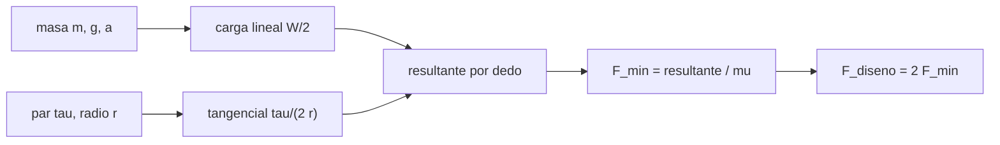

# B97-C10 — Manipulación de herramientas

<!-- nav:top -->
[🏠 Programa](../../../../README.md) · [📚 Bloque B97](../../../tronco-comun/B97-robotica-y-construccion-extraterrestre.md) · [← Anterior: B97-C09 — Robótica colaborativa](../B97-C09-robotica-colaborativa/CLASE.md) · [Siguiente: B97-C11 — Robots de inspección orbital →](../B97-C11-robots-de-inspeccion-orbital/CLASE.md)
<!-- /nav -->

## 1. Ubicación, nivel y alcance

Clase 10 del bloque B97. Nivel N3. Para que un robot use una herramienta debe sujetarla sin que resbale, y la fuerza de agarre depende del peso, de la aceleración del brazo y del par que la herramienta transmite al apretar un tornillo. Aquí calculas la fuerza mínima con fricción de Coulomb en cuatro entornos (Tierra, Marte, Luna y órbita) y descubres que, en muchos casos, el par de reacción domina sobre el peso. La herramienta es **ilustrativa**.

## 2. Por qué esta clase existe

Un agarre insuficiente deja caer o gira la herramienta; uno excesivo daña el mango. Saber qué carga domina evita diseñar el agarre solo con el peso, error frecuente cuando se reduce la gravedad. La decisión central: **¿qué fuerza de agarre hace falta en cada entorno, y qué carga la domina: el peso o el par de reacción?**

## 3. Lo que podrás hacer al terminar

1. Calcular la carga lineal por dedo a partir de la masa, la gravedad y la aceleración.
2. Calcular la carga tangencial por dedo debida al par de reacción.
3. Calcular la fuerza de agarre mínima con el cono de fricción.
4. Verificar la fuerza mínima por bisección.
5. Comparar la fuerza con y sin par de reacción en cuatro entornos.
6. Separar lo consultado (gravedades) de lo ilustrativo (herramienta, fricción y par).

La evidencia es la **ficha de fuerza de agarre de una herramienta** del ejercicio 12 (sección 20).

## 4. Con qué llegas y cómo comprobarlo

1. ¿Qué es el coeficiente de fricción?
2. ¿Qué es un par (o momento) y en qué unidades se mide?
3. ¿Qué es una fuerza normal?
4. ¿Qué es un dato ilustrativo?
5. ¿Qué es una segunda vía de cálculo?

<details>
<summary>Ver respuestas</summary>

1. La razón entre la fuerza de fricción máxima y la fuerza normal. 2. El efecto de giro de una fuerza, en N·m. 3. La fuerza perpendicular a la superficie de contacto. 4. Un dato inventado de forma verosímil para el ejemplo, no medido. 5. Calcular lo mismo con otro método y comparar.
</details>

Con cuatro o cinco aciertos, sigue; si no, repasa los prerrequisitos.

## 5. Un caso de contexto y casos de referencia

Una herramienta de `2 kg` con fricción `0,5`, agarrada por dos dedos a `0,02 m` del eje, transmite un par de `2 N·m`. La fuerza mínima de agarre es `102,11` N en la Tierra, `100,36` N en Marte, `100,09` N en la Luna y `100,00` N en órbita: casi igual en todas porque domina el par. Es el **ejemplo conductor**.

## 6. Vocabulario

La **fricción de Coulomb** limita la fuerza tangencial a `μ N`. El **par de reacción** es el momento que la herramienta devuelve al agarre. La **carga lineal** es el peso más la inercia. La **fuerza mínima de agarre** es la que hace que cada dedo no resbale. El **factor de seguridad** multiplica la fuerza mínima para el diseño.

## 7. Modelo mental



*Descripción textual:* el peso y el par dan una resultante por dedo; dividida por la fricción da la fuerza mínima, que se multiplica por el factor de seguridad.

Analogía: sujetar un destornillador mientras aprietas un tornillo; cuesta más evitar que gire que sostener su peso. Límite: el contacto es puntual con fricción de Coulomb y sin deformación.

## 8. La explicación, paso a paso

### 8.1 Cargas por dedo

`W = m (g + a)`. En la Tierra `W = 20,64` N y en la Luna `4,24` N. Cada dedo soporta `W/2` y, por el par, `τ/(2r) = 50,0` N en dirección tangencial.

### 8.2 Fuerza mínima

La resultante por dedo es `hypot(W/2, τ/(2r))`; la fuerza mínima es esa resultante entre `μ`: `102,11` N (Tierra), `100,36` N (Marte), `100,09` N (Luna), `100,00` N (órbita). Con factor de seguridad 2, en la Tierra, `204,22` N.

### 8.3 Qué domina

Sin par, la fuerza sería `20,64` N en la Tierra, `4,24` N en la Luna y `1,00` N en órbita: el peso sí importa. Con el par de `2 N·m`, el término tangencial domina y la razón Luna/Tierra es `0,980`: bajar la gravedad ahorra poco agarre.

### 8.4 Segunda vía

La bisección sobre `F` con el criterio de fricción coincide con la fórmula con diferencia `0,00e+00` N. Es una verificación del código; no incluye deformación del mango ni dinámica del contacto.

## 9. Magnitudes, símbolos y unidades

| Símbolo | Qué es | Unidad | Valor / nota |
|---|---|---|---|
| `m` | masa de la herramienta | kg | 2,0 (ilustrativa) |
| `μ` | coeficiente de fricción | — | 0,5 (ilustrativo) |
| `τ` | par de reacción | N·m | 2,0 (ilustrativo) |
| `r` | radio de agarre | m | 0,02 (ilustrativo) |
| `F_min` | fuerza mínima de agarre | N | 102,11 (Tierra) |

## 10. Convenciones y referencias

Dos dedos, contacto puntual con fricción de Coulomb, aceleración de 0,5 m/s² en la dirección de la gravedad; la órbita se idealiza con `g = 0`. Gravedades de las fichas NASA/NSSDC; resto ilustrativo.

## 11. De dónde sale lo que afirmamos

| ID | Fuente | Localizador | Respalda | Estado |
|---|---|---|---|---|
| S1 | NASA/NSSDC, Moon Fact Sheet — https://nssdc.gsfc.nasa.gov/planetary/factsheet/moonfact.html (consultada 2026-11-10) | ficha completa leída | gravedad media 1,62 m/s²; radio medio 1737,4 km; distancia media a la Tierra 384,4 × 10³ km; rango diurno ecuatorial 95–390 K | Consultada |
| S2 | NASA/NSSDC, Mars Fact Sheet — https://nssdc.gsfc.nasa.gov/planetary/factsheet/marsfact.html (consultada 2026-11-10) | ficha completa leída | gravedad media 3,73 m/s²; radio medio 3389,5 km; distancia a la Tierra de 54,6 a 401,4 × 10⁶ km; presión 4,0–8,7 mb | Consultada |
| S3 | NASA/NSSDC, Earth Fact Sheet — https://nssdc.gsfc.nasa.gov/planetary/factsheet/earthfact.html (consultada 2026-11-10) | ficha completa leída | gravedad media 9,820 m/s²; radio medio 6371,0 km | Consultada |
| — | Relaciones estándar usadas en el laboratorio | — | las verifica el laboratorio con una segunda vía | No consultada en una fuente concreta |

Límites: la herramienta, la fricción, el par y la aceleración no se consultaron; la microgravedad orbital se idealiza como `g = 0`.

## 12. Cómo ver el resultado

| Magnitud | Valor |
|---|---|
| `F_min` Tierra | 102,11 N |
| `F_min` Marte | 100,36 N |
| `F_min` Luna | 100,09 N |
| `F_min` órbita | 100,00 N |
| Sin par, Tierra | 20,64 N |

Descripción larga: con un par de reacción de 2 N·m el agarre casi no depende de la gravedad; sin ese par, la fuerza mínima caería con ella.

## 13. Ejemplo trabajado

**Paso 1 · Carga lineal.** `W = 2 × (3,73 + 0,5) = 8,46` N en Marte; `W/2 = 4,23` N.

**Paso 2 · Tangencial.** `τ/(2r) = 2/0,04 = 50` N.

**Paso 3 · Resultante.** `√(4,23² + 50²) = 50,18` N.

**Paso 4 · Fuerza mínima.** `50,18/0,5 = 100,36` N.

## 14. Distintas formas de describir el problema

**Por peso:** `W`. **Por par:** `τ/(2r)`. **Por resultante:** hipotenusa. **Por fricción:** `μ`. **Por diseño:** `F_min × FS`.

## 15. Práctica guiada

**Ejercicio 1 · con los pasos indicados.** Calcula `W/2` en la Luna con `a = 0,5`. *Pasos:* `m(g + a)/2`.

<details><summary>Solución comentada</summary>

`2 × 2,12/2 = 2,12` N.
</details>

**Ejercicio 2 · con una pista.** Predice qué carga domina con `τ = 2 N·m`. *Pista:* compara 50 N con el peso.

<details><summary>Solución comentada</summary>

El par: 50 N tangenciales por dedo frente a 10,3 N de carga lineal en la Tierra.
</details>

**Ejercicio 3 · casi autónomo.** ¿Cuánto vale la fuerza mínima sin par en órbita?

<details><summary>Solución comentada</summary>

`1,00` N.
</details>

## 16. Práctica autónoma, transferencia e integrador

**Ejercicio 4 · autónomo.** ¿Qué pasa con `F_min` si `μ` baja a 0,25?

<details><summary>Solución comentada</summary>

Se duplica: `F ∝ 1/μ`.
</details>

**Ejercicio 5 · autónomo.** ¿Qué par hace que el peso de la Tierra domine?

<details><summary>Solución comentada</summary>

Cuando `τ/(2r)` iguala a `W/2`, es decir `τ = W r = 20,64 × 0,02 = 0,41 N·m` en la Tierra; con menos par, el peso domina.
</details>

**Ejercicio 6 · autónomo.** Calcula `F_diseno` en la Luna.

<details><summary>Solución comentada</summary>

`2 × 100,09` N.
</details>

**Ejercicio 7 · autónomo.** ¿Qué sucede si el radio de agarre se duplica a 0,04 m?

<details><summary>Solución comentada</summary>

`τ/(2r)` baja a 25 N y `F_min` casi se reduce a la mitad.
</details>

**Ejercicio 8 · autónomo.** ¿Por qué la aceleración del brazo importa en órbita?

<details><summary>Solución comentada</summary>

Es la única carga lineal: `W = m a`.
</details>

**Ejercicio 9 · transferencia.** Una herramienta se desliza en el regolito polvoriento. ¿Qué parámetro cambia? **Transferencia.**

<details><summary>Solución comentada</summary>

Baja `μ`: la fuerza mínima sube.
</details>

**Ejercicio 10 · transferencia.** El tornillo se aprieta más y el par sube a 5 N·m. ¿Qué haces? **Transferencia.**

<details><summary>Solución comentada</summary>

Recalcular: `F_min` casi se multiplica por 2,5; si el agarre no llega, se necesita un tope o un efector específico.
</details>

**Ejercicio 11 · transferencia.** ¿Qué falta para usar el resultado en un diseño real? **Transferencia.**

<details><summary>Solución comentada</summary>

Fricción medida con el material y la contaminación, deformación del mango y dinámica del contacto.
</details>

**Ejercicio 12 · integrador.** Elabora tu *ficha de fuerza de agarre de una herramienta*: tabla de cargas y fuerzas mínimas en los cuatro entornos, con y sin par, y los supuestos rotulados. **Integrador.**

<details><summary>Solución comentada</summary>

Secciones 8.1–8.4 y la salida del laboratorio.
</details>

## 17. Laboratorio

El script [agarre_herramienta.py](agarre_herramienta.py) calcula la fuerza mínima de agarre en cuatro entornos, con y sin par de reacción, y la contrasta con una bisección (**comprueba** diferencia < 1e-9 N y que la fuerza en la Luna sea menor que en la Tierra).

**Datos:** gravedades (NASA/NSSDC, consultadas); herramienta, fricción, par, radio y aceleración **ilustrativos**. **Predice antes de ejecutar:** ¿Será la fuerza de agarre en la Luna mucho menor que en la Tierra? (No: domina el par.) **Ejecución del 2026-11-10 (Python 3.12.9):**

```text
Python 3.12.9 (biblioteca estandar)
Herramienta ILUSTRATIVA: m = 2.0 kg, mu = 0.5, r = 0.02 m, par = 2.0 N m, a = 0.5 m/s2, factor de seguridad 2.0
 entorno   g [m/s2]  W [N]   carga/dedo [N]  tangencial/dedo [N]  F_min [N]  F_diseno [N]
Tierra      9.820  20.640          10.320              50.000    102.108      204.216
Marte       3.730   8.460           4.230              50.000    100.357      200.714
Luna        1.620   4.240           2.120              50.000    100.090      200.180
Orbita      0.000   1.000           0.500              50.000    100.005      200.010
F_min sin par de reaccion: Tierra 20.640 N; Marte 8.460 N; Luna 4.240 N; Orbita 1.000 N
Diferencia maxima formula frente a biseccion = 0.00e+00 N
Pruebas superadas.
```

```bash
python programa/clases/B97/B97-C10-manipulacion-de-herramientas/agarre_herramienta.py
```

**Límites:** fricción de Coulomb con contacto puntual, sin deformación ni dinámica; la órbita se idealiza con `g = 0`.

## 18. Errores frecuentes y cómo corregirlos

**Diseñar el agarre solo con el peso.** El par puede dominar (8.3)

**Creer que menos gravedad es menos fuerza.** Depende de la carga dominante (8.3)

**Usar el valor de `μ` de la Tierra en regolito.** El polvo la cambia

**Presentar la herramienta como real.** Es ilustrativa; ver la sección 10

## 19. Cómo sabrás que vas bien

Tras la sección 8: ¿qué carga esperabas que dominara y qué obtuviste? Si dudas, repasa el ejemplo 13. Tras el laboratorio: ¿qué comprueba? (ver la sección 17).

## 20. Qué entregas y cómo se evalúa

El producto es tu **ficha de fuerza de agarre de una herramienta** (ejercicio 12).

| Criterio | Inicial | En desarrollo | Logrado | Destacado |
|---|---|---|---|---|
| Conceptos | Los confunde | Parciales | Explica el modelo y sus supuestos | Explica los límites |
| Cálculo | Sin unidades | Con errores | Tablas completas con unidades | Calcula casos nuevos |
| Numérico | Sin comprobar | Un caso | Contraste con una segunda vía | Interpreta las diferencias |
| Fuentes | Sin fuente | Sin fecha | Fuentes con fecha y estado | Declara lo ilustrativo y lo no consultado |
| Límites | No los nombra | Uno | Tres | Discute qué falta del modelo |

**Condiciones críticas (no se compensan con promedio):** rotular los datos sintéticos e ilustrativos; no presentar un resultado simulado como observado o medido; citar solo lo consultado.

## 21. Ética, seguridad y límites

Clase educativa: los modelos son simplificados y sus datos son sintéticos o ilustrativos; ningún resultado describe una misión real, certifica un diseño ni sustituye a las normas aplicables ni a las pruebas de hardware.  Accesibilidad: tablas equivalentes a las gráficas, fórmulas en texto, ejercicios sin conexión.

## 22. Para cerrar y seguir

La fuerza mínima va de `100,0` N (órbita) a `102,1` N (Tierra): casi no depende de la gravedad porque domina el par. Queda una pregunta: ¿cómo se inspecciona otra nave en órbita sin chocar con ella?

**Glosario español–inglés.** fricción de Coulomb · *Coulomb friction*; par de reacción · *reaction torque*; fuerza de agarre · *grip force*; factor de seguridad · *safety factor*; efector final · *end effector*.

**Continuidad.** [B97-C11](../B97-C11-robots-de-inspeccion-orbital/CLASE.md) estudia los robots de inspección orbital.

**Referencias:** ver sección 11.

<!-- nav:bottom -->
---

[← Anterior: B97-C09 — Robótica colaborativa](../B97-C09-robotica-colaborativa/CLASE.md) · [📚 Bloque B97](../../../tronco-comun/B97-robotica-y-construccion-extraterrestre.md) · [Siguiente: B97-C11 — Robots de inspección orbital →](../B97-C11-robots-de-inspeccion-orbital/CLASE.md)
<!-- /nav -->
