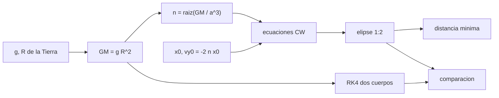

# B97-C11 — Robots de inspección orbital

<!-- nav:top -->
[🏠 Programa](../../../../README.md) · [📚 Bloque B97](../../../tronco-comun/B97-robotica-y-construccion-extraterrestre.md) · [← Anterior: B97-C10 — Manipulación de herramientas](../B97-C10-manipulacion-de-herramientas/CLASE.md) · [Siguiente: B97-C12 — Robots de mantenimiento →](../B97-C12-robots-de-mantenimiento/CLASE.md)
<!-- /nav -->

## 1. Ubicación, nivel y alcance

Clase 11 del bloque B97. Nivel N3. Inspeccionar otra nave desde un robot orbital exige moverse cerca de ella sin chocar y sin gastar combustible. Las ecuaciones de Clohessy–Wiltshire describen el movimiento relativo cerca de una órbita circular; con la condición adecuada, el robot recorre una elipse fija alrededor del objetivo sin empuje. Aquí la calculas y la verificas integrando numéricamente el problema de dos cuerpos. La órbita y la elipse son **ilustrativas**.

## 2. Por qué esta clase existe

Una inspección segura se diseña de modo que, si falla el empuje, el robot no se acerque ni se aleje: la elipse sin deriva lo garantiza. Con una condición inicial mal elegida, el robot se aleja decenas de veces la distancia deseada en una órbita. La decisión central: **¿qué velocidad inicial relativa evita la deriva, y cuánto se acerca el robot al objetivo durante la inspección?**

## 3. Lo que podrás hacer al terminar

1. Calcular el movimiento medio `n` de una órbita circular a partir de `GM` y el radio.
2. Escribir la solución de Clohessy–Wiltshire para movimiento libre.
3. Aplicar la condición sin deriva `v_y = −2 n x` y obtener la elipse 1:2.
4. Calcular la velocidad relativa máxima y la distancia mínima de la inspección.
5. Verificar la solución con una integración RK4 de dos cuerpos.
6. Separar lo consultado (gravedad y radio de la Tierra) de lo ilustrativo (altitud y elipse).

La evidencia es la **ficha de una órbita relativa de inspección** del ejercicio 12 (sección 20).

## 4. Con qué llegas y cómo comprobarlo

1. ¿Qué es una órbita circular y qué es su movimiento medio?
2. ¿Qué es un sistema de referencia local (radial, a lo largo de la traza)?
3. ¿Qué es una integración numérica?
4. ¿Qué es un dato ilustrativo?
5. ¿Qué es una segunda vía de cálculo?

<details>
<summary>Ver respuestas</summary>

1. Una órbita de radio constante; el movimiento medio es la velocidad angular `n = √(GM/a³)`. 2. Un sistema que gira con el objetivo: `x` hacia fuera, `y` en el sentido del movimiento. 3. Calcular la trayectoria por pasos pequeños. 4. Un dato inventado de forma verosímil para el ejemplo, no medido. 5. Calcular lo mismo con otro método y comparar.
</details>

Con cuatro o cinco aciertos, sigue; si no, repasa los prerrequisitos.

## 5. Un caso de contexto y casos de referencia

Un objetivo ilustrativo a `400 km` de altitud tiene `n = 1,1331e-03` rad/s y periodo `92,42` min. Un robot a `100 m` radiales con `v_y = -0,22663` m/s recorre una elipse de `100 × 200 m` sin empuje; su velocidad relativa máxima es `0,2266` m/s y su distancia mínima al objetivo es `100,00` m. Es el **ejemplo conductor**.

## 6. Vocabulario

El **movimiento relativo** es la posición del robot respecto del objetivo. Las **ecuaciones de Clohessy–Wiltshire (CW)** lo describen linealizado alrededor de una órbita circular. La **condición sin deriva** es `v_y = −2 n x`. El **sistema local (LVLH)** tiene `x` radial hacia fuera e `y` a lo largo de la traza. La **órbita de inspección** es la elipse relativa cerrada.

## 7. Modelo mental



*Descripción textual:* de `GM` y la altitud sale `n`; la solución CW con la condición sin deriva da una elipse cerrada; la integración RK4 la verifica.

Analogía: dos patinadores en un óvalo de hielo, uno inmóvil en el centro, otro describiendo una elipse a su alrededor sin esfuerzo. Límite: la linealización vale para distancias pequeñas frente al radio orbital.

## 8. La explicación, paso a paso

### 8.1 Movimiento medio

`GM = g R² = 398590274620000,0000` m³/s² (derivado de la ficha, aproximado); `a = 6771,0` km; `n = √(GM/a³) = 1,1331e-03` rad/s y el periodo es `92,42` min.

### 8.2 Solución CW sin deriva

Con `x₀ = 100 m`, `vₓ₀ = 0` y `v_y0 = −2 n x₀ = -0,22663` m/s: `x(t) = x₀ cos nt`, `y(t) = y₀ − 2 x₀ sin nt`. La elipse tiene semiejes `100 m` (radial) y `200 m` (traza). La velocidad máxima es `2 n x₀ = 0,2266` m/s.

### 8.3 Distancia mínima

La distancia mínima al objetivo es el semieje menor, `100,00` m. Sin la condición `v_y = −2 n x₀`, el término secular `6(sin nt − nt) x₀` produciría una deriva de `3770` m a lo largo de la traza tras una órbita.

### 8.4 Segunda vía

Con RK4 de dos cuerpos (paso `1 s`, `5545` pasos), la amplitud radial es `100,00` m y la de traza `200,01` m; el cierre tras una órbita es `0,003` m y la diferencia máxima con CW es `0,014` m. CW es una linealización: las diferencias crecen con el tamaño de la elipse.

## 9. Magnitudes, símbolos y unidades

| Símbolo | Qué es | Unidad | Valor / nota |
|---|---|---|---|
| `GM` | parámetro gravitacional | m³/s² | 398590274620000,0000 (derivado) |
| `n` | movimiento medio | rad/s | 1,1331e-03 |
| `x₀` | separación radial inicial | m | 100 (ilustrativa) |
| `v_y0` | velocidad relativa de traza | m/s | -0,22663 |
| `T` | periodo | min | 92,42 |

## 10. Convenciones y referencias

Sistema local con `x` radial hacia fuera e `y` a lo largo de la traza, objetivo en órbita circular a 400 km, sin perturbaciones ni empuje; la integración es en un sistema inercial centrado en la Tierra. Gravedad y radio de la ficha NASA/NSSDC; altitud y elipse ilustrativas.

## 11. De dónde sale lo que afirmamos

| ID | Fuente | Localizador | Respalda | Estado |
|---|---|---|---|---|
| S1 | NASA/NSSDC, Earth Fact Sheet — https://nssdc.gsfc.nasa.gov/planetary/factsheet/earthfact.html (consultada 2026-11-10) | ficha completa leída | gravedad media 9,820 m/s²; radio medio 6371,0 km | Consultada |
| — | Relaciones estándar usadas en el laboratorio | — | las verifica el laboratorio con una segunda vía | No consultada en una fuente concreta |

Límites: la altitud y la elipse no se consultaron; `GM` se deriva de `g R²` (el valor publicado no se consultó); no se modelan resistencia atmosférica, achatamiento ni empuje.

## 12. Cómo ver el resultado

| Magnitud | Valor |
|---|---|
| `n` | 1,1331e-03 rad/s |
| Periodo | 92,42 min |
| Velocidad relativa máx. | 0,2266 m/s |
| Distancia mínima | 100,00 m |
| Diferencia RK4–CW | 0,014 m |

Descripción larga: el robot recorre una elipse de 100 × 200 m en una órbita sin empuje; la diferencia con la integración numérica es pequeña frente al tamaño de la elipse.

## 13. Ejemplo trabajado

**Paso 1 · Movimiento medio.** `n = 1,1331e-03` rad/s.

**Paso 2 · Velocidad inicial.** `v_y0 = −2 × 1,1331e-03 × 100 = -0,22663` m/s.

**Paso 3 · Elipse.** `x = 100 cos nt`, `y = −200 sin nt`.

**Paso 4 · Seguridad.** Distancia mínima `100 m`; velocidad máxima `0,2266` m/s.

## 14. Distintas formas de describir el problema

**Por ecuaciones:** CW. **Por geometría:** elipse 1:2. **Por velocidad:** `2 n x₀`. **Por seguridad:** distancia mínima. **Por verificación:** RK4.

## 15. Práctica guiada

**Ejercicio 1 · con los pasos indicados.** Calcula `n` para `a = 6771 km` con `GM = 3,986 × 10¹⁴`. *Pasos:* `√(GM/a³)`.

<details><summary>Solución comentada</summary>

`n ≈ 1,1331e-03` rad/s.
</details>

**Ejercicio 2 · con una pista.** Predice la amplitud en la traza de la elipse sin deriva. *Pista:* el doble de la radial.

<details><summary>Solución comentada</summary>

`200 m`.
</details>

**Ejercicio 3 · casi autónomo.** ¿Qué velocidad `v_y0` hace falta para `x₀ = 50 m`?

<details><summary>Solución comentada</summary>

`−2 n × 50`, la mitad de -0,22663 m/s en valor absoluto, es decir `−0,11332 m/s`.
</details>

## 16. Práctica autónoma, transferencia e integrador

**Ejercicio 4 · autónomo.** ¿Qué distancia mínima tiene una elipse con `x₀ = 50 m`?

<details><summary>Solución comentada</summary>

`50 m`.
</details>

**Ejercicio 5 · autónomo.** ¿Cuánto vale la velocidad máxima para `x₀ = 50 m`?

<details><summary>Solución comentada</summary>

`2 n x₀`, mitad de 0,2266 m/s.
</details>

**Ejercicio 6 · autónomo.** ¿Por qué crece la deriva con el tiempo si no se cumple la condición?

<details><summary>Solución comentada</summary>

Por el término secular `6 n t x₀`.
</details>

**Ejercicio 7 · autónomo.** ¿Cuándo falla la linealización?

<details><summary>Solución comentada</summary>

Cuando la distancia no es pequeña frente a `a`.
</details>

**Ejercicio 8 · autónomo.** ¿Qué pasa con el periodo de la elipse?

<details><summary>Solución comentada</summary>

Es el mismo que el de la órbita del objetivo, `92,42 min`.
</details>

**Ejercicio 9 · transferencia.** El empuje del robot falla en el punto más cercano. ¿Qué ocurre si estaba en la elipse sin deriva? **Transferencia.**

<details><summary>Solución comentada</summary>

Sigue en la elipse, sin acercarse más: es una trayectoria pasivamente segura.
</details>

**Ejercicio 10 · transferencia.** Hay una perturbación que rompe la condición. ¿Qué haces? **Transferencia.**

<details><summary>Solución comentada</summary>

Ejecutar una maniobra de corrección y monitorear la deriva con la telemetría.
</details>

**Ejercicio 11 · transferencia.** ¿Qué falta para usar el resultado en una misión real? **Transferencia.**

<details><summary>Solución comentada</summary>

Perturbaciones (arrastre, J2), navegación relativa, restricciones de iluminación y la validación por el equipo de dinámica de vuelo.
</details>

**Ejercicio 12 · integrador.** Elabora tu *ficha de una órbita relativa de inspección*: `n`, elipse, velocidades, distancia mínima y la comparación con RK4, con lo consultado y lo ilustrativo rotulados. **Integrador.**

<details><summary>Solución comentada</summary>

Secciones 8.1–8.4 y la salida del laboratorio.
</details>

## 17. Laboratorio

El script [orbita_inspeccion.py](orbita_inspeccion.py) calcula la elipse de inspección con Clohessy–Wiltshire y la verifica integrando con RK4 las dos naves (**comprueba** diferencia máxima < 0,5 m y distancia mínima cercana a 100 m).

**Datos:** gravedad y radio de la Tierra (NASA/NSSDC, consultados); altitud, elipse y paso **ilustrativos**. **Predice antes de ejecutar:** ¿Qué distancia mínima al objetivo tiene la elipse? (El semieje menor, 100 m.) **Ejecución del 2026-11-10 (Python 3.12.9):**

```text
Python 3.12.9 (biblioteca estandar)
GM = g R^2 = 3.9859e+14 m3/s2 (derivado); objetivo ILUSTRATIVO a 400 km: n = 1.133141e-03 rad/s; periodo = 92.42 min
Elipse de inspeccion: x0 = 100.0 m, vy0 = -0.22663 m/s (condicion sin deriva); velocidad relativa maxima = 0.2266 m/s
Integracion RK4 (5545 pasos de 1 s): amplitud radial = 100.00 m; amplitud a lo largo de la traza = 200.01 m; distancia minima al objetivo = 100.00 m
Cierre tras una orbita = 0.003 m; diferencia maxima RK4 frente a CW = 0.014 m
Sin la condicion vy0 = -2 n x0, la deriva en una orbita seria 3770 m a lo largo de la traza
Pruebas superadas.
```

```bash
python programa/clases/B97/B97-C11-robots-de-inspeccion-orbital/orbita_inspeccion.py
```

**Límites:** gravedad puntual sin perturbaciones, objetivo en órbita circular y linealización de CW; `GM` derivado de `g R²`.

## 18. Errores frecuentes y cómo corregirlos

**Dar una velocidad inicial arbitraria.** Produce deriva secular (8.3)

**Usar CW con distancias grandes.** Falla la linealización (8.4)

**Olvidar que `GM` es derivado.** Es aproximado (8.1)

**Presentar la elipse como una misión real.** Es ilustrativa; ver la sección 10

## 19. Cómo sabrás que vas bien

Tras la sección 8: ¿qué distancia mínima esperabas y cuál obtuviste? Si dudas, repasa el ejemplo 13. Tras el laboratorio: ¿qué comprueba? (ver la sección 17).

## 20. Qué entregas y cómo se evalúa

El producto es tu **ficha de una órbita relativa de inspección** (ejercicio 12).

| Criterio | Inicial | En desarrollo | Logrado | Destacado |
|---|---|---|---|---|
| Conceptos | Los confunde | Parciales | Explica el modelo y sus supuestos | Explica los límites |
| Cálculo | Sin unidades | Con errores | Tablas completas con unidades | Calcula casos nuevos |
| Numérico | Sin comprobar | Un caso | Contraste con una segunda vía | Interpreta las diferencias |
| Fuentes | Sin fuente | Sin fecha | Fuentes con fecha y estado | Declara lo ilustrativo y lo no consultado |
| Límites | No los nombra | Uno | Tres | Discute qué falta del modelo |

**Condiciones críticas (no se compensan con promedio):** rotular los datos sintéticos e ilustrativos; no presentar un resultado simulado como observado o medido; citar solo lo consultado.

## 21. Ética, seguridad y límites

Clase educativa: los modelos son simplificados y sus datos son sintéticos o ilustrativos; ningún resultado describe una misión real, certifica un diseño ni sustituye a las normas aplicables ni a las pruebas de hardware.  Accesibilidad: tablas equivalentes a las gráficas, fórmulas en texto, ejercicios sin conexión.

## 22. Para cerrar y seguir

Con `v_y0 = −2 n x₀` el robot recorre una elipse de `100 × 200 m` y no se acerca a menos de `100` m. Queda una pregunta: ¿cómo se reemplazan las piezas que fallan en una nave o una base?

**Glosario español–inglés.** movimiento relativo · *relative motion*; sin deriva · *drift-free*; sistema local · *local frame (LVLH)*; órbita de inspección · *inspection orbit*; movimiento medio · *mean motion*.

**Continuidad.** [B97-C12](../B97-C12-robots-de-mantenimiento/CLASE.md) estudia los robots de mantenimiento.

**Referencias:** ver sección 11.

<!-- nav:bottom -->
---

[← Anterior: B97-C10 — Manipulación de herramientas](../B97-C10-manipulacion-de-herramientas/CLASE.md) · [📚 Bloque B97](../../../tronco-comun/B97-robotica-y-construccion-extraterrestre.md) · [Siguiente: B97-C12 — Robots de mantenimiento →](../B97-C12-robots-de-mantenimiento/CLASE.md)
<!-- /nav -->
