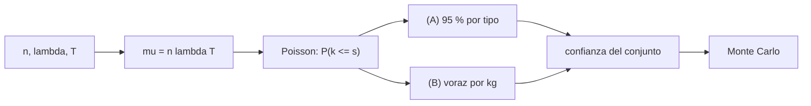

# B97-C12 — Robots de mantenimiento

<!-- nav:top -->
[🏠 Programa](../../../../README.md) · [📚 Bloque B97](../../../tronco-comun/B97-robotica-y-construccion-extraterrestre.md) · [← Anterior: B97-C11 — Robots de inspección orbital](../B97-C11-robots-de-inspeccion-orbital/CLASE.md) · [Siguiente: B97-C13 — Ensamblaje de estructuras en órbita →](../B97-C13-ensamblaje-de-estructuras-en-orbita/CLASE.md)
<!-- /nav -->

## 1. Ubicación, nivel y alcance

Clase 12 del bloque B97. Nivel N3. Un robot que repara una base o una nave necesita repuestos, pero cada kilogramo extra cuesta. Con fallas aleatorias de tasa constante (proceso de Poisson), puedes calcular cuántos repuestos de cada tipo cubren una misión con una confianza dada, y repartirlos con más inteligencia que «95 % por tipo». Todos los datos son **sintéticos**.

## 2. Por qué esta clase existe

Pocos repuestos dejan la misión sin reparación posible; demasiados cargan masa. La confianza del conjunto, no la de cada pieza, es la que importa, y se obtiene con el producto de las probabilidades. La decisión central: **¿cuántos repuestos de cada tipo llevar para que el conjunto cubra una misión con 95 % de confianza, con la menor masa posible?**

## 3. Lo que podrás hacer al terminar

1. Calcular el número esperado de fallas de cada tipo.
2. Calcular la probabilidad de cubrir las fallas con `s` repuestos con la distribución de Poisson.
3. Calcular la confianza del conjunto como producto de las de cada tipo.
4. Repartir los repuestos con una regla voraz de log-confianza por kg.
5. Verificar la confianza por Monte Carlo con semilla fija.
6. Separar lo sintético (tasas, masas, misión) de lo consultado (nada).

La evidencia es la **ficha de repuestos de mantenimiento para una misión** del ejercicio 12 (sección 20).

## 4. Con qué llegas y cómo comprobarlo

1. ¿Qué es una tasa de falla?
2. ¿Qué es una distribución de Poisson?
3. ¿Qué es una probabilidad acumulada?
4. ¿Qué es un dato sintético?
5. ¿Qué es una segunda vía de cálculo?

<details>
<summary>Ver respuestas</summary>

1. El número de fallas por unidad de tiempo. 2. La distribución del número de eventos independientes de tasa constante en un intervalo. 3. La probabilidad de que la variable sea menor o igual que un valor. 4. Un dato generado para el ejemplo, no medido. 5. Calcular lo mismo con otro método y comparar.
</details>

Con cuatro o cinco aciertos, sigue; si no, repasa los prerrequisitos.

## 5. Un caso de contexto y casos de referencia

Con 5 tipos de unidad y `8760 h` de misión, se esperan `16,99` fallas en total. Cubrir el 95 % de cada tipo (`33` repuestos, `101,6` kg) deja la confianza del conjunto en solo `0,8686`; exigir `0,95^(1/5)` a cada tipo la lleva a `0,9762` con `127,7` kg; un reparto voraz alcanza `0,9538` con `39` repuestos y `112,1` kg. Es el **ejemplo conductor**; todo es sintético.

## 6. Vocabulario

La **tasa de falla** `λ` es el número de fallas por hora. El **número esperado de fallas** es `μ = n λ T`. La **distribución de Poisson** da `P(k) = e^(−μ) μ^k/k!`. La **confianza** es la probabilidad de que los repuestos cubran las fallas. La **unidad reemplazable (ORU)** es la que un robot puede cambiar.

## 7. Modelo mental



*Descripción textual:* de las tasas sale el número esperado de fallas; Poisson da la confianza por tipo; el conjunto se evalúa por producto y se verifica por simulación.

Analogía: llevar neumáticos de repuesto para un viaje; uno basta casi siempre, pero para un convoy de cinco vehículos necesitas pensar en el conjunto. Límite: aquí las fallas son independientes y de tasa constante.

## 8. La explicación, paso a paso

### 8.1 Fallas esperadas

`μ_i = n_i λ_i T`. Los valores, por tipo, están en la salida del laboratorio; en total `μ = 16,994` fallas esperadas.

### 8.2 Confianza por tipo y del conjunto

`P(k ≤ s) = Σ e^(−μ) μ^k/k!`. La confianza del conjunto es el producto de las de cada tipo. Con 95 % por tipo, el conjunto queda en `0,8686`: **no** llega al 95 %. Con `0,95^(1/5) = 0,9898` por tipo, queda en `0,9762` y pesa `127,7` kg.

### 8.3 Reparto voraz

En cada paso se añade el repuesto con mayor ganancia de log-confianza por kg hasta alcanzar 95 % en el conjunto: `39` repuestos, `112,1` kg y confianza `0,9538`. Frente al reparto uniforme `0,95^(1/5)` (el otro método que sí cumple), el ahorro es `15,6` kg (`12,2` %).

### 8.4 Monte Carlo

Con `100 000` misiones y tiempos entre fallas exponenciales, la confianza del reparto voraz es `0,9537`, a `6,28e-05` del cálculo exacto. Esto verifica la fórmula, no que las tasas sean realistas.

## 9. Magnitudes, símbolos y unidades

| Símbolo | Qué es | Unidad | Valor / nota |
|---|---|---|---|
| `λ` | tasa de falla | 1/10 000 h | 0,5–2,0 (sintética) |
| `T` | duración | h | 8760 |
| `μ` | fallas esperadas | — | 16,994 (total) |
| `s` | repuestos | — | ver la tabla |
| `P` | confianza | — | 0,95 objetivo |

## 10. Convenciones y referencias

Fallas independientes con tasa constante, sin fallas de modo común, sin reparación de la unidad dañada ni reabastecimiento; confianza objetivo 95 %. Todos los datos son sintéticos.

## 11. De dónde sale lo que afirmamos

| ID | Fuente | Localizador | Respalda | Estado |
|---|---|---|---|---|
| — | Relaciones estándar usadas en el laboratorio | — | las verifica el laboratorio con una segunda vía | No consultada en una fuente concreta |

Límites: no se consultó ninguna tasa de falla ni masa de componente; el caso es sintético.

## 12. Cómo ver el resultado

| Magnitud | Valor |
|---|---|
| Fallas esperadas | 16,994 |
| A: 95 % por tipo | 33 repuestos, 101,6 kg, conjunto 0,8686 |
| C: uniforme | 41 repuestos, 127,7 kg, conjunto 0,9762 |
| B: voraz | 39 repuestos, 112,1 kg, conjunto 0,9538 |
| Monte Carlo B | 0,9537 |

Descripción larga: fijar el 95 % por tipo no alcanza el 95 % del conjunto; el reparto voraz lo alcanza con menos masa que el reparto uniforme.

## 13. Ejemplo trabajado

**Paso 1 · Fallas esperadas.** Motor de rueda: `6 × (1,2/10 000) × 8760 = 6,31`.

**Paso 2 · Probabilidad.** `P(k ≤ s)` con la suma de Poisson.

**Paso 3 · Conjunto.** Producto de las confianzas por tipo.

## 14. Distintas formas de describir el problema

**Por tasa:** `λ`. **Por conteo:** `μ`. **Por probabilidad:** Poisson. **Por masa:** kg de repuestos. **Por simulación:** Monte Carlo.

## 15. Práctica guiada

**Ejercicio 1 · con los pasos indicados.** Calcula `μ` para 2 unidades con `λ = 0,8/10 000 h` en 8760 h. *Pasos:* `n λ T`.

<details><summary>Solución comentada</summary>

`2 × 0,00008 × 8760 = 1,40`.
</details>

**Ejercicio 2 · con una pista.** Predice si el método A (95 % por tipo) alcanza el 95 % del conjunto. *Pista:* producto de cinco números menores que 1.

<details><summary>Solución comentada</summary>

No: llega a `0,8686`.
</details>

**Ejercicio 3 · casi autónomo.** Calcula `P(0)` con `μ = 0,5`.

<details><summary>Solución comentada</summary>

`e^(−0,5) = 0,6065`.
</details>

## 16. Práctica autónoma, transferencia e integrador

**Ejercicio 4 · autónomo.** ¿Por qué la confianza del conjunto es menor que la de cada tipo?

<details><summary>Solución comentada</summary>

Es un producto de números menores que 1.
</details>

**Ejercicio 5 · autónomo.** ¿Qué pasa con los repuestos si la misión se duplica?

<details><summary>Solución comentada</summary>

`μ` se duplica y aumentan los repuestos, no necesariamente al doble.
</details>

**Ejercicio 6 · autónomo.** ¿Qué efecto tiene una falla de modo común?

<details><summary>Solución comentada</summary>

La independencia deja de valer y el producto sobreestima la confianza.
</details>

**Ejercicio 7 · autónomo.** Si un repuesto pesa el doble, ¿cómo cambia el reparto voraz?

<details><summary>Solución comentada</summary>

Se prefiere aumentar la confianza con otros tipos más ligeros.
</details>

**Ejercicio 8 · autónomo.** ¿Cuántos repuestos da el método B en total?

<details><summary>Solución comentada</summary>

`39`, frente a `41` del uniforme.
</details>

**Ejercicio 9 · transferencia.** Los robots pueden reparar una unidad dañada. ¿Cómo cambia el modelo? **Transferencia.**

<details><summary>Solución comentada</summary>

Parte de las unidades vuelve al inventario: hace falta un modelo de reparación y tiempos de espera.
</details>

**Ejercicio 10 · transferencia.** Un tipo de pieza falla más en el polvo lunar. ¿Qué haces? **Transferencia.**

<details><summary>Solución comentada</summary>

Subir su tasa con evidencia de pruebas y recalcular; los datos reales mandan sobre los sintéticos.
</details>

**Ejercicio 11 · transferencia.** ¿Qué falta para usar el método en una misión real? **Transferencia.**

<details><summary>Solución comentada</summary>

Tasas de falla con evidencia, criticidad de cada pieza y logística de reabastecimiento (ver C19).
</details>

**Ejercicio 12 · integrador.** Elabora tu *ficha de repuestos de mantenimiento para una misión*: `μ`, repuestos, masa y confianza de ambos métodos con la comprobación Monte Carlo, todo rotulado como sintético. **Integrador.**

<details><summary>Solución comentada</summary>

Secciones 8.1–8.4 y la salida del laboratorio.
</details>

## 17. Laboratorio

El script [repuestos_poisson.py](repuestos_poisson.py) calcula repuestos con tres criterios, evalúa la confianza del conjunto y la contrasta con Monte Carlo (**comprueba** diferencia < 0,5 puntos, que A no alcanza el 95 % y que B y C sí).

**Datos:** **sintéticos** (tipos, tasas, masas, misión y semilla); no se usa ningún dato publicado. **Predice antes de ejecutar:** ¿Alcanzará el 95 % de cada tipo el 95 % del conjunto? (No: solo 0,87.) **Ejecución del 2026-11-10 (Python 3.12.9):**

```text
Python 3.12.9 (biblioteca estandar)
Datos SINTETICOS: mision de 8760 h; confianza objetivo 95 %; semilla 20261110
 tipo               mu     s (A)   s (C)   s (B)  masa [kg]
motor de rueda      6.307     11      13      12       4.0
controlador         1.402      4       5       5       1.5
sensor de vision    5.256      9      11      12       0.6
junta articular     3.154      6       8       7       3.2
bateria             0.876      3       4       3       9.0
(A) 95 % por tipo: 33 repuestos, 101.6 kg, confianza del conjunto = 86.86 % (NO alcanza el objetivo)
(C) 0.95^(1/5) por tipo: 41 repuestos, 127.7 kg, confianza del conjunto = 97.62 %
(B) voraz   : 39 repuestos, 112.1 kg, confianza del conjunto = 95.38 %; ahorro frente a (C) = 15.6 kg (12.2 %)
Monte Carlo de (B): 95.37 %; diferencia con el calculo exacto = 0.006 puntos
Pruebas superadas.
```

```bash
python programa/clases/B97/B97-C12-robots-de-mantenimiento/repuestos_poisson.py
```

**Límites:** fallas independientes de tasa constante, sin modo común, sin reparación y sin reabastecimiento.

## 18. Errores frecuentes y cómo corregirlos

**Dar 95 % a cada tipo y creer que el conjunto tiene 95 %.** Es el producto (8.2)

**Usar tasas sintéticas como reales.** Son sintéticas; ver la sección 10

**Ignorar el modo común.** El modelo lo excluye (8.4)

**Olvidar la masa.** El reparto voraz la usa (8.3)

## 19. Cómo sabrás que vas bien

Tras la sección 8: ¿qué confianza esperabas para el método A y cuál obtuviste? Si dudas, repasa el ejemplo 13. Tras el laboratorio: ¿qué comprueba? (ver la sección 17).

## 20. Qué entregas y cómo se evalúa

El producto es tu **ficha de repuestos de mantenimiento para una misión** (ejercicio 12).

| Criterio | Inicial | En desarrollo | Logrado | Destacado |
|---|---|---|---|---|
| Conceptos | Los confunde | Parciales | Explica el modelo y sus supuestos | Explica los límites |
| Cálculo | Sin unidades | Con errores | Tablas completas con unidades | Calcula casos nuevos |
| Numérico | Sin comprobar | Un caso | Contraste con una segunda vía | Interpreta las diferencias |
| Fuentes | Sin fuente | Sin fecha | Fuentes con fecha y estado | Declara lo ilustrativo y lo no consultado |
| Límites | No los nombra | Uno | Tres | Discute qué falta del modelo |

**Condiciones críticas (no se compensan con promedio):** rotular los datos sintéticos e ilustrativos; no presentar un resultado simulado como observado o medido; citar solo lo consultado.

## 21. Ética, seguridad y límites

Clase educativa: los modelos son simplificados y sus datos son sintéticos o ilustrativos; ningún resultado describe una misión real, certifica un diseño ni sustituye a las normas aplicables ni a las pruebas de hardware.  Accesibilidad: tablas equivalentes a las gráficas, fórmulas en texto, ejercicios sin conexión.

## 22. Para cerrar y seguir

El reparto voraz cubre la misión con `0,954` de confianza y `112,1` kg, frente a `127,7` kg del reparto uniforme; el 95 % por tipo solo daba `0,869` del conjunto. Queda una pregunta: ¿cómo se ensamblan estructuras en órbita con robots?

**Glosario español–inglés.** tasa de falla · *failure rate*; unidad reemplazable · *orbital replacement unit (ORU)*; proceso de Poisson · *Poisson process*; confianza · *confidence*; repuesto · *spare*.

**Continuidad.** [B97-C13](../B97-C13-ensamblaje-de-estructuras-en-orbita/CLASE.md) estudia el ensamblaje de estructuras en órbita.

**Referencias:** ver sección 11.

<!-- nav:bottom -->
---

[← Anterior: B97-C11 — Robots de inspección orbital](../B97-C11-robots-de-inspeccion-orbital/CLASE.md) · [📚 Bloque B97](../../../tronco-comun/B97-robotica-y-construccion-extraterrestre.md) · [Siguiente: B97-C13 — Ensamblaje de estructuras en órbita →](../B97-C13-ensamblaje-de-estructuras-en-orbita/CLASE.md)
<!-- /nav -->
