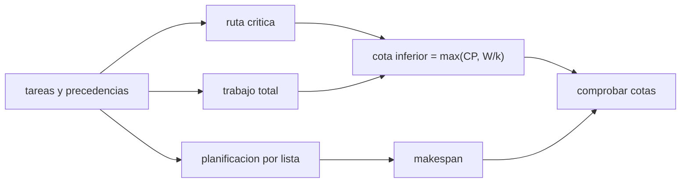

# B97-C13 — Ensamblaje de estructuras en órbita

<!-- nav:top -->
[🏠 Programa](../../../../README.md) · [📚 Bloque B97](../../../tronco-comun/B97-robotica-y-construccion-extraterrestre.md) · [← Anterior: B97-C12 — Robots de mantenimiento](../B97-C12-robots-de-mantenimiento/CLASE.md) · [Siguiente: B97-C14 — Construcción con regolito — Robótica y construcción extraterrestre →](../B97-C14-construccion-con-regolito-robotica-y-construccion-extraterrestre/CLASE.md)
<!-- /nav -->

## 1. Ubicación, nivel y alcance

Clase 13 del bloque B97. Nivel N3. Ensamblar una armadura en órbita no es solo pegar piezas: hay un orden obligatorio (precedencias) y, si hay varios robots, un reparto. La **ruta crítica** fija el mínimo de tiempo, por muchos robots que haya. Aquí calculas el cronograma de 14 tareas sintéticas con 1 a 4 robots, la ruta crítica por dos caminos y las cotas del tiempo total. Todo es **sintético**.

## 2. Por qué esta clase existe

Añadir robots no acorta el trabajo indefinidamente: hay un punto en que la ruta crítica manda. Conocerlo evita lanzar una flota de robots que quedan esperando. La decisión central: **¿cuántos robots conviene usar para ensamblar la estructura, y a partir de cuándo ya no acortan el tiempo?**

## 3. Lo que podrás hacer al terminar

1. Definir tareas con duraciones y precedencias.
2. Calcular la ruta crítica hacia adelante y hacia atrás.
3. Planificar por lista con prioridad al camino más largo restante.
4. Comprobar que el tiempo total respeta las cotas inferior y superior.
5. Calcular la aceleración y la eficiencia con `k` robots.
6. Separar lo sintético (todo el caso) de lo consultado (nada).

La evidencia es la **ficha de cronograma de ensamblaje de una armadura** del ejercicio 12 (sección 20).

## 4. Con qué llegas y cómo comprobarlo

1. ¿Qué es una precedencia entre tareas?
2. ¿Qué es una ruta crítica?
3. ¿Qué es el tiempo total (makespan)?
4. ¿Qué es un dato sintético?
5. ¿Qué es una segunda vía de cálculo?

<details>
<summary>Ver respuestas</summary>

1. Una tarea que no puede empezar hasta que otra termine. 2. La cadena de tareas dependientes más larga, que fija el mínimo de tiempo. 3. El tiempo desde el inicio de la primera tarea hasta el final de la última. 4. Un dato generado para el ejemplo, no medido. 5. Calcular lo mismo con otro método y comparar.
</details>

Con cuatro o cinco aciertos, sigue; si no, repasa los prerrequisitos.

## 5. Un caso de contexto y casos de referencia

Una armadura sintética de `14` tareas suma `196` min de trabajo y tiene una ruta crítica de `118` min. Con 1 robot dura `196` min, con 2 robots `133` min y con 4 robots `118` min: a partir de cierto punto, más robots no ayudan. Es el **ejemplo conductor**.

## 6. Vocabulario

Una **tarea** tiene duración y predecesoras. La **ruta crítica** es el camino de mayor duración. El **makespan** es el tiempo total. La **planificación por lista** asigna tareas listas al robot libre. La **eficiencia** es `trabajo/(k × makespan)`.

## 7. Modelo mental



*Descripción textual:* las tareas dan la ruta crítica y el trabajo total, que fijan una cota inferior del tiempo; el planificador por lista da el tiempo real, que debe respetar las cotas.

Analogía: cocinar una cena con varios cocineros; algunos platos esperan a otros y, pasado cierto número de cocineros, hay gente de brazos cruzados. Límite: aquí no hay desplazamientos ni cambios de herramienta.

## 8. La explicación, paso a paso

### 8.1 Ruta crítica

Hacia adelante, el fin más tardío es `118` min; hacia atrás, el mayor camino desde cualquier tarea da el mismo valor (diferencia `0,00e+00` min). La cadena que la determina es base, puntal, nodo, diagonal, puntal superior, soporte de panel, inspección y cierre.

### 8.2 Planificación por lista

En cada paso se elige, entre las tareas listas, la de mayor camino restante y se asigna al robot que se libera antes. Con 1 robot, el tiempo es el trabajo total, `196` min.

### 8.3 Cotas

`max(CP, W/k) ≤ makespan ≤ W/k + (1 − 1/k) CP`. Con `k = 2`: `133` min; con `k = 3`: `118` min; con `k = 4`: `118` min. La aceleración con 2 robots es `1,47` y con 4, `1,66`; la eficiencia baja de `0,74` a `0,42`.

### 8.4 Qué no incluye

No hay tiempos de desplazamiento entre puntos de trabajo, cambios de herramienta, colisiones ni fallas. La cota superior es un resultado estándar de la planificación que no se consultó en una fuente concreta; aquí solo se verifica numéricamente.

## 9. Magnitudes, símbolos y unidades

| Símbolo | Qué es | Unidad | Valor / nota |
|---|---|---|---|
| `W` | trabajo total | min | 196 |
| `CP` | ruta crítica | min | 118 |
| `k` | número de robots | — | 1–4 |
| makespan | tiempo total | min | 133 (k = 2) |
| eficiencia | `W/(k × makespan)` | — | 0,74 (k = 2) |

## 10. Convenciones y referencias

Tareas con duraciones en minutos y precedencias sintéticas; robots idénticos; sin desplazamientos, fallas ni colisiones. Todos los datos son sintéticos.

## 11. De dónde sale lo que afirmamos

| ID | Fuente | Localizador | Respalda | Estado |
|---|---|---|---|---|
| — | Relaciones estándar usadas en el laboratorio | — | las verifica el laboratorio con una segunda vía | No consultada en una fuente concreta |

Límites: no se consultó ninguna fuente para el caso, que es sintético; las cotas de planificación son resultados estándar que el laboratorio comprueba, no que se hayan consultado.

## 12. Cómo ver el resultado

| Magnitud | Valor |
|---|---|
| Trabajo total | 196 min |
| Ruta crítica | 118 min |
| Makespan, 1 robot | 196 min |
| Makespan, 2 robots | 133 min |
| Makespan, 4 robots | 118 min |

Descripción larga: el segundo robot ahorra `196 − 133` min, el tercero ahorra hasta `118` min y el cuarto nada, porque la ruta crítica ya domina.

## 13. Ejemplo trabajado

**Paso 1 · Ruta crítica.** Suma de la cadena `20 + 15 + 10 + 18 + 15 + 25 + 10 + 5 = 118` min.

**Paso 2 · Cota con 4 robots.** `max(118, 196/4)`.

**Paso 3 · Resultado.** El laboratorio da `118` min con 4 robots.

## 14. Distintas formas de describir el problema

**Por grafo:** tareas y precedencias. **Por camino:** ruta crítica. **Por tiempo:** makespan. **Por cotas:** inferior y superior. **Por eficiencia:** `W/(k × makespan)`.

## 15. Práctica guiada

**Ejercicio 1 · con los pasos indicados.** Calcula la cota inferior con 2 robots. *Pasos:* `max(CP, W/2)`.

<details><summary>Solución comentada</summary>

`max(118, 196/2)`.
</details>

**Ejercicio 2 · con una pista.** Predice si 8 robots acortan el tiempo por debajo de la ruta crítica. *Pista:* ninguna tarea se acelera.

<details><summary>Solución comentada</summary>

No: el mínimo es `118` min.
</details>

**Ejercicio 3 · casi autónomo.** ¿Por qué con 1 robot el makespan es el trabajo total?

<details><summary>Solución comentada</summary>

Porque no hay paralelismo.
</details>

## 16. Práctica autónoma, transferencia e integrador

**Ejercicio 4 · autónomo.** Calcula la eficiencia con 4 robots.

<details><summary>Solución comentada</summary>

`0,42`.
</details>

**Ejercicio 5 · autónomo.** Si una tarea de la ruta crítica baja 5 min, ¿baja la ruta crítica?

<details><summary>Solución comentada</summary>

Sí, 5 min si sigue siendo la ruta más larga.
</details>

**Ejercicio 6 · autónomo.** Si una tarea fuera de la ruta crítica baja 5 min, ¿cambia el tiempo?

<details><summary>Solución comentada</summary>

No (o poco): hay holgura.
</details>

**Ejercicio 7 · autónomo.** ¿Qué ocurre si un robot falla y solo hay 1 disponible?

<details><summary>Solución comentada</summary>

El tiempo sube al del trabajo total, `196` min.
</details>

**Ejercicio 8 · autónomo.** ¿Qué mide la aceleración con 2 robots?

<details><summary>Solución comentada</summary>

`makespan₁/makespan₂ = 1,47`.
</details>

**Ejercicio 9 · transferencia.** Los robots se estorban en zonas comunes. ¿Qué no cubre el modelo? **Transferencia.**

<details><summary>Solución comentada</summary>

Las colisiones y el reparto del espacio: el tiempo real sería mayor.
</details>

**Ejercicio 10 · transferencia.** Una tarea necesita una herramienta única. ¿Cómo se modela? **Transferencia.**

<details><summary>Solución comentada</summary>

Como un recurso compartido que impide ejecutar dos tareas a la vez.
</details>

**Ejercicio 11 · transferencia.** ¿Cómo decidirías cuántos robots lanzar? **Transferencia.**

<details><summary>Solución comentada</summary>

Comparando el ahorro de tiempo con su masa y su costo, hasta que la eficiencia caiga bajo un umbral.
</details>

**Ejercicio 12 · integrador.** Elabora tu *ficha de cronograma de ensamblaje de una armadura*: ruta crítica, makespan con 1–4 robots, cotas y eficiencia, todo rotulado como sintético. **Integrador.**

<details><summary>Solución comentada</summary>

Secciones 8.1–8.4 y la salida del laboratorio.
</details>

## 17. Laboratorio

El script [cronograma_ensamblaje.py](cronograma_ensamblaje.py) calcula la ruta crítica por dos caminos, planifica con 1 a 4 robots y comprueba las cotas del tiempo total (**comprueba** coincidencia de la ruta crítica y cotas cumplidas).

**Datos:** **sintéticos** (tareas, duraciones y precedencias); no se usa ningún dato publicado. **Predice antes de ejecutar:** ¿Acorta el cuarto robot el tiempo respecto del tercero? (No: ambos terminan en la ruta crítica.) **Ejecución del 2026-11-10 (Python 3.12.9):**

```text
Python 3.12.9 (biblioteca estandar)
Armadura SINTETICA: 14 tareas; trabajo total = 196 min; ruta critica = 118 min (adelante y atras difieren en 0.0e+00)
 robots  makespan [min]  cota inferior  cota superior  eficiencia
     1           196.0         196.00         196.00       1.000
     2           133.0         118.00         157.00       0.737
     3           118.0         118.00         144.00       0.554
     4           118.0         118.00         137.50       0.415
Aceleracion con 2 robots = 1.474; con 4 robots = 1.661
Pruebas superadas.
```

```bash
python programa/clases/B97/B97-C13-ensamblaje-de-estructuras-en-orbita/cronograma_ensamblaje.py
```

**Límites:** sin desplazamientos, cambios de herramienta, colisiones ni fallas; robots idénticos.

## 18. Errores frecuentes y cómo corregirlos

**Creer que más robots siempre acortan el tiempo.** La ruta crítica lo limita (8.3)

**Optimizar tareas fuera de la ruta crítica.** No cambia el tiempo (ejercicio 6)

**Olvidar los desplazamientos.** El modelo los excluye (8.4)

**Presentar el caso como una obra real.** Es sintético; ver la sección 10

## 19. Cómo sabrás que vas bien

Tras la sección 8: ¿qué tiempo esperabas con 4 robots y cuál obtuviste? Si dudas, repasa el ejemplo 13. Tras el laboratorio: ¿qué comprueba? (ver la sección 17).

## 20. Qué entregas y cómo se evalúa

El producto es tu **ficha de cronograma de ensamblaje de una armadura** (ejercicio 12).

| Criterio | Inicial | En desarrollo | Logrado | Destacado |
|---|---|---|---|---|
| Conceptos | Los confunde | Parciales | Explica el modelo y sus supuestos | Explica los límites |
| Cálculo | Sin unidades | Con errores | Tablas completas con unidades | Calcula casos nuevos |
| Numérico | Sin comprobar | Un caso | Contraste con una segunda vía | Interpreta las diferencias |
| Fuentes | Sin fuente | Sin fecha | Fuentes con fecha y estado | Declara lo ilustrativo y lo no consultado |
| Límites | No los nombra | Uno | Tres | Discute qué falta del modelo |

**Condiciones críticas (no se compensan con promedio):** rotular los datos sintéticos e ilustrativos; no presentar un resultado simulado como observado o medido; citar solo lo consultado.

## 21. Ética, seguridad y límites

Clase educativa: los modelos son simplificados y sus datos son sintéticos o ilustrativos; ningún resultado describe una misión real, certifica un diseño ni sustituye a las normas aplicables ni a las pruebas de hardware.  Accesibilidad: tablas equivalentes a las gráficas, fórmulas en texto, ejercicios sin conexión.

## 22. Para cerrar y seguir

Con 4 robots el ensamblaje sintético baja de `196` a `118` min, pero la ruta crítica de `118` min ya lo limita. Queda una pregunta: ¿cómo se cubre un hábitat con regolito para protegerlo?

**Glosario español–inglés.** ruta crítica · *critical path*; precedencia · *precedence*; tiempo total · *makespan*; planificación por lista · *list scheduling*; eficiencia · *efficiency*.

**Continuidad.** [B97-C14](../B97-C14-construccion-con-regolito-robotica-y-construccion-extraterrestre/CLASE.md) estudia la construcción con regolito.

**Referencias:** ver sección 11.

<!-- nav:bottom -->
---

[← Anterior: B97-C12 — Robots de mantenimiento](../B97-C12-robots-de-mantenimiento/CLASE.md) · [📚 Bloque B97](../../../tronco-comun/B97-robotica-y-construccion-extraterrestre.md) · [Siguiente: B97-C14 — Construcción con regolito — Robótica y construcción extraterrestre →](../B97-C14-construccion-con-regolito-robotica-y-construccion-extraterrestre/CLASE.md)
<!-- /nav -->
