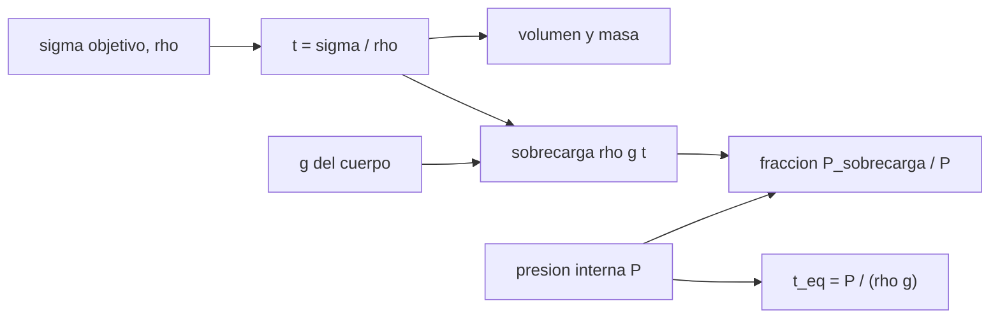

# B97-C14 — Construcción con regolito — Robótica y construcción extraterrestre

<!-- nav:top -->
[🏠 Programa](../../../../README.md) · [📚 Bloque B97](../../../tronco-comun/B97-robotica-y-construccion-extraterrestre.md) · [← Anterior: B97-C13 — Ensamblaje de estructuras en órbita](../B97-C13-ensamblaje-de-estructuras-en-orbita/CLASE.md) · [Siguiente: B97-C15 — Impresión 3D espacial →](../B97-C15-impresion-3d-espacial/CLASE.md)
<!-- /nav -->

## 1. Ubicación, nivel y alcance

Clase 14 del bloque B97. Nivel N3. Cubrir un hábitat con regolito sirve para protegerlo de la radiación y de los micrometeoroides, y su peso ayuda a contener la presión interna solo en parte. Aquí calculas el espesor de la cubierta a partir de una densidad superficial objetivo, la presión que su peso ejerce en la Luna, Marte y la Tierra, y lo comparas con la presión interna. Todos los parámetros del hábitat y del regolito son **ilustrativos**.

## 2. Por qué esta clase existe

Quien cree que el regolito «sostiene» el hábitat se equivoca: con baja gravedad, el peso de una cubierta de poco más de un metro cubre solo una pequeña fracción de la presión interna. La estructura debe resistir la diferencia por tracción o anclaje. La decisión central: **¿qué espesor de regolito se necesita para el blindaje, cuánta masa hay que mover y qué fracción de la presión interna contiene su peso?**

## 3. Lo que podrás hacer al terminar

1. Calcular el espesor de cubierta a partir de la densidad superficial y la densidad aparente.
2. Calcular la presión de la sobrecarga en cada cuerpo.
3. Comparar la sobrecarga con la presión interna.
4. Calcular el volumen y la masa de la cubierta de un cilindro.
5. Verificar el volumen con una integración numérica.
6. Separar lo consultado (gravedades) de lo ilustrativo (presión, densidades y geometría).

La evidencia es la **ficha de cobertura de regolito de un hábitat** del ejercicio 12 (sección 20).

## 4. Con qué llegas y cómo comprobarlo

1. ¿Qué es la densidad superficial y en qué unidades se mide?
2. ¿Qué es una presión y cómo se relaciona con el peso?
3. ¿Qué es la densidad aparente de un suelo?
4. ¿Qué es un dato ilustrativo?
5. ¿Qué es una segunda vía de cálculo?

<details>
<summary>Ver respuestas</summary>

1. La masa por unidad de área, en kg/m². 2. La fuerza por unidad de área; el peso de una columna de material es `ρ g h`. 3. La masa del suelo por volumen total, huecos incluidos. 4. Un dato inventado de forma verosímil para el ejemplo, no medido. 5. Calcular lo mismo con otro método y comparar.
</details>

Con cuatro o cinco aciertos, sigue; si no, repasa los prerrequisitos.

## 5. Un caso de contexto y casos de referencia

Un hábitat cilíndrico ilustrativo (`r = 4 m`, `L = 10 m`, `70 kPa`) se cubre con regolito de `1500 kg/m³` hasta `2000 kg/m²`: `1,333` m de espesor y `586,4` t. En la Luna ese peso da `3240` Pa, solo `0,0463` de la presión interna; el espesor que la equilibraría sería `28,8` m. Es el **ejemplo conductor**.

## 6. Vocabulario

La **densidad superficial** `σ` es la masa por área. La **sobrecarga** es la presión que el peso de la cubierta ejerce sobre la estructura. El **espesor de equilibrio** `t_eq = P/(ρ g)` sería el que contiene la presión interna solo con peso. El **blindaje** es la cubierta que atenúa la radiación.

## 7. Modelo mental



*Descripción textual:* la densidad superficial fija el espesor y la masa; la sobrecarga depende de `g` y se compara con la presión interna.

Analogía: una pila de arena sobre un globo inflado; la arena lo protege pero no lo contiene: el globo debe resistir su propia presión. Límite: no se calcula la resistencia de la estructura.

## 8. La explicación, paso a paso

### 8.1 Espesor y masa

`t = σ/ρ = 2000/1500 = 1,333` m, independiente de `g`. El volumen de la cubierta es `V = π((r+t)² − r²) L = 391,0` m³ y la masa `586,4` t. Una estimación delgada (`σ ×` área interior, `251,3` m²) daría `502655` kg; la exacta es mayor porque la cubierta rodea una superficie más grande.

### 8.2 Sobrecarga y presión interna

Luna: `ρ g t = 3240` Pa (`0,0463` de `P`). Marte: `7460` Pa (`0,1066`). Tierra: `19640` Pa (`0,2806`).

### 8.3 Espesor de equilibrio

`t_eq = P/(ρ g)`: `28,8` m en la Luna, `12,5` m en Marte y `4,8` m en la Tierra. En la Luna es unas veinte veces el espesor de blindaje: la cubierta no contiene la presión; la estructura trabaja en tracción con una presión neta de `66760` Pa hacia fuera en la Luna.

### 8.4 Segunda vía

La integración numérica por anillos finos da el mismo volumen con diferencia relativa `1,45e-16`. Esto verifica la geometría, no el blindaje ni la resistencia estructural.

## 9. Magnitudes, símbolos y unidades

| Símbolo | Qué es | Unidad | Valor / nota |
|---|---|---|---|
| `σ` | densidad superficial de blindaje | kg/m² | 2000 (ilustrativa) |
| `ρ` | densidad aparente del regolito | kg/m³ | 1500 (ilustrativa) |
| `t` | espesor de cubierta | m | 1,333 |
| `P` | presión interna | kPa | 70 (ilustrativa) |
| `g` | gravedad | m/s² | 1,62; 3,73; 9,820 (consultadas) |

## 10. Convenciones y referencias

Cilindro de radio interior 4 m y longitud 10 m rodeado por una cubierta uniforme; sin tapas, huecos ni compactación variable; densidad aparente constante. Gravedades de las fichas NASA/NSSDC; el resto es ilustrativo y no corresponde a ninguna norma ni requisito.

## 11. De dónde sale lo que afirmamos

| ID | Fuente | Localizador | Respalda | Estado |
|---|---|---|---|---|
| S1 | NASA/NSSDC, Moon Fact Sheet — https://nssdc.gsfc.nasa.gov/planetary/factsheet/moonfact.html (consultada 2026-11-10) | ficha completa leída | gravedad media 1,62 m/s²; radio medio 1737,4 km; distancia media a la Tierra 384,4 × 10³ km; rango diurno ecuatorial 95–390 K | Consultada |
| S2 | NASA/NSSDC, Mars Fact Sheet — https://nssdc.gsfc.nasa.gov/planetary/factsheet/marsfact.html (consultada 2026-11-10) | ficha completa leída | gravedad media 3,73 m/s²; radio medio 3389,5 km; distancia a la Tierra de 54,6 a 401,4 × 10⁶ km; presión 4,0–8,7 mb | Consultada |
| S3 | NASA/NSSDC, Earth Fact Sheet — https://nssdc.gsfc.nasa.gov/planetary/factsheet/earthfact.html (consultada 2026-11-10) | ficha completa leída | gravedad media 9,820 m/s²; radio medio 6371,0 km | Consultada |
| — | Relaciones estándar usadas en el laboratorio | — | las verifica el laboratorio con una segunda vía | No consultada en una fuente concreta |

Límites: la presión, la densidad del regolito, el blindaje objetivo y la geometría son ilustrativos; no se consultaron datos de radiación ni propiedades del regolito; no es un cálculo estructural.

## 12. Cómo ver el resultado

| Magnitud | Valor |
|---|---|
| Espesor `t` | 1,333 m |
| Masa de la cubierta | 586,4 t |
| Sobrecarga en la Luna | 3240 Pa |
| Fracción de `P` (Luna) | 0,0463 |
| `t_eq` en la Luna | 28,8 m |

Descripción larga: el espesor del blindaje es igual en todos los cuerpos, pero el peso que ejerce es proporcional a la gravedad y en la Luna apenas contiene un pequeño porcentaje de la presión interna.

## 13. Ejemplo trabajado

**Paso 1 · Espesor.** `2000/1500 = 1,333` m.

**Paso 2 · Sobrecarga lunar.** `1500 × 1,62 × 1,333 = 3240` Pa.

**Paso 3 · Fracción.** `3240/70 000 = 0,0463`.

**Paso 4 · Equilibrio.** `70 000/(1500 × 1,62) = 28,8` m.

## 14. Distintas formas de describir el problema

**Por espesor:** `σ/ρ`. **Por masa:** `ρ V`. **Por presión:** `ρ g t`. **Por fracción:** frente a `P`. **Por equilibrio:** `t_eq`.

## 15. Práctica guiada

**Ejercicio 1 · con los pasos indicados.** Calcula `t` para `σ = 3000 kg/m²` y `ρ = 1500`. *Pasos:* `σ/ρ`.

<details><summary>Solución comentada</summary>

`2,0 m`.
</details>

**Ejercicio 2 · con una pista.** Predice si el blindaje es más grueso en Marte que en la Luna. *Pista:* `t = σ/ρ`.

<details><summary>Solución comentada</summary>

No: es igual; depende de `σ` y `ρ`, no de `g`.
</details>

**Ejercicio 3 · casi autónomo.** Calcula la sobrecarga en Marte con `t = 1,333 m`.

<details><summary>Solución comentada</summary>

`7460` Pa.
</details>

## 16. Práctica autónoma, transferencia e integrador

**Ejercicio 4 · autónomo.** ¿Qué fracción de 70 kPa es la sobrecarga lunar?

<details><summary>Solución comentada</summary>

`0,0463`, es decir, cerca del 5 %.
</details>

**Ejercicio 5 · autónomo.** ¿Qué presión interna haría que la sobrecarga lunar equilibrara la presión?

<details><summary>Solución comentada</summary>

`3240` Pa, unos 3,2 kPa.
</details>

**Ejercicio 6 · autónomo.** Si la densidad aparente baja a 1000 kg/m³, ¿cómo cambian `t` y la sobrecarga?

<details><summary>Solución comentada</summary>

`t` sube a 2,0 m y `ρ g t` queda igual (`σ g`).
</details>

**Ejercicio 7 · autónomo.** ¿Cuánto cambia la masa de la cubierta si el radio interior sube a 5 m?

<details><summary>Solución comentada</summary>

Crece con el área: la masa se multiplica por `15,11/12,44 = 1,21`, con `(6,333² − 25)` frente a `(5,333² − 16)`.
</details>

**Ejercicio 8 · autónomo.** ¿Qué falta en el modelo para dimensionar la estructura?

<details><summary>Solución comentada</summary>

Cargas combinadas, sismos, térmica y propiedades reales.
</details>

**Ejercicio 9 · transferencia.** Se propone «usar el peso del regolito para sostener el hábitat en la Luna». ¿Qué respondes? **Transferencia.**

<details><summary>Solución comentada</summary>

Que solo contiene alrededor del 5 % de la presión; la estructura debe resistir el resto.
</details>

**Ejercicio 10 · transferencia.** ¿Qué decisión de la construcción depende de la masa de cubierta? **Transferencia.**

<details><summary>Solución comentada</summary>

El tamaño de la flota de excavación y acarreo y el tiempo de obra (ver C25 y C27).
</details>

**Ejercicio 11 · transferencia.** ¿Qué dato necesitarías para pasar del modelo a un diseño? **Transferencia.**

<details><summary>Solución comentada</summary>

El blindaje requerido por una norma, la densidad medida del regolito compactado y el análisis estructural.
</details>

**Ejercicio 12 · integrador.** Elabora tu *ficha de cobertura de regolito de un hábitat*: espesor, masa, sobrecarga y fracción de la presión en tres cuerpos, con lo consultado y lo ilustrativo rotulados. **Integrador.**

<details><summary>Solución comentada</summary>

Secciones 8.1–8.4 y la salida del laboratorio.
</details>

## 17. Laboratorio

El script [cobertura_regolito.py](cobertura_regolito.py) calcula el espesor, el volumen y la masa de una cubierta de regolito y la sobrecarga frente a la presión en tres cuerpos, y verifica el volumen por integración (**comprueba** diferencia relativa < 1e-9 y orden de fracciones Luna < Marte < Tierra).

**Datos:** gravedades (NASA/NSSDC, consultadas); presión, densidades, blindaje y geometría **ilustrativos**. **Predice antes de ejecutar:** ¿Qué fracción de la presión contiene la sobrecarga lunar? (Alrededor del 5 %.) **Ejecución del 2026-11-10 (Python 3.12.9):**

```text
Python 3.12.9 (biblioteca estandar)
Habitat ILUSTRATIVO: r = 4.0 m, L = 10.0 m; P = 70 kPa; rho = 1500 kg/m3; blindaje objetivo = 2000 kg/m2
Espesor de cubierta t = sigma/rho = 1.3333 m (igual en los tres cuerpos); volumen = 390.95 m3; masa = 586.4 t
 cuerpo   sobrecarga [kPa]   fraccion de P   espesor de equilibrio [m]   presion neta hacia arriba [kPa]
Luna               3.240          0.0463                       28.81                          66.76
Marte              7.460          0.1066                       12.51                          62.54
Tierra            19.640          0.2806                        4.75                          50.36
Masa de una cubierta delgada (sigma x area interior) = 502.7 t; la exacta es 586.4 t
Diferencia relativa entre volumen cerrado e integral numerica = 1.45e-16
Pruebas superadas.
```

```bash
python programa/clases/B97/B97-C14-construccion-con-regolito-robotica-y-construccion-extraterrestre/cobertura_regolito.py
```

**Límites:** cubierta uniforme alrededor del cilindro, sin tapas ni huecos ni compactación variable; no es un cálculo estructural ni de radiación.

## 18. Errores frecuentes y cómo corregirlos

**Creer que el regolito contiene la presión.** Solo una fracción pequeña (8.2)

**Pensar que el blindaje depende de `g`.** Depende de `σ` y `ρ` (8.1)

**Tomar los parámetros como requisitos.** Son ilustrativos; ver la sección 10

**Ignorar el volumen de la cubierta.** Rodea una superficie mayor (8.1)

## 19. Cómo sabrás que vas bien

Tras la sección 8: ¿qué fracción de la presión esperabas que contuviera la sobrecarga y qué obtuviste? Si dudas, repasa el ejemplo 13. Tras el laboratorio: ¿qué comprueba? (ver la sección 17).

## 20. Qué entregas y cómo se evalúa

El producto es tu **ficha de cobertura de regolito de un hábitat** (ejercicio 12).

| Criterio | Inicial | En desarrollo | Logrado | Destacado |
|---|---|---|---|---|
| Conceptos | Los confunde | Parciales | Explica el modelo y sus supuestos | Explica los límites |
| Cálculo | Sin unidades | Con errores | Tablas completas con unidades | Calcula casos nuevos |
| Numérico | Sin comprobar | Un caso | Contraste con una segunda vía | Interpreta las diferencias |
| Fuentes | Sin fuente | Sin fecha | Fuentes con fecha y estado | Declara lo ilustrativo y lo no consultado |
| Límites | No los nombra | Uno | Tres | Discute qué falta del modelo |

**Condiciones críticas (no se compensan con promedio):** rotular los datos sintéticos e ilustrativos; no presentar un resultado simulado como observado o medido; citar solo lo consultado.

## 21. Ética, seguridad y límites

Clase educativa: los modelos son simplificados y sus datos son sintéticos o ilustrativos; ningún resultado describe una misión real, certifica un diseño ni sustituye a las normas aplicables ni a las pruebas de hardware.  Accesibilidad: tablas equivalentes a las gráficas, fórmulas en texto, ejercicios sin conexión.

## 22. Para cerrar y seguir

Una cubierta de `1,33` m (`586` t) contiene en la Luna `0,046` de la presión interna: protege, no sostiene. Queda una pregunta: ¿cómo se imprime en 3D una estructura con regolito?

**Glosario español–inglés.** densidad superficial · *areal density*; sobrecarga · *overburden*; blindaje · *shielding*; regolito · *regolith*; densidad aparente · *bulk density*.

**Continuidad.** [B97-C15](../B97-C15-impresion-3d-espacial/CLASE.md) estudia la impresión 3D espacial.

**Referencias:** ver sección 11.

<!-- nav:bottom -->
---

[← Anterior: B97-C13 — Ensamblaje de estructuras en órbita](../B97-C13-ensamblaje-de-estructuras-en-orbita/CLASE.md) · [📚 Bloque B97](../../../tronco-comun/B97-robotica-y-construccion-extraterrestre.md) · [Siguiente: B97-C15 — Impresión 3D espacial →](../B97-C15-impresion-3d-espacial/CLASE.md)
<!-- /nav -->
