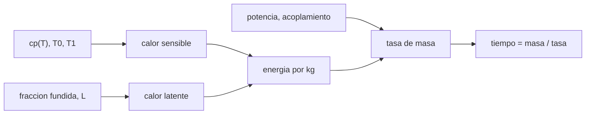

# B97-C15 — Impresión 3D espacial

<!-- nav:top -->
[🏠 Programa](../../../../README.md) · [📚 Bloque B97](../../../tronco-comun/B97-robotica-y-construccion-extraterrestre.md) · [← Anterior: B97-C14 — Construcción con regolito — Robótica y construcción extraterrestre](../B97-C14-construccion-con-regolito-robotica-y-construccion-extraterrestre/CLASE.md) · [Siguiente: B97-C16 — Autonomía de exploración →](../B97-C16-autonomia-de-exploracion/CLASE.md)
<!-- /nav -->

## 1. Ubicación, nivel y alcance

Clase 15 del bloque B97. Nivel N3. Imprimir una estructura con regolito exige calentarlo hasta sinterizarlo. El presupuesto de energía y el tiempo de impresión dependen del calor específico, de la fracción fundida y de la potencia que realmente se acopla al material. Aquí calculas la energía por kilogramo, la tasa de deposición y el tiempo de impresión de un muro, y compruebas la integral de un calor específico variable por dos vías. Los parámetros del material y de la máquina son **ilustrativos**: no se consultó ninguno.

## 2. Por qué esta clase existe

La impresión 3D parece barata en masa (se usa material local), pero cuesta energía y tiempo. Sin un presupuesto, no se sabe si la fuente de energía alcanza ni cuántas horas se necesitan para un muro. La decisión central: **¿cuánta energía y cuántas horas necesita imprimir un muro con una potencia dada, y cuánto pesa el calor latente en el total?**

## 3. Lo que podrás hacer al terminar

1. Calcular la energía por kg como calor sensible más latente.
2. Integrar un calor específico que depende de la temperatura.
3. Calcular la tasa de deposición a partir de la potencia útil y el acoplamiento.
4. Calcular el tiempo de impresión y el tiempo por capa.
5. Verificar la integral por la regla del trapecio.
6. Separar lo sintético (todo) de lo consultado (nada).

La evidencia es la **ficha de energía y tiempo de una impresión 3d** del ejercicio 12 (sección 20).

## 4. Con qué llegas y cómo comprobarlo

1. ¿Qué es el calor específico y en qué unidades se mide?
2. ¿Qué es un calor latente?
3. ¿Qué es una potencia y qué relación tiene con la energía?
4. ¿Qué es un dato ilustrativo?
5. ¿Qué es una segunda vía de cálculo?

<details>
<summary>Ver respuestas</summary>

1. La energía para subir 1 K la temperatura de 1 kg, en J/(kg·K). 2. La energía por kg para cambiar de fase sin cambiar la temperatura. 3. La energía por unidad de tiempo: `P = E/t`. 4. Un dato inventado de forma verosímil para el ejemplo, no medido. 5. Calcular lo mismo con otro método y comparar.
</details>

Con cuatro o cinco aciertos, sigue; si no, repasa los prerrequisitos.

## 5. Un caso de contexto y casos de referencia

Un muro de `4 × 0,25 × 1 m` (`1700` kg) exige `1217280` J/kg para sinterizar: `575` kWh en total. Con `1 kW` útil y acoplamiento `0,30`, la tasa es `0,89` kg/h y la impresión dura `1916,1` h. Es el **ejemplo conductor**; ningún parámetro es real.

## 6. Vocabulario

La **sinterización** une granos con calor sin fundirlos por completo. El **calor sensible** eleva la temperatura; el **calor latente** cambia de fase. El **acoplamiento** es la fracción de la potencia que llega al material. La **tasa de deposición** es kg impresos por hora.

## 7. Modelo mental



*Descripción textual:* el calor específico y la fracción fundida dan la energía por kg; con la potencia útil se obtiene la tasa de deposición y el tiempo de impresión.

Analogía: calentar agua para un té; cuanta más agua y más grados, más energía y más tiempo con la misma hornalla. Límite: aquí no se modelan pérdidas por radiación, que en vacío pueden ser grandes.

## 8. La explicación, paso a paso

### 8.1 Energía específica

Con `cp(T) = 840 (1 + 0,0004 (T − 300))`, el calor sensible entre `300 K` y `1400 K` es `1127280` J/kg. El calor latente por la fracción fundida aporta `0,074` del total; la energía específica es `1217280` J/kg (`0,338` kWh/kg). Con `cp` constante sería `1014000` J/kg.

### 8.2 Masa y energía del muro

`V = 4 × 0,25 × 1 = 1,00` m³; `m = 1700 V = 1700` kg; energía total `575` kWh.

### 8.3 Tasa y tiempo

La potencia útil es `ηP = 300 W`; la tasa es `0,89` kg/h. El muro tarda `1916,1` h, es decir `1149,7` min por capa de `10 mm` (`100` capas).

### 8.4 Segunda vía

La integral de `cp` por trapecios coincide con la forma cerrada con diferencia relativa `0,00e+00`. Es una comprobación de la matemática, no de que el material sinterice así. No se modelan pérdidas por radiación, conducción ni recarga de material.

## 9. Magnitudes, símbolos y unidades

| Símbolo | Qué es | Unidad | Valor / nota |
|---|---|---|---|
| `cp` | calor específico | J/(kg·K) | 840 (ilustrativo) |
| `L` | calor latente | J/kg | 3,0 × 10⁵ (ilustrativo) |
| `η` | acoplamiento | — | 0,30 (ilustrativo) |
| `P` | potencia útil | W | 1000 (ilustrativa) |
| `E` | energía por kg | J/kg | 1217280 |

## 10. Convenciones y referencias

Calentamiento de 300 K a 1400 K con 30 % de fracción fundida, densidad impresa constante, potencia constante, sin pérdidas ni tiempos muertos. Todos los parámetros son ilustrativos.

## 11. De dónde sale lo que afirmamos

| ID | Fuente | Localizador | Respalda | Estado |
|---|---|---|---|---|
| — | Relaciones estándar usadas en el laboratorio | — | las verifica el laboratorio con una segunda vía | No consultada en una fuente concreta |

Límites: no se consultó ninguna propiedad de regolito ni de máquina; las cifras son ilustrativas y no corresponden a un proceso real.

## 12. Cómo ver el resultado

| Magnitud | Valor |
|---|---|
| Energía específica | 0,338 kWh/kg |
| Masa del muro | 1700 kg |
| Energía total | 575 kWh |
| Tasa de deposición | 0,89 kg/h |
| Tiempo de impresión | 1916,1 h |

Descripción larga: con 1 kW útiles, imprimir un muro de 1,7 t lleva unas `1916` h (más de dos meses): hacen falta potencias mucho mayores o varias impresoras; el calor latente pesa una fracción moderada de la energía.

## 13. Ejemplo trabajado

**Paso 1 · Sensible.** `840 × [1100 + 0,5 × 0,0004 × 1100²] = 1127280` J/kg.

**Paso 2 · Latente.** `0,30 × 3 × 10⁵ = 90 000` J/kg.

**Paso 3 · Tasa.** `300 W/1217280 J/kg = 0,00025` kg/s.

**Paso 4 · Tiempo.** `1700 kg/0,00025 = 6897920` s = `1916,1` h.

## 14. Distintas formas de describir el problema

**Por energía:** J/kg y kWh. **Por masa:** kg. **Por tiempo:** horas. **Por capa:** minutos. **Por potencia:** útil y acoplada.

## 15. Práctica guiada

**Ejercicio 1 · con los pasos indicados.** Calcula el calor latente por kg con fracción 0,30 y `L = 3 × 10⁵`. *Pasos:* producto.

<details><summary>Solución comentada</summary>

`90 000 J/kg`.
</details>

**Ejercicio 2 · con una pista.** Predice si duplicar la potencia reduce el tiempo a la mitad. *Pista:* `t = m E/(η P)`.

<details><summary>Solución comentada</summary>

Sí, si el acoplamiento no cambia.
</details>

**Ejercicio 3 · casi autónomo.** ¿Cuánta energía total necesita el muro en kWh?

<details><summary>Solución comentada</summary>

`575`.
</details>

## 16. Práctica autónoma, transferencia e integrador

**Ejercicio 4 · autónomo.** ¿Qué tasa en kg/h se logra con `P = 2 kW`?

<details><summary>Solución comentada</summary>

`2 × 0,89`.
</details>

**Ejercicio 5 · autónomo.** ¿Cuánto tarda el muro si el acoplamiento baja a 0,15?

<details><summary>Solución comentada</summary>

El doble: `2 × 1916,1` h.
</details>

**Ejercicio 6 · autónomo.** ¿Qué pasa con la energía si la temperatura de sinterizado baja a 1200 K?

<details><summary>Solución comentada</summary>

El calor sensible pasa a `840 × (900 + 0,0002 × 900²) = 892 080 J/kg`, un 21 % menos.
</details>

**Ejercicio 7 · autónomo.** ¿Por qué el calor latente es una fracción pequeña del total?

<details><summary>Solución comentada</summary>

Porque solo una fracción del material se funde.
</details>

**Ejercicio 8 · autónomo.** ¿Cuántas capas hay con espesor de 5 mm?

<details><summary>Solución comentada</summary>

`200`.
</details>

**Ejercicio 9 · transferencia.** La radiación al vacío enfría la superficie. ¿Qué cambia? **Transferencia.**

<details><summary>Solución comentada</summary>

La potencia útil real baja y el tiempo sube; hay que calcular pérdidas.
</details>

**Ejercicio 10 · transferencia.** La máquina necesita 5 h de recarga de material cada 20 h. ¿Cómo se incluye? **Transferencia.**

<details><summary>Solución comentada</summary>

Se suma al tiempo total: el muro tarda unas 25 % más.
</details>

**Ejercicio 11 · transferencia.** ¿Qué dato falta para pasar del modelo a un diseño? **Transferencia.**

<details><summary>Solución comentada</summary>

Propiedades medidas del regolito (cp, fusión) y la eficiencia real del proceso.
</details>

**Ejercicio 12 · integrador.** Elabora tu *ficha de energía y tiempo de una impresión 3D*: energía por kg, masa, energía total, tasa y tiempo con la comprobación de la integral, todo rotulado como ilustrativo. **Integrador.**

<details><summary>Solución comentada</summary>

Secciones 8.1–8.4 y la salida del laboratorio.
</details>

## 17. Laboratorio

El script [energia_impresion.py](energia_impresion.py) calcula la energía específica, la tasa de deposición y el tiempo de impresión de un muro y verifica la integral del calor específico por trapecios (**comprueba** diferencia relativa < 1e-9).

**Datos:** **ilustrativos** (propiedades del material, potencia y geometría); no se consultó ninguna fuente para este caso. **Predice antes de ejecutar:** ¿Cuántas horas tarda el muro? (Unas 1916 h.) **Ejecución del 2026-11-10 (Python 3.12.9):**

```text
Python 3.12.9 (biblioteca estandar)
Muro ILUSTRATIVO 4.0 x 0.25 x 1.0 m = 1.00 m3; densidad impresa 1700 kg/m3 -> masa = 1700 kg; 100 capas de 10 mm
Calor sensible = 1127.3 kJ/kg; latente = 90.0 kJ/kg; energia especifica = 1217.3 kJ/kg (0.338 kWh/kg)
Energia total = 2.069 GJ (575 kWh); tasa de deposicion = 0.89 kg/h con 1000 W utiles y acoplamiento 0.3
Tiempo de impresion = 1916.1 h (1149.7 min por capa)
Con cp constante la energia especifica seria 1014.0 kJ/kg; el cp variable aporta 18.0 % del calor sensible
Diferencia relativa entre la integral de cp cerrada y por trapecios = 0.00e+00
Pruebas superadas.
```

```bash
python programa/clases/B97/B97-C15-impresion-3d-espacial/energia_impresion.py
```

**Límites:** potencia constante, sin pérdidas por radiación o conducción, sin recarga de material ni desplazamientos.

## 18. Errores frecuentes y cómo corregirlos

**Usar `cp` constante sin pensar.** El `cp` variable aporta calor adicional (8.1)

**Ignorar el acoplamiento.** La potencia útil es una fracción (8.3)

**Tomar los parámetros como de un regolito real.** Son ilustrativos; ver la sección 10

**Olvidar las pérdidas.** El modelo las excluye (8.4)

## 19. Cómo sabrás que vas bien

Tras la sección 8: ¿qué tiempo esperabas para el muro y cuál obtuviste? Si dudas, repasa el ejemplo 13. Tras el laboratorio: ¿qué comprueba? (ver la sección 17).

## 20. Qué entregas y cómo se evalúa

El producto es tu **ficha de energía y tiempo de una impresión 3d** (ejercicio 12).

| Criterio | Inicial | En desarrollo | Logrado | Destacado |
|---|---|---|---|---|
| Conceptos | Los confunde | Parciales | Explica el modelo y sus supuestos | Explica los límites |
| Cálculo | Sin unidades | Con errores | Tablas completas con unidades | Calcula casos nuevos |
| Numérico | Sin comprobar | Un caso | Contraste con una segunda vía | Interpreta las diferencias |
| Fuentes | Sin fuente | Sin fecha | Fuentes con fecha y estado | Declara lo ilustrativo y lo no consultado |
| Límites | No los nombra | Uno | Tres | Discute qué falta del modelo |

**Condiciones críticas (no se compensan con promedio):** rotular los datos sintéticos e ilustrativos; no presentar un resultado simulado como observado o medido; citar solo lo consultado.

## 21. Ética, seguridad y límites

Clase educativa: los modelos son simplificados y sus datos son sintéticos o ilustrativos; ningún resultado describe una misión real, certifica un diseño ni sustituye a las normas aplicables ni a las pruebas de hardware.  Accesibilidad: tablas equivalentes a las gráficas, fórmulas en texto, ejercicios sin conexión.

## 22. Para cerrar y seguir

Un muro sintético de `1700` kg necesita `575` kWh y `1916` h con `1 kW` útil y acoplamiento `0,30`. Queda una pregunta: ¿cómo decide un robot qué explorar sin esperar instrucciones?

**Glosario español–inglés.** sinterización · *sintering*; calor latente · *latent heat*; acoplamiento · *coupling efficiency*; tasa de deposición · *deposition rate*; impresión 3D · *3D printing*.

**Continuidad.** [B97-C16](../B97-C16-autonomia-de-exploracion/CLASE.md) estudia la autonomía de exploración.

**Referencias:** ver sección 11.

<!-- nav:bottom -->
---

[← Anterior: B97-C14 — Construcción con regolito — Robótica y construcción extraterrestre](../B97-C14-construccion-con-regolito-robotica-y-construccion-extraterrestre/CLASE.md) · [📚 Bloque B97](../../../tronco-comun/B97-robotica-y-construccion-extraterrestre.md) · [Siguiente: B97-C16 — Autonomía de exploración →](../B97-C16-autonomia-de-exploracion/CLASE.md)
<!-- /nav -->
