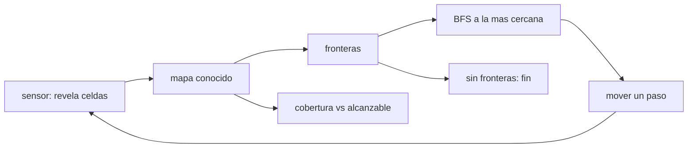

# B97-C16 — Autonomía de exploración

<!-- nav:top -->
[🏠 Programa](../../../../README.md) · [📚 Bloque B97](../../../tronco-comun/B97-robotica-y-construccion-extraterrestre.md) · [← Anterior: B97-C15 — Impresión 3D espacial](../B97-C15-impresion-3d-espacial/CLASE.md) · [Siguiente: B97-C17 — Seguridad funcional robótica →](../B97-C17-seguridad-funcional-robotica/CLASE.md)
<!-- /nav -->

## 1. Ubicación, nivel y alcance

Clase 16 del bloque B97. Nivel N3. Un robot que explora sin ayuda debe decidir hacia dónde ir para saber más. La estrategia clásica de fronteras va a la celda libre más cercana que linda con lo desconocido. Aquí la comparas con un paseo aleatorio en 15 mapas sintéticos de rejilla, midiendo los pasos hasta alcanzar la misma cobertura y comprobando el resultado contra la alcanzabilidad real del mapa. Los mapas son **sintéticos**.

## 2. Por qué esta clase existe

Con retardo de comunicación, el robot que decide qué explorar ahorra horas de operación. Medir cuánto ahorra una estrategia frente a otra permite justificar la autonomía a bordo. La decisión central: **¿cuántos pasos ahorra una exploración por fronteras frente a una aleatoria para conocer la misma parte del terreno?**

## 3. Lo que podrás hacer al terminar

1. Definir una frontera en un mapa parcialmente conocido.
2. Planificar el camino a la frontera más cercana con BFS.
3. Medir la cobertura contra las celdas realmente alcanzables.
4. Comparar los pasos con los de un paseo aleatorio.
5. Verificar que el mapa conocido no contiene errores.
6. Separar lo sintético (todos los mapas) de lo consultado (nada).

La evidencia es la **ficha de cobertura de una estrategia de exploración** del ejercicio 12 (sección 20).

## 4. Con qué llegas y cómo comprobarlo

1. ¿Qué es un mapa de rejilla?
2. ¿Qué es una búsqueda en anchura (BFS)?
3. ¿Qué es una cobertura?
4. ¿Qué es un dato sintético?
5. ¿Qué es una segunda vía de cálculo?

<details>
<summary>Ver respuestas</summary>

1. Una representación del terreno como celdas libres u ocupadas. 2. Un recorrido que explora los nodos por distancia creciente. 3. La fracción de lo alcanzable que ya se conoce. 4. Un dato generado para el ejemplo, no medido. 5. Calcular lo mismo con otro método y comparar.
</details>

Con cuatro o cinco aciertos, sigue; si no, repasa los prerrequisitos.

## 5. Un caso de contexto y casos de referencia

En 15 mapas de `30 × 30` con 20 % de obstáculos, la exploración por fronteras alcanza una cobertura media de `1,0000` con `234,1` pasos en promedio; el paseo aleatorio necesita `8445,9` pasos para la misma cobertura, `36,1` veces más. Es el **ejemplo conductor**; los mapas son sintéticos.

## 6. Vocabulario

Una **frontera** es una celda libre conocida adyacente a una desconocida. La **cobertura** es la fracción de celdas libres alcanzables ya conocidas. El **paseo aleatorio** elige una vecina libre al azar. El **tope** es el máximo de pasos permitido.

## 7. Modelo mental



*Descripción textual:* el robot revela celdas, detecta fronteras, va a la más cercana y repite hasta que no quedan; la cobertura se mide contra el mapa verdadero.

Analogía: explorar una casa a oscuras yendo siempre a la puerta abierta más cercana sin entrar a una habitación ya vista. Límite: aquí no hay ruido, incertidumbre de posición ni costo de energía.

## 8. La explicación, paso a paso

### 8.1 Fronteras

Con alcance `3`, cada paso revela un cuadrado de `7 × 7` celdas. Una frontera es una celda libre conocida con una vecina desconocida; cuando no quedan, la exploración termina.

### 8.2 Resultados

Cobertura media `1,0000` y mínima `1,0000`; pasos: media `234,1`, mínimo `209`, máximo `266`. Hay `714,1` celdas libres alcanzables en promedio.

### 8.3 Frente al paseo aleatorio

El paseo, parado cuando alcanza la misma cobertura, necesita `8445,9` pasos en promedio (`13` de `15` mapas dentro del tope): `36,1` veces más. Las ejecuciones que no llegan a la cobertura cuentan los `20 000` pasos del tope, de modo que esa media es una **cota inferior**. Por fronteras gana en `15` de `15` mapas.

### 8.4 Segunda vía

Se comprueba que ninguna celda conocida como libre sea un obstáculo (`0` errores) y se mide la cobertura contra el mapa verdadero. El resultado depende de los mapas sintéticos y del sensor ideal; no se generaliza a un terreno real.

## 9. Magnitudes, símbolos y unidades

| Símbolo | Qué es | Unidad | Valor / nota |
|---|---|---|---|
| `N` | lado del mapa | celdas | 30 |
| `R` | alcance del sensor | celdas | 3 |
| `p_obs` | probabilidad de obstáculo | — | 0,20 |
| pasos | movimientos del robot | — | 234,1 (fronteras) |
| cobertura | fracción conocida | — | 1,0000 |

## 10. Convenciones y referencias

Mapas aleatorios con semilla fija, sensor cuadrado ideal sin línea de visión, movimiento a vecinas de 4 conectividad, sin ruido ni incertidumbre de posición. Todos los datos son sintéticos.

## 11. De dónde sale lo que afirmamos

| ID | Fuente | Localizador | Respalda | Estado |
|---|---|---|---|---|
| — | Relaciones estándar usadas en el laboratorio | — | las verifica el laboratorio con una segunda vía | No consultada en una fuente concreta |

Límites: no se consultó ninguna fuente para los mapas, que son sintéticos; el sensor ideal no representa uno real.

## 12. Cómo ver el resultado

| Magnitud | Valor |
|---|---|
| Cobertura media | 1,0000 |
| Pasos por fronteras | 234,1 |
| Pasos del paseo aleatorio | 8445,9 |
| Razón paseo/fronteras | 36,1 |
| Errores de mapa | 0 |

Descripción larga: la exploración por fronteras necesita una fracción de los pasos del paseo aleatorio y no produce errores de mapa.

## 13. Ejemplo trabajado

**Paso 1 · Revelar.** Alcance 3 revela `7 × 7` celdas alrededor del robot.

**Paso 2 · Frontera.** La celda libre conocida más cercana con una vecina desconocida.

**Paso 3 · Mover y repetir.** Hasta que no queden fronteras: cobertura media `1,0000`.

## 14. Distintas formas de describir el problema

**Por mapa:** celdas conocidas. **Por frontera:** libre con vecina desconocida. **Por pasos:** conteo. **Por cobertura:** fracción alcanzable. **Por comparación:** razón entre estrategias.

## 15. Práctica guiada

**Ejercicio 1 · con los pasos indicados.** Calcula cuántas celdas revela un alcance 3. *Pasos:* `(2R+1)²`.

<details><summary>Solución comentada</summary>

`49`.
</details>

**Ejercicio 2 · con una pista.** Predice cuál estrategia gasta menos pasos. *Pista:* una va a lo no visto, otra al azar.

<details><summary>Solución comentada</summary>

Fronteras: `234,1` frente a `8445,9`.
</details>

**Ejercicio 3 · casi autónomo.** ¿Qué pasa con una celda libre rodeada de obstáculos?

<details><summary>Solución comentada</summary>

Es inalcanzable y no cuenta para la cobertura.
</details>

## 16. Práctica autónoma, transferencia e integrador

**Ejercicio 4 · autónomo.** ¿Por qué se mide contra las celdas alcanzables y no contra todas?

<details><summary>Solución comentada</summary>

Porque una celda libre aislada nunca se puede explorar.
</details>

**Ejercicio 5 · autónomo.** ¿Qué ocurre con la cobertura si el sensor es de alcance 1?

<details><summary>Solución comentada</summary>

Se requieren más pasos para lo mismo.
</details>

**Ejercicio 6 · autónomo.** ¿Qué pasa si la densidad de obstáculos sube al 40 %?

<details><summary>Solución comentada</summary>

El mapa se fragmenta, la zona alcanzable se reduce y el número de pasos baja.
</details>

**Ejercicio 7 · autónomo.** ¿Qué mide el mínimo de cobertura?

<details><summary>Solución comentada</summary>

El peor caso entre los mapas.
</details>

**Ejercicio 8 · autónomo.** ¿Por qué el BFS garantiza la frontera más cercana?

<details><summary>Solución comentada</summary>

Porque explora por distancia creciente en una rejilla de costo uniforme.
</details>

**Ejercicio 9 · transferencia.** El sensor tiene ruido y marca un obstáculo como libre. ¿Qué cambia? **Transferencia.**

<details><summary>Solución comentada</summary>

Aparecen errores de mapa y hay que probabilizar el mapa (rejilla de ocupación).
</details>

**Ejercicio 10 · transferencia.** El robot tiene energía limitada. ¿Qué criterio añadir a la frontera? **Transferencia.**

<details><summary>Solución comentada</summary>

El costo del camino o la ganancia de información por paso.
</details>

**Ejercicio 11 · transferencia.** ¿Cómo usarías el resultado para decidir entre autonomía y teleoperación? **Transferencia.**

<details><summary>Solución comentada</summary>

Comparando los pasos y el tiempo de decisión con el retardo del enlace (ver C07).
</details>

**Ejercicio 12 · integrador.** Elabora tu *ficha de cobertura de una estrategia de exploración*: pasos, cobertura, razón frente al paseo aleatorio y errores de mapa, todo rotulado como sintético. **Integrador.**

<details><summary>Solución comentada</summary>

Secciones 8.1–8.4 y la salida del laboratorio.
</details>

## 17. Laboratorio

El script [exploracion_fronteras.py](exploracion_fronteras.py) explora 15 mapas con la estrategia de fronteras y con un paseo aleatorio, y compara pasos y cobertura contra la alcanzabilidad real (**comprueba** cero errores de mapa, cobertura media > 90 % y razón > 1).

**Datos:** **sintéticos** (mapas, obstáculos, sensor y semilla); no se usa ningún dato publicado. **Predice antes de ejecutar:** ¿Cuántas veces más pasos necesita el paseo aleatorio? (Ver el laboratorio: 36,1.) **Ejecución del 2026-11-10 (Python 3.12.9):**

```text
Python 3.12.9 (biblioteca estandar)
Datos SINTETICOS: 15 mapas de 30 x 30; 20 % de obstaculos; sensor de 3 celdas; semilla 20261110
Celdas libres alcanzables (media) = 714.1; cobertura de la estrategia por fronteras: media 100.00 %, minima 100.00 %
Pasos por fronteras: media 234.1 (min 209, max 266); paseo aleatorio hasta la misma cobertura: media 8445.9 (13 de 15 dentro del tope)
El paseo necesita 36.1 veces mas pasos; fronteras gana en 15 de 15 mapas
Celdas conocidas como libres que eran obstaculos = 0
Pruebas superadas.
```

```bash
python programa/clases/B97/B97-C16-autonomia-de-exploracion/exploracion_fronteras.py
```

**Límites:** sensor ideal cuadrado sin ruido ni línea de visión, posición conocida y sin costo de energía.

## 18. Errores frecuentes y cómo corregirlos

**Medir la cobertura sobre todas las celdas.** Hay que usar las alcanzables (8.4)

**Generalizar a un terreno real.** Los mapas son sintéticos; ver la sección 10

**Ignorar el ruido del sensor.** El modelo lo excluye (8.4)

**Confundir frontera con obstáculo.** Es una celda libre junto a lo desconocido (8.1)

## 19. Cómo sabrás que vas bien

Tras la sección 8: ¿cuántas veces más pasos esperabas para el paseo y cuántas obtuviste? Si dudas, repasa el ejemplo 13. Tras el laboratorio: ¿qué comprueba? (ver la sección 17).

## 20. Qué entregas y cómo se evalúa

El producto es tu **ficha de cobertura de una estrategia de exploración** (ejercicio 12).

| Criterio | Inicial | En desarrollo | Logrado | Destacado |
|---|---|---|---|---|
| Conceptos | Los confunde | Parciales | Explica el modelo y sus supuestos | Explica los límites |
| Cálculo | Sin unidades | Con errores | Tablas completas con unidades | Calcula casos nuevos |
| Numérico | Sin comprobar | Un caso | Contraste con una segunda vía | Interpreta las diferencias |
| Fuentes | Sin fuente | Sin fecha | Fuentes con fecha y estado | Declara lo ilustrativo y lo no consultado |
| Límites | No los nombra | Uno | Tres | Discute qué falta del modelo |

**Condiciones críticas (no se compensan con promedio):** rotular los datos sintéticos e ilustrativos; no presentar un resultado simulado como observado o medido; citar solo lo consultado.

## 21. Ética, seguridad y límites

Clase educativa: los modelos son simplificados y sus datos son sintéticos o ilustrativos; ningún resultado describe una misión real, certifica un diseño ni sustituye a las normas aplicables ni a las pruebas de hardware.  Accesibilidad: tablas equivalentes a las gráficas, fórmulas en texto, ejercicios sin conexión.

## 22. Para cerrar y seguir

La exploración por fronteras alcanzó `1,000` de cobertura con `234` pasos; el paseo aleatorio necesitó `36,1` veces más. Queda una pregunta: ¿qué debe hacerse para que un robot no cause daño si falla?

**Glosario español–inglés.** frontera · *frontier*; cobertura · *coverage*; paseo aleatorio · *random walk*; búsqueda en anchura · *breadth-first search*; rejilla de ocupación · *occupancy grid*.

**Continuidad.** [B97-C17](../B97-C17-seguridad-funcional-robotica/CLASE.md) estudia la seguridad funcional robótica.

**Referencias:** ver sección 11.

<!-- nav:bottom -->
---

[← Anterior: B97-C15 — Impresión 3D espacial](../B97-C15-impresion-3d-espacial/CLASE.md) · [📚 Bloque B97](../../../tronco-comun/B97-robotica-y-construccion-extraterrestre.md) · [Siguiente: B97-C17 — Seguridad funcional robótica →](../B97-C17-seguridad-funcional-robotica/CLASE.md)
<!-- /nav -->
