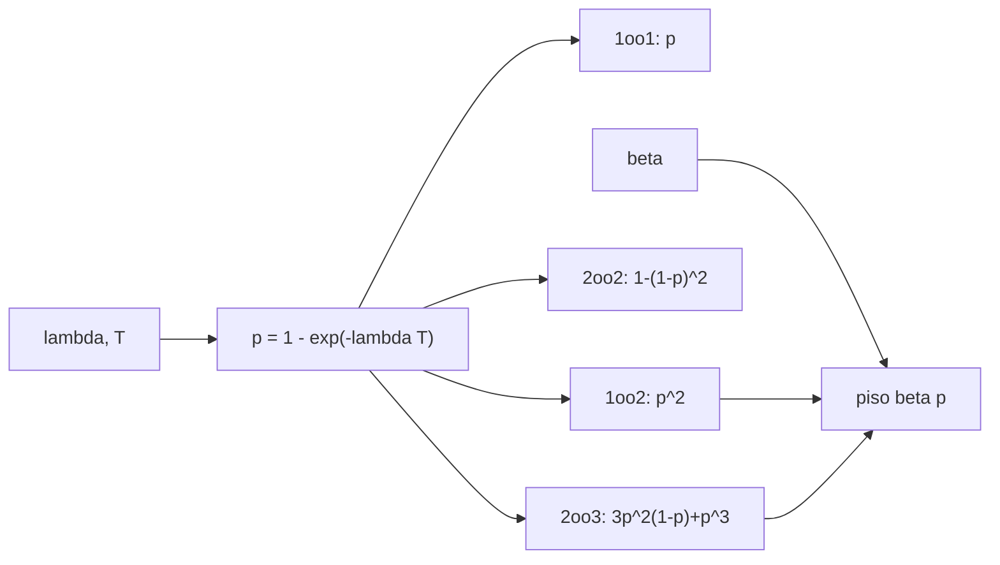

# B97-C17 — Seguridad funcional robótica

<!-- nav:top -->
[🏠 Programa](../../../../README.md) · [📚 Bloque B97](../../../tronco-comun/B97-robotica-y-construccion-extraterrestre.md) · [← Anterior: B97-C16 — Autonomía de exploración](../B97-C16-autonomia-de-exploracion/CLASE.md) · [Siguiente: B97-C18 — Pruebas en entornos análogos →](../B97-C18-pruebas-en-entornos-analogos/CLASE.md)
<!-- /nav -->

## 1. Ubicación, nivel y alcance

Clase 17 del bloque B97. Nivel N3. La seguridad funcional de un robot depende de qué pasa cuando algo falla. Aquí comparas cuatro arquitecturas de canales (un canal, dos en paralelo, dos en serie y dos de tres con votación) y descubres que la falla de causa común pone un piso a la mejora que da la redundancia. Las tasas son **sintéticas** y no corresponden a ningún nivel de integridad ni norma: las normas de seguridad funcional **no se consultaron**.

## 2. Por qué esta clase existe

Duplicar un canal parece bajar la probabilidad de falla al cuadrado; pero si una causa afecta a ambos, la mejora real es mucho menor. Calcularlo evita sobreestimar la seguridad de una arquitectura redundante. La decisión central: **¿cuánto reduce la redundancia la probabilidad de perder una función, y qué límite impone la causa común?**

## 3. Lo que podrás hacer al terminar

1. Calcular la probabilidad de falla de un canal en una misión.
2. Calcular la probabilidad de falla de arquitecturas 1oo1, 1oo2, 2oo2 y 2oo3.
3. Incorporar la falla de causa común con un factor beta.
4. Verificar cada resultado por Monte Carlo con semilla fija.
5. Interpretar el piso que impone la causa común.
6. Separar lo sintético (tasas y beta) de lo consultado (nada).

La evidencia es la **ficha de probabilidad de falla de una arquitectura redundante** del ejercicio 12 (sección 20).

## 4. Con qué llegas y cómo comprobarlo

1. ¿Qué es una tasa de falla?
2. ¿Qué es una probabilidad de falla en una misión?
3. ¿Qué es una redundancia?
4. ¿Qué es un dato sintético?
5. ¿Qué es una segunda vía de cálculo?

<details>
<summary>Ver respuestas</summary>

1. El número de fallas por unidad de tiempo. 2. `p = 1 − e^(−λT)`. 3. Tener más canales de los necesarios para que la falla de uno no pierda la función. 4. Un dato generado para el ejemplo, no medido. 5. Calcular lo mismo con otro método y comparar.
</details>

Con cuatro o cinco aciertos, sigue; si no, repasa los prerrequisitos.

## 5. Un caso de contexto y casos de referencia

Con `λ = 10⁻³/h` y `100 h`, un canal falla con `p = 0,09516`. Dos canales en paralelo (1oo2) bajan la probabilidad de perder la función a `0,009056` sin causa común (`10,5` veces mejor) y a `0,01289` con `β = 0,05` (`7,4` veces mejor: la causa común le quita casi un tercio de la mejora). Es el **ejemplo conductor**; todo es sintético.

## 6. Vocabulario

**1oo1**, **1oo2**, **2oo2** y **2oo3** indican cuántos canales hacen falta para que la función exista: `k` de `n`. La **falla de causa común** afecta a varios canales por un mismo motivo. El **factor β** es la fracción de la probabilidad de falla que es de causa común. El **votador** decide a partir de los canales.

## 7. Modelo mental



*Descripción textual:* de la tasa sale la probabilidad de un canal; cada arquitectura la combina de modo distinto, y la causa común añade un piso proporcional a `β p`.

Analogía: dos linternas en una mochila se apagan a la vez si cae agua en la mochila; tener dos no protege de eso. Límite: aquí el votador es perfecto y las fallas se detectan al instante.

## 8. La explicación, paso a paso

### 8.1 Un canal

`p = 1 − e^(−10⁻³ × 100) = 0,09516`.

### 8.2 Arquitecturas sin causa común

1oo1: `0,09516`; 1oo2 (fallan los dos): `p² = 0,009056`; 2oo2 (falla cualquiera): `0,18127`; 2oo3 (fallan dos o más): `0,025444`.

### 8.3 Con causa común

Con `β = 0,05`, la parte común es `β p = 0,004758` y actúa como un piso. 1oo2 pasa de `0,009056` a `0,012892`; 2oo3, de `0,025444` a `0,027690`. La mejora de 1oo2 frente a 1oo1 baja de `10,5` a `7,4`.

### 8.4 Segunda vía

Con `400 000` misiones simuladas y semilla fija, todas las diferencias con el cálculo analítico quedan por debajo de `1,07` desviaciones típicas binomiales (el criterio es 3). Esto verifica las fórmulas, no que las tasas ni β sean realistas.

## 9. Magnitudes, símbolos y unidades

| Símbolo | Qué es | Unidad | Valor / nota |
|---|---|---|---|
| `λ` | tasa de falla por canal | 1/h | 1,0 × 10⁻³ (sintética) |
| `T` | duración de la misión | h | 100 |
| `p` | probabilidad de falla de un canal | — | 0,09516 |
| `β` | factor de causa común | — | 0,05 (sintético) |
| `k`oo`n` | arquitectura | — | 1oo1, 1oo2, 2oo2, 2oo3 |

## 10. Convenciones y referencias

Canales idénticos e independientes salvo la causa común; falla = pérdida de la función pedida; votador perfecto; sin detección ni reparación. Los datos son sintéticos y no corresponden a un nivel de integridad ni a una norma.

## 11. De dónde sale lo que afirmamos

| ID | Fuente | Localizador | Respalda | Estado |
|---|---|---|---|---|
| — | Relaciones estándar usadas en el laboratorio | — | las verifica el laboratorio con una segunda vía | No consultada en una fuente concreta |

Límites: no se consultó ninguna norma de seguridad funcional (por ejemplo, ECSS ni IEC) ni tasas de falla reales; no se asigna ningún nivel de integridad.

## 12. Cómo ver el resultado

| Magnitud | Valor |
|---|---|
| `p` de un canal | 0,09516 |
| 1oo2 sin causa común | 0,009056 |
| 1oo2 con `β` | 0,012892 |
| 2oo3 con `β` | 0,027690 |
| Piso `β p` | 0,004758 |

Descripción larga: sin causa común, la redundancia reduce la probabilidad de falla en un orden de magnitud; con `β = 0,05` la mejora baja a `7,4` veces porque queda limitada por el piso `β p`.

## 13. Ejemplo trabajado

**Paso 1 · Un canal.** `p = 0,09516`.

**Paso 2 · Dos canales (1oo2).** `p² = 0,009056`.

**Paso 3 · Con causa común.** `1 − (1 − β p)(1 − ((1−β)p)²) = 0,012892`.

## 14. Distintas formas de describir el problema

**Por canal:** `p`. **Por arquitectura:** combinación `k` de `n`. **Por mejora:** razón frente a 1oo1. **Por piso:** `β p`. **Por simulación:** Monte Carlo.

## 15. Práctica guiada

**Ejercicio 1 · con los pasos indicados.** Calcula `p` con `λ = 2 × 10⁻³/h` y `T = 50 h`. *Pasos:* `1 − e^(−λT)`.

<details><summary>Solución comentada</summary>

`1 − e^(−0,1) = 0,0952`.
</details>

**Ejercicio 2 · con una pista.** Predice si 2oo2 es más o menos seguro que 1oo1 para no perder la función. *Pista:* se necesitan ambos.

<details><summary>Solución comentada</summary>

Menos: `0,18127` frente a `0,09516`.
</details>

**Ejercicio 3 · casi autónomo.** ¿Para qué sirve 2oo2?

<details><summary>Solución comentada</summary>

Para no actuar por error (evitar falsas activaciones), a costa de más pérdidas de función.
</details>

## 16. Práctica autónoma, transferencia e integrador

**Ejercicio 4 · autónomo.** Calcula 2oo3 con `p = 0,1` sin causa común.

<details><summary>Solución comentada</summary>

`3 × 0,01 × 0,9 + 0,001 = 0,028`.
</details>

**Ejercicio 5 · autónomo.** ¿Qué le pasa al piso si `β` se duplica a 0,10?

<details><summary>Solución comentada</summary>

Se duplica: `β p = 2 × 0,004758`.
</details>

**Ejercicio 6 · autónomo.** ¿Qué mejora da 1oo2 con `β = 0,20`?

<details><summary>Solución comentada</summary>

Unas 3,9 veces (`p = 0,0952`; `q = 0,0761`; `q² = 0,0058`; parte común `0,0190`; total `0,0247`): el piso `0,2 p` domina.
</details>

**Ejercicio 7 · autónomo.** ¿Por qué no se compara solo la tasa `λ`?

<details><summary>Solución comentada</summary>

Porque la probabilidad depende de la misión: `p = 1 − e^(−λT)`.
</details>

**Ejercicio 8 · autónomo.** ¿Qué mide el criterio de 3 desviaciones?

<details><summary>Solución comentada</summary>

Que la simulación y la fórmula concuerdan dentro del ruido estadístico.
</details>

**Ejercicio 9 · transferencia.** Dos sensores comparten la misma fuente de alimentación. ¿Qué modelas? **Transferencia.**

<details><summary>Solución comentada</summary>

Causa común: un `β` alto para esa falla, o un canal de alimentación propio.
</details>

**Ejercicio 10 · transferencia.** Un votador falla. ¿Qué no cubre el modelo? **Transferencia.**

<details><summary>Solución comentada</summary>

La falla del votador, que puede dominar la probabilidad total.
</details>

**Ejercicio 11 · transferencia.** ¿Qué falta para asignar un nivel de integridad real? **Transferencia.**

<details><summary>Solución comentada</summary>

Tasas con evidencia, cobertura de diagnóstico, análisis de modos de falla y la norma aplicable.
</details>

**Ejercicio 12 · integrador.** Elabora tu *ficha de probabilidad de falla de una arquitectura redundante*: tabla de las cuatro arquitecturas con y sin causa común, comprobación por Monte Carlo y piso `β p`, todo rotulado como sintético. **Integrador.**

<details><summary>Solución comentada</summary>

Secciones 8.1–8.4 y la salida del laboratorio.
</details>

## 17. Laboratorio

El script [arquitecturas_redundantes.py](arquitecturas_redundantes.py) calcula la probabilidad de falla de cuatro arquitecturas, con y sin causa común, y la contrasta con Monte Carlo (**comprueba** diferencias dentro de 3 desviaciones típicas).

**Datos:** **sintéticos** (tasa, misión, beta y semilla); no se consultó ninguna norma ni tasa real. **Predice antes de ejecutar:** ¿Cuánto mejora 1oo2 con causa común frente a sin ella? (Algo menos: 7,4 frente a 10,5 veces.) **Ejecución del 2026-11-10 (Python 3.12.9):**

```text
Python 3.12.9 (biblioteca estandar)
Datos SINTETICOS: lambda = 0.001 /h; T = 100 h -> p de un canal = 0.09516; beta = 0.05; 400000 misiones; semilla 20261110
 arquitectura   beta    analitica    Monte Carlo   |dif| en sigmas
1oo1           0.00     0.095163      0.095378         0.46
1oo1           0.05     0.095163      0.094668         1.07
1oo2           0.00     0.009056      0.008927         0.86
1oo2           0.05     0.012892      0.012760         0.74
2oo2           0.00     0.181269      0.180725         0.89
2oo2           0.05     0.176573      0.176040         0.88
2oo3           0.00     0.025444      0.025597         0.62
2oo3           0.05     0.027690      0.027852         0.63
Mejora de 1oo2 frente a 1oo1: x10.5 sin causa comun y x7.4 con beta = 0.05 (piso beta p = 0.004758)
Pruebas superadas.
```

```bash
python programa/clases/B97/B97-C17-seguridad-funcional-robotica/arquitecturas_redundantes.py
```

**Límites:** votador perfecto, canales idénticos, sin detección ni reparación; no asigna niveles de integridad.

## 18. Errores frecuentes y cómo corregirlos

**Creer que dos canales dan `p²` siempre.** La causa común impone un piso (8.3)

**Confundir 2oo2 con redundancia de disponibilidad.** Se necesitan ambos (ejercicio 3)

**Ignorar el votador.** Puede dominar la falla; no se modela aquí

**Presentar las tasas como reales.** Son sintéticas; ver la sección 10

## 19. Cómo sabrás que vas bien

Tras la sección 8: ¿qué mejora esperabas de 1oo2 con causa común y cuál obtuviste? Si dudas, repasa el ejemplo 13. Tras el laboratorio: ¿qué comprueba? (ver la sección 17).

## 20. Qué entregas y cómo se evalúa

El producto es tu **ficha de probabilidad de falla de una arquitectura redundante** (ejercicio 12).

| Criterio | Inicial | En desarrollo | Logrado | Destacado |
|---|---|---|---|---|
| Conceptos | Los confunde | Parciales | Explica el modelo y sus supuestos | Explica los límites |
| Cálculo | Sin unidades | Con errores | Tablas completas con unidades | Calcula casos nuevos |
| Numérico | Sin comprobar | Un caso | Contraste con una segunda vía | Interpreta las diferencias |
| Fuentes | Sin fuente | Sin fecha | Fuentes con fecha y estado | Declara lo ilustrativo y lo no consultado |
| Límites | No los nombra | Uno | Tres | Discute qué falta del modelo |

**Condiciones críticas (no se compensan con promedio):** rotular los datos sintéticos e ilustrativos; no presentar un resultado simulado como observado o medido; citar solo lo consultado.

## 21. Ética, seguridad y límites

Clase educativa: los modelos son simplificados y sus datos son sintéticos o ilustrativos; ningún resultado describe una misión real, certifica un diseño ni sustituye a las normas aplicables ni a las pruebas de hardware.  Accesibilidad: tablas equivalentes a las gráficas, fórmulas en texto, ejercicios sin conexión.

## 22. Para cerrar y seguir

Con `β = 0,05`, la mejora de dos canales cae de `11` a `7,4` veces. Queda una pregunta: ¿cómo se prueba un robot en un entorno que se parezca al de la misión?

**Glosario español–inglés.** redundancia · *redundancy*; causa común · *common cause*; votador · *voter*; seguridad funcional · *functional safety*; factor beta · *beta factor*.

**Continuidad.** [B97-C18](../B97-C18-pruebas-en-entornos-analogos/CLASE.md) estudia las pruebas en entornos análogos.

**Referencias:** ver sección 11.

<!-- nav:bottom -->
---

[← Anterior: B97-C16 — Autonomía de exploración](../B97-C16-autonomia-de-exploracion/CLASE.md) · [📚 Bloque B97](../../../tronco-comun/B97-robotica-y-construccion-extraterrestre.md) · [Siguiente: B97-C18 — Pruebas en entornos análogos →](../B97-C18-pruebas-en-entornos-analogos/CLASE.md)
<!-- /nav -->
