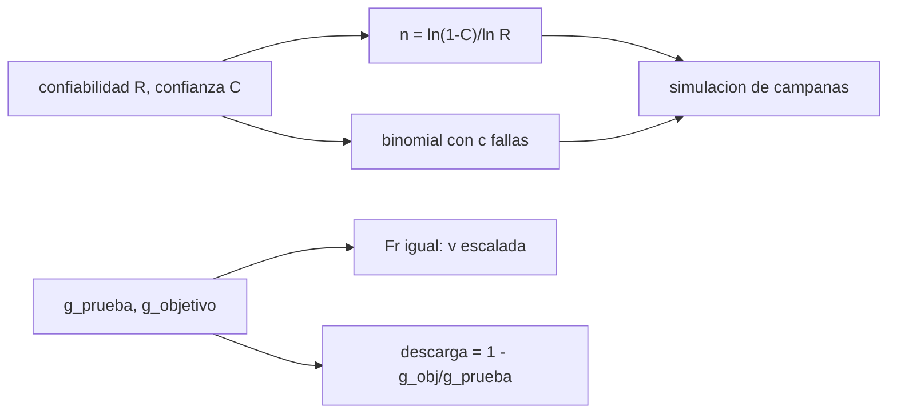

# B97-C18 — Pruebas en entornos análogos

<!-- nav:top -->
[🏠 Programa](../../../../README.md) · [📚 Bloque B97](../../../tronco-comun/B97-robotica-y-construccion-extraterrestre.md) · [← Anterior: B97-C17 — Seguridad funcional robótica](../B97-C17-seguridad-funcional-robotica/CLASE.md) · [Siguiente: B97-C19 — Logística de piezas y reparaciones →](../B97-C19-logistica-de-piezas-y-reparaciones/CLASE.md)
<!-- /nav -->

## 1. Ubicación, nivel y alcance

Clase 18 del bloque B97. Nivel N3. Una campaña de pruebas en un entorno análogo (un lugar o un montaje que se parece al de la misión) debe responder dos preguntas: cuántas pruebas hacen falta para afirmar una confiabilidad con una confianza dada, y cómo escalar la prueba cuando la gravedad del análogo no es la de la misión. Aquí aplicas el teorema de ejecución exitosa, la binomial con fallas permitidas y la semejanza de Froude. Los objetivos son **ilustrativos**.

## 2. Por qué esta clase existe

Declarar «el robot funciona» tras diez pruebas buenas no dice nada sin una confiabilidad y una confianza; y una prueba en la Tierra con el robot completo solo se parece a una en Marte si se corrige el peso. La decisión central: **¿cuántas pruebas sin fallas hacen falta para sostener una confiabilidad con una confianza dada, y cómo se escala una prueba terrestre para representar otra gravedad?**

## 3. Lo que podrás hacer al terminar

1. Calcular el número de pruebas sin fallas para una confiabilidad y confianza dadas.
2. Calcular el tamaño de la campaña si se permiten fallas.
3. Verificar por simulación la tasa de aprobación de una campaña.
4. Escalar la velocidad de una prueba por semejanza de Froude.
5. Calcular la descarga de peso necesaria en un análogo terrestre.
6. Separar lo consultado (gravedades y masa) de lo ilustrativo (objetivos y geometría).

La evidencia es la **plan de campaña de pruebas en un entorno análogo** del ejercicio 12 (sección 20).

## 4. Con qué llegas y cómo comprobarlo

1. ¿Qué es una confiabilidad?
2. ¿Qué es un nivel de confianza?
3. ¿Qué es la distribución binomial?
4. ¿Qué es un dato ilustrativo?
5. ¿Qué es una segunda vía de cálculo?

<details>
<summary>Ver respuestas</summary>

1. La probabilidad de que el sistema cumpla su función en una prueba. 2. La probabilidad de que la afirmación estadística sea correcta. 3. La distribución del número de éxitos en `n` pruebas independientes. 4. Un dato inventado de forma verosímil para el ejemplo, no medido. 5. Calcular lo mismo con otro método y comparar.
</details>

Con cuatro o cinco aciertos, sigue; si no, repasa los prerrequisitos.

## 5. Un caso de contexto y casos de referencia

Para afirmar una confiabilidad de `0,95` con confianza `0,90` sin fallas hacen falta `45` pruebas; con una falla permitida, `77`; con dos, `105`. Probar un rover de `1025 kg` en la Tierra para representar Marte exige descargar `0,620` de su peso (`6242` N) y moverlo a `0,0681` m/s para igualar el Froude de `0,042 m/s`. Es el **ejemplo conductor**; los objetivos son ilustrativos.

## 6. Vocabulario

El **teorema de ejecución exitosa** da `n = ln(1 − C)/ln R` para cero fallas. Una **campaña con fallas permitidas** usa la binomial. El **número de Froude** `Fr = v/√(g L)` compara inercia y gravedad. La **semejanza de Froude** mantiene `Fr` entre el análogo y el objetivo. El **entorno análogo** reproduce solo parte de las condiciones.

## 7. Modelo mental



*Descripción textual:* la confiabilidad y la confianza dan el tamaño de la campaña, verificado por simulación; la semejanza de Froude da la velocidad y la descarga de peso del análogo.

Analogía: probar un paracaídas lanzándolo pocas veces no demuestra nada; y probar un barco a escala exige mover el modelo más despacio. Límite: el análogo no reproduce el suelo, la temperatura ni el polvo.

## 8. La explicación, paso a paso

### 8.1 Pruebas sin fallas

`n = ⌈ln(1 − C)/ln R⌉`. Para `R = 0,95` y `C = 0,90`: `n = 45`. Para `R = 0,99`: `230` (confianza 0,90) y `299` (0,95). Para `R = 0,90` y `C = 0,90`: `22`.

### 8.2 Con fallas permitidas

Se busca el menor `n` con `P(X ≤ c) ≤ 1 − C` y `X ~ Bin(n, 1 − R)`: para `R = 0,95`, `C = 0,90`, son `45`, `77` y `105` pruebas para `c = 0, 1, 2`. Permitir una falla cuesta más pruebas, no menos.

### 8.3 Simulación

Si la confiabilidad real fuese exactamente `0,95`, una campaña de `45` pruebas sin fallas pasa con probabilidad `0,10`. En `200 000` campañas simuladas (semilla fija) pasaron `0,09982`, a `0,28` desviaciones de lo esperado.

### 8.4 Escalado de Froude

Con `Fr = v/√(g L)` igual, la velocidad terrestre que representa a Marte es `v √(g_T/g_M) = 0,0681` m/s (Luna: `0,1034` m/s). La descarga de peso es `1 − g_obj/g_T`: `0,620` para Marte (`6242` N) y `0,835` para la Luna (`8405` N). La diferencia de Froude entre objetivo y prueba escalada es `6,94e-18`. El análogo no reproduce el suelo ni el polvo.

## 9. Magnitudes, símbolos y unidades

| Símbolo | Qué es | Unidad | Valor / nota |
|---|---|---|---|
| `R` | confiabilidad | — | 0,90; 0,95; 0,99 (ilustrativas) |
| `C` | confianza | — | 0,90; 0,95 (ilustrativas) |
| `n` | número de pruebas | — | 45 (R 0,95; C 0,90) |
| `Fr` | número de Froude | — | 0,0178 (Marte) |
| `g` | gravedad | m/s² | 9,820; 3,73; 1,62 (consultadas) |

## 10. Convenciones y referencias

Pruebas independientes e idénticas; análogo que reproduce solo la gravedad por descarga de peso; velocidad y longitud característica ilustrativas; masa de Perseverance (NASA, consultada).

## 11. De dónde sale lo que afirmamos

| ID | Fuente | Localizador | Respalda | Estado |
|---|---|---|---|---|
| S1 | NASA/NSSDC, Moon Fact Sheet — https://nssdc.gsfc.nasa.gov/planetary/factsheet/moonfact.html (consultada 2026-11-10) | ficha completa leída | gravedad media 1,62 m/s²; radio medio 1737,4 km; distancia media a la Tierra 384,4 × 10³ km; rango diurno ecuatorial 95–390 K | Consultada |
| S2 | NASA/NSSDC, Mars Fact Sheet — https://nssdc.gsfc.nasa.gov/planetary/factsheet/marsfact.html (consultada 2026-11-10) | ficha completa leída | gravedad media 3,73 m/s²; radio medio 3389,5 km; distancia a la Tierra de 54,6 a 401,4 × 10⁶ km; presión 4,0–8,7 mb | Consultada |
| S3 | NASA, Mars 2020 Perseverance Rover Components — https://science.nasa.gov/mission/mars-2020-perseverance/rover-components/ (consultada 2026-11-10) | página completa leída | masa 1025 kg; seis ruedas de 52,5 cm con un motor cada una; brazo de 2,1 m; velocidad máxima ~152 m/h sobre terreno plano y duro | Consultada |
| S4 | NASA/NSSDC, Earth Fact Sheet — https://nssdc.gsfc.nasa.gov/planetary/factsheet/earthfact.html (consultada 2026-11-10) | ficha completa leída | gravedad media 9,820 m/s²; radio medio 6371,0 km | Consultada |
| — | Relaciones estándar usadas en el laboratorio | — | las verifica el laboratorio con una segunda vía | No consultada en una fuente concreta |

Límites: los objetivos de confiabilidad y confianza, la longitud característica y la velocidad no se consultaron; no se consultó ninguna norma de verificación ni campañas reales.

## 12. Cómo ver el resultado

| Magnitud | Valor |
|---|---|
| Pruebas (R 0,95; C 0,90; 0 fallas) | 45 |
| Con 1 falla | 77 |
| Con 2 fallas | 105 |
| Descarga para Marte | 0,620 |
| `v` de prueba (Marte) | 0,0681 m/s |

Descripción larga: más confiabilidad o más confianza multiplican el número de pruebas; permitir fallas obliga a más pruebas; y la descarga de peso para Marte supera la mitad del peso terrestre.

## 13. Ejemplo trabajado

**Paso 1 · Pruebas.** `ln 0,10/ln 0,95 = 44,9`, es decir `45`.

**Paso 2 · Probabilidad de pasar.** `0,95^45 = 0,0994 ≤ 0,10`.

**Paso 3 · Escalado.** `v = 0,042 √(9,82/3,73) = 0,0681` m/s.

## 14. Distintas formas de describir el problema

**Por estadística:** `n`, `R`, `C`. **Por binomial:** fallas permitidas. **Por semejanza:** Froude. **Por peso:** descarga. **Por simulación:** tasa de aprobación.

## 15. Práctica guiada

**Ejercicio 1 · con los pasos indicados.** Calcula `n` para `R = 0,90` y `C = 0,90`. *Pasos:* `ln 0,1/ln 0,9`.

<details><summary>Solución comentada</summary>

`22`.
</details>

**Ejercicio 2 · con una pista.** Predice si `R = 0,99` exige más o menos pruebas que `0,95`. *Pista:* más confiabilidad.

<details><summary>Solución comentada</summary>

Más: `230` frente a `45`.
</details>

**Ejercicio 3 · casi autónomo.** ¿Qué pasa con `n` si la confianza sube a 0,95 con `R = 0,95`?

<details><summary>Solución comentada</summary>

Sube: `ln 0,05/ln 0,95 = 58,4`, es decir `59`.
</details>

## 16. Práctica autónoma, transferencia e integrador

**Ejercicio 4 · autónomo.** Calcula la descarga de peso para la Luna.

<details><summary>Solución comentada</summary>

`0,835`, `8405` N.
</details>

**Ejercicio 5 · autónomo.** Calcula la velocidad de prueba para la Luna.

<details><summary>Solución comentada</summary>

`0,042 √(9,82/1,62) = 0,1034` m/s.
</details>

**Ejercicio 6 · autónomo.** ¿Por qué el Froude no depende de la masa?

<details><summary>Solución comentada</summary>

Porque solo compara velocidad, gravedad y longitud.
</details>

**Ejercicio 7 · autónomo.** ¿Qué significa que `0,95^45 = 0,099`?

<details><summary>Solución comentada</summary>

Que si la confiabilidad real fuera 0,95, solo el 9,9 % de las campañas pasarían sin fallas.
</details>

**Ejercicio 8 · autónomo.** ¿Qué falla de realismo tiene un análogo con descarga de peso?

<details><summary>Solución comentada</summary>

Solo reproduce la gravedad: no el suelo, la temperatura, el polvo ni la dinámica de la descarga.
</details>

**Ejercicio 9 · transferencia.** Una campaña de 45 pruebas pasa sin fallas. ¿Qué puedes afirmar? **Transferencia.**

<details><summary>Solución comentada</summary>

Que la confiabilidad es al menos 0,95 con confianza 0,90, si las pruebas son independientes y representativas.
</details>

**Ejercicio 10 · transferencia.** Se detecta una falla en la prueba 30. ¿Qué haces? **Transferencia.**

<details><summary>Solución comentada</summary>

Corregir la causa y repetir una campaña con el diseño corregido, o ampliarla con fallas permitidas; no ignorar la falla.
</details>

**Ejercicio 11 · transferencia.** ¿Qué falta para usar el resultado en una verificación real? **Transferencia.**

<details><summary>Solución comentada</summary>

Un plan aprobado con criterios de aceptación y representatividad (las normas no se consultaron).
</details>

**Ejercicio 12 · integrador.** Elabora tu *plan de campaña de pruebas en un entorno análogo*: tabla de `n` con 0, 1 y 2 fallas, tasa de aprobación simulada, velocidad y descarga de peso escaladas, y los límites del análogo. **Integrador.**

<details><summary>Solución comentada</summary>

Secciones 8.1–8.4 y la salida del laboratorio.
</details>

## 17. Laboratorio

El script [campana_analoga.py](campana_analoga.py) calcula el tamaño de campañas con y sin fallas, simula su tasa de aprobación y escala la velocidad y la descarga de peso por Froude (**comprueba** n mínimo, tasa dentro de 3 sigma y coherencia algebraica del Froude).

**Datos:** gravedades y masa (NASA/NSSDC y NASA, consultadas); objetivos, longitud, velocidad y semilla **ilustrativos**. **Predice antes de ejecutar:** ¿Cuántas pruebas sin fallas hacen falta para `R = 0,95` y `C = 0,90`? (45.) **Ejecución del 2026-11-10 (Python 3.12.9):**

```text
Python 3.12.9 (biblioteca estandar)
Campana de pruebas ILUSTRATIVA (pruebas independientes, confiabilidad R, confianza C):
   R     C    n (0 fallas)  R^n      n (<=0)  n (<=1)  n (<=2)
 0.90  0.90         22    0.09848       22       38       52
 0.90  0.95         29    0.04710       29       46       61
 0.95  0.90         45    0.09944       45       77      105
 0.95  0.95         59    0.04849       59       93      124
 0.99  0.90        230    0.09910      230      388      531
 0.99  0.95        299    0.04954      299      473      628
Simulacion de 200000 campanas de 45 pruebas con R = 0.95: tasa de aprobacion = 0.09982 (esperado 0.10000); desviacion = 0.28 sigma
Escalado de Froude (L = 1.5 m, v objetivo = 0.042 m/s, masa 1025 kg):
  Marte: v de prueba en la Tierra = 0.0681 m/s; fraccion a descargar = 62.0 % (6242 N); Fr = 0.0178
  Luna: v de prueba en la Tierra = 0.1034 m/s; fraccion a descargar = 83.5 % (8405 N); Fr = 0.0269
Diferencia de Froude entre el objetivo y la prueba escalada = 6.94e-18
Pruebas superadas.
```

```bash
python programa/clases/B97/B97-C18-pruebas-en-entornos-analogos/campana_analoga.py
```

**Límites:** pruebas independientes e idénticas; el análogo reproduce solo la gravedad; sin dependencia del suelo ni de la temperatura; la igualdad de Froude es una identidad algebraica (comprueba el código, no el análogo).

## 18. Errores frecuentes y cómo corregirlos

**Declarar confiabilidad sin confianza.** Los dos números van juntos (8.1)

**Pensar que permitir una falla reduce las pruebas.** Las aumenta (8.2)

**Probar a la velocidad objetivo en la Tierra.** Hay que escalar por Froude (8.4)

**Tomar los objetivos como requisitos.** Son ilustrativos; ver la sección 10

## 19. Cómo sabrás que vas bien

Tras la sección 8: ¿cuántas pruebas esperabas y cuántas obtuviste? Si dudas, repasa el ejemplo 13. Tras el laboratorio: ¿qué comprueba? (ver la sección 17).

## 20. Qué entregas y cómo se evalúa

El producto es tu **plan de campaña de pruebas en un entorno análogo** (ejercicio 12).

| Criterio | Inicial | En desarrollo | Logrado | Destacado |
|---|---|---|---|---|
| Conceptos | Los confunde | Parciales | Explica el modelo y sus supuestos | Explica los límites |
| Cálculo | Sin unidades | Con errores | Tablas completas con unidades | Calcula casos nuevos |
| Numérico | Sin comprobar | Un caso | Contraste con una segunda vía | Interpreta las diferencias |
| Fuentes | Sin fuente | Sin fecha | Fuentes con fecha y estado | Declara lo ilustrativo y lo no consultado |
| Límites | No los nombra | Uno | Tres | Discute qué falta del modelo |

**Condiciones críticas (no se compensan con promedio):** rotular los datos sintéticos e ilustrativos; no presentar un resultado simulado como observado o medido; citar solo lo consultado.

## 21. Ética, seguridad y límites

Clase educativa: los modelos son simplificados y sus datos son sintéticos o ilustrativos; ningún resultado describe una misión real, certifica un diseño ni sustituye a las normas aplicables ni a las pruebas de hardware.  Accesibilidad: tablas equivalentes a las gráficas, fórmulas en texto, ejercicios sin conexión.

## 22. Para cerrar y seguir

Sostener `R = 0,95` con `C = 0,90` cuesta `45` pruebas sin fallas; representar Marte en la Tierra exige descargar `0,62` del peso. Queda una pregunta: ¿cómo se gestionan las piezas y las reparaciones de una flota?

**Glosario español–inglés.** ejecución exitosa · *success run*; confiabilidad · *reliability*; semejanza de Froude · *Froude similarity*; entorno análogo · *analog environment*; descarga de peso · *gravity offload*.

**Continuidad.** [B97-C19](../B97-C19-logistica-de-piezas-y-reparaciones/CLASE.md) estudia la logística de piezas y reparaciones.

**Referencias:** ver sección 11.

<!-- nav:bottom -->
---

[← Anterior: B97-C17 — Seguridad funcional robótica](../B97-C17-seguridad-funcional-robotica/CLASE.md) · [📚 Bloque B97](../../../tronco-comun/B97-robotica-y-construccion-extraterrestre.md) · [Siguiente: B97-C19 — Logística de piezas y reparaciones →](../B97-C19-logistica-de-piezas-y-reparaciones/CLASE.md)
<!-- /nav -->
