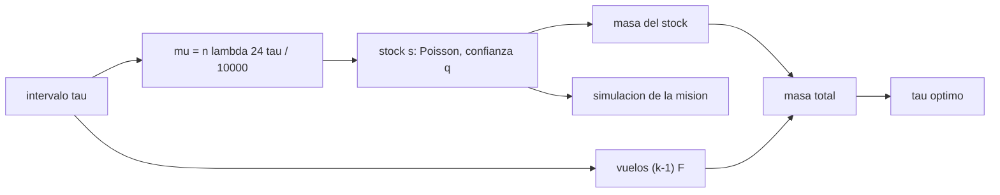

# B97-C19 — Logística de piezas y reparaciones

<!-- nav:top -->
[🏠 Programa](../../../../README.md) · [📚 Bloque B97](../../../tronco-comun/B97-robotica-y-construccion-extraterrestre.md) · [← Anterior: B97-C18 — Pruebas en entornos análogos](../B97-C18-pruebas-en-entornos-analogos/CLASE.md) · [Siguiente: B97-C20 — Misión robótica integrada simulada →](../B97-C20-mision-robotica-integrada-simulada/CLASE.md)
<!-- /nav -->

## 1. Ubicación, nivel y alcance

Clase 19 del bloque B97. Nivel N3. Una base con robots que se averían necesita repuestos, y cada repuesto pesa. Se pueden llevar muchos al inicio o reabastecer con frecuencia, pero cada vuelo tiene un costo fijo. Aquí dimensionas el stock inicial de un kit con Poisson para una confianza de misión del 95 %, comparas intervalos de reabastecimiento de 30 a 720 días y verificas la confianza por simulación. Todos los datos son **sintéticos**.

## 2. Por qué esta clase existe

Un stock grande cuesta masa inicial; reabastecer a menudo cuesta vuelos. El mínimo está en un punto intermedio que solo aparece al calcular ambos efectos con la misma confianza de misión. La decisión central: **¿cada cuántos días conviene reabastecer para que la masa total del kit y los vuelos sea mínima con 95 % de confianza de no quedarse sin repuestos?**

## 3. Lo que podrás hacer al terminar

1. Calcular las fallas esperadas por intervalo de reabastecimiento.
2. Dimensionar el stock por tipo con Poisson para una confianza de misión dada.
3. Calcular la masa total con stock, vuelos y consumo.
4. Encontrar el intervalo de masa total mínima.
5. Verificar la confianza de la misión por simulación.
6. Separar lo sintético (todo) de lo consultado (nada).

La evidencia es la **ficha de kit de repuestos y reabastecimiento** del ejercicio 12 (sección 20).

## 4. Con qué llegas y cómo comprobarlo

1. ¿Qué es un proceso de Poisson?
2. ¿Qué es una confianza de misión?
3. ¿Qué es un costo fijo frente a uno variable?
4. ¿Qué es un dato sintético?
5. ¿Qué es una segunda vía de cálculo?

<details>
<summary>Ver respuestas</summary>

1. Un modelo de eventos independientes de tasa constante. 2. La probabilidad de que no falten repuestos en toda la misión. 3. El fijo no depende de la cantidad; el variable crece con ella. 4. Un dato generado para el ejemplo, no medido. 5. Calcular lo mismo con otro método y comparar.
</details>

Con cuatro o cinco aciertos, sigue; si no, repasa los prerrequisitos.

## 5. Un caso de contexto y casos de referencia

Para una misión de `720 d` con tres tipos de unidad y `10 kg` equivalentes por vuelo, el intervalo de masa total mínima es `240` d (`3` intervalos): `159,0` kg, frente a `202,7` kg sin reabastecimiento. Es el **ejemplo conductor**; todo es sintético.

## 6. Vocabulario

El **stock inicial** es la cantidad de repuestos al comienzo de cada intervalo. El **intervalo de reabastecimiento** `τ` es el tiempo entre vuelos. La **confianza de misión** es la probabilidad de no quedarse sin repuestos en ningún intervalo. El **consumo** es la masa esperada de repuestos usados.

## 7. Modelo mental



*Descripción textual:* el intervalo fija las fallas esperadas y el stock; el stock y los vuelos suman la masa total, cuyo mínimo da el intervalo óptimo; la simulación comprueba la confianza.

Analogía: abastecer una cabaña con víveres; mucha despensa pesa, ir al pueblo cada día cuesta tiempo, y lo razonable está en medio. Límite: aquí el reabastecimiento es instantáneo y no falla.

## 8. La explicación, paso a paso

### 8.1 Fallas por intervalo

`μ_i = n_i λ_i · 24 τ / 10 000`. Con `τ = 30 d`, los tipos tienen `μ` pequeños; con `τ = 720 d`, son 24 veces mayores.

### 8.2 Stock

Para cada tipo se elige el menor `s` con `P(X ≤ s) ≥ q`, `q = 0,95^(1/(3k))`: la confianza de misión es el producto sobre intervalos y tipos. El plan de `τ = 240` d tiene stock de `65,2` kg y confianza analítica `0,9652`.

### 8.3 Masa total

`masa total = stock + (k − 1) F + consumo`. Con un solo vuelo (sin reabastecimiento) el stock es `128,9` kg y el total `202,7` kg; con `τ = 30 d`, `332,4` kg; el mínimo está en `τ = 240` d con `159,0` kg. El ahorro frente a no reabastecer es `43,7` kg. El consumo esperado, `73,8` kg, es el mismo en todos los planes.

### 8.4 Simulación

La misión completa simulada con ese plan (`100 000` repeticiones, semilla fija) da `0,9663` de éxito, a `1,99` desviaciones de la confianza analítica. Esto verifica el cálculo, no que las tasas, masas o el costo de vuelo sean realistas.

## 9. Magnitudes, símbolos y unidades

| Símbolo | Qué es | Unidad | Valor / nota |
|---|---|---|---|
| `τ` | intervalo de reabastecimiento | d | 30–720 (ilustrativo) |
| `F` | costo fijo por vuelo | kg | 10 (ilustrativo) |
| `s` | stock por tipo | — | ver la tabla |
| `q` | confianza por intervalo y tipo | — | 0,95^(1/(3k)) |
| `k` | intervalos | — | 3 (óptimo) |

## 10. Convenciones y referencias

Misión de 720 días, tres tipos de unidad con tasas de Poisson independientes, reabastecimiento instantáneo, sin fallas del vuelo ni retrasos. Todos los datos son sintéticos.

## 11. De dónde sale lo que afirmamos

| ID | Fuente | Localizador | Respalda | Estado |
|---|---|---|---|---|
| — | Relaciones estándar usadas en el laboratorio | — | las verifica el laboratorio con una segunda vía | No consultada en una fuente concreta |

Límites: no se consultó ninguna tasa de falla, masa ni costo de vuelo; el caso es sintético.

## 12. Cómo ver el resultado

| Magnitud | Valor |
|---|---|
| Intervalo óptimo | 240 d |
| Masa total óptima | 159,0 kg |
| Sin reabastecer | 202,7 kg |
| Ahorro | 43,7 kg |
| Confianza simulada | 0,9663 |

Descripción larga: la masa total tiene un mínimo en un intervalo intermedio: más vuelos suman costo fijo y menos vuelos exigen más stock.

## 13. Ejemplo trabajado

**Paso 1 · Fallas por intervalo.** Motor, `τ = 120 d`: `6 × 1,2 × 24 × 120/10 000 = 2,07`.

**Paso 2 · Stock.** Menor `s` con `P(X ≤ s) ≥ q`.

**Paso 3 · Total.** `stock + (k−1) F + consumo`; el laboratorio da `159,0` kg en el óptimo.

## 14. Distintas formas de describir el problema

**Por intervalo:** `τ`. **Por stock:** repuestos y kg. **Por vuelos:** número y masa. **Por confianza:** analítica y simulada. **Por total:** suma de masas.

## 15. Práctica guiada

**Ejercicio 1 · con los pasos indicados.** Calcula `μ` del controlador (2 unidades, `λ = 0,8`) para `τ = 60 d`. *Pasos:* `n λ 24 τ/10 000`.

<details><summary>Solución comentada</summary>

`2 × 0,8 × 24 × 60/10 000 = 0,2304`.
</details>

**Ejercicio 2 · con una pista.** Predice si el stock inicial crece o baja con `τ`. *Pista:* más tiempo, más fallas.

<details><summary>Solución comentada</summary>

Crece.
</details>

**Ejercicio 3 · casi autónomo.** ¿Qué pasa con el número de vuelos al duplicar `τ`?

<details><summary>Solución comentada</summary>

Se reduce a la mitad aproximadamente.
</details>

## 16. Práctica autónoma, transferencia e integrador

**Ejercicio 4 · autónomo.** ¿Por qué el consumo esperado no depende de `τ`?

<details><summary>Solución comentada</summary>

Porque es la masa de repuestos usados en total en 720 días.
</details>

**Ejercicio 5 · autónomo.** ¿Qué pasa si el costo por vuelo sube a 40 kg?

<details><summary>Solución comentada</summary>

El intervalo óptimo se alarga: conviene reabastecer menos veces.
</details>

**Ejercicio 6 · autónomo.** ¿Qué pasa con la confianza de misión si se exige 99 %?

<details><summary>Solución comentada</summary>

Sube el stock y se desplaza el óptimo.
</details>

**Ejercicio 7 · autónomo.** ¿Cuántos vuelos hay con `τ = 180 d`?

<details><summary>Solución comentada</summary>

`k − 1 = 3`.
</details>

**Ejercicio 8 · autónomo.** ¿Qué mide el criterio de 3 sigma en la simulación?

<details><summary>Solución comentada</summary>

Que la frecuencia simulada y la analítica concuerdan dentro del ruido.
</details>

**Ejercicio 9 · transferencia.** Un vuelo se retrasa 20 días. ¿Qué no cubre el modelo? **Transferencia.**

<details><summary>Solución comentada</summary>

El retraso aumenta el intervalo efectivo: hay que dimensionar con margen.
</details>

**Ejercicio 10 · transferencia.** Las piezas se pueden fabricar en el lugar con impresión 3D. ¿Qué cambia? **Transferencia.**

<details><summary>Solución comentada</summary>

El stock de piezas imprimibles baja y el costo pasa a energía y material (ver C15).
</details>

**Ejercicio 11 · transferencia.** ¿Qué falta para pasar a una misión real? **Transferencia.**

<details><summary>Solución comentada</summary>

Tasas con evidencia, criticidad por pieza, costos de vuelo reales y restricciones de ventanas de lanzamiento.
</details>

**Ejercicio 12 · integrador.** Elabora tu *ficha de kit de repuestos y reabastecimiento*: tabla de intervalos con stock, vuelos, consumo, total y confianza, y la comprobación por simulación, todo rotulado como sintético. **Integrador.**

<details><summary>Solución comentada</summary>

Secciones 8.1–8.4 y la salida del laboratorio.
</details>

## 17. Laboratorio

El script [kit_reabastecimiento.py](kit_reabastecimiento.py) dimensiona el stock para ocho intervalos de reabastecimiento, calcula la masa total, elige el mínimo y simula la misión (**comprueba** simulación dentro de 3 sigma y confianza analítica ≥ 95 % en todos los planes).

**Datos:** **sintéticos** (tipos, tasas, masas, costo de vuelo, misión y semilla); no se usa ningún dato publicado. **Predice antes de ejecutar:** ¿Será mínimo el total sin reabastecimiento? (No: el mínimo es interior.) **Ejecución del 2026-11-10 (Python 3.12.9):**

```text
Python 3.12.9 (biblioteca estandar)
Datos SINTETICOS: mision de 720 dias; costo por vuelo 10 kg; confianza de mision 95 %; semilla 20261110
 tau [d]  intervalos  stock [kg]  vuelos [kg]  consumo [kg]  total [kg]  confianza analitica
     30         24        28.6        230.0          73.8       332.4           98.59 %
     60         12        37.3        110.0          73.8       221.1           98.79 %
     90          8        41.3         70.0          73.8       185.1           97.76 %
    120          6        48.5         50.0          73.8       172.3           97.98 %
    180          4        61.2         30.0          73.8       165.0           98.68 %
    240          3        65.2         20.0          73.8       159.0           96.52 %
    360          2        85.1         10.0          73.8       168.9           97.48 %
    720          1       128.9          0.0          73.8       202.7           96.47 %
Intervalo de masa total minima: 240 d (3 intervalos); total = 159.0 kg frente a 202.7 kg sin reabastecimiento (ahorro 43.7 kg)
Simulacion de la mision con ese plan: confianza = 96.63 % (analitica 96.52 %; 1.99 sigma)
Pruebas superadas.
```

```bash
python programa/clases/B97/B97-C19-logistica-de-piezas-y-reparaciones/kit_reabastecimiento.py
```

**Límites:** reabastecimiento instantáneo y sin fallas, sin retrasos de entrega ni ventanas de lanzamiento; fallas independientes de tasa constante.

## 18. Errores frecuentes y cómo corregirlos

**Medir solo la masa del stock.** Hay que sumar vuelos y consumo (8.3)

**Exigir 95 % por intervalo y tipo.** La confianza de misión es un producto (8.2)

**Suponer entregas sin retraso.** El modelo las excluye; ver la sección 10

**Tomar los costos como reales.** Son sintéticos; ver la sección 10

## 19. Cómo sabrás que vas bien

Tras la sección 8: ¿qué intervalo esperabas como óptimo y cuál obtuviste? Si dudas, repasa el ejemplo 13. Tras el laboratorio: ¿qué comprueba? (ver la sección 17).

## 20. Qué entregas y cómo se evalúa

El producto es tu **ficha de kit de repuestos y reabastecimiento** (ejercicio 12).

| Criterio | Inicial | En desarrollo | Logrado | Destacado |
|---|---|---|---|---|
| Conceptos | Los confunde | Parciales | Explica el modelo y sus supuestos | Explica los límites |
| Cálculo | Sin unidades | Con errores | Tablas completas con unidades | Calcula casos nuevos |
| Numérico | Sin comprobar | Un caso | Contraste con una segunda vía | Interpreta las diferencias |
| Fuentes | Sin fuente | Sin fecha | Fuentes con fecha y estado | Declara lo ilustrativo y lo no consultado |
| Límites | No los nombra | Uno | Tres | Discute qué falta del modelo |

**Condiciones críticas (no se compensan con promedio):** rotular los datos sintéticos e ilustrativos; no presentar un resultado simulado como observado o medido; citar solo lo consultado.

## 21. Ética, seguridad y límites

Clase educativa: los modelos son simplificados y sus datos son sintéticos o ilustrativos; ningún resultado describe una misión real, certifica un diseño ni sustituye a las normas aplicables ni a las pruebas de hardware.  Accesibilidad: tablas equivalentes a las gráficas, fórmulas en texto, ejercicios sin conexión.

## 22. Para cerrar y seguir

El plan de masa mínima reabastece cada `240` días y pesa `159` kg frente a `203` kg sin reabastecer. Queda una pregunta: ¿cómo se junta todo esto en una misión robótica simulada?

**Glosario español–inglés.** reabastecimiento · *resupply*; stock · *stock*; intervalo · *interval*; confianza de misión · *mission confidence*; consumo · *consumption*.

**Continuidad.** [B97-C20](../B97-C20-mision-robotica-integrada-simulada/CLASE.md) estudia la misión robótica integrada simulada.

**Referencias:** ver sección 11.

<!-- nav:bottom -->
---

[← Anterior: B97-C18 — Pruebas en entornos análogos](../B97-C18-pruebas-en-entornos-analogos/CLASE.md) · [📚 Bloque B97](../../../tronco-comun/B97-robotica-y-construccion-extraterrestre.md) · [Siguiente: B97-C20 — Misión robótica integrada simulada →](../B97-C20-mision-robotica-integrada-simulada/CLASE.md)
<!-- /nav -->
