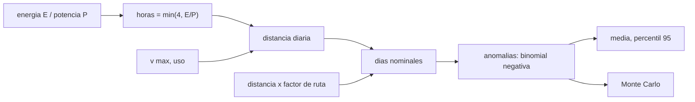

# B97-C20 — Misión robótica integrada simulada

<!-- nav:top -->
[🏠 Programa](../../../../README.md) · [📚 Bloque B97](../../../tronco-comun/B97-robotica-y-construccion-extraterrestre.md) · [← Anterior: B97-C19 — Logística de piezas y reparaciones](../B97-C19-logistica-de-piezas-y-reparaciones/CLASE.md) · [Siguiente: B97-C21 — Clasificación y priorización autónoma de muestras a bordo →](../B97-C21-clasificacion-y-priorizacion-autonoma-de-muestras-a-bordo/CLASE.md)
<!-- /nav -->

## 1. Ubicación, nivel y alcance

Clase 20 del bloque B97. Nivel N3. Una misión robótica integra movilidad, energía, planificación y fallas. Aquí armas la versión más pequeña y verificable: un rover que debe recorrer una ruta, con un límite de energía y de horas por día, un factor de ruta que viene de un planificador y una probabilidad de anomalia que pierde un día. Calculas los días nominales, la distribución de la duración por Monte Carlo y la sensibilidad a cada parámetro. Todo es **sintético**, salvo la velocidad máxima de Perseverance, que está consultada.

## 2. Por qué esta clase existe

Una misión se diseña con un presupuesto de días y de margen. Un modelo integrado, aunque simple, muestra cuál parámetro domina y cuánto margen pide una anomalía, antes de invertir en simulaciones detalladas. La decisión central: **¿cuántos días hacen falta con un 95 % de confianza para llegar a la meta, y qué parámetro mueve más ese número?**

## 3. Lo que podrás hacer al terminar

1. Combinar límites de tiempo y energía en una distancia diaria.
2. Calcular los días nominales con un factor de ruta.
3. Modelar las anomalías como días perdidos y calcular su efecto esperado.
4. Simular la misión y comparar con la media y la varianza analíticas.
5. Calcular el percentil 95 de la duración.
6. Hacer un análisis de sensibilidad y separar lo consultado de lo sintético.

La evidencia es la **informe de una misión robótica simulada** del ejercicio 12 (sección 20).

## 4. Con qué llegas y cómo comprobarlo

1. ¿Qué es una distribución binomial negativa?
2. ¿Qué es un percentil?
3. ¿Qué es un análisis de sensibilidad?
4. ¿Qué es un dato sintético?
5. ¿Qué es una segunda vía de cálculo?

<details>
<summary>Ver respuestas</summary>

1. La distribución del número de intentos hasta lograr `n` éxitos. 2. El valor bajo el cual queda una fracción dada de los datos. 3. Variar un parámetro a la vez para ver su efecto. 4. Un dato generado para el ejemplo, no medido. 5. Calcular lo mismo con otro método y comparar.
</details>

Con cuatro o cinco aciertos, sigue; si no, repasa los prerrequisitos.

## 5. Un caso de contexto y casos de referencia

Un rover sintético debe llegar a `3000 m` en línea recta con un factor de ruta de `1,274` (de C08). Con `3,00` h de conducción por día (limitadas por la batería) avanza `228,0` m por día y necesita `17` días nominales; con anomalías de `5 %` el tiempo esperado es `17,89` d y el percentil 95 es `20` d. Es el **ejemplo conductor**.

## 6. Vocabulario

La **distancia diaria** es velocidad × uso × horas. Los **días nominales** son `⌈D f/d⌉`. Una **anomalía** pierde el día. El **percentil 95** es el tiempo que se supera solo el 5 % de las veces. La **sensibilidad** mide el cambio de resultado al variar un parámetro.

## 7. Modelo mental



*Descripción textual:* la energía y el tiempo fijan las horas útiles; con la velocidad dan la distancia diaria; la distancia por el factor de ruta da los días nominales y las anomalías los alargan.

Analogía: una excursión con jornadas limitadas por la luz y por la batería de la linterna, y con algún día perdido por mal tiempo. Límite: aquí no hay pendientes, comunicación ni degradación.

## 8. La explicación, paso a paso

### 8.1 Horas y distancia diaria

`h = min(4 h, E/P) = min(4, 1,2/0,4) = 3,00` h, limitadas por la batería. `d = v · uso · h = 152 m/h × 0,5 × 3,00 h = 228,0` m por día.

### 8.2 Días nominales

`N = ⌈3000 × 1,274/228,0⌉ = 17` días.

### 8.3 Anomalías

Cada día falla con `p = 0,05`: los días hasta `N` éxitos siguen una binomial negativa, con media `N/(1 − p) = 17,89` d y desviación `0,970` d. La simulación (`20 000` misiones) da `17,90` y `0,974` d; la diferencia de la media es `0,45` sigmas. El percentil 95 es `20` d: hay que presupuestar `20` d, no `17`.

### 8.4 Sensibilidad

Días nominales con cada cambio de ±20 %: uso +20 %: `14`; uso −20 %: `21`; ruta +20 %: `21`; distancia +20 %: `21`; batería +20 %: `14`; batería −20 %: `21` (frente a `17` nominales). El uso y la ruta actúan siempre sobre la distancia diaria; la batería solo mientras limita las horas (aquí limita, porque `E/P` es menor que 4 h).

## 9. Magnitudes, símbolos y unidades

| Símbolo | Qué es | Unidad | Valor / nota |
|---|---|---|---|
| `D` | distancia en línea recta | m | 3000 (sintética) |
| `f` | factor de ruta | — | 1,274 (de C08) |
| `v` | velocidad máxima | m/h | 152 (consultada) |
| `p` | probabilidad de anomalía por día | — | 0,05 (sintética) |
| `N` | días nominales | d | 17 |

## 10. Convenciones y referencias

Distancia diaria constante, anomalías independientes de probabilidad 5 % por día con pérdida del día completo, sin pendientes ni ventanas de comunicación; el factor de ruta viene de un mapa sintético; solo la velocidad máxima es un valor consultado.

## 11. De dónde sale lo que afirmamos

| ID | Fuente | Localizador | Respalda | Estado |
|---|---|---|---|---|
| S1 | NASA, Mars 2020 Perseverance Rover Components — https://science.nasa.gov/mission/mars-2020-perseverance/rover-components/ (consultada 2026-11-10) | página completa leída | masa 1025 kg; seis ruedas de 52,5 cm con un motor cada una; brazo de 2,1 m; velocidad máxima ~152 m/h sobre terreno plano y duro | Consultada |
| — | Relaciones estándar usadas en el laboratorio | — | las verifica el laboratorio con una segunda vía | No consultada en una fuente concreta |

Límites: no se consultó ninguna misión real ni datos de anomalías; las horas, la batería, la potencia, la probabilidad de anomalía y la distancia son sintéticas; esta no es la misión de Perseverance.

## 12. Cómo ver el resultado

| Magnitud | Valor |
|---|---|
| Horas por día | 3,00 h |
| Distancia diaria | 228,0 m |
| Días nominales | 17 |
| Esperado con anomalías | 17,89 d |
| Percentil 95 | 20 d |

Descripción larga: la anomalía suma un día esperado y el percentil 95 añade otros; el presupuesto de días debe incluir ese margen.

## 13. Ejemplo trabajado

**Paso 1 · Distancia diaria.** `152 × 0,5 × 3 = 228` m (el límite es de 3 h por la batería).

**Paso 2 · Días nominales.** `3000 × 1,274/228,0` redondeado hacia arriba: `17`.

**Paso 3 · Con anomalías.** `17/0,95 = 17,89` d.

## 14. Distintas formas de describir el problema

**Por tiempo:** horas por día. **Por energía:** `E/P`. **Por distancia:** m por día. **Por riesgo:** media y percentil 95. **Por sensibilidad:** variación de los días nominales.

## 15. Práctica guiada

**Ejercicio 1 · con los pasos indicados.** Calcula las horas de conducción si `E = 1,2 kWh` y `P = 0,4 kW`. *Pasos:* `E/P`.

<details><summary>Solución comentada</summary>

`3 h`.
</details>

**Ejercicio 2 · con una pista.** Predice si la batería o el tiempo limita. *Pista:* compara `E/P` con 4 h.

<details><summary>Solución comentada</summary>

La batería (`3 h < 4 h`).
</details>

**Ejercicio 3 · casi autónomo.** Calcula los días nominales con uso 0,7.

<details><summary>Solución comentada</summary>

`3822/(152 × 0,7 × 3) = 11,97`, es decir `12` días.
</details>

## 16. Práctica autónoma, transferencia e integrador

**Ejercicio 4 · autónomo.** ¿Qué efecto tiene una anomalía diaria de 10 % sobre la media?

<details><summary>Solución comentada</summary>

`N/0,9 = 1,11 N`.
</details>

**Ejercicio 5 · autónomo.** ¿Cuál es la media si `N = 17` y `p = 0,05`?

<details><summary>Solución comentada</summary>

`17/0,95 = 17,89` d.
</details>

**Ejercicio 6 · autónomo.** ¿Por qué el percentil 95 es mayor que la media?

<details><summary>Solución comentada</summary>

Porque la distribución tiene cola hacia días más largos.
</details>

**Ejercicio 7 · autónomo.** ¿Qué pasa con los días si la ruta se alarga 20 %?

<details><summary>Solución comentada</summary>

Aumentan en proporción: ver la tabla.
</details>

**Ejercicio 8 · autónomo.** ¿Por qué la batería +20 % no cambiaría los días si el tiempo limitara?

<details><summary>Solución comentada</summary>

Porque entonces el límite es el tiempo de 4 h y más energía no suma horas.
</details>

**Ejercicio 9 · transferencia.** Una pendiente reduce el uso a 0,3 en un tramo. ¿Cómo lo modelas? **Transferencia.**

<details><summary>Solución comentada</summary>

Con una distancia diaria por tramo, sumando los días de cada tramo.
</details>

**Ejercicio 10 · transferencia.** Hay una tormenta de polvo que reduce la energía. ¿Qué parámetro cambia? **Transferencia.**

<details><summary>Solución comentada</summary>

`E`: baja las horas útiles si `E/P < 4 h`.
</details>

**Ejercicio 11 · transferencia.** ¿Cómo se integra el retardo de comunicación del bloque? **Transferencia.**

<details><summary>Solución comentada</summary>

Con un plan por día y un día perdido si el plan no llega (ver C07).
</details>

**Ejercicio 12 · integrador.** Elabora tu *informe de una misión robótica simulada*: parámetros (consultados y sintéticos), días nominales, media, percentil 95, sensibilidad y límites del simulador. **Integrador.**

<details><summary>Solución comentada</summary>

Secciones 8.1–8.4 y la salida del laboratorio.
</details>

## 17. Laboratorio

El script [mision_integrada.py](mision_integrada.py) combina energía, tiempo, ruta y anomalías, simula la misión y contrasta con la media y varianza analíticas, y calcula la sensibilidad (**comprueba** media dentro de 3 sigma y desviación dentro de 5 %).

**Datos:** velocidad máxima de Perseverance (NASA, consultada); factor de ruta de C08, y el resto **sintético**. **Predice antes de ejecutar:** ¿Qué parámetro mueve más los días nominales? (Ver la tabla de sensibilidad.) **Ejecución del 2026-11-10 (Python 3.12.9):**

```text
Python 3.12.9 (biblioteca estandar)
Mision SINTETICA: meta a 3000 m (en linea recta), factor de ruta 1.274; v max 152 m/h (consultada), uso 0.5
Horas de conduccion por dia = 3.00 h (limitadas por energia); distancia diaria = 228.0 m; dias nominales = 17
Con anomalias (p = 0.05) el tiempo esperado es 17.89 d (simulado 17.90 d); desviacion tipica analitica 0.970 d, simulada 0.974 d
Percentil 95 de la duracion = 20 d; minimo 17 d; maximo 24 d; diferencia de la media = 0.45 sigma
Sensibilidad de los dias nominales:
  uso +20 %        -> 14 d (-3)
  uso -20 %        -> 21 d (+4)
  ruta +20 %       -> 21 d (+4)
  bateria +20 %    -> 14 d (-3)
  bateria -20 %    -> 21 d (+4)
  distancia +20 %  -> 21 d (+4)
Pruebas superadas.
```

```bash
python programa/clases/B97/B97-C20-mision-robotica-integrada-simulada/mision_integrada.py
```

**Límites:** distancia diaria constante, anomalías independientes con pérdida del día, sin pendientes, comunicación ni degradación; no es una misión real.

## 18. Errores frecuentes y cómo corregirlos

**Presupuestar solo los días nominales.** Las anomalías añaden media y cola (8.3)

**Creer que más batería siempre ayuda.** Solo si limita la energía (ejercicio 8)

**Presentar la misión como real.** Es sintética; ver la sección 10

**Olvidar el factor de ruta.** La distancia real es mayor que la recta (8.2)

## 19. Cómo sabrás que vas bien

Tras la sección 8: ¿cuántos días esperabas y cuántos obtuviste? Si dudas, repasa el ejemplo 13. Tras el laboratorio: ¿qué comprueba? (ver la sección 17).

## 20. Qué entregas y cómo se evalúa

El producto es tu **informe de una misión robótica simulada** (ejercicio 12).

| Criterio | Inicial | En desarrollo | Logrado | Destacado |
|---|---|---|---|---|
| Conceptos | Los confunde | Parciales | Explica el modelo y sus supuestos | Explica los límites |
| Cálculo | Sin unidades | Con errores | Tablas completas con unidades | Calcula casos nuevos |
| Numérico | Sin comprobar | Un caso | Contraste con una segunda vía | Interpreta las diferencias |
| Fuentes | Sin fuente | Sin fecha | Fuentes con fecha y estado | Declara lo ilustrativo y lo no consultado |
| Límites | No los nombra | Uno | Tres | Discute qué falta del modelo |

**Condiciones críticas (no se compensan con promedio):** rotular los datos sintéticos e ilustrativos; no presentar un resultado simulado como observado o medido; citar solo lo consultado.

## 21. Ética, seguridad y límites

Clase educativa: los modelos son simplificados y sus datos son sintéticos o ilustrativos; ningún resultado describe una misión real, certifica un diseño ni sustituye a las normas aplicables ni a las pruebas de hardware.  Accesibilidad: tablas equivalentes a las gráficas, fórmulas en texto, ejercicios sin conexión.

## 22. Para cerrar y seguir

La misión sintética necesita `17` días nominales y se presupuestan `20` d con 95 % de confianza. Queda una pregunta: ¿cómo se diseña un simulador que dé confianza en estos números?

**Glosario español–inglés.** distancia diaria · *daily distance*; anomalía · *anomaly*; percentil · *percentile*; sensibilidad · *sensitivity*; misión simulada · *simulated mission*.

**Continuidad.** [B97-C21](../B97-C21-clasificacion-y-priorizacion-autonoma-de-muestras-a-bordo/CLASE.md) estudia la clasificación autónoma de muestras a bordo.

**Referencias:** ver sección 11.

<!-- nav:bottom -->
---

[← Anterior: B97-C19 — Logística de piezas y reparaciones](../B97-C19-logistica-de-piezas-y-reparaciones/CLASE.md) · [📚 Bloque B97](../../../tronco-comun/B97-robotica-y-construccion-extraterrestre.md) · [Siguiente: B97-C21 — Clasificación y priorización autónoma de muestras a bordo →](../B97-C21-clasificacion-y-priorizacion-autonoma-de-muestras-a-bordo/CLASE.md)
<!-- /nav -->
