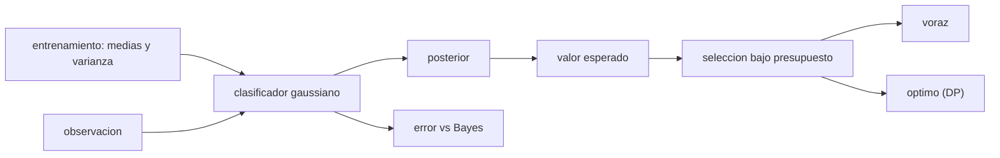

# B97-C21 — Clasificación y priorización autónoma de muestras a bordo

<!-- nav:top -->
[🏠 Programa](../../../../README.md) · [📚 Bloque B97](../../../tronco-comun/B97-robotica-y-construccion-extraterrestre.md) · [← Anterior: B97-C20 — Misión robótica integrada simulada](../B97-C20-mision-robotica-integrada-simulada/CLASE.md) · [Siguiente: B97-C22 — Detección autónoma de eventos científicos →](../B97-C22-deteccion-autonoma-de-eventos-cientificos/CLASE.md)
<!-- /nav -->

## 1. Ubicación, nivel y alcance

Clase 21 del bloque B97. Nivel N3. Un robot que lleva un espectrómetro no puede transmitir todo lo que mide. Si clasifica a bordo cada observación y estima cuán probable es que sea de interés, puede decidir qué enviar primero. Aquí entrenas un clasificador gaussiano con espectros **sintéticos** (dos rasgos), mides su error contra el error de Bayes analítico y resuelves la selección de datos bajo un presupuesto de enlace con una regla voraz y con programación dinámica. Nada representa una mineralogía real.

## 2. Por qué esta clase existe

Con enlaces de unos pocos kilobits por segundo y retardo de minutos, enviar solo lo valioso multiplica el rendimiento científico. Hay que saber cuánto confiar en el clasificador y cuánto pierde una regla simple frente al óptimo. La decisión central: **¿qué observaciones se transmiten con un presupuesto de enlace dado, y qué error de clasificación se acepta al decidirlo a bordo?**

## 3. Lo que podrás hacer al terminar

1. Estimar un clasificador gaussiano de varianzas iguales a partir de datos de entrenamiento.
2. Calcular la probabilidad posterior de que una observación sea del objetivo.
3. Comparar el error de prueba con el error de Bayes analítico.
4. Calcular el valor esperado de cada observación.
5. Seleccionar observaciones bajo un presupuesto con una regla voraz y con programación dinámica.
6. Separar lo sintético (todo el caso) de lo consultado (nada).

La evidencia es la **ficha de priorización de muestras a bordo** del ejercicio 12 (sección 20).

## 4. Con qué llegas y cómo comprobarlo

1. ¿Qué es una distribución normal?
2. ¿Qué es una probabilidad posterior?
3. ¿Qué es el problema de la mochila (0/1)?
4. ¿Qué es un dato sintético?
5. ¿Qué es una segunda vía de cálculo?

<details>
<summary>Ver respuestas</summary>

1. Una distribución en campana definida por media y varianza. 2. La probabilidad de una clase tras ver los datos, por el teorema de Bayes. 3. Elegir objetos con peso y valor para maximizar el valor sin superar una capacidad. 4. Un dato generado para el ejemplo, no medido. 5. Calcular lo mismo con otro método y comparar.
</details>

Con cuatro o cinco aciertos, sigue; si no, repasa los prerrequisitos.

## 5. Un caso de contexto y casos de referencia

Con dos clases sintéticas separadas `d = 3,005` desviaciones, el clasificador tiene un error de prueba de `0,0663` frente a `0,0665` de Bayes. De 40 observaciones candidatas (`11321` kbit), un presupuesto de `2400 kbit` permite enviar con la regla voraz un valor esperado de `59,86` y con el óptimo `59,86`. Es el **ejemplo conductor**; todo es sintético.

## 6. Vocabulario

La **clasificación a bordo** decide la clase de una observación sin esperar a la Tierra. La **probabilidad posterior** es la probabilidad de la clase dado el dato. El **valor esperado** es la posterior por el valor científico. El **presupuesto de enlace** es el volumen que se puede transmitir. La **mochila 0/1** es la selección de observaciones completas o nada.

## 7. Modelo mental



*Descripción textual:* un clasificador entrenado da la posterior; la posterior se convierte en valor esperado y se elige qué enviar bajo el presupuesto, con una regla voraz y con el óptimo.

Analogía: un geólogo que, en una excursión con una mochila pequeña, elige qué muestras llevarse según cuánto le parece que valen y cuánto pesan. Límite: aquí los rasgos son dos y las observaciones son independientes.

## 8. La explicación, paso a paso

### 8.1 Clasificador

Las medias estimadas (`n = 400`) y la desviación estimada `0,0592` (verdadera `0,06`) definen una regla de varianzas iguales: la posterior es una función logística de la diferencia de distancias a las dos medias.

### 8.2 Error frente a Bayes

La distancia de Mahalanobis es `d = 3,005`. El error de Bayes con a priori iguales es `Φ(−d/2) = 0,0665`. El error de prueba con `100 000` muestras es `0,0663`, a `0,21` desviaciones; los falsos positivos son `0,059` y los falsos negativos `0,073` (fracciones).

### 8.3 Selección

Cada observación vale `posterior × valor científico`. Con `2400 kbit` de presupuesto (`0,212` del total), el óptimo obtiene `0,936` del valor esperado total (`59,86` de `63,93`); la regla voraz por valor/tamaño obtiene `59,86`, una brecha de `0,0000` (fracción).

### 8.4 Segunda vía

La programación dinámica coincide con la fuerza bruta en 16 elementos con diferencia `1,78e-15`. El error de Bayes es una referencia analítica independiente del código de clasificación. Nada de esto prueba que los espectros reales se separen así.

## 9. Magnitudes, símbolos y unidades

| Símbolo | Qué es | Unidad | Valor / nota |
|---|---|---|---|
| `d` | distancia de Mahalanobis | — | 3,005 |
| `σ` | desviación de los rasgos | — | 0,06 (sintética) |
| `P` | posterior | — | ver 8.1 |
| presupuesto | volumen transmitible | kbit | 2400 (sintético) |
| valor | posterior × valor científico | — | 59,86 (óptimo) |

## 10. Convenciones y referencias

Dos clases con dos rasgos gaussianos independientes de varianza igual, a priori iguales, observaciones independientes, tamaño y valor científico aleatorios con semilla fija. Todos los datos son sintéticos.

## 11. De dónde sale lo que afirmamos

| ID | Fuente | Localizador | Respalda | Estado |
|---|---|---|---|---|
| — | Relaciones estándar usadas en el laboratorio | — | las verifica el laboratorio con una segunda vía | No consultada en una fuente concreta |

Límites: no se consultó ningún espectro, instrumento ni misión; los rasgos y las clases son sintéticos y no representan una mineralogía.

## 12. Cómo ver el resultado

| Magnitud | Valor |
|---|---|
| Error de prueba | 0,0663 |
| Error de Bayes | 0,0665 |
| Valor voraz | 59,86 |
| Valor óptimo | 59,86 |
| Brecha del voraz | 0,0000 |

Descripción larga: el clasificador queda a una fracción de desviación del límite de Bayes y, en esta instancia, la regla voraz coincide con el óptimo (en otras instancias puede perder algo).

## 13. Ejemplo trabajado

**Paso 1 · Distancia.** `d = √(0,15² + 0,10²)/0,06 = 3,005`.

**Paso 2 · Error de Bayes.** `Φ(−3,005/2) = 0,0665`.

**Paso 3 · Valor esperado.** Una observación con posterior 0,9 y valor 8 vale `7,2`.

## 14. Distintas formas de describir el problema

**Por probabilidad:** posterior. **Por error:** de prueba y de Bayes. **Por valor:** esperado. **Por presupuesto:** kbit. **Por optimalidad:** voraz frente a DP.

## 15. Práctica guiada

**Ejercicio 1 · con los pasos indicados.** Calcula `d` para medias `(0,10, 0,20)` y `(0,25, 0,10)` con `σ = 0,06`. *Pasos:* `√(Δ₁² + Δ₂²)/σ`.

<details><summary>Solución comentada</summary>

`3,005`.
</details>

**Ejercicio 2 · con una pista.** Predice si el error de prueba puede ser menor que el de Bayes. *Pista:* Bayes es el mínimo posible.

<details><summary>Solución comentada</summary>

Solo por azar de la muestra; en promedio no.
</details>

**Ejercicio 3 · casi autónomo.** ¿Qué le pasa al error de Bayes si `σ` sube?

<details><summary>Solución comentada</summary>

`d` baja y el error sube.
</details>

## 16. Práctica autónoma, transferencia e integrador

**Ejercicio 4 · autónomo.** Calcula el valor esperado de una observación con posterior 0,6 y valor 5.

<details><summary>Solución comentada</summary>

`3`.
</details>

**Ejercicio 5 · autónomo.** ¿Qué ocurre si el presupuesto sube al total?

<details><summary>Solución comentada</summary>

Se envía todo y el óptimo es el valor total.
</details>

**Ejercicio 6 · autónomo.** ¿Por qué la regla voraz puede no ser óptima?

<details><summary>Solución comentada</summary>

Porque ordena por valor/tamaño y puede dejar capacidad sin usar.
</details>

**Ejercicio 7 · autónomo.** ¿Cuánto vale un falso negativo en términos de valor?

<details><summary>Solución comentada</summary>

El valor científico de una observación valiosa no priorizada.
</details>

**Ejercicio 8 · autónomo.** ¿Qué mide la brecha del voraz?

<details><summary>Solución comentada</summary>

`1 − voraz/óptimo`.
</details>

**Ejercicio 9 · transferencia.** El instrumento se descalibra y las medias cambian. ¿Qué ocurre? **Transferencia.**

<details><summary>Solución comentada</summary>

El clasificador entrenado pierde exactitud; hay que detectar la deriva y recalibrar.
</details>

**Ejercicio 10 · transferencia.** Los costos de un falso positivo y un falso negativo son distintos. ¿Qué haces? **Transferencia.**

<details><summary>Solución comentada</summary>

Mover el umbral de la posterior según los costos en lugar de usar 0,5.
</details>

**Ejercicio 11 · transferencia.** ¿Qué dato falta para aplicar esto a una misión real? **Transferencia.**

<details><summary>Solución comentada</summary>

Espectros reales con etiquetas, validación y un criterio científico de valor.
</details>

**Ejercicio 12 · integrador.** Elabora tu *ficha de priorización de muestras a bordo*: error de prueba y de Bayes, valor esperado, selección voraz y óptima y los límites del caso, todo rotulado como sintético. **Integrador.**

<details><summary>Solución comentada</summary>

Secciones 8.1–8.4 y la salida del laboratorio.
</details>

## 17. Laboratorio

El script [clasificacion_priorizacion.py](clasificacion_priorizacion.py) entrena un clasificador, compara su error con el de Bayes y selecciona observaciones bajo un presupuesto con una regla voraz y con programación dinámica (**comprueba** error dentro de 3 sigma del de Bayes y DP igual a fuerza bruta).

**Datos:** **sintéticos** (clases, rasgos, tamaños, valores y semilla); no se usa ningún dato publicado. **Predice antes de ejecutar:** ¿Cuántas veces se acerca el error de prueba al de Bayes? (A menos de una desviación: ver el laboratorio.) **Ejecución del 2026-11-10 (Python 3.12.9):**

```text
Python 3.12.9 (biblioteca estandar)
Datos SINTETICOS: d = 3.005 (Mahalanobis); entrenamiento 400; prueba 100000; semilla 20261110; desviacion estimada 0.0592 (verdadera 0.06)
Error de prueba = 6.634 %; error de Bayes analitico = 6.651 % (0.21 sigma); falsos positivos 5.94 %; falsos negativos 7.33 %
Candidatas: 40 observaciones (7 del objetivo), 11321 kbit en total; presupuesto 2400 kbit (21.2 % del total)
Valor esperado total = 63.93; voraz = 59.86 (2386 kbit); optimo (DP) = 59.86 (93.6 % del valor); brecha del voraz = 0.00 %
Diferencia DP frente a fuerza bruta (16 elementos) = 1.78e-15
Pruebas superadas.
```

```bash
python programa/clases/B97/B97-C21-clasificacion-y-priorizacion-autonoma-de-muestras-a-bordo/clasificacion_priorizacion.py
```

**Límites:** dos rasgos gaussianos con varianza igual, a priori iguales, observaciones independientes; no representa espectros reales.

## 18. Errores frecuentes y cómo corregirlos

**Creer que el clasificador no tiene error mínimo.** El error de Bayes es un piso (8.2)

**Priorizar solo por probabilidad.** Hay que incluir el valor y el tamaño (8.3)

**Aplicar el modelo a espectros reales sin validar.** Es sintético; ver la sección 10

**Usar 0,5 siempre como umbral.** Depende de los costos (ejercicio 10)

## 19. Cómo sabrás que vas bien

Tras la sección 8: ¿qué error esperabas y cuál obtuviste? Si dudas, repasa el ejemplo 13. Tras el laboratorio: ¿qué comprueba? (ver la sección 17).

## 20. Qué entregas y cómo se evalúa

El producto es tu **ficha de priorización de muestras a bordo** (ejercicio 12).

| Criterio | Inicial | En desarrollo | Logrado | Destacado |
|---|---|---|---|---|
| Conceptos | Los confunde | Parciales | Explica el modelo y sus supuestos | Explica los límites |
| Cálculo | Sin unidades | Con errores | Tablas completas con unidades | Calcula casos nuevos |
| Numérico | Sin comprobar | Un caso | Contraste con una segunda vía | Interpreta las diferencias |
| Fuentes | Sin fuente | Sin fecha | Fuentes con fecha y estado | Declara lo ilustrativo y lo no consultado |
| Límites | No los nombra | Uno | Tres | Discute qué falta del modelo |

**Condiciones críticas (no se compensan con promedio):** rotular los datos sintéticos e ilustrativos; no presentar un resultado simulado como observado o medido; citar solo lo consultado.

## 21. Ética, seguridad y límites

Clase educativa: los modelos son simplificados y sus datos son sintéticos o ilustrativos; ningún resultado describe una misión real, certifica un diseño ni sustituye a las normas aplicables ni a las pruebas de hardware.  Accesibilidad: tablas equivalentes a las gráficas, fórmulas en texto, ejercicios sin conexión.

## 22. Para cerrar y seguir

El clasificador sintético llegó a `0,066` de error frente a `0,067` del límite de Bayes, y el óptimo envió `0,94` del valor con `0,21` de los bits. Queda una pregunta: ¿cómo detecta un robot por sí solo un evento que importa, como un remolino de polvo?

**Glosario español–inglés.** clasificación a bordo · *onboard classification*; probabilidad posterior · *posterior probability*; error de Bayes · *Bayes error*; presupuesto de enlace · *downlink budget*; mochila · *knapsack*.

**Continuidad.** [B97-C22](../B97-C22-deteccion-autonoma-de-eventos-cientificos/CLASE.md) estudia la detección autónoma de eventos científicos.

**Referencias:** ver sección 11.

<!-- nav:bottom -->
---

[← Anterior: B97-C20 — Misión robótica integrada simulada](../B97-C20-mision-robotica-integrada-simulada/CLASE.md) · [📚 Bloque B97](../../../tronco-comun/B97-robotica-y-construccion-extraterrestre.md) · [Siguiente: B97-C22 — Detección autónoma de eventos científicos →](../B97-C22-deteccion-autonoma-de-eventos-cientificos/CLASE.md)
<!-- /nav -->
