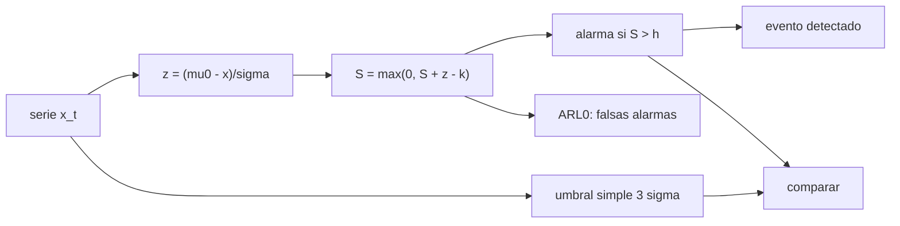

# B97-C22 — Detección autónoma de eventos científicos

<!-- nav:top -->
[🏠 Programa](../../../../README.md) · [📚 Bloque B97](../../../tronco-comun/B97-robotica-y-construccion-extraterrestre.md) · [← Anterior: B97-C21 — Clasificación y priorización autónoma de muestras a bordo](../B97-C21-clasificacion-y-priorizacion-autonoma-de-muestras-a-bordo/CLASE.md) · [Siguiente: B97-C23 — Diseño de simulador de misión robótica →](../B97-C23-diseno-de-simulador-de-mision-robotica/CLASE.md)
<!-- /nav -->

## 1. Ubicación, nivel y alcance

Clase 22 del bloque B97. Nivel N3. Un robot lejos de la Tierra no puede esperar a que alguien vea un remolino de polvo en sus datos: tiene que detectarlo por sí solo. Aquí implementas el detector CUSUM, un acumulador de desviaciones respecto de una línea de base, sobre una serie de presión **sintética** con una línea de base consultada (636 Pa), y lo comparas con un umbral simple. Mides la longitud media hasta una falsa alarma, la probabilidad de detección y el retraso. Los eventos y el ruido son **ilustrativos**.

## 2. Por qué esta clase existe

Un detector sensible produce falsas alarmas que consumen enlace y energía; uno estricto pierde eventos. La clave es medir ambos efectos con una referencia (ARL₀) y comparar métodos con el mismo costo de falsas alarmas. La decisión central: **¿qué umbral y qué método dan una tasa de falsas alarmas tolerable y aun así detectan los eventos pequeños con poco retraso?**

## 3. Lo que podrás hacer al terminar

1. Implementar la recursión CUSUM unilateral para una caída de presión.
2. Calcular la longitud media hasta una falsa alarma (ARL₀) por simulación y con una aproximación estándar.
3. Calcular la probabilidad y el retraso de detección de un evento pequeño y uno grande.
4. Comparar el CUSUM con un umbral simple de 3 sigma.
5. Convertir ARL₀ en falsas alarmas por hora.
6. Separar lo consultado (línea de base de 636 Pa) de lo ilustrativo (ruido y eventos).

La evidencia es la **ficha de un detector autónomo de eventos** del ejercicio 12 (sección 20).

## 4. Con qué llegas y cómo comprobarlo

1. ¿Qué es el ruido blanco gaussiano?
2. ¿Qué es una desviación típica?
3. ¿Qué es una falsa alarma?
4. ¿Qué es un dato sintético?
5. ¿Qué es una segunda vía de cálculo?

<details>
<summary>Ver respuestas</summary>

1. Una señal aleatoria sin correlación temporal con distribución normal. 2. Una medida de la dispersión de los valores. 3. Una alarma sin evento real. 4. Un dato generado para el ejemplo, no medido. 5. Calcular lo mismo con otro método y comparar.
</details>

Con cuatro o cinco aciertos, sigue; si no, repasa los prerrequisitos.

## 5. Un caso de contexto y casos de referencia

Sobre una línea de base de `636 Pa` con ruido de `0,30 Pa`, un evento de `3,0 Pa` (diez sigmas) se detecta siempre; uno de `0,6 Pa` (dos sigmas) lo detecta el CUSUM `1,000` de las veces y el umbral simple `0,706`. El CUSUM tiene `ARL₀ = 340` s, es decir `10,59` falsas alarmas por hora. Es el **ejemplo conductor**; la serie es sintética.

## 6. Vocabulario

El **CUSUM** acumula `(μ₀ − x)/σ − k` y se reinicia en 0. `k` es el **margen** y `h` el **umbral de decisión**. El **ARL₀** es la longitud media hasta una falsa alarma. El **retraso de detección** es el tiempo entre el inicio del evento (dos anchos antes del centro) y la alarma; una alarma anterior al inicio es una falsa alarma.

## 7. Modelo mental



*Descripción textual:* la serie se normaliza, se acumula con margen y se reinicia en cero; una alarma indica un evento; el ARL₀ cuantifica las falsas alarmas y se compara con un umbral simple.

Analogía: oír un goteo pequeño pero constante que no te despierta por un golpe aislado, sino por la suma de gotas. Límite: aquí el ruido es blanco y la línea de base es constante.

## 8. La explicación, paso a paso

### 8.1 Recursión

`S_t = max(0, S_{t−1} + (μ₀ − x_t)/σ − k)` con `k = 0,5` y alarma si `S_t > h = 4`. Una caída sostenida de 2σ aporta `1,5` por muestra y cruza el umbral en pocas muestras.

### 8.2 Falsas alarmas

La simulación de `3000` corridas sin evento da `ARL₀ = 339,9` s; la aproximación de Siegmund (`b = h + 1,166 k`) da `338,1` s: diferencia `0,005` (fracción). El umbral simple de 3σ tiene `ARL₀ = 741` s. En falsas alarmas por hora: CUSUM `10,59`, umbral simple `4,86`.

### 8.3 Detección

Evento de `0,6 Pa`: CUSUM `1,000`, umbral simple `0,706` (fracciones), con retardo medio del CUSUM de `6,7` s desde el inicio del evento. Evento de `3,0 Pa`: CUSUM `1,000` con retardo `1,70` s; umbral simple `1,000` con `2,35` s.

### 8.4 Qué falta

Se supone ruido blanco y línea de base constante: en una serie real hay ciclo diurno, deriva y ruido correlacionado, que cambian el ARL₀. La aproximación de Siegmund es un resultado estándar que no se consultó en una fuente concreta; aquí se contrasta con la simulación.

## 9. Magnitudes, símbolos y unidades

| Símbolo | Qué es | Unidad | Valor / nota |
|---|---|---|---|
| `μ₀` | línea de base de presión | Pa | 636 (consultada) |
| `σ` | ruido | Pa | 0,30 (sintético) |
| `k`, `h` | margen y umbral del CUSUM | σ | 0,5; 4 |
| `ARL₀` | longitud media hasta falsa alarma | s | 340 |
| amplitud | caída del evento | Pa | 0,6; 3,0 (ilustrativas) |

## 10. Convenciones y referencias

Serie a 1 muestra/s, ruido blanco gaussiano, línea de base constante de 636 Pa (6,36 mb de la ficha de Marte), evento gaussiano de ancho 5 s; CUSUM unilateral; sin ciclo diurno ni deriva. Ruido y eventos ilustrativos.

## 11. De dónde sale lo que afirmamos

| ID | Fuente | Localizador | Respalda | Estado |
|---|---|---|---|---|
| S1 | NASA/NSSDC, Mars Fact Sheet — https://nssdc.gsfc.nasa.gov/planetary/factsheet/marsfact.html (consultada 2026-11-10) | ficha completa leída | gravedad media 3,73 m/s²; radio medio 3389,5 km; distancia a la Tierra de 54,6 a 401,4 × 10⁶ km; presión 4,0–8,7 mb | Consultada |
| — | Relaciones estándar usadas en el laboratorio | — | las verifica el laboratorio con una segunda vía | No consultada en una fuente concreta |

Límites: el ruido, los eventos, `k` y `h` no se consultaron; no se consultó ninguna serie medida de presión ni modelo de remolinos de polvo; el modelo no incluye variaciones estacionales (la ficha da 4,0–8,7 mb).

## 12. Cómo ver el resultado

| Magnitud | Valor |
|---|---|
| ARL₀ CUSUM | 340 s |
| ARL₀ umbral 3σ | 741 s |
| Detección 0,6 Pa, CUSUM | 1,000 |
| Detección 0,6 Pa, umbral | 0,706 |
| Retardo 3,0 Pa, CUSUM | 1,70 s |

Descripción larga: el CUSUM detecta todos los eventos pequeños mientras el umbral simple pierde casi un tercio; a cambio, tiene más falsas alarmas por hora (del mismo orden).

## 13. Ejemplo trabajado

**Paso 1 · Normalizar.** `(636 − 635,4)/0,3 = 2` para una caída de `0,6 Pa`.

**Paso 2 · Acumular.** `S = max(0, S + 2 − 0,5)`: sube `1,5` por muestra.

**Paso 3 · Alarma.** `S > 4` tras unas tres muestras de caída sostenida.

## 14. Distintas formas de describir el problema

**Por recursión:** `S_t`. **Por umbral:** `h`. **Por falsas alarmas:** ARL₀. **Por retardo:** segundos. **Por probabilidad:** fracción detectada.

## 15. Práctica guiada

**Ejercicio 1 · con los pasos indicados.** Calcula `z` para `x = 635,1` Pa con `μ₀ = 636` y `σ = 0,3`. *Pasos:* `(μ₀ − x)/σ`.

<details><summary>Solución comentada</summary>

`3,0`.
</details>

**Ejercicio 2 · con una pista.** Predice si una caída sostenida de 1σ se acumula con `k = 0,5`. *Pista:* aporta `1 − 0,5`.

<details><summary>Solución comentada</summary>

Sí: sube `0,5` por muestra y cruza `h = 4` en unas ocho muestras.
</details>

**Ejercicio 3 · casi autónomo.** ¿Por qué el CUSUM se reinicia en 0?

<details><summary>Solución comentada</summary>

Para no acumular evidencia negativa y reaccionar rápido a un cambio.
</details>

## 16. Práctica autónoma, transferencia e integrador

**Ejercicio 4 · autónomo.** Convierte `ARL₀ = 338 s` en falsas alarmas por hora.

<details><summary>Solución comentada</summary>

`3600/338 = 10,7` por hora.
</details>

**Ejercicio 5 · autónomo.** ¿Qué pasa con el ARL₀ si `h` sube a 5?

<details><summary>Solución comentada</summary>

Crece unas 2,8 veces con Siegmund: `b = 6,166` y `ARL₀ ≈ 937 s` frente a `338 s`.
</details>

**Ejercicio 6 · autónomo.** ¿Qué pasa con el retraso si `h` sube a 5?

<details><summary>Solución comentada</summary>

Aumenta: hace falta acumular más.
</details>

**Ejercicio 7 · autónomo.** ¿Por qué el umbral simple pierde el evento de 2σ?

<details><summary>Solución comentada</summary>

Porque la caída de un solo punto rara vez supera 3σ.
</details>

**Ejercicio 8 · autónomo.** ¿Qué ocurre si el ruido real es el doble del supuesto?

<details><summary>Solución comentada</summary>

Las falsas alarmas se disparan: hay que estimar `σ` con datos.
</details>

**Ejercicio 9 · transferencia.** El ciclo diurno desplaza la línea de base. ¿Qué haces? **Transferencia.**

<details><summary>Solución comentada</summary>

Estimar la línea de base con una media móvil o restar un modelo diurno antes del CUSUM.
</details>

**Ejercicio 10 · transferencia.** Cada falsa alarma cuesta enlace. ¿Cómo eliges `h`? **Transferencia.**

<details><summary>Solución comentada</summary>

Con el ARL₀ que da una tasa de falsas alarmas tolerable por día.
</details>

**Ejercicio 11 · transferencia.** ¿Qué falta para usar el detector en una misión real? **Transferencia.**

<details><summary>Solución comentada</summary>

Series reales para estimar el ruido, validación con eventos conocidos y manejo de la línea de base.
</details>

**Ejercicio 12 · integrador.** Elabora tu *ficha de un detector autónomo de eventos*: ARL₀, falsas alarmas por hora, detección y retardo para dos amplitudes y comparación con el umbral simple, todo rotulado como sintético salvo la línea de base. **Integrador.**

<details><summary>Solución comentada</summary>

Secciones 8.1–8.4 y la salida del laboratorio.
</details>

## 17. Laboratorio

El script [detector_cusum.py](detector_cusum.py) implementa un CUSUM y un umbral simple sobre una serie sintética, mide el ARL₀ y la detección de dos eventos, y contrasta el ARL₀ con una aproximación estándar (**comprueba** diferencia < 10 %, mayor detección del CUSUM en el evento pequeño y detección casi total del evento grande).

**Datos:** presión media de Marte (NASA/NSSDC, consultada); ruido, eventos y semilla **ilustrativos**. **Predice antes de ejecutar:** ¿Detecta el umbral simple todos los eventos de 0,6 Pa? (No: pierde cerca de un tercio.) **Ejecución del 2026-11-10 (Python 3.12.9):**

```text
Python 3.12.9 (biblioteca estandar)
Serie SINTETICA: base 636 Pa (consultada), ruido 0.3 Pa a 1 Hz; CUSUM k = 0.5 sigma, h = 4.0 sigma; evento gaussiano de 5 s; semilla 20261110
ARL0 (falsa alarma) CUSUM: Monte Carlo = 339.9 s; Siegmund = 338.1 s (diferencia 0.5 %); umbral simple de 3 sigma: 741 s
Falsas alarmas por hora: CUSUM 10.59; umbral simple 4.86
 amplitud [Pa]  metodo    deteccion   retardo medio desde el inicio [s]
         0.6  CUSUM        100.0 %            6.68
         0.6  umbral        70.5 %            8.91
         3.0  CUSUM        100.0 %            1.70
         3.0  umbral       100.0 %            2.35
Pruebas superadas.
```

```bash
python programa/clases/B97/B97-C22-deteccion-autonoma-de-eventos-cientificos/detector_cusum.py
```

**Límites:** ruido blanco gaussiano, línea de base constante, sin ciclo diurno ni deriva; la serie y los eventos no son reales.

## 18. Errores frecuentes y cómo corregirlos

**Elegir `h` sin medir las falsas alarmas.** El ARL₀ lo cuantifica (8.2)

**Creer que el CUSUM detecta sin retraso.** Hay retardo que crece con `h` (8.3)

**Aplicar el ruido supuesto a datos reales.** Hay que estimarlo; ver 8.4

**Presentar la serie como medida.** Es sintética; ver la sección 10

## 19. Cómo sabrás que vas bien

Tras la sección 8: ¿qué detección esperabas del evento pequeño y qué obtuviste? Si dudas, repasa el ejemplo 13. Tras el laboratorio: ¿qué comprueba? (ver la sección 17).

## 20. Qué entregas y cómo se evalúa

El producto es tu **ficha de un detector autónomo de eventos** (ejercicio 12).

| Criterio | Inicial | En desarrollo | Logrado | Destacado |
|---|---|---|---|---|
| Conceptos | Los confunde | Parciales | Explica el modelo y sus supuestos | Explica los límites |
| Cálculo | Sin unidades | Con errores | Tablas completas con unidades | Calcula casos nuevos |
| Numérico | Sin comprobar | Un caso | Contraste con una segunda vía | Interpreta las diferencias |
| Fuentes | Sin fuente | Sin fecha | Fuentes con fecha y estado | Declara lo ilustrativo y lo no consultado |
| Límites | No los nombra | Uno | Tres | Discute qué falta del modelo |

**Condiciones críticas (no se compensan con promedio):** rotular los datos sintéticos e ilustrativos; no presentar un resultado simulado como observado o medido; citar solo lo consultado.

## 21. Ética, seguridad y límites

Clase educativa: los modelos son simplificados y sus datos son sintéticos o ilustrativos; ningún resultado describe una misión real, certifica un diseño ni sustituye a las normas aplicables ni a las pruebas de hardware.  Accesibilidad: tablas equivalentes a las gráficas, fórmulas en texto, ejercicios sin conexión.

## 22. Para cerrar y seguir

El CUSUM detecta la fracción `1,00` de los eventos de `0,6 Pa` con `10,6` falsas alarmas por hora, frente a `0,71` del umbral simple con `4,9`. Queda una pregunta: ¿cómo se diseña un simulador para probar estos algoritmos?

**Glosario español–inglés.** CUSUM · *cumulative sum*; falsa alarma · *false alarm*; retraso de detección · *detection delay*; línea de base · *baseline*; umbral de decisión · *decision threshold*.

**Continuidad.** [B97-C23](../B97-C23-diseno-de-simulador-de-mision-robotica/CLASE.md) estudia el diseño de un simulador de misión robótica.

**Referencias:** ver sección 11.

<!-- nav:bottom -->
---

[← Anterior: B97-C21 — Clasificación y priorización autónoma de muestras a bordo](../B97-C21-clasificacion-y-priorizacion-autonoma-de-muestras-a-bordo/CLASE.md) · [📚 Bloque B97](../../../tronco-comun/B97-robotica-y-construccion-extraterrestre.md) · [Siguiente: B97-C23 — Diseño de simulador de misión robótica →](../B97-C23-diseno-de-simulador-de-mision-robotica/CLASE.md)
<!-- /nav -->
