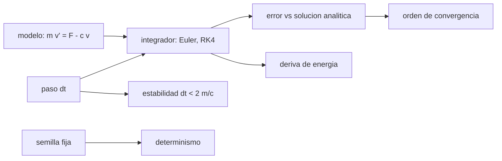

# B97-C23 — Diseño de simulador de misión robótica

<!-- nav:top -->
[🏠 Programa](../../../../README.md) · [📚 Bloque B97](../../../tronco-comun/B97-robotica-y-construccion-extraterrestre.md) · [← Anterior: B97-C22 — Detección autónoma de eventos científicos](../B97-C22-deteccion-autonoma-de-eventos-cientificos/CLASE.md) · [Siguiente: B97-C24 — Modelos de actuadores virtuales e integración en simulación →](../B97-C24-modelos-de-actuadores-virtuales-e-integracion-en-simulacion/CLASE.md)
<!-- /nav -->

## 1. Ubicación, nivel y alcance

Clase 23 del bloque B97. Nivel N3. Un simulador de misión robótica es, en su núcleo, un integrador de ecuaciones con un paso de tiempo y una semilla. Si el paso es grande, el error crece o la simulación se vuelve inestable; si la semilla no se fija, nadie puede repetir el resultado. Aquí diseñas ese núcleo con un caso de un grado de libertad (un rover con empuje y amortiguamiento), comparas Euler con RK4 contra la solución analítica, observas el orden de convergencia, el límite de estabilidad y el determinismo. El modelo es **ilustrativo**; solo la masa de `1025 kg` está consultada.

## 2. Por qué esta clase existe

Una simulación sin verificar produce números bonitos y erróneos. Cinco pruebas baratas (solución analítica, orden de convergencia, estabilidad, conservación y repetibilidad) detectan casi todos los errores de un integrador antes de poner modelos complejos encima. La decisión central: **¿qué paso de tiempo y qué integrador dan un error aceptable sin riesgo de inestabilidad, y cómo se garantiza que el resultado sea repetible?**

## 3. Lo que podrás hacer al terminar

1. Escribir un integrador de paso fijo (Euler y RK4) para una dinámica simple.
2. Comparar con la solución analítica y medir el error.
3. Verificar el orden de convergencia por la razón de errores.
4. Calcular el límite de estabilidad de Euler.
5. Medir la deriva de energía de un oscilador y la repetibilidad con semilla fija.
6. Separar lo consultado (masa) de lo ilustrativo (empuje, amortiguamiento y rigidez).

La evidencia es la **especificación de un simulador de misión robótica** del ejercicio 12 (sección 20).

## 4. Con qué llegas y cómo comprobarlo

1. ¿Qué es una ecuación diferencial ordinaria?
2. ¿Qué es el orden de un método numérico?
3. ¿Qué es una solución analítica?
4. ¿Qué es un dato ilustrativo?
5. ¿Qué es una segunda vía de cálculo?

<details>
<summary>Ver respuestas</summary>

1. Una ecuación que relaciona una función con sus derivadas. 2. El exponente `p` tal que el error crece como `dt^p`. 3. Una fórmula exacta de la solución. 4. Un dato inventado de forma verosímil para el ejemplo, no medido. 5. Calcular lo mismo con otro método y comparar.
</details>

Con cuatro o cinco aciertos, sigue; si no, repasa los prerrequisitos.

## 5. Un caso de contexto y casos de referencia

Un rover de `1025 kg` con `200 N` de empuje y `80 N·s/m` de amortiguamiento tiene `v(60 s) = 2,476870` m/s. Con paso de `5 s`, Euler comete un error relativo de `6,67e-03` y RK4 de `1,17e-05`; con `0,1 s`, `1,70e-04` y `1,36e-12`. Es el **ejemplo conductor**; el modelo es ilustrativo.

## 6. Vocabulario

El **paso de integración** `dt` es el intervalo entre estados. **Euler explícito** avanza con la pendiente inicial; **RK4** usa cuatro pendientes por paso. El **orden** de un método dice cómo baja el error con `dt`. La **estabilidad** pide `dt < 2 m/c` en Euler para este problema. El **determinismo** exige la misma semilla y el mismo orden de operaciones.

## 7. Modelo mental



*Descripción textual:* el modelo y el paso alimentan el integrador; se verifica con la solución analítica, el orden, la estabilidad, la energía y la repetibilidad.

Analogía: medir una curva con pasos largos o cortos; con pasos cortos la sigues bien, con pasos muy largos te sales del camino. Límite: aquí hay un solo grado de libertad y no hay contacto ni saturación.

## 8. La explicación, paso a paso

### 8.1 Solución analítica

`v(t) = (F/c)(1 − e^(−c t/m))`, con constante de tiempo `m/c = 12,81` s y velocidad terminal `F/c = 2,50` m/s. A `60 s`, `v = 2,476870` m/s.

### 8.2 Errores y orden

Con `dt = 5 s`: Euler `6,67e-03`, RK4 `1,17e-05`; con `1 s`: `1,64e-03` y `1,44e-08`; con `0,1 s`: `1,70e-04` y `1,36e-12`. Al dividir `dt` por 2 (de 5 a 2,5 s), el error de Euler baja `1,75` veces (orden 1: ≈ 2) y el de RK4 `18,86` veces (orden 4: ≈ 16).

### 8.3 Estabilidad

Euler es estable si `|1 − c dt/m| < 1`, es decir `dt < 2 m/c = 25,62` s. Con `dt = 30 s` se vuelve inestable: el integrador amplifica el error en vez de amortiguarlo.

### 8.4 Energía y repetibilidad

Un oscilador sin amortiguamiento conserva la energía; tras `2000 s` con `dt = 1 s`, la deriva relativa es `7,20e+80` (Euler, que amplifica la energía sin límite en un oscilador) y `2,52e-02` (RK4, un 2,5 % tras 2000 s: pequeña pero no nula). Con la misma semilla, dos ejecuciones dan la misma huella (`5a308c4408df046e` y `5a308c4408df046e`); otra semilla da otra (`e2cc06e241be53b0`). La repetibilidad no garantiza que el modelo sea correcto, solo que el resultado se puede reproducir.

## 9. Magnitudes, símbolos y unidades

| Símbolo | Qué es | Unidad | Valor / nota |
|---|---|---|---|
| `m` | masa | kg | 1025 (consultada) |
| `F` | empuje | N | 200 (ilustrativo) |
| `c` | amortiguamiento | N·s/m | 80 (ilustrativo) |
| `dt` | paso de integración | s | 5–0,1 |
| `τ` | constante de tiempo `m/c` | s | 12,81 |

## 10. Convenciones y referencias

Un grado de libertad, empuje y amortiguamiento constantes, sin saturación ni contacto, pasos fijos; oscilador de comprobación de 1025 kg y 100 N/m. La masa es la de Perseverance (NASA); el resto es ilustrativo.

## 11. De dónde sale lo que afirmamos

| ID | Fuente | Localizador | Respalda | Estado |
|---|---|---|---|---|
| S1 | NASA, Mars 2020 Perseverance Rover Components — https://science.nasa.gov/mission/mars-2020-perseverance/rover-components/ (consultada 2026-11-10) | página completa leída | masa 1025 kg; seis ruedas de 52,5 cm con un motor cada una; brazo de 2,1 m; velocidad máxima ~152 m/h sobre terreno plano y duro | Consultada |
| — | Relaciones estándar usadas en el laboratorio | — | las verifica el laboratorio con una segunda vía | No consultada en una fuente concreta |

Límites: el empuje, el amortiguamiento, la rigidez y los pasos son ilustrativos; no se consultó ningún simulador ni modelo de vehículo; no se modelan contacto, saturación ni varias variables acopladas.

## 12. Cómo ver el resultado

| Magnitud | Valor |
|---|---|
| `v(60 s)` exacta | 2,476870 m/s |
| Error Euler (`dt` = 1 s) | 1,64e-03 |
| Error RK4 (`dt` = 1 s) | 1,44e-08 |
| Límite de Euler | 25,62 s |
| Deriva de energía RK4 | 2,52e-02 |

Descripción larga: RK4 gana varios órdenes de magnitud de exactitud con el mismo paso, y Euler se vuelve inestable por encima de `2 m/c`.

## 13. Ejemplo trabajado

**Paso 1 · Constante de tiempo.** `m/c = 1025/80 = 12,81` s.

**Paso 2 · Límite de Euler.** `2 m/c = 25,62` s.

**Paso 3 · Comparar.** Con `dt = 5 s`, Euler tiene `6,67e-03` y RK4 `1,17e-05` de error relativo.

## 14. Distintas formas de describir el problema

**Por solución:** analítica. **Por método:** Euler o RK4. **Por error:** relativo y orden. **Por estabilidad:** límite de `dt`. **Por repetibilidad:** huella de una secuencia.

## 15. Práctica guiada

**Ejercicio 1 · con los pasos indicados.** Calcula `τ = m/c` para `m = 1025`, `c = 80`. *Pasos:* división.

<details><summary>Solución comentada</summary>

`12,81` s.
</details>

**Ejercicio 2 · con una pista.** Predice si Euler con `dt = 10 s` es estable. *Pista:* compara con `2 m/c`.

<details><summary>Solución comentada</summary>

Sí: `10 < 25,62`.
</details>

**Ejercicio 3 · casi autónomo.** ¿Cuál es la velocidad terminal?

<details><summary>Solución comentada</summary>

`F/c = 2,50` m/s.
</details>

## 16. Práctica autónoma, transferencia e integrador

**Ejercicio 4 · autónomo.** ¿Qué le pasa al error de RK4 si `dt` se divide por 2?

<details><summary>Solución comentada</summary>

Baja unas 16 veces.
</details>

**Ejercicio 5 · autónomo.** ¿Qué le pasa al error de Euler si `dt` se divide por 10?

<details><summary>Solución comentada</summary>

Baja unas 10 veces (orden 1).
</details>

**Ejercicio 6 · autónomo.** ¿Por qué RK4 cuesta más por paso?

<details><summary>Solución comentada</summary>

Evalúa la derivada cuatro veces.
</details>

**Ejercicio 7 · autónomo.** ¿Por qué comprobar la conservación de energía?

<details><summary>Solución comentada</summary>

Porque una deriva sistemática revela un integrador inadecuado para tiempos largos.
</details>

**Ejercicio 8 · autónomo.** ¿Qué diferencia hay entre repetible y correcto?

<details><summary>Solución comentada</summary>

Repetible: mismo resultado con la misma semilla. Correcto: concuerda con la solución analítica o con medidas.
</details>

**Ejercicio 9 · transferencia.** El simulador usa pasos variables y el resultado cambia al cambiar de computadora. ¿Qué haces? **Transferencia.**

<details><summary>Solución comentada</summary>

Fijar el paso, el orden de las operaciones y las semillas; documentar la versión del software.
</details>

**Ejercicio 10 · transferencia.** Un contacto rígido exige `dt` muy pequeño. ¿Qué haces? **Transferencia.**

<details><summary>Solución comentada</summary>

Usar un integrador implícito o un modelo de contacto más suave y volver a verificar el paso.
</details>

**Ejercicio 11 · transferencia.** ¿Qué falta para llamar «simulador de misión» a este núcleo? **Transferencia.**

<details><summary>Solución comentada</summary>

Modelos de entorno, sensores y actuadores, una interfaz con el software de control y su validación.
</details>

**Ejercicio 12 · integrador.** Elabora tu *especificación de un simulador de misión robótica*: paso de tiempo elegido, integrador, pruebas (analítica, orden, estabilidad, energía, repetibilidad) y límites, con lo consultado y lo ilustrativo rotulados. **Integrador.**

<details><summary>Solución comentada</summary>

Secciones 8.1–8.4 y la salida del laboratorio.
</details>

## 17. Laboratorio

El script [paso_simulador.py](paso_simulador.py) integra la dinámica con Euler y RK4, mide errores y órdenes, verifica la estabilidad, la deriva de energía y la repetibilidad (**comprueba** órdenes ≈ 2 y ≈ 16, inestabilidad de Euler con `dt = 30 s`, huellas iguales con la misma semilla y deriva de RK4 menor).

**Datos:** masa de Perseverance (NASA, consultada); empuje, amortiguamiento, rigidez y semilla **ilustrativos**. **Predice antes de ejecutar:** ¿Qué razón de errores tendrá RK4 al dividir el paso por 2? (Unas 16 veces.) **Ejecución del 2026-11-10 (Python 3.12.9):**

```text
Python 3.12.9 (biblioteca estandar)
Modelo ILUSTRATIVO: m = 1025 kg (consultada), F = 200 N, c = 80 N s/m; v(60 s) exacta = 2.476870 m/s; tau = 12.81 s; v terminal = 2.50 m/s
 dt [s]   error relativo Euler   error relativo RK4
   5.0            6.672e-03            1.172e-05
   2.5            3.823e-03            6.218e-07
   1.0            1.638e-03            1.443e-08
   0.5            8.363e-04            8.731e-10
   0.1            1.700e-04            1.361e-12
Razon de errores al dividir dt por 2 (5 -> 2.5): Euler = 1.75 (orden 1 -> 2); RK4 = 18.86 (orden 4 -> 16)
Limite de estabilidad de Euler: dt < 2 m/c = 25.62 s; con dt = 30 s, inestable = True
Deriva de energia del oscilador en 2000 s con dt = 1 s: Euler = 7.200e+80; RK4 = 2.516e-02
Huellas de 1000 numeros: semilla 20261110: 5a308c4408df046e y 5a308c4408df046e (iguales: True); semilla 20261111: e2cc06e241be53b0
Pruebas superadas.
```

```bash
python programa/clases/B97/B97-C23-diseno-de-simulador-de-mision-robotica/paso_simulador.py
```

**Límites:** un grado de libertad con parámetros constantes y pasos fijos; sin contacto, saturación ni acoplamientos.

## 18. Errores frecuentes y cómo corregirlos

**Elegir `dt` por comodidad.** Se verifica con el error y la estabilidad (8.2 y 8.3)

**Confundir repetible con correcto.** Ver 8.4

**Usar Euler para tiempos largos.** Deriva de energía (8.4)

**Presentar el modelo como un vehículo real.** Es ilustrativo; ver la sección 10

## 19. Cómo sabrás que vas bien

Tras la sección 8: ¿qué razón de errores esperabas y cuál obtuviste? Si dudas, repasa el ejemplo 13. Tras el laboratorio: ¿qué comprueba? (ver la sección 17).

## 20. Qué entregas y cómo se evalúa

El producto es tu **especificación de un simulador de misión robótica** (ejercicio 12).

| Criterio | Inicial | En desarrollo | Logrado | Destacado |
|---|---|---|---|---|
| Conceptos | Los confunde | Parciales | Explica el modelo y sus supuestos | Explica los límites |
| Cálculo | Sin unidades | Con errores | Tablas completas con unidades | Calcula casos nuevos |
| Numérico | Sin comprobar | Un caso | Contraste con una segunda vía | Interpreta las diferencias |
| Fuentes | Sin fuente | Sin fecha | Fuentes con fecha y estado | Declara lo ilustrativo y lo no consultado |
| Límites | No los nombra | Uno | Tres | Discute qué falta del modelo |

**Condiciones críticas (no se compensan con promedio):** rotular los datos sintéticos e ilustrativos; no presentar un resultado simulado como observado o medido; citar solo lo consultado.

## 21. Ética, seguridad y límites

Clase educativa: los modelos son simplificados y sus datos son sintéticos o ilustrativos; ningún resultado describe una misión real, certifica un diseño ni sustituye a las normas aplicables ni a las pruebas de hardware.  Accesibilidad: tablas equivalentes a las gráficas, fórmulas en texto, ejercicios sin conexión.

## 22. Para cerrar y seguir

Con el mismo paso de `1 s`, RK4 tiene un error relativo de `1,44e-08` y Euler de `1,64e-03`; con `dt` mayor que `25,6` s, Euler es inestable. Queda una pregunta: ¿cómo se modelan los actuadores que el simulador mueve?

**Glosario español–inglés.** paso de integración · *time step*; orden de convergencia · *convergence order*; estabilidad · *stability*; determinismo · *determinism*; solución analítica · *analytical solution*.

**Continuidad.** [B97-C24](../B97-C24-modelos-de-actuadores-virtuales-e-integracion-en-simulacion/CLASE.md) estudia los modelos de actuadores virtuales.

**Referencias:** ver sección 11.

<!-- nav:bottom -->
---

[← Anterior: B97-C22 — Detección autónoma de eventos científicos](../B97-C22-deteccion-autonoma-de-eventos-cientificos/CLASE.md) · [📚 Bloque B97](../../../tronco-comun/B97-robotica-y-construccion-extraterrestre.md) · [Siguiente: B97-C24 — Modelos de actuadores virtuales e integración en simulación →](../B97-C24-modelos-de-actuadores-virtuales-e-integracion-en-simulacion/CLASE.md)
<!-- /nav -->
