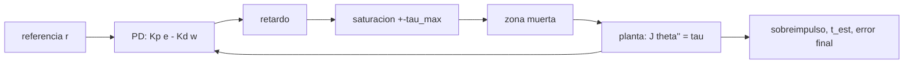

# B97-C24 — Modelos de actuadores virtuales e integración en simulación

<!-- nav:top -->
[🏠 Programa](../../../../README.md) · [📚 Bloque B97](../../../tronco-comun/B97-robotica-y-construccion-extraterrestre.md) · [← Anterior: B97-C23 — Diseño de simulador de misión robótica](../B97-C23-diseno-de-simulador-de-mision-robotica/CLASE.md) · [Siguiente: B97-C25 — Excavación y manejo de regolito con robots →](../B97-C25-excavacion-y-manejo-de-regolito-con-robots/CLASE.md)
<!-- /nav -->

## 1. Ubicación, nivel y alcance

Clase 24 del bloque B97. Nivel N3. En un simulador, el actuador no es un símbolo que obedece: es un modelo con límites. Saturación del par, retardo de la señal y holgura mecánica cambian el comportamiento de un lazo de control, a veces de forma drástica. Aquí modelas una articulación con un controlador PD, la verificas contra la solución analítica de segundo orden y añades uno a uno los tres efectos. Todo es **ilustrativo**: ningún valor corresponde a un motor real; la holgura se modela como una zona muerta, que es una simplificación.

## 2. Por qué esta clase existe

Un controlador que funciona en simulación con un actuador ideal puede oscilar o no llegar al objetivo con uno real. Conocer qué efecto causa cada fenómeno evita sorpresas al integrar el control con el hardware. La decisión central: **¿qué efecto tiene cada limitación del actuador (saturación, retardo y holgura) sobre el sobreimpulso, el tiempo de establecimiento y el error final de un lazo de posición?**

## 3. Lo que podrás hacer al terminar

1. Escribir el lazo PD de una articulación y calcular `ωₙ` y `ζ`.
2. Verificar el caso ideal con el sobreimpulso y el tiempo de pico analíticos.
3. Añadir saturación, retardo y zona muerta y medir su efecto por separado.
4. Interpretar el sobreimpulso, el tiempo de establecimiento y el error final.
5. Reconocer las simplificaciones de cada modelo de actuador.
6. Separar lo sintético (todo) de lo consultado (nada).

La evidencia es la **ficha de un actuador virtual y su respuesta** del ejercicio 12 (sección 20).

## 4. Con qué llegas y cómo comprobarlo

1. ¿Qué es un controlador PD?
2. ¿Qué es el sobreimpulso de una respuesta al escalón?
3. ¿Qué es una saturación?
4. ¿Qué es un dato ilustrativo?
5. ¿Qué es una segunda vía de cálculo?

<details>
<summary>Ver respuestas</summary>

1. Un controlador cuya salida suma un término proporcional al error y otro a su derivada. 2. Cuánto se pasa la respuesta del valor final, en proporción. 3. Un límite máximo de la señal que el actuador puede entregar. 4. Un dato inventado de forma verosímil para el ejemplo, no medido. 5. Calcular lo mismo con otro método y comparar.
</details>

Con cuatro o cinco aciertos, sigue; si no, repasa los prerrequisitos.

## 5. Un caso de contexto y casos de referencia

Una articulación de `2 kg·m²` con `Kp = 50` y `Kd = 6` tiene `ωₙ = 5,000` rad/s y `ζ = 0,300`: sobreimpulso analítico `0,3723` (fracción). Con un par máximo de `10 N·m` el sobreimpulso baja a `0,3368` (pero la respuesta se alarga), con `20 ms` de retardo sube a `0,4353` y con los tres efectos es `0,4372`. Es el **ejemplo conductor**; todo es ilustrativo.

## 6. Vocabulario

La **saturación** limita el par a `±τ_max`. El **retardo** retrasa la orden unos milisegundos. La **zona muerta** anula el par pequeño (aquí representa la holgura). El **sobreimpulso** es lo que se pasa la respuesta del valor pedido. El **tiempo de establecimiento al 2 %** es el último instante fuera de ±2 % del valor final.

## 7. Modelo mental



*Descripción textual:* el controlador envía un par que pasa por retardo, saturación y zona muerta antes de llegar a la planta; la salida se mide en sobreimpulso, establecimiento y error final.

Analogía: conducir con un volante que tarda en responder, con juego y con un límite de giro; el mismo conductor se comporta distinto. Límite: aquí la holgura es una zona muerta del par, no un modelo de engranajes.

## 8. La explicación, paso a paso

### 8.1 Caso ideal

`ωₙ = √(Kp/J) = 5,000` rad/s, `ζ = Kd/(2√(Kp J)) = 0,300`. El sobreimpulso analítico es `exp(−πζ/√(1−ζ²)) = 0,3723` (fracción) y el tiempo de pico `π/(ωₙ√(1−ζ²)) = 0,6587` s. La simulación del caso ideal da `0,3720`; la diferencia es `3,02e-04` y `9,97e-04` en el tiempo de pico (fracción).

### 8.2 Saturación

El par inicial pedido es `Kp r = 25,0` N·m, por encima de `10 N·m`: el actuador satura y entrega menos de lo pedido al inicio. Aquí el sobreimpulso baja a `0,3368` (la aceleración inicial es menor), pero el tiempo de pico se alarga a `0,756` s y el establecimiento es `2,33` s frente a `2,24` s. Con otras ganancias, la saturación puede empeorar el sobreimpulso (acumulación del error).

### 8.3 Retardo y zona muerta

Con `20 ms` de retardo, el sobreimpulso es `0,4353` y el establecimiento `2,75` s. Con zona muerta de `±1 N·m`, el sobreimpulso es `0,3971` y queda un error final de `0,00616` rad (por debajo de la cota `zona/Kp = 0,020` rad).

### 8.4 Los tres juntos

Con los tres efectos: sobreimpulso `0,4372`, establecimiento `7,94` s, error final `0,00927` rad. La conclusión es cualitativa para este caso ilustrativo; los valores dependen de los parámetros y no valen para un motor real.

## 9. Magnitudes, símbolos y unidades

| Símbolo | Qué es | Unidad | Valor / nota |
|---|---|---|---|
| `J` | inercia | kg·m² | 2,0 (ilustrativa) |
| `Kp`, `Kd` | ganancias PD | N·m/rad; N·m·s/rad | 50; 6 (ilustrativas) |
| `τ_max` | par máximo | N·m | 10 (ilustrativo) |
| retardo | retraso de la orden | s | 0,020 (ilustrativo) |
| zona | zona muerta del par | N·m | ±1,0 (ilustrativa) |

## 10. Convenciones y referencias

Una articulación sin carga variable ni fricción, paso de 1 ms con integración semi-implícita, escalón de 0,5 rad; ángulos en radianes. Todos los datos son ilustrativos; la holgura se modela como zona muerta.

## 11. De dónde sale lo que afirmamos

| ID | Fuente | Localizador | Respalda | Estado |
|---|---|---|---|---|
| — | Relaciones estándar usadas en el laboratorio | — | las verifica el laboratorio con una segunda vía | No consultada en una fuente concreta |

Límites: no se consultó ningún motor, reductor ni controlador real; los valores son ilustrativos y la zona muerta no es un modelo de juego en engranajes.

## 12. Cómo ver el resultado

| Magnitud | Valor |
|---|---|
| Sobreimpulso ideal | 0,3720 |
| Con saturación | 0,3368 |
| Con retardo | 0,4353 |
| Con zona muerta | 0,3971 |
| Error final con zona muerta | 0,00616 rad |

Descripción larga: cada efecto modifica la respuesta de forma distinta: la saturación alarga el tiempo de pico, el retardo aumenta el sobreimpulso y la zona muerta deja un error final y alarga el establecimiento.

## 13. Ejemplo trabajado

**Paso 1 · Parámetros.** `ωₙ = √(50/2) = 5,000` rad/s; `ζ = 6/(2√100) = 0,300`.

**Paso 2 · Sobreimpulso.** `exp(−π × 0,300/√(1 − 0,300²)) = 0,3723`.

**Paso 3 · Saturación.** `Kp r = 25,0` N·m > 10 N·m: el actuador satura al inicio.

## 14. Distintas formas de describir el problema

**Por parámetros:** `ωₙ`, `ζ`. **Por respuesta:** sobreimpulso y tiempo de pico. **Por efecto:** saturación, retardo, zona muerta. **Por error:** final. **Por establecimiento:** banda del 2 %.

## 15. Práctica guiada

**Ejercicio 1 · con los pasos indicados.** Calcula `ζ` para `Kd = 6`, `Kp = 50`, `J = 2`. *Pasos:* `Kd/(2√(Kp J))`.

<details><summary>Solución comentada</summary>

`0,300`.
</details>

**Ejercicio 2 · con una pista.** Predice si el sobreimpulso con saturación es mayor o menor que el ideal. *Pista:* el actuador entrega menos par del pedido al inicio.

<details><summary>Solución comentada</summary>

Menor en esta configuración: `0,3368` frente a `0,3720`; la saturación limita la aceleración inicial y alarga el tiempo de pico (`2,33` s de establecimiento frente a `2,24` s).
</details>

**Ejercicio 3 · casi autónomo.** ¿Qué efecto tiene aumentar el retardo a 50 ms?

<details><summary>Solución comentada</summary>

Reduce el margen de estabilidad: más sobreimpulso y posible oscilación.
</details>

## 16. Práctica autónoma, transferencia e integrador

**Ejercicio 4 · autónomo.** ¿Qué cota del error final impone una zona muerta de ±1 N·m con `Kp = 50`?

<details><summary>Solución comentada</summary>

`1/50 = 0,02` rad como cota; el laboratorio da `0,00616` rad.
</details>

**Ejercicio 5 · autónomo.** ¿Qué ganancia `Kd` da `ζ = 1`?

<details><summary>Solución comentada</summary>

`Kd = 2√(Kp J) = 20`.
</details>

**Ejercicio 6 · autónomo.** ¿Qué pasa con el tiempo de pico si `J` se duplica?

<details><summary>Solución comentada</summary>

Aumenta en un factor `√2`.
</details>

**Ejercicio 7 · autónomo.** ¿Por qué se verifica el caso ideal contra la solución analítica?

<details><summary>Solución comentada</summary>

Porque valida el integrador y el lazo antes de añadir no linealidades.
</details>

**Ejercicio 8 · autónomo.** ¿Qué diferencia hay entre una zona muerta y un juego real de engranajes?

<details><summary>Solución comentada</summary>

El juego tiene dos masas y pérdida de contacto: la zona muerta solo anula el par.
</details>

**Ejercicio 9 · transferencia.** El control funciona en simulación pero oscila en el hardware. ¿Qué revisas? **Transferencia.**

<details><summary>Solución comentada</summary>

Retardos, saturaciones, holguras y el paso de muestreo del control.
</details>

**Ejercicio 10 · transferencia.** Un actuador virtual tiene `τ_max` demasiado alto. ¿Qué riesgo hay? **Transferencia.**

<details><summary>Solución comentada</summary>

Aprobar un diseño que el hardware no podrá ejecutar; el simulador debe usar el límite real.
</details>

**Ejercicio 11 · transferencia.** ¿Cómo integrarías este modelo con el simulador de C23? **Transferencia.**

<details><summary>Solución comentada</summary>

Usándolo como el bloque de actuación dentro del paso de integración, con el paso verificado.
</details>

**Ejercicio 12 · integrador.** Elabora tu *ficha de un actuador virtual y su respuesta*: parámetros, comparación con el caso analítico y efecto de cada limitación, con todo rotulado como ilustrativo. **Integrador.**

<details><summary>Solución comentada</summary>

Secciones 8.1–8.4 y la salida del laboratorio.
</details>

## 17. Laboratorio

El script [actuador_virtual.py](actuador_virtual.py) simula un lazo de posición con y sin saturación, retardo y zona muerta, y verifica el caso ideal con el sobreimpulso y el tiempo de pico analíticos (**comprueba** diferencias < 1 punto y < 0,5 %).

**Datos:** **ilustrativos** (inercia, ganancias, límites y paso); no se consultó ninguna fuente. **Predice antes de ejecutar:** ¿Dejará la zona muerta un error final? (Sí, del orden de `zona/Kp`.) **Ejecución del 2026-11-10 (Python 3.12.9):**

```text
Python 3.12.9 (biblioteca estandar)
Lazo ILUSTRATIVO: J = 2.0 kg m2; Kp = 50.0; Kd = 6.0; escalon 0.5 rad; wn = 5.000 rad/s; zeta = 0.300
Analitico: sobreimpulso = 37.233 %; tiempo de pico = 0.6587 s
 caso         sobreimpulso [%]   t pico [s]   t establecimiento 2 % [s]   error final [rad]
ideal                37.20        0.658                  2.243               0.00000
saturacion           33.68        0.756                  2.330               0.00000
retardo              43.53        0.651                  2.752               0.00000
holgura              39.71        0.683                  6.593               0.00616
los tres             43.72        0.835                  7.935               0.00927
Ideal frente a analitico: diferencia de sobreimpulso = 0.030 puntos; de tiempo de pico = 0.100 %
Par inicial pedido = 25.0 N m (limite 10.0 N m); error de zona muerta esperado ~ zona/Kp = 0.020 rad
Pruebas superadas.
```

```bash
python programa/clases/B97/B97-C24-modelos-de-actuadores-virtuales-e-integracion-en-simulacion/actuador_virtual.py
```

**Límites:** una articulación sin carga ni fricción; la holgura es una zona muerta del par y no un juego mecánico completo.

## 18. Errores frecuentes y cómo corregirlos

**Simular solo con un actuador ideal.** Se pierde saturación, retardo y holgura (8.2–8.4)

**Ignorar la saturación inicial.** El par pedido supera el máximo (8.2)

**Tomar los parámetros como de un motor real.** Son ilustrativos; ver la sección 10

**Llamar «juego» a la zona muerta.** Es una simplificación (ver los límites)

## 19. Cómo sabrás que vas bien

Tras la sección 8: ¿qué efecto esperabas de cada limitación y cuál obtuviste? Si dudas, repasa el ejemplo 13. Tras el laboratorio: ¿qué comprueba? (ver la sección 17).

## 20. Qué entregas y cómo se evalúa

El producto es tu **ficha de un actuador virtual y su respuesta** (ejercicio 12).

| Criterio | Inicial | En desarrollo | Logrado | Destacado |
|---|---|---|---|---|
| Conceptos | Los confunde | Parciales | Explica el modelo y sus supuestos | Explica los límites |
| Cálculo | Sin unidades | Con errores | Tablas completas con unidades | Calcula casos nuevos |
| Numérico | Sin comprobar | Un caso | Contraste con una segunda vía | Interpreta las diferencias |
| Fuentes | Sin fuente | Sin fecha | Fuentes con fecha y estado | Declara lo ilustrativo y lo no consultado |
| Límites | No los nombra | Uno | Tres | Discute qué falta del modelo |

**Condiciones críticas (no se compensan con promedio):** rotular los datos sintéticos e ilustrativos; no presentar un resultado simulado como observado o medido; citar solo lo consultado.

## 21. Ética, seguridad y límites

Clase educativa: los modelos son simplificados y sus datos son sintéticos o ilustrativos; ningún resultado describe una misión real, certifica un diseño ni sustituye a las normas aplicables ni a las pruebas de hardware.  Accesibilidad: tablas equivalentes a las gráficas, fórmulas en texto, ejercicios sin conexión.

## 22. Para cerrar y seguir

El mismo lazo pasa de `0,372` de sobreimpulso (ideal) a `0,437` con saturación, retardo y zona muerta. Queda una pregunta: ¿cómo se excava y se mueve regolito con un robot?

**Glosario español–inglés.** actuador virtual · *virtual actuator*; saturación · *saturation*; retardo · *delay*; zona muerta · *dead zone*; sobreimpulso · *overshoot*.

**Continuidad.** [B97-C25](../B97-C25-excavacion-y-manejo-de-regolito-con-robots/CLASE.md) estudia la excavación y el manejo de regolito con robots.

**Referencias:** ver sección 11.

<!-- nav:bottom -->
---

[← Anterior: B97-C23 — Diseño de simulador de misión robótica](../B97-C23-diseno-de-simulador-de-mision-robotica/CLASE.md) · [📚 Bloque B97](../../../tronco-comun/B97-robotica-y-construccion-extraterrestre.md) · [Siguiente: B97-C25 — Excavación y manejo de regolito con robots →](../B97-C25-excavacion-y-manejo-de-regolito-con-robots/CLASE.md)
<!-- /nav -->
