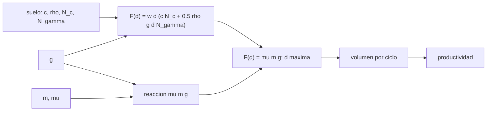

# B97-C25 — Excavación y manejo de regolito con robots

<!-- nav:top -->
[🏠 Programa](../../../../README.md) · [📚 Bloque B97](../../../tronco-comun/B97-robotica-y-construccion-extraterrestre.md) · [← Anterior: B97-C24 — Modelos de actuadores virtuales e integración en simulación](../B97-C24-modelos-de-actuadores-virtuales-e-integracion-en-simulacion/CLASE.md) · [Siguiente: B97-C26 — Monitoreo de condición de maquinaria extraterrestre →](../B97-C26-monitoreo-de-condicion-de-maquinaria-extraterrestre/CLASE.md)
<!-- /nav -->

## 1. Ubicación, nivel y alcance

Clase 25 del bloque B97. Nivel N3. Excavar y acarrear regolito es la tarea física más repetida de la construcción extraterrestre, y la gravedad la condiciona de un modo contraintuitivo: la fuerza para cortar un suelo con cohesión casi no baja con la gravedad, pero la fuerza con la que una máquina ligera puede reaccionar sí. Aquí calculas la profundidad máxima de corte en tres cuerpos, la productividad de un ciclo de excavación y acarreo y la masa mínima que necesitaría la excavadora en la Luna. Todo es **ilustrativo**.

## 2. Por qué esta clase existe

Una excavadora diseñada y probada en la Tierra puede ser incapaz de cortar en la Luna por falta de reacción, no por falta de potencia. Es un error de diseño caro que un cálculo de pocos renglones evita. La decisión central: **¿qué profundidad de corte puede lograr una excavadora robótica en cada gravedad, cuánto produce por hora y qué masa necesita para cortar a una profundidad útil?**

## 3. Lo que podrás hacer al terminar

1. Calcular la fuerza de corte por una ecuación de capacidad con cohesión y peso del suelo.
2. Calcular la reacción máxima que la máquina puede dar (peso por fricción).
3. Resolver la profundidad máxima de corte como una ecuación cuadrática y por bisección.
4. Calcular el volumen y la productividad de un ciclo de excavación y acarreo.
5. Calcular la masa mínima para una profundidad dada en la Luna.
6. Separar lo consultado (gravedades) de lo ilustrativo (máquina y suelo).

La evidencia es la **ficha de excavación y acarreo de regolito** del ejercicio 12 (sección 20).

## 4. Con qué llegas y cómo comprobarlo

1. ¿Qué es la cohesión de un suelo?
2. ¿Qué es una fuerza de reacción?
3. ¿Qué es una ecuación cuadrática?
4. ¿Qué es un dato ilustrativo?
5. ¿Qué es una segunda vía de cálculo?

<details>
<summary>Ver respuestas</summary>

1. La resistencia al corte de un suelo sin carga. 2. La fuerza con la que el suelo o el piso devuelve la fuerza aplicada; aquí limitada por peso por fricción. 3. Una ecuación `a x² + b x + c = 0`. 4. Un dato inventado de forma verosímil para el ejemplo, no medido. 5. Calcular lo mismo con otro método y comparar.
</details>

Con cuatro o cinco aciertos, sigue; si no, repasa los prerrequisitos.

## 5. Un caso de contexto y casos de referencia

Una excavadora ilustrativa de `100 kg` puede reaccionar con `589` N en la Tierra, `224` N en Marte y `97` N en la Luna. La profundidad máxima de corte es `0,1190`, `0,0630` y `0,0297` m. Cortar `5 cm` en la Luna exige una máquina de al menos `175` kg. Es el **ejemplo conductor**.

## 6. Vocabulario

La **fuerza de corte** es la resistencia del suelo a la cuchara. La **reacción máxima** `μ m g` es la fuerza que la máquina puede aplicar sin deslizarse. La **profundidad máxima** es la que iguala ambas. Un **ciclo** es corte, acarreo, descarga y regreso. La **productividad** es masa por hora.

## 7. Modelo mental



*Descripción textual:* la fuerza de corte del suelo y la reacción máxima de la máquina se igualan para dar la profundidad máxima, que fija el volumen y la productividad.

Analogía: tirar de un cajón atascado con las zapatillas puestas en un piso resbaloso; la fuerza para abrirlo no depende de ti, pero tu agarre al piso sí. Límite: se modela un corte plano de profundidad constante.

## 8. La explicación, paso a paso

### 8.1 Fuerza de corte

`F = w d (c N_c + ½ ρ g d N_γ)`. A `5 cm`, `F = 196,8` N en la Tierra y `166,1` N en la Luna: casi igual, porque domina la cohesión (`w d c N_c = 160 N` por cada 5 cm).

### 8.2 Reacción y profundidad máxima

La reacción es `μ m g`: `589`, `224` y `97` N. Igualar `F(d) = μ m g` da la cuadrática `½ w ρ g N_γ d² + w c N_c d − μ m g = 0`: `d_max = 0,1190` m (Tierra), `0,0630` m (Marte) y `0,0297` m (Luna). La bisección coincide con diferencia `4,86e-17` m.

### 8.3 Productividad

A `5 cm`, el ciclo dura `20` s de corte + `333` s de acarreo + `15 s` de descarga `= 368` s, y mueve `30,00` kg (`0,0200` m³). La productividad es `293,21` kg/h: mover una tonelada requiere `33` ciclos. El acarreo domina el tiempo.

### 8.4 Qué falta

En la Luna, la excavadora de `100 kg` solo corta unos `3 cm`; para `5 cm` hace falta `175` kg o anclarse. El modelo no incluye llenado parcial, desgaste ni variaciones del suelo.

## 9. Magnitudes, símbolos y unidades

| Símbolo | Qué es | Unidad | Valor / nota |
|---|---|---|---|
| `m` | masa de la excavadora | kg | 100 (ilustrativa) |
| `μ` | fricción de reacción | — | 0,6 (ilustrativa) |
| `c` | cohesión | Pa | 1000 (ilustrativa) |
| `N_c`, `N_γ` | factores de capacidad | — | 8; 5 (ilustrativos) |
| `d_max` | profundidad máxima de corte | m | 0,0297 (Luna) |

## 10. Convenciones y referencias

Corte plano de profundidad constante, cuchara de 0,40 m y corte de 1,0 m, sin llenado parcial ni desgaste; gravedades de las fichas NASA/NSSDC; máquina y suelo ilustrativos.

## 11. De dónde sale lo que afirmamos

| ID | Fuente | Localizador | Respalda | Estado |
|---|---|---|---|---|
| S1 | NASA/NSSDC, Moon Fact Sheet — https://nssdc.gsfc.nasa.gov/planetary/factsheet/moonfact.html (consultada 2026-11-10) | ficha completa leída | gravedad media 1,62 m/s²; radio medio 1737,4 km; distancia media a la Tierra 384,4 × 10³ km; rango diurno ecuatorial 95–390 K | Consultada |
| S2 | NASA/NSSDC, Mars Fact Sheet — https://nssdc.gsfc.nasa.gov/planetary/factsheet/marsfact.html (consultada 2026-11-10) | ficha completa leída | gravedad media 3,73 m/s²; radio medio 3389,5 km; distancia a la Tierra de 54,6 a 401,4 × 10⁶ km; presión 4,0–8,7 mb | Consultada |
| S3 | NASA/NSSDC, Earth Fact Sheet — https://nssdc.gsfc.nasa.gov/planetary/factsheet/earthfact.html (consultada 2026-11-10) | ficha completa leída | gravedad media 9,820 m/s²; radio medio 6371,0 km | Consultada |
| — | Relaciones estándar usadas en el laboratorio | — | las verifica el laboratorio con una segunda vía | No consultada en una fuente concreta |

Límites: la máquina, el suelo, los factores de capacidad y los tiempos no se consultaron; no se consultaron datos de regolito ni de excavadoras reales.

## 12. Cómo ver el resultado

| Magnitud | Valor |
|---|---|
| `d_max` Tierra | 0,1190 m |
| `d_max` Marte | 0,0630 m |
| `d_max` Luna | 0,0297 m |
| Productividad a 5 cm | 293,21 kg/h |
| Masa mínima Luna a 5 cm | 175 kg |

Descripción larga: la profundidad máxima cae con la gravedad porque la reacción es proporcional a `g` mientras el corte lo es poco; y la productividad está dominada por el acarreo.

## 13. Ejemplo trabajado

**Paso 1 · Reacción lunar.** `0,6 × 100 × 1,62 = 97,2` N.

**Paso 2 · Cuadrática.** `a = ½ × 0,4 × 1500 × 1,62 × 5 = 2430`, `b = 0,4 × 1000 × 8 = 3200`.

**Paso 3 · Profundidad.** `d = (−3200 + √(3200² + 4 × 2430 × 97,2))/(2 × 2430) = 0,0297` m.

## 14. Distintas formas de describir el problema

**Por fuerza:** `F(d)`. **Por reacción:** `μ m g`. **Por profundidad:** `d_max`. **Por ciclo:** tiempos. **Por masa:** mínima para un corte.

## 15. Práctica guiada

**Ejercicio 1 · con los pasos indicados.** Calcula la reacción de una excavadora de 100 kg en Marte con `μ = 0,6`. *Pasos:* `μ m g`.

<details><summary>Solución comentada</summary>

`223,8` N.
</details>

**Ejercicio 2 · con una pista.** Predice si `d_max` es mayor en la Tierra o en la Luna. *Pista:* la reacción crece con `g`.

<details><summary>Solución comentada</summary>

En la Tierra: 0,1190 frente a 0,0297 m.
</details>

**Ejercicio 3 · casi autónomo.** ¿Por qué la fuerza de corte casi no depende de `g` a 5 cm?

<details><summary>Solución comentada</summary>

Porque la cohesión `w d c N_c` domina sobre el término de peso.
</details>

## 16. Práctica autónoma, transferencia e integrador

**Ejercicio 4 · autónomo.** Calcula el volumen por ciclo a `d = 0,05 m`.

<details><summary>Solución comentada</summary>

`0,40 × 0,05 × 1,0 = 0,02 m³`.
</details>

**Ejercicio 5 · autónomo.** ¿Cuántos kg mueve un ciclo a 5 cm?

<details><summary>Solución comentada</summary>

`1500 × 0,02 = 30 kg`.
</details>

**Ejercicio 6 · autónomo.** Si el acarreo se acorta a 25 m, ¿cómo cambia el ciclo?

<details><summary>Solución comentada</summary>

El acarreo baja de `333 s` a `2 × 25/0,3 = 167 s`: el ciclo pasa de `368` s a unos 201 s.
</details>

**Ejercicio 7 · autónomo.** ¿Qué pasa con `d_max` si la fricción baja a 0,3?

<details><summary>Solución comentada</summary>

Se reduce: la reacción se divide por 2.
</details>

**Ejercicio 8 · autónomo.** ¿Qué pasa con la productividad si `d` se duplica?

<details><summary>Solución comentada</summary>

La masa por ciclo se duplica y el tiempo casi no cambia: se duplica.
</details>

**Ejercicio 9 · transferencia.** La excavadora se desliza al cortar. ¿Qué haces? **Transferencia.**

<details><summary>Solución comentada</summary>

Reducir la profundidad, añadir masa o anclaje, o cortar en pasadas más superficiales.
</details>

**Ejercicio 10 · transferencia.** Hay que mover 1000 t. ¿Qué dimensionas? **Transferencia.**

<details><summary>Solución comentada</summary>

El número de máquinas, los ciclos necesarios y el tiempo total (ver C27).
</details>

**Ejercicio 11 · transferencia.** ¿Qué falta para usar el resultado en un diseño real? **Transferencia.**

<details><summary>Solución comentada</summary>

Propiedades medidas del regolito y ensayos de la herramienta en un análogo (ver C18).
</details>

**Ejercicio 12 · integrador.** Elabora tu *ficha de excavación y acarreo de regolito*: reacción, profundidad máxima, ciclo, productividad y masa mínima en la Luna, con lo consultado y lo ilustrativo rotulados. **Integrador.**

<details><summary>Solución comentada</summary>

Secciones 8.1–8.4 y la salida del laboratorio.
</details>

## 17. Laboratorio

El script [excavacion_regolito.py](excavacion_regolito.py) calcula la profundidad máxima de corte en tres cuerpos, la productividad de un ciclo y la masa mínima en la Luna y contrasta la profundidad con una bisección (**comprueba** diferencia < 1e-9 m y orden Luna < Marte < Tierra).

**Datos:** gravedades (NASA/NSSDC, consultadas); máquina, suelo y tiempos **ilustrativos**. **Predice antes de ejecutar:** ¿Es la profundidad máxima en la Luna mayor o menor que en la Tierra? (Menor.) **Ejecución del 2026-11-10 (Python 3.12.9):**

```text
Python 3.12.9 (biblioteca estandar)
Excavadora ILUSTRATIVA: 100 kg, mu = 0.6, cuchara 0.4 m, corte 1.0 m; suelo c = 1000 Pa, N_c = 8.0, N_gamma = 5.0, rho = 1500 kg/m3
 cuerpo   reaccion max mu m g [N]   fuerza a 5 cm [N]   profundidad maxima [m]   (biseccion)   productividad a d_max [kg/h]
Tierra                   589.2               196.8                0.11897       0.11897                   697.68
Marte                    223.8               174.0                0.06300       0.06300                   369.44
Luna                      97.2               166.1                0.02970       0.02970                   174.20
Ciclo a 5 cm: corte 20 s + acarreo 333 s + descarga 15 s = 368 s; masa por ciclo = 30.00 kg; productividad = 293.21 kg/h
Ciclos para mover 1 t a 5 cm: 33; masa minima de la excavadora para cortar 5 cm en la Luna = 175 kg
Diferencia maxima entre solucion cuadratica y biseccion = 4.86e-17 m
Pruebas superadas.
```

```bash
python programa/clases/B97/B97-C25-excavacion-y-manejo-de-regolito-con-robots/excavacion_regolito.py
```

**Límites:** corte plano de profundidad constante, sin llenado parcial, desgaste ni variaciones del suelo; no es un cálculo de diseño.

## 18. Errores frecuentes y cómo corregirlos

**Creer que menos gravedad facilita cortar.** La cohesión no baja y la reacción sí (8.1 y 8.2)

**Medir solo la potencia.** El límite aquí es la reacción (8.2)

**Ignorar el acarreo.** Domina el ciclo (8.3)

**Tomar los parámetros como reales.** Son ilustrativos; ver la sección 10

## 19. Cómo sabrás que vas bien

Tras la sección 8: ¿qué profundidad esperabas en la Luna y cuál obtuviste? Si dudas, repasa el ejemplo 13. Tras el laboratorio: ¿qué comprueba? (ver la sección 17).

## 20. Qué entregas y cómo se evalúa

El producto es tu **ficha de excavación y acarreo de regolito** (ejercicio 12).

| Criterio | Inicial | En desarrollo | Logrado | Destacado |
|---|---|---|---|---|
| Conceptos | Los confunde | Parciales | Explica el modelo y sus supuestos | Explica los límites |
| Cálculo | Sin unidades | Con errores | Tablas completas con unidades | Calcula casos nuevos |
| Numérico | Sin comprobar | Un caso | Contraste con una segunda vía | Interpreta las diferencias |
| Fuentes | Sin fuente | Sin fecha | Fuentes con fecha y estado | Declara lo ilustrativo y lo no consultado |
| Límites | No los nombra | Uno | Tres | Discute qué falta del modelo |

**Condiciones críticas (no se compensan con promedio):** rotular los datos sintéticos e ilustrativos; no presentar un resultado simulado como observado o medido; citar solo lo consultado.

## 21. Ética, seguridad y límites

Clase educativa: los modelos son simplificados y sus datos son sintéticos o ilustrativos; ningún resultado describe una misión real, certifica un diseño ni sustituye a las normas aplicables ni a las pruebas de hardware.  Accesibilidad: tablas equivalentes a las gráficas, fórmulas en texto, ejercicios sin conexión.

## 22. Para cerrar y seguir

La excavadora de `100 kg` corta `0,030` m en la Luna frente a `0,119` m en la Tierra; para `5 cm` en la Luna necesita `175` kg. Queda una pregunta: ¿cómo se vigila la salud de la maquinaria que hace este trabajo?

**Glosario español–inglés.** fuerza de corte · *cutting force*; reacción · *reaction force*; excavadora · *excavator*; productividad · *productivity*; ciclo de acarreo · *haul cycle*.

**Continuidad.** [B97-C26](../B97-C26-monitoreo-de-condicion-de-maquinaria-extraterrestre/CLASE.md) estudia el monitoreo de condición de la maquinaria extraterrestre.

**Referencias:** ver sección 11.

<!-- nav:bottom -->
---

[← Anterior: B97-C24 — Modelos de actuadores virtuales e integración en simulación](../B97-C24-modelos-de-actuadores-virtuales-e-integracion-en-simulacion/CLASE.md) · [📚 Bloque B97](../../../tronco-comun/B97-robotica-y-construccion-extraterrestre.md) · [Siguiente: B97-C26 — Monitoreo de condición de maquinaria extraterrestre →](../B97-C26-monitoreo-de-condicion-de-maquinaria-extraterrestre/CLASE.md)
<!-- /nav -->
