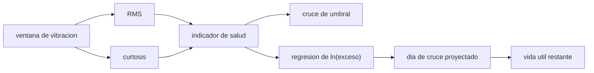

# B97-C26 — Monitoreo de condición de maquinaria extraterrestre

<!-- nav:top -->
[🏠 Programa](../../../../README.md) · [📚 Bloque B97](../../../tronco-comun/B97-robotica-y-construccion-extraterrestre.md) · [← Anterior: B97-C25 — Excavación y manejo de regolito con robots](../B97-C25-excavacion-y-manejo-de-regolito-con-robots/CLASE.md) · [Siguiente: B97-C27 — Simulación de productividad de flotas de maquinaria →](../B97-C27-simulacion-de-productividad-de-flotas-de-maquinaria/CLASE.md)
<!-- /nav -->

## 1. Ubicación, nivel y alcance

Clase 26 del bloque B97. Nivel N3. Una excavadora o un rover en la Luna no se puede llevar a un taller: hay que saber en qué condición está por sus propias señales. Aquí calculas dos indicadores de vibración, la raíz del valor cuadrático medio (RMS) y la curtosis, sobre una serie **sintética** de 140 ventanas diarias de un rodamiento con una falla incipiente; ves cuál avisa antes y proyectas la vida útil restante por regresión. Las señales, los umbrales y la falla son **ilustrativos**: no se consultó ninguna norma ni dato real.

## 2. Por qué esta clase existe

Reparar cuando algo falla puede ser imposible en un entorno remoto, y reparar «por si acaso» desperdicia piezas. Un indicador que avise a tiempo y una proyección con su incertidumbre permiten planificar la reparación. La decisión central: **¿qué indicador detecta antes la falla, y cuántos días de vida útil quedan si se proyecta la tendencia con una regresión?**

## 3. Lo que podrás hacer al terminar

1. Calcular el RMS y la curtosis de una ventana de vibración.
2. Verificar los indicadores con casos analíticos (senoidal y gaussiana).
3. Detectar el primer día en que cada indicador cruza su umbral.
4. Ajustar una regresión lineal del logaritmo del exceso de potencia.
5. Proyectar el día de cruce del umbral y la vida útil restante.
6. Separar lo sintético (todo) de lo consultado (nada).

La evidencia es la **ficha de condición de un rodamiento sintético** del ejercicio 12 (sección 20).

## 4. Con qué llegas y cómo comprobarlo

1. ¿Qué es el RMS de una señal?
2. ¿Qué es la curtosis de una distribución?
3. ¿Qué es una regresión lineal?
4. ¿Qué es un dato sintético?
5. ¿Qué es una segunda vía de cálculo?

<details>
<summary>Ver respuestas</summary>

1. La raíz del promedio de los cuadrados: mide la energía de la señal. 2. El momento de cuarto orden normalizado: mide lo «picuda» o impulsiva que es la señal; vale 3 para una gaussiana. 3. El ajuste de una recta a datos por mínimos cuadrados. 4. Un dato generado para el ejemplo, no medido. 5. Calcular lo mismo con otro método y comparar.
</details>

Con cuatro o cinco aciertos, sigue; si no, repasa los prerrequisitos.

## 5. Un caso de contexto y casos de referencia

En 140 ventanas sintéticas con una falla desde el día 40, la curtosis supera `3,6` el día `88` y el RMS supera `1,5` el día `106`: la curtosis avisa `18` días antes. Con la regresión sobre los últimos 20 días hasta el día 96 se proyecta el cruce del umbral en el día `105,5` (vida útil restante `9,5` d) frente al día `106` de la referencia determinista. Es el **ejemplo conductor**.

## 6. Vocabulario

El **RMS** mide la energía de la señal. La **curtosis** mide su carácter impulsivo. El **indicador de salud** es la magnitud que resume la condición. La **vida útil restante (RUL)** es el tiempo hasta que el indicador cruza su umbral. La **regresión** ajusta una tendencia para extrapolar.

## 7. Modelo mental



*Descripción textual:* cada ventana da RMS y curtosis; los indicadores se comparan con umbrales y su tendencia se proyecta por regresión para estimar la vida útil restante.

Analogía: escuchar un motor que primero hace un golpeteo ocasional (curtosis) y mucho después suena más fuerte en general (RMS). Límite: aquí todo es sintético y no se considera carga ni temperatura.

## 8. La explicación, paso a paso

### 8.1 Indicadores y su comprobación

RMS de una senoidal de amplitud `2`: `1,4142` (teórico `1,4142`). Curtosis de una senoidal: `1,500` (teórico `1,5`); de una gaussiana: `2,995` (≈ 3). Los días sanos dan RMS `1,0016` y curtosis `3,010`.

### 8.2 Detección

Con la falla, el día 96 el RMS es `1,167` y la curtosis `6,40`; el día 139, `12,73` y `46,36`. La curtosis cruza `3,6` el día `88` y el RMS cruza `1,5` el día `106`: la curtosis avisa antes porque los impulsos aparecen antes de que suba la energía total. Los umbrales son ilustrativos.

### 8.3 Proyección de la vida útil

El exceso de potencia `E = RMS² − 1` crece como `A²`, es decir exponencialmente; la regresión de `ln E`, ponderada por `E²` (los días con más señal pesan más), sobre los últimos 20 días hasta el día 96 tiene pendiente `0,1268` por día (factor `1,135`/día). Se proyecta el cruce de `E = 1,25` (RMS `1,5`) en el día `105,5`: `9,5` d de vida restante. La referencia determinista, con la potencia esperada, cruza el día `106` (`10` d); el error es `0,5` días.

### 8.4 Qué falta

Una regresión sobre el ruido puede subestimar o sobrestimar la vida útil; hay que dar un intervalo. Los umbrales de alarma reales vienen de normas y de la experiencia de la máquina, no se consultaron; el modelo no incluye variaciones de carga, velocidad ni temperatura.

## 9. Magnitudes, símbolos y unidades

| Símbolo | Qué es | Unidad | Valor / nota |
|---|---|---|---|
| RMS | raíz del valor cuadrático medio | u.a. | 1,002 (sano) |
| curtosis | momento de 4.º orden normalizado | — | 3,01 (sano) |
| `E` | exceso de potencia `RMS² − 1` | u.a.² | umbral 1,25 |
| RUL | vida útil restante | d | 9,5 (proyectada) |
| pendiente | de `ln E` por día | 1/d | 0,1268 |

## 10. Convenciones y referencias

Ventana diaria de 2048 muestras en unidades arbitrarias; ruido gaussiano de desviación 1; falla desde el día 40 con impulsos periódicos de amplitud creciente; umbrales ilustrativos de RMS 1,5 y curtosis 3,6. Todos los datos son sintéticos.

## 11. De dónde sale lo que afirmamos

| ID | Fuente | Localizador | Respalda | Estado |
|---|---|---|---|---|
| — | Relaciones estándar usadas en el laboratorio | — | las verifica el laboratorio con una segunda vía | No consultada en una fuente concreta |

Límites: no se consultó ninguna norma de severidad de vibración ni datos de rodamientos; los umbrales, el ruido y la falla son sintéticos.

## 12. Cómo ver el resultado

| Magnitud | Valor |
|---|---|
| Día de alarma por curtosis | 88 |
| Día de alarma por RMS | 106 |
| Cruce proyectado | día 105,5 |
| Referencia determinista | día 106 |
| Error del día de cruce | 0,5 d |

Descripción larga: la curtosis avisa antes que el RMS, y la regresión del logaritmo del exceso de potencia proyecta el cruce a pocos días de la referencia.

## 13. Ejemplo trabajado

**Paso 1 · Exceso.** `E = RMS² − 1`; para RMS `1,5`, `E = 1,25`.

**Paso 2 · Regresión.** `ln E = a + b d` ponderada por `E²` sobre los últimos 20 días: `b = 0,1268`.

**Paso 3 · Cruce.** `d = (ln 1,25 − a)/b = 105,5`; vida restante `9,5` d.

## 14. Distintas formas de describir el problema

**Por energía:** RMS. **Por impulsividad:** curtosis. **Por tendencia:** regresión de `ln E`. **Por proyección:** día de cruce. **Por incertidumbre:** error frente a la referencia.

## 15. Práctica guiada

**Ejercicio 1 · con los pasos indicados.** Calcula el RMS de `(3, 4)`. *Pasos:* `√((9 + 16)/2)`.

<details><summary>Solución comentada</summary>

`3,536`.
</details>

**Ejercicio 2 · con una pista.** Predice si la curtosis de una gaussiana es mayor o menor que la de una senoidal. *Pista:* 3 frente a 1,5.

<details><summary>Solución comentada</summary>

Mayor: `3` frente a `1,5`.
</details>

**Ejercicio 3 · casi autónomo.** ¿Por qué la curtosis avisa antes que el RMS?

<details><summary>Solución comentada</summary>

Los impulsos elevan el cuarto momento antes de que cambie la energía total.
</details>

## 16. Práctica autónoma, transferencia e integrador

**Ejercicio 4 · autónomo.** ¿Por qué se regresa `ln E` y no `E`?

<details><summary>Solución comentada</summary>

Porque el crecimiento es exponencial: en escala logarítmica es una recta.
</details>

**Ejercicio 5 · autónomo.** ¿Qué pasa con la vida útil proyectada si la pendiente real es mayor?

<details><summary>Solución comentada</summary>

Se subestima la rapidez y se sobrestima la vida restante.
</details>

**Ejercicio 6 · autónomo.** ¿Qué pasa si la ventana de regresión pasa de 20 a 5 días?

<details><summary>Solución comentada</summary>

Más ruido en la pendiente y una proyección menos estable.
</details>

**Ejercicio 7 · autónomo.** ¿Qué mide el criterio de verificación de 5 días?

<details><summary>Solución comentada</summary>

Que el día de cruce proyectado quede a menos de 5 días del de referencia.
</details>

**Ejercicio 8 · autónomo.** ¿Qué agrega un intervalo de predicción?

<details><summary>Solución comentada</summary>

Una banda de días con confianza dada en vez de un único valor.
</details>

**Ejercicio 9 · transferencia.** Hay carga variable que modifica la vibración. ¿Qué haces? **Transferencia.**

<details><summary>Solución comentada</summary>

Normalizar el indicador por carga o velocidad antes de la tendencia.
</details>

**Ejercicio 10 · transferencia.** Una falsa alarma de RMS detiene la máquina. ¿Qué criterio añades? **Transferencia.**

<details><summary>Solución comentada</summary>

Exigir persistencia (varios días seguidos) o combinar indicadores.
</details>

**Ejercicio 11 · transferencia.** ¿Qué falta para usar esto en una máquina real? **Transferencia.**

<details><summary>Solución comentada</summary>

Datos reales de la máquina, umbrales de norma o de la experiencia y validación de la proyección.
</details>

**Ejercicio 12 · integrador.** Elabora tu *ficha de condición de un rodamiento sintético*: indicadores, días de alarma, regresión, vida útil proyectada y su error, todo rotulado como sintético. **Integrador.**

<details><summary>Solución comentada</summary>

Secciones 8.1–8.4 y la salida del laboratorio.
</details>

## 17. Laboratorio

El script [condicion_rodamiento.py](condicion_rodamiento.py) calcula RMS y curtosis de 140 ventanas, verifica los indicadores con casos analíticos, detecta el cruce de umbrales y proyecta la vida útil por regresión (**comprueba** indicadores y error del día de cruce < 5 días).

**Datos:** **sintéticos** (ruido, falla, umbrales y semilla); no se consultó ninguna fuente. **Predice antes de ejecutar:** ¿Qué indicador avisa antes? (La curtosis.) **Ejecución del 2026-11-10 (Python 3.12.9):**

```text
Python 3.12.9 (biblioteca estandar)
Datos SINTETICOS: 140 dias, ventanas de 2048 muestras; falla incipiente desde el dia 40; semilla 20261110
Pruebas de indicadores: RMS de una senoidal de amplitud 2 = 1.4142 (teorico 1.4142); curtosis senoidal = 1.5000 (1.5); curtosis gaussiana = 2.995 (~3)
Dias sanos: RMS medio = 1.0016; curtosis media = 3.010
Dia 96: RMS = 1.1668; curtosis = 6.400; dia 139: RMS = 12.727; curtosis = 46.361
Primer dia sobre el umbral: curtosis > 3.6: dia 88; RMS > 1.5: dia 106 (la curtosis avisa 18 dias antes)
Regresion de ln(exceso de potencia) en los ultimos 20 dias hasta el dia 96: pendiente = 0.1268 por dia (factor 1.1351/dia)
Cruce proyectado del umbral de RMS: dia 105.5 (vida util restante 9.5 d); referencia determinista: dia 106 (10 d); error 0.5 d
Pruebas superadas.
```

```bash
python programa/clases/B97/B97-C26-monitoreo-de-condicion-de-maquinaria-extraterrestre/condicion_rodamiento.py
```

**Límites:** ruido gaussiano, falla con impulsos periódicos de crecimiento exponencial, sin carga ni temperatura; umbrales no normativos.

## 18. Errores frecuentes y cómo corregirlos

**Confiar solo en el RMS.** Avisa tarde (8.2)

**Extrapolar una tendencia ruidosa sin intervalo.** La vida útil tiene incertidumbre (8.4)

**Usar umbrales ilustrativos como normativos.** No lo son; ver la sección 10

**Ignorar la carga.** El modelo la excluye (8.4)

## 19. Cómo sabrás que vas bien

Tras la sección 8: ¿qué indicador esperabas que avisara antes y cuál lo hizo? Si dudas, repasa el ejemplo 13. Tras el laboratorio: ¿qué comprueba? (ver la sección 17).

## 20. Qué entregas y cómo se evalúa

El producto es tu **ficha de condición de un rodamiento sintético** (ejercicio 12).

| Criterio | Inicial | En desarrollo | Logrado | Destacado |
|---|---|---|---|---|
| Conceptos | Los confunde | Parciales | Explica el modelo y sus supuestos | Explica los límites |
| Cálculo | Sin unidades | Con errores | Tablas completas con unidades | Calcula casos nuevos |
| Numérico | Sin comprobar | Un caso | Contraste con una segunda vía | Interpreta las diferencias |
| Fuentes | Sin fuente | Sin fecha | Fuentes con fecha y estado | Declara lo ilustrativo y lo no consultado |
| Límites | No los nombra | Uno | Tres | Discute qué falta del modelo |

**Condiciones críticas (no se compensan con promedio):** rotular los datos sintéticos e ilustrativos; no presentar un resultado simulado como observado o medido; citar solo lo consultado.

## 21. Ética, seguridad y límites

Clase educativa: los modelos son simplificados y sus datos son sintéticos o ilustrativos; ningún resultado describe una misión real, certifica un diseño ni sustituye a las normas aplicables ni a las pruebas de hardware.  Accesibilidad: tablas equivalentes a las gráficas, fórmulas en texto, ejercicios sin conexión.

## 22. Para cerrar y seguir

La curtosis avisó `18` días antes que el RMS y la proyección dio `9` d de vida restante. Queda una pregunta: ¿cómo se estima la productividad de toda una flota de maquinaria?

**Glosario español–inglés.** monitoreo de condición · *condition monitoring*; curtosis · *kurtosis*; indicador de salud · *health indicator*; vida útil restante · *remaining useful life (RUL)*; regresión · *regression*.

**Continuidad.** [B97-C27](../B97-C27-simulacion-de-productividad-de-flotas-de-maquinaria/CLASE.md) estudia la simulación de productividad de flotas de maquinaria.

**Referencias:** ver sección 11.

<!-- nav:bottom -->
---

[← Anterior: B97-C25 — Excavación y manejo de regolito con robots](../B97-C25-excavacion-y-manejo-de-regolito-con-robots/CLASE.md) · [📚 Bloque B97](../../../tronco-comun/B97-robotica-y-construccion-extraterrestre.md) · [Siguiente: B97-C27 — Simulación de productividad de flotas de maquinaria →](../B97-C27-simulacion-de-productividad-de-flotas-de-maquinaria/CLASE.md)
<!-- /nav -->
