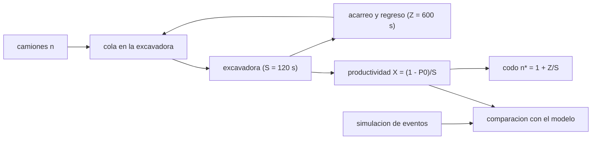

# B97-C27 — Simulación de productividad de flotas de maquinaria

<!-- nav:top -->
[🏠 Programa](../../../../README.md) · [📚 Bloque B97](../../../tronco-comun/B97-robotica-y-construccion-extraterrestre.md) · [← Anterior: B97-C26 — Monitoreo de condición de maquinaria extraterrestre](../B97-C26-monitoreo-de-condicion-de-maquinaria-extraterrestre/CLASE.md) · [Siguiente: B98-C01 — Planificación por objetivos a bordo →](../../../tronco-comun/B98-autonomia-y-teleoperacion-espacial.md#b98-c01)
<!-- /nav -->

## 1. Ubicación, nivel y alcance

Clase 27 del bloque B97. Nivel N3. Una flota de maquinaria no rinde lo que suma cada máquina: una excavadora compartida con varios camiones forma una cola, y por encima de cierto número de camiones agregar más no produce más. Aquí estimas la productividad de una flota con simulación de eventos discretos, la contrastas con el modelo analítico de población finita (el «problema del reparador de máquinas») y ves el codo de saturación. Todos los datos son **sintéticos**.

## 2. Por qué esta clase existe

Comprar o enviar más camiones sin calcular el cuello de botella desperdicia masa de lanzamiento. Con un modelo mínimo se ve cuántos camiones sirven y qué máquina limita. La decisión central: **¿cuántos camiones conviene asignar a una excavadora, y cuántas toneladas por hora entrega la flota?**

## 3. Lo que podrás hacer al terminar

1. Calcular la productividad analítica de una flota con una excavadora compartida.
2. Simular el sistema con eventos discretos y semilla fija.
3. Comparar la simulación con el modelo analítico.
4. Identificar el codo de saturación y el cuello de botella.
5. Comparar tiempos de acarreo exponenciales y deterministas.
6. Separar lo sintético (todo) de lo consultado (nada).

La evidencia es la **ficha de productividad de una flota de maquinaria** del ejercicio 12 (sección 20).

## 4. Con qué llegas y cómo comprobarlo

1. ¿Qué es una cola?
2. ¿Qué es una distribución exponencial?
3. ¿Qué es una simulación de eventos discretos?
4. ¿Qué es un dato sintético?
5. ¿Qué es una segunda vía de cálculo?

<details>
<summary>Ver respuestas</summary>

1. Una fila de elementos que esperan un servicio. 2. La distribución del tiempo entre eventos independientes de tasa constante. 3. Una simulación que avanza de evento en evento. 4. Un dato generado para el ejemplo, no medido. 5. Calcular lo mismo con otro método y comparar.
</details>

Con cuatro o cinco aciertos, sigue; si no, repasa los prerrequisitos.

## 5. Un caso de contexto y casos de referencia

Con una excavadora que carga en `120 s` y camiones con `600 s` de ida y vuelta, el codo está en `n* = 6` camiones. La flota entrega `4,23` t/h con 3 camiones, `7,27` t/h con 6 y `8,83` t/h con 10 (cota de la excavadora: `9,00` t/h, con `300 kg` por carga). Es el **ejemplo conductor**; todo es sintético.

## 6. Vocabulario

La **productividad** es la masa entregada por hora. La **utilización** es la fracción de tiempo que la excavadora está ocupada. El **codo** `n* = 1 + Z/S` es el número de camiones en el que la excavadora se satura. El **cuello de botella** es la máquina que limita el sistema. Una **simulación de eventos discretos** avanza de evento en evento.

## 7. Modelo mental



*Descripción textual:* los camiones circulan entre la cola de la excavadora y el acarreo; la productividad sube con `n` hasta el codo; la simulación se compara con el modelo.

Analogía: varios repartidores que cargan en un único muelle; con pocos, el muelle espera; con muchos, los repartidores esperan al muelle. Límite: aquí no hay averías, colas de descarga ni variaciones del terreno.

## 8. La explicación, paso a paso

### 8.1 Modelo analítico

Con tiempos exponenciales y población finita, `P_k ∝ n!/(n−k)! (S/Z)^k`; la utilización de la excavadora es `U = 1 − P₀` y la productividad `X = U/S`. Con `n = 3`: `U = 0,470`; con `n = 6`: `0,808`; con `n = 10`: `0,982` (saturada).

### 8.2 Productividad

La cota de la excavadora es `1/S = 30,0` cargas/h (`9,00` t/h). Con 1, 3, 6 y 10 camiones, `X = 5,0`, `14,1`, `24,2` y `29,4` cargas/h. Pasar de 3 a 6 camiones multiplica la productividad por `1,718`; de 6 a 10, solo por `1,215`.

### 8.3 Espera

La espera media en cola de cada camión es `45,4` s con 3 camiones y `502,5` s con 10: a partir del codo, cada camión adicional solo suma espera.

### 8.4 Simulación y acarreo determinista

La simulación de eventos con acarreo exponencial coincide con el modelo con diferencia máxima `0,007` (fracción). Con acarreo determinista a 600 s y 6 camiones, la productividad es `7,25` t/h frente a `7,27` t/h del modelo exponencial: en este caso la diferencia es pequeña porque la carga sigue siendo aleatoria, pero con otra variabilidad o con colas de descarga no tiene por qué serlo; el modelo analítico es una referencia.

## 9. Magnitudes, símbolos y unidades

| Símbolo | Qué es | Unidad | Valor / nota |
|---|---|---|---|
| `S` | tiempo medio de carga | s | 120 (sintético) |
| `Z` | tiempo medio de ida y vuelta | s | 600 (sintético) |
| `n` | camiones | — | 1–10 |
| `n*` | codo `1 + Z/S` | — | 6 |
| `X` | productividad | cargas/h (t/h) | 24,2 (n = 6) |

## 10. Convenciones y referencias

Una excavadora que carga un camión a la vez, camiones idénticos en un circuito cerrado, tiempos exponenciales en el modelo y simulación de comparación, carga útil de 300 kg, sin averías ni colas de descarga. Todos los datos son sintéticos.

## 11. De dónde sale lo que afirmamos

| ID | Fuente | Localizador | Respalda | Estado |
|---|---|---|---|---|
| — | Relaciones estándar usadas en el laboratorio | — | las verifica el laboratorio con una segunda vía | No consultada en una fuente concreta |

Límites: no se consultó ninguna flota ni datos reales; los tiempos y la carga útil son sintéticos; las fórmulas de colas son resultados estándar que el laboratorio contrasta con la simulación.

## 12. Cómo ver el resultado

| Magnitud | Valor |
|---|---|
| Codo `n*` | 6 |
| Productividad con 3 camiones | 4,23 t/h |
| Productividad con 6 camiones | 7,27 t/h |
| Cota de la excavadora | 9,00 t/h |
| Dif. simulación–modelo | 0,007 (fracción) |

Descripción larga: la productividad sube casi linealmente hasta el codo y luego se aplana contra la cota de la excavadora; más camiones solo alargan la espera.

## 13. Ejemplo trabajado

**Paso 1 · Codo.** `1 + 600/120 = 6`.

**Paso 2 · Cota.** `3600/120 = 30,0` cargas/h.

**Paso 3 · Toneladas.** `30,0 × 0,3 = 9,00` t/h.

## 14. Distintas formas de describir el problema

**Por modelo:** `P_k` y `X`. **Por cota:** `min(n/(S + Z), 1/S)`. **Por simulación:** eventos discretos. **Por cuello de botella:** excavadora o camiones. **Por espera:** tiempo en cola.

## 15. Práctica guiada

**Ejercicio 1 · con los pasos indicados.** Calcula el codo con `S = 100 s` y `Z = 500 s`. *Pasos:* `1 + Z/S`.

<details><summary>Solución comentada</summary>

`6`.
</details>

**Ejercicio 2 · con una pista.** Predice si 10 camiones rinden el doble que 5. *Pista:* la excavadora satura.

<details><summary>Solución comentada</summary>

No: `29,45/21,45 = 1,37` según el laboratorio, en vez de `2`.
</details>

**Ejercicio 3 · casi autónomo.** ¿Cuántas toneladas por hora es el máximo de la excavadora con 300 kg por carga?

<details><summary>Solución comentada</summary>

`9,00` t/h.
</details>

## 16. Práctica autónoma, transferencia e integrador

**Ejercicio 4 · autónomo.** ¿Qué pasa con la utilización de la excavadora al añadir camiones?

<details><summary>Solución comentada</summary>

Se acerca a 1 y se satura.
</details>

**Ejercicio 5 · autónomo.** ¿Qué cambia si la excavadora es dos veces más rápida?

<details><summary>Solución comentada</summary>

`S = 60 s`: el codo sube a 11 y la cota se duplica.
</details>

**Ejercicio 6 · autónomo.** ¿Qué pasa si el acarreo se acorta a 300 s?

<details><summary>Solución comentada</summary>

El codo baja a `1 + 300/120 = 3,5`: con menos camiones se satura la excavadora.
</details>

**Ejercicio 7 · autónomo.** ¿Cuánto cambia la productividad con acarreo determinista frente al exponencial con 6 camiones?

<details><summary>Solución comentada</summary>

Poco: `7,25` frente a `7,27` t/h; la variabilidad de la carga domina la cola.
</details>

**Ejercicio 8 · autónomo.** ¿Qué mide el criterio de 3 % del laboratorio?

<details><summary>Solución comentada</summary>

Que la simulación y el modelo analítico concuerdan dentro del ruido.
</details>

**Ejercicio 9 · transferencia.** Una excavadora se avería a menudo. ¿Cómo lo incorporas? **Transferencia.**

<details><summary>Solución comentada</summary>

Con tiempos de falla y reparación en la simulación: la excavadora se vuelve un recurso intermitente (ver C12 y C26).
</details>

**Ejercicio 10 · transferencia.** Dos excavadoras comparten los camiones. ¿Qué cambia? **Transferencia.**

<details><summary>Solución comentada</summary>

El modelo pasa a varios servidores y el codo se duplica aproximadamente.
</details>

**Ejercicio 11 · transferencia.** ¿Cómo usarías el modelo para dimensionar una flota para 1000 t? **Transferencia.**

<details><summary>Solución comentada</summary>

Eligiendo `n` en el codo y calculando el tiempo con la productividad resultante.
</details>

**Ejercicio 12 · integrador.** Elabora tu *ficha de productividad de una flota de maquinaria*: tabla de productividad analítica y simulada por número de camiones, codo, cota y espera, todo rotulado como sintético. **Integrador.**

<details><summary>Solución comentada</summary>

Secciones 8.1–8.4 y la salida del laboratorio.
</details>

## 17. Laboratorio

El script [flota_productividad.py](flota_productividad.py) calcula la productividad analítica de una flota, la simula con eventos discretos con acarreo exponencial y determinista y compara (**comprueba** diferencia máxima < 3 % entre la simulación exponencial y el modelo).

**Datos:** **sintéticos** (tiempos, carga útil y semilla); no se usa ningún dato publicado. **Predice antes de ejecutar:** ¿Cuántos camiones saturan la excavadora? (Cerca del codo, 6.) **Ejecución del 2026-11-10 (Python 3.12.9):**

```text
Python 3.12.9 (biblioteca estandar)
Flota SINTETICA: carga media S = 120 s; ida y vuelta Z = 600 s; carga util 300 kg; 60000 cargas por caso; semilla 20261110
 n   X analitica [cargas/h]  U excav.  X simulada (exp.)  dif. [%]   X simulada (det.)  U (det.)  espera analitica [s]
 1                 5.00     0.167             5.01      0.24              5.01     0.165                  0.0
 2                 9.73     0.324             9.74      0.08              9.73     0.324                 20.0
 3                14.11     0.470            14.21      0.70             14.11     0.471                 45.4
 4                18.05     0.602            18.07      0.12             18.06     0.600                 77.8
 5                21.45     0.715            21.51      0.27             21.48     0.716                119.0
 6                24.24     0.808            24.23      0.05             24.16     0.809                170.9
 7                26.38     0.879            26.45      0.26             26.35     0.881                235.1
 8                27.90     0.930            27.75      0.55             27.93     0.929                312.3
 9                28.88     0.963            28.82      0.20             28.83     0.963                402.0
10                29.45     0.982            29.54      0.31             29.60     0.982                502.5
Codo n* = 1 + Z/S = 6.0; cota de la excavadora 1/S = 30.0 cargas/h = 9.00 t/h
Productividad con 3 / 6 / 10 camiones = 4.23 / 7.27 / 8.83 t/h; la ganancia de 6 a 10 camiones es x1.215
Diferencia maxima de X entre simulacion exponencial y modelo analitico = 0.70 %
Pruebas superadas.
```

```bash
python programa/clases/B97/B97-C27-simulacion-de-productividad-de-flotas-de-maquinaria/flota_productividad.py
```

**Límites:** circuito cerrado con una excavadora, camiones idénticos, sin averías ni colas de descarga; el modelo analítico supone tiempos exponenciales.

## 18. Errores frecuentes y cómo corregirlos

**Sumar la productividad de cada máquina.** El cuello de botella limita (8.2)

**Añadir camiones sin calcular el codo.** Pasado el codo solo aumenta la espera (8.3)

**Usar el modelo exponencial como exacto.** Otra variabilidad lo cambia (8.4)

**Presentar los tiempos como reales.** Son sintéticos; ver la sección 10

## 19. Cómo sabrás que vas bien

Tras la sección 8: ¿cuántos camiones esperabas en el codo y cuál obtuviste? Si dudas, repasa el ejemplo 13. Tras el laboratorio: ¿qué comprueba? (ver la sección 17).

## 20. Qué entregas y cómo se evalúa

El producto es tu **ficha de productividad de una flota de maquinaria** (ejercicio 12).

| Criterio | Inicial | En desarrollo | Logrado | Destacado |
|---|---|---|---|---|
| Conceptos | Los confunde | Parciales | Explica el modelo y sus supuestos | Explica los límites |
| Cálculo | Sin unidades | Con errores | Tablas completas con unidades | Calcula casos nuevos |
| Numérico | Sin comprobar | Un caso | Contraste con una segunda vía | Interpreta las diferencias |
| Fuentes | Sin fuente | Sin fecha | Fuentes con fecha y estado | Declara lo ilustrativo y lo no consultado |
| Límites | No los nombra | Uno | Tres | Discute qué falta del modelo |

**Condiciones críticas (no se compensan con promedio):** rotular los datos sintéticos e ilustrativos; no presentar un resultado simulado como observado o medido; citar solo lo consultado.

## 21. Ética, seguridad y límites

Clase educativa: los modelos son simplificados y sus datos son sintéticos o ilustrativos; ningún resultado describe una misión real, certifica un diseño ni sustituye a las normas aplicables ni a las pruebas de hardware.  Accesibilidad: tablas equivalentes a las gráficas, fórmulas en texto, ejercicios sin conexión.

## 22. Para cerrar y seguir

La flota sintética rinde `7,27` t/h con 6 camiones y solo `8,83` t/h con 10 (`1,21` veces más), porque la excavadora se acerca a la cota de `9,00` t/h. Este es el último de los 27 temas del bloque B97; el siguiente bloque estudia la autonomía y la teleoperación espacial.

**Glosario español–inglés.** productividad · *productivity*; cuello de botella · *bottleneck*; utilización · *utilization*; simulación de eventos discretos · *discrete-event simulation*; flota · *fleet*.

**Continuidad.** El bloque siguiente, [B98](../../../tronco-comun/B98-autonomia-y-teleoperacion-espacial.md), presenta la autonomía y la teleoperación espacial.

**Referencias:** ver sección 11.

<!-- nav:bottom -->
---

[← Anterior: B97-C26 — Monitoreo de condición de maquinaria extraterrestre](../B97-C26-monitoreo-de-condicion-de-maquinaria-extraterrestre/CLASE.md) · [📚 Bloque B97](../../../tronco-comun/B97-robotica-y-construccion-extraterrestre.md) · [Siguiente: B98-C01 — Planificación por objetivos a bordo →](../../../tronco-comun/B98-autonomia-y-teleoperacion-espacial.md#b98-c01)
<!-- /nav -->
