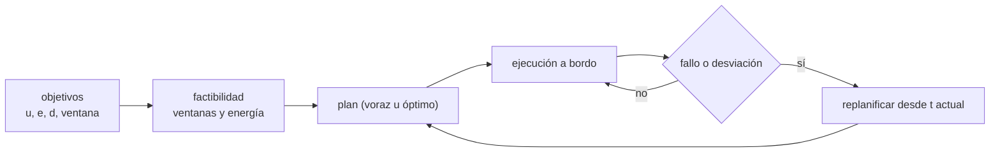

# B98-C01 — Planificación por objetivos a bordo

<!-- nav:top -->
[🏠 Programa](../../../../README.md) · [📚 Bloque B98](../../../tronco-comun/B98-autonomia-y-teleoperacion-espacial.md) · [← Anterior: B97-C27 — Simulación de productividad de flotas de maquinaria](../../B97/B97-C27-simulacion-de-productividad-de-flotas-de-maquinaria/CLASE.md) · [Siguiente: B98-C02 — Sistemas de decisión autónomos y máquinas de estados de comportamiento →](../B98-C02-sistemas-de-decision-autonomos-y-maquinas-de-estados-de-comportamiento/CLASE.md)
<!-- /nav -->

## 1. Ubicación, nivel y alcance

Clase 1 del bloque B98. Nivel N3. Desde la Tierra se planifica con horas de antelación; a bordo hay que decidir cuándo el enlace no permite esperar. Aquí aprendes a describir un conjunto de **objetivos** (utilidad, energía, duración y ventana de tiempo), a elegir cuáles ejecutar bajo un presupuesto de energía y a **replanificar** cuando un fallo recorta ese presupuesto. Usas [B96](../../../tronco-comun/B96-control-y-operacion-de-misiones-espaciales.md) solo para la idea de plan de operaciones hecho desde Tierra. Los ocho objetivos de la clase son **sintéticos**: no corresponden a ninguna misión.

## 2. Por qué esta clase existe

Si el vehículo solo ejecuta una secuencia fija de comandos, un fallo a mitad de jornada deja sin sentido el resto del plan y hay que esperar la respuesta de Tierra. La decisión central: **¿qué objetivos conviene ejecutar con la energía y el tiempo disponibles, y qué hace el vehículo cuando la energía disponible baja de golpe?**

## 3. Lo que podrás hacer al terminar

1. Describir un objetivo con utilidad, energía, duración y ventana de tiempo.
2. Comprobar si un conjunto de objetivos es factible (ventanas y presupuesto de energía).
3. Construir un plan voraz por utilidad/energía y calcular su razón frente al óptimo.
4. Replanificar los objetivos pendientes tras una pérdida de energía.
5. Cuantificar cuánta utilidad se pierde por el fallo y qué objetivos se sacrifican.
6. Separar lo calculado (plan) de lo supuesto (datos sintéticos y modelo).

La evidencia es la **ficha de plan a bordo con su plan de contingencia** del ejercicio 12 (sección 20).

## 4. Con qué llegas y cómo comprobarlo

1. ¿Qué es la energía de una batería y en qué unidades se mide?
2. ¿Qué es una ventana de tiempo?
3. ¿Qué es una restricción?
4. ¿Qué es un dato sintético?
5. ¿Qué es una verificación por segunda vía?

<details>
<summary>Ver respuestas</summary>

1. La capacidad de realizar trabajo; se mide en Wh (o J). 2. El intervalo en el que una actividad puede ocurrir. 3. Una condición que un plan debe cumplir. 4. Un dato generado para el ejemplo, no medido. 5. Calcular lo mismo con otro método y comparar.
</details>

Con cuatro o cinco aciertos, sigue; si no, repasa los prerrequisitos.

## 5. Un caso de contexto y casos de referencia

Una jornada de 240 min con 8 objetivos candidatos y un presupuesto de energía de 150 Wh. El plan **óptimo** reúne 6 objetivos con utilidad 68 y 149 Wh; el plan **voraz** reúne 7 con utilidad 66 y 134 Wh (razón 0,971). Si a los 100 min una avería recorta 35 Wh, el plan de contingencia solo suma 25 de utilidad más lo ya hecho: 51 en total. Es el **ejemplo conductor**. Todo es **sintético**: ninguna cifra describe una misión.

## 6. Vocabulario

Un **objetivo** es un resultado deseado con utilidad `u`, energía `e`, duración `d` y ventana `[a, b]`. Un **plan** es un subconjunto de objetivos con un orden y unos instantes de inicio. Es **factible** si cada objetivo empieza en `t ≥ a`, termina en `t + d ≤ b`, no se solapa con otro y `Σe ≤ E`. El planificador **voraz** ordena por `u/e` y añade lo que cabe. La **replanificación** recalcula el plan desde el instante actual con el estado real.

## 7. Modelo mental: el itinerario de un día con poco combustible



*Descripción textual:* los objetivos pasan por una comprobación de factibilidad y producen un plan; la ejecución lo vigila y, si hay un fallo, recalcula el plan desde el instante actual con la energía real.

Analogía: un turista con una mochila de peso limitado y horarios de museos elige qué visitar; si se le pierde parte del dinero, rehace la lista con lo que queda del día. Límite: aquí la utilidad es un número fijo conocido y las duraciones son exactas; en una misión real ambas son inciertas.

## 8. La explicación, paso a paso

### 8.1 Factibilidad

Dado un conjunto y un orden, se avanza el reloj: `inicio = max(t, a)`, `fin = inicio + d`; si `fin > b` el orden no es factible. Como el orden importa, el laboratorio prueba las permutaciones (para 8 objetivos hay como máximo `Σ 8!/(8−k)! = 109 601` órdenes). Además `Σ e ≤ 150 Wh`.

### 8.2 Voraz frente a óptimo

Razones `u/e`: G5 0,75; G1 0,556; G8 0,55; G7 0,5; G2 0,467; G3 0,462; G6 y G4 0,364. El voraz toma G5, G1, G8, G7, G2, G3 y G6 (134 Wh, utilidad 66) y rechaza G4 porque `134 + 55 = 189 > 150`. El óptimo, buscado entre `2⁸ = 256` subconjuntos, sacrifica G1 y G6 para incluir la perforación G4 (utilidad 20): 6 objetivos, 149 Wh, utilidad 68. La razón voraz/óptimo es `66/68 = 0,971`.

### 8.3 Fallo y contingencia

A los 100 min solo han terminado G2 y G3 (56 Wh). Tras perder 35 Wh quedan `150 − 56 − 35 = 59 Wh`. Con los objetivos pendientes y el reloj en `t = 100`, el mejor plan es G5 + G6 + G8 (50 Wh, utilidad 25). La utilidad total es `(14 + 12) + 25 = 51` frente a 68 sin fallo (pérdida del 25 %).

### 8.4 Qué cambia y qué no

La replanificación usa el **mismo** código que la planificación; cambian el instante inicial y la energía. La perforación G4, que estaba en curso, se descarta en el modelo (no se contabiliza su energía parcial): es una simplificación que debes nombrar.

## 9. Magnitudes, símbolos y unidades

| Símbolo | Qué es | Unidad | Valor / nota |
|---|---|---|---|
| `u` | utilidad del objetivo | — | 6 a 20 (sintética) |
| `e` | energía del objetivo | Wh | 8 a 55 |
| `d` | duración | min | 10 a 60 |
| `[a, b]` | ventana de tiempo | min desde t = 0 | 0 a 240 |
| `E` | presupuesto de energía | Wh | 150; 59 tras el fallo |
| `u/e` | razón de utilidad por energía | 1/Wh | 0,364 a 0,75 |

## 10. Convenciones y referencias

Reloj de a bordo en minutos desde el inicio de la jornada; energía en Wh. Utilidades, energías, duraciones y ventanas son **sintéticas**. El óptimo se calcula por enumeración exhaustiva (válida solo porque hay 8 objetivos); el problema general es combinatorio y se resuelve con búsqueda y heurísticas. La replanificación se dispara por un único evento (pérdida de 35 Wh a los 100 min).

## 11. De dónde sale lo que afirmamos

| ID | Fuente | Localizador | Respalda | Estado |
|---|---|---|---|---|
| S1 | Muscettola, Nayak, Pell y Williams (1998), «Remote Agent: To Boldly Go Where No AI System Has Gone Before», Artificial Intelligence 103(1-2), 5-48 — https://groups.csail.mit.edu/mers/old-site/abstracts/aij98-abstract.html (consultada 2026-11-10) | resumen y datos de publicación | arquitectura con planificación y programación temporal con restricciones, ejecución multihilo y reconfiguración basada en modelos, para el control a bordo de Deep Space One | Consultada (solo resumen) |
| S2 | ECSS-E-ST-70-11C Rev.1, «Space segment operability» (15 octubre 2025) — https://ecss.nl/standard/ecss-e-st-70-11c-rev-1-space-segment-operability-15-october-2025/ (consultada 2026-11-10) | ficha pública de la norma obtenida por búsqueda web | la norma recoge requisitos de operabilidad del segmento espacial que cada misión debe adaptar; no se leyeron sus requisitos | Consultada (solo ficha) |
| — | ECSS-E-ST-70-41C (PUS, servicios de utilización de paquetes) | — | cómo se encapsulan órdenes y planes en un servicio de utilización de paquetes | No consultada |
| — | Modelos y leyes de la clase | — | los verifica el laboratorio con una segunda vía | No consultada en una fuente concreta |

Límites: del Remote Agent solo se consultó el resumen (planificación y programación con restricciones para controlar una nave a bordo); no se reproduce su algoritmo. Los objetivos, la utilidad y los presupuestos son sintéticos.

## 12. Cómo ver un plan

| Magnitud | Valor |
|---|---|
| Voraz | utilidad 66; 134 Wh; 7 objetivos |
| Óptimo | utilidad 68; 149 Wh; 6 objetivos |
| Razón voraz/óptimo | 0,971 |
| Energía restante tras el fallo | 59 Wh |
| Utilidad total con fallo | 51 (frente a 68) |

Descripción larga: el plan óptimo ocupa casi todo el presupuesto (149 de 150 Wh); tras el fallo el plan se reduce a tres objetivos baratos y la utilidad total baja a tres cuartas partes.

## 13. Ejemplo trabajado: la energía restante tras el fallo

**Paso 1 · Lo ejecutado.** Hasta `t = 100 min` terminaron G2 (30 Wh) y G3 (26 Wh): 56 Wh.

**Paso 2 · Presupuesto.** `150 − 56 − 35 = 59 Wh`.

**Paso 3 · Candidatos.** G5 (8 Wh), G6 (22 Wh) y G8 (20 Wh) suman 50 Wh ≤ 59 y caben en sus ventanas; añadir G7 (10 Wh) llevaría a 60 Wh > 59.

**Paso 4 · Utilidad.** `6 + 8 + 11 = 25`.

## 14. Distintas formas de describir un plan

**Por tabla:** objetivo, inicio, fin, energía. **Por línea de tiempo:** barras sobre el eje de 0 a 240 min. **Por balance:** energía acumulada frente al presupuesto. **Por razón:** `u/e` de cada objetivo elegido.

## 15. Práctica guiada

**Ejercicio 1 · con los pasos indicados.** Calcula `u/e` de G2 (utilidad 14, energía 30 Wh). *Pasos:* divide y redondea a tres decimales.

<details><summary>Solución comentada</summary>

`14/30 = 0,467`.
</details>

**Ejercicio 2 · con una pista.** ¿Cuánto margen de energía deja el plan voraz? *Pista:* resta 134 Wh del presupuesto.

<details><summary>Solución comentada</summary>

`150 − 134 = 16 Wh`.
</details>

**Ejercicio 3 · casi autónomo.** ¿Por qué el voraz no incluye G4?

<details><summary>Solución comentada</summary>

Su razón `u/e = 0,364` es la menor y, además, `134 + 55 = 189 > 150`.
</details>

## 16. Práctica autónoma, transferencia e integrador

**Ejercicio 4 · autónomo.** ¿Cuánto mejor es el óptimo que el voraz, en porcentaje?

<details><summary>Solución comentada</summary>

`68/66 − 1 = 3,0 %`.
</details>

**Ejercicio 5 · autónomo.** Si la pérdida fuera de 50 Wh, ¿cuánta energía restaría tras el fallo?

<details><summary>Solución comentada</summary>

`150 − 56 − 50 = 44 Wh`; G5 + G6 + G8 (50 Wh) ya no cabrían.
</details>

**Ejercicio 6 · autónomo.** ¿Cuántos subconjuntos de 8 objetivos hay?

<details><summary>Solución comentada</summary>

`2⁸ = 256`.
</details>

**Ejercicio 7 · autónomo.** ¿Cuántos órdenes distintos pueden probarse como máximo?

<details><summary>Solución comentada</summary>

`109 601`, la suma de las permutaciones de cada tamaño.
</details>

**Ejercicio 8 · autónomo.** ¿Qué fracción de la utilidad se pierde con el fallo?

<details><summary>Solución comentada</summary>

`1 − 51/68 = 25 %`.
</details>

**Ejercicio 9 · transferencia.** **Transferencia.** Un rover recibe de Tierra un plan rígido y se avería a mitad. ¿Qué ventaja da la replanificación a bordo?

<details><summary>Solución comentada</summary>

Evita esperar el viaje de ida y vuelta de la señal y las horas de decisión en Tierra, y aprovecha la energía que queda. Riesgo: el plan a bordo puede ignorar prioridades que solo conoce el equipo científico.
</details>

**Ejercicio 10 · transferencia.** **Transferencia.** Las utilidades las asigna el equipo científico. ¿Qué ocurre si cambian tras el lanzamiento?

<details><summary>Solución comentada</summary>

Hay que poder actualizar la tabla de objetivos desde Tierra; el algoritmo no cambia, sus entradas sí.
</details>

**Ejercicio 11 · transferencia.** **Transferencia.** ¿Qué pasa si el tiempo de calcular el plan supera el margen entre el fallo y el inicio del siguiente objetivo?

<details><summary>Solución comentada</summary>

Se necesita un comportamiento por defecto (esperar en modo seguro) y un planificador con tiempo acotado; se conecta con B98-C05 y C07.
</details>

**Ejercicio 12 · integrador.** **Integrador.** Elabora tu *ficha de plan a bordo con su plan de contingencia*: tabla de objetivos, plan elegido con su factibilidad, plan tras un fallo que tú definas, utilidad perdida y lista de supuestos.

<details><summary>Solución comentada</summary>

Secciones 8.1–8.4 y la salida del laboratorio, cambiando `PERDIDA` o `T_FALLO`.
</details>

## 17. Laboratorio: selección de objetivos y replanificación

El script [plan_a_bordo.py](plan_a_bordo.py) enumera factibilidad (ventanas y energía), compara el plan voraz con el óptimo y replanifica tras un fallo (**comprueba** que la energía no se excede, que el voraz no supera al óptimo y que el plan de contingencia empieza después del fallo).

**Datos:** los ocho objetivos, el presupuesto de 150 Wh y el fallo son **sintéticos**; no hay datos consultados en este laboratorio. **Predice antes de ejecutar:** ¿incluirá el óptimo la perforación G4? (sí: es el único plan que la incluye sin pasar de 150 Wh). **Ejecución del 2026-11-10 (Python 3.12.9):**

```text
Python 3.12.9 (biblioteca estandar)
DATOS SINTETICOS: 8 objetivos, presupuesto 150 Wh, jornada 240 min
Plan voraz: utilidad 66, energia 134 Wh, objetivos 7
   G5 calibracion                  0.0 ->   10.0 min  (8 Wh)
   G1 imagen panoramica           10.0 ->   30.0 min  (18 Wh)
   G2 espectro A                  30.0 ->   65.0 min  (30 Wh)
   G3 espectro B                  65.0 ->   95.0 min  (26 Wh)
   G7 meteorologia               100.0 ->  125.0 min  (10 Wh)
   G6 desplazamiento a sitio 2   125.0 ->  165.0 min  (22 Wh)
   G8 imagen alta resolucion     165.0 ->  190.0 min  (20 Wh)
Plan optimo: utilidad 68, energia 149 Wh, objetivos 6
   G2 espectro A                  10.0 ->   45.0 min  (30 Wh)
   G3 espectro B                  45.0 ->   75.0 min  (26 Wh)
   G4 perforacion superficial     75.0 ->  135.0 min  (55 Wh)
   G5 calibracion                135.0 ->  145.0 min  (8 Wh)
   G7 meteorologia               145.0 ->  170.0 min  (10 Wh)
   G8 imagen alta resolucion     170.0 ->  195.0 min  (20 Wh)
Razon voraz/optimo = 0.971
Fallo de bateria en t = 100 min: terminados 2 objetivos (56 Wh); energia restante tras perder 35 Wh = 59 Wh
Plan de contingencia (replanificado): utilidad 25, energia 50 Wh, objetivos 3
   G5 calibracion                100.0 ->  110.0 min  (8 Wh)
   G6 desplazamiento a sitio 2   110.0 ->  150.0 min  (22 Wh)
   G8 imagen alta resolucion     150.0 ->  175.0 min  (20 Wh)
Utilidad total con fallo = 51 (sin fallo, optimo = 68)
Pruebas superadas.
```

```bash
python programa/clases/B98/B98-C01-planificacion-por-objetivos-a-bordo/plan_a_bordo.py
```

**Límites:** energía y duración exactas, sin incertidumbre; la actividad en curso se descarta sin coste; el óptimo por enumeración no escala a muchos objetivos.

## 18. Errores frecuentes y cómo corregirlos

**Planificar solo con la utilidad.** Ignora el coste; se corrige con 8.2.

**Olvidar las ventanas.** Un conjunto puede caber en energía y no en el tiempo; se corrige con 8.1.

**Tomar el voraz por óptimo.** Aquí pierde un 3 %; se corrige con 8.2.

**Presentar los objetivos sintéticos como los de una misión.** Se corrige con la sección 10.

## 19. Cómo sabrás que vas bien

Tras la sección 8: ¿qué plan esperabas con 150 Wh y cuál obtuviste? Si dudas, repasa el ejemplo 13. Tras el laboratorio: ¿qué comprueba? (ver la sección 17).

## 20. Qué entregas y cómo se evalúa

El producto es tu **ficha de plan a bordo con su plan de contingencia**.

| Criterio | Inicial | En desarrollo | Logrado | Destacado |
|---|---|---|---|---|
| Conceptos | Los confunde | Parciales | Aplica el modelo con sus supuestos | Explica los límites |
| Cálculo | Sin unidades | Con errores | Tablas completas con unidades | Calcula casos nuevos |
| Numérico | Sin comprobar | Un caso | Contraste con una segunda vía | Interpreta las diferencias |
| Fuentes | Sin fuente | Sin fecha | Fuentes con fecha y estado | Declara lo sintético y lo no consultado |
| Límites | No los nombra | Uno | Tres | Discute qué falta del modelo |

**Condiciones críticas (no se compensan con promedio):** rotular los objetivos y las utilidades como sintéticos; no presentar el plan como el de una misión real; citar solo lo consultado.

## 21. Ética, seguridad y límites

Clase educativa: los modelos son simplificados y sus datos son sintéticos o ilustrativos; ningún resultado describe una misión real ni sustituye a las normas y procedimientos de operaciones.  Accesibilidad: tablas equivalentes a las gráficas, fórmulas en texto, ejercicios sin conexión.

## 22. Para cerrar y seguir

Con 150 Wh el plan óptimo de la jornada aporta utilidad 68 y, tras perder 35 Wh, la jornada rinde 51. Queda una pregunta: ¿cómo se organiza la decisión a bordo para que el plan se ejecute y reaccione a lo inesperado?

**Glosario español–inglés.** objetivo · *goal* · planificación · *planning* · replanificación · *replanning* · ventana de tiempo · *time window* · presupuesto de energía · *energy budget*.

**Continuidad.** [B98-C02](../B98-C02-sistemas-de-decision-autonomos-y-maquinas-de-estados-de-comportamiento/CLASE.md) estudia las máquinas de estados y los árboles de comportamiento.

**Referencias:** ver sección 11.

<!-- nav:bottom -->
---

[← Anterior: B97-C27 — Simulación de productividad de flotas de maquinaria](../../B97/B97-C27-simulacion-de-productividad-de-flotas-de-maquinaria/CLASE.md) · [📚 Bloque B98](../../../tronco-comun/B98-autonomia-y-teleoperacion-espacial.md) · [Siguiente: B98-C02 — Sistemas de decisión autónomos y máquinas de estados de comportamiento →](../B98-C02-sistemas-de-decision-autonomos-y-maquinas-de-estados-de-comportamiento/CLASE.md)
<!-- /nav -->
