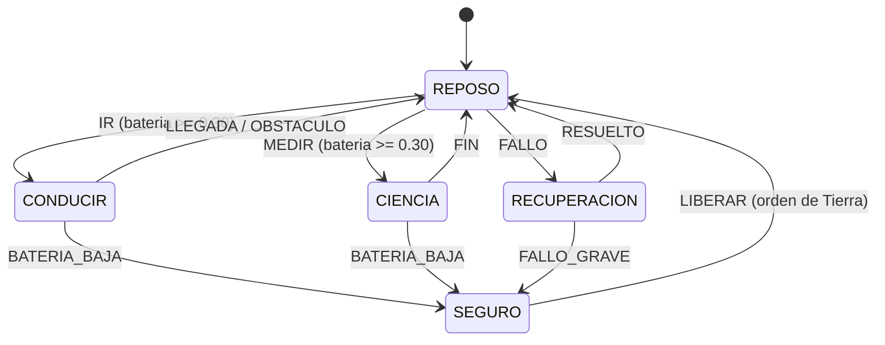

# B98-C02 — Sistemas de decisión autónomos y máquinas de estados de comportamiento

<!-- nav:top -->
[🏠 Programa](../../../../README.md) · [📚 Bloque B98](../../../tronco-comun/B98-autonomia-y-teleoperacion-espacial.md) · [← Anterior: B98-C01 — Planificación por objetivos a bordo](../B98-C01-planificacion-por-objetivos-a-bordo/CLASE.md) · [Siguiente: B98-C03 — Control supervisado y autonomía compartida →](../B98-C03-control-supervisado-y-autonomia-compartida/CLASE.md)
<!-- /nav -->

## 1. Ubicación, nivel y alcance

Clase 2 del bloque B98. Nivel N3. Un plan dice *qué* hacer; el sistema de decisión dice *qué hacer ahora* según lo que ocurre. Aquí modelas un comportamiento como **máquina de estados** con guardas, compruebas sus invariantes de seguridad por enumeración y simulación, y lo comparas con un **árbol de comportamiento**. Usas [B07](../../../tronco-comun/B07-programacion-cientifica-y-fundamentos-de-computacion.md) solo para el condicional. El rover y los eventos son **sintéticos**.

## 2. Por qué esta clase existe

Una cadena de `if` crece sin control y nadie puede decir si un estado inseguro es alcanzable. La decisión central: **¿cómo se estructura la decisión para que se pueda comprobar que nunca se conduce sin energía ni se sale del modo seguro sin orden de Tierra?**

## 3. Lo que podrás hacer al terminar

1. Definir estados, eventos y transiciones de un comportamiento.
2. Comprobar que la tabla es determinista y que todos los estados son alcanzables.
3. Expresar una guarda (energía mínima) y verificar su cumplimiento por simulación.
4. Verificar que de un estado seguro solo se sale con una orden explícita.
5. Expresar la misma decisión como un árbol de comportamiento y contrastarlo con la tabla.
6. Medir la cobertura de transiciones de una simulación.

La evidencia es la **diagrama de estados verificado de un comportamiento** del ejercicio 12 (sección 20).

## 4. Con qué llegas y cómo comprobarlo

1. ¿Qué es un condicional?
2. ¿Qué es un estado?
3. ¿Qué es una transición?
4. ¿Qué es una semilla aleatoria?
5. ¿Qué es un invariante?

<details>
<summary>Ver respuestas</summary>

1. Una instrucción que ejecuta una acción si se cumple una condición. 2. La situación del sistema en un instante, de entre un conjunto finito. 3. El paso de un estado a otro por un evento. 4. El valor inicial que hace repetible una simulación. 5. Una propiedad que debe cumplirse siempre.
</details>

Con cuatro o cinco aciertos, sigue; si no, repasa los prerrequisitos.

## 5. Un caso de contexto y casos de referencia

Un rover sintético tiene cinco estados (SEGURO, REPOSO, CONDUCIR, CIENCIA, RECUPERACIÓN) y 13 transiciones definidas entre 10 eventos. En 20 000 ticks simulados (semilla 98002) no entra nunca a CONDUCIR o CIENCIA con batería < 0,30 y nunca sale de SEGURO sin la orden LIBERAR; la simulación cubre 11 de las 13 transiciones. Es el **ejemplo conductor**. Todo es **sintético**.

## 6. Vocabulario

Una **máquina de estados** es un conjunto finito de estados y una función de transición `(estado, evento) → estado`. Una **guarda** es una condición que habilita una transición. Un **modo seguro** es un estado de baja actividad al que se llega ante un problema. Un **árbol de comportamiento** combina nodos *Secuencia* (todos deben tener éxito), *Fallback* (basta uno), condiciones y acciones. Un **invariante** es una propiedad verificable en toda ejecución.

## 7. Modelo mental: un semáforo con reglas de paso



*Descripción textual:* el rover vive en REPOSO; desde allí conduce o mide solo con batería suficiente; la batería baja o un fallo grave lo llevan a SEGURO, del que solo sale una orden LIBERAR de Tierra.

Analogía: un ascensor solo abre puertas con el ascensor parado y solo se pone en marcha con las puertas cerradas; las reglas son las guardas. Límite: el rover real tiene muchos más estados y eventos asíncronos, y varios subsistemas con sus propias máquinas.

## 8. La explicación, paso a paso

### 8.1 Estados, eventos y la tabla

Con 5 estados y 10 eventos hay `5 × 10 = 50` pares; solo 13 tienen transición. Los demás eventos se **ignoran** en ese estado, lo que es una decisión de diseño que debe revisarse (¿ignorar o registrar?).

### 8.2 Guardas

La transición a CONDUCIR o CIENCIA se bloquea si `batería < 0,30`. Es una guarda en la función de paso, no una condición dispersa en el código.

### 8.3 Verificación

(I1) Un diccionario `(estado, evento) → destino` es determinista por construcción. (I2) Un recorrido en anchura desde SEGURO alcanza los 5 estados. (I3) y (I4) se comprueban en 20 000 ticks con eventos aleatorios ponderados (fallos raros): 0 violaciones. La cobertura de transiciones es `11/13 = 84,6 %`: una simulación aleatoria **no prueba** lo que no visita.

### 8.4 Árbol de comportamiento

`Fallback( Secuencia(batería_ok, sin_obstáculo, CONDUCIR), Secuencia(¬batería_ok, QUEDARSE), QUEDARSE )` decide igual que la tabla en los `3 niveles de batería × 2 valores de obstáculo = 6` casos enumerados. La ventaja del árbol es la modularidad; la de la tabla, la verificación exhaustiva de transiciones.

## 9. Magnitudes, símbolos y unidades

| Símbolo | Qué es | Unidad | Valor / nota |
|---|---|---|---|
| estados | modos del comportamiento | — | 5 |
| eventos | señales que disparan transiciones | — | 10 |
| transiciones | pares (estado, evento) con destino | — | 13 de 50 |
| batería | fracción de carga | — (0 a 1) | umbral 0,30 |
| tick | paso de tiempo discreto | s | 1 (sintético) |
| cobertura | transiciones visitadas / definidas | — | 11/13 |

## 10. Convenciones y referencias

Tiempo discreto, un evento por tick. Batería simulada con deriva aleatoria; los pesos de los eventos y el umbral son **sintéticos** (semilla 98002). Un evento sin transición definida se ignora. No se modela concurrencia entre subsistemas.

## 11. De dónde sale lo que afirmamos

| ID | Fuente | Localizador | Respalda | Estado |
|---|---|---|---|---|
| S1 | Colledanchise y Ögren, «Behavior Trees in Robotics and AI: An Introduction» (arXiv 1709.00084; libro CRC Press, 2018) — https://arxiv.org/abs/1709.00084 (consultada 2026-11-10) | resumen | los árboles de comportamiento son modulares y reactivos y generalizan estructuras de conmutación anteriores | Consultada (solo resumen) |
| S2 | Muscettola, Nayak, Pell y Williams (1998), «Remote Agent: To Boldly Go Where No AI System Has Gone Before», Artificial Intelligence 103(1-2), 5-48 — https://groups.csail.mit.edu/mers/old-site/abstracts/aij98-abstract.html (consultada 2026-11-10) | resumen y datos de publicación | arquitectura con planificación y programación temporal con restricciones, ejecución multihilo y reconfiguración basada en modelos, para el control a bordo de Deep Space One | Consultada (solo resumen) |
| — | ECSS-E-ST-70-41C (PUS, servicios de utilización de paquetes) | — | cómo se estandarizan los modos y las órdenes de un vehículo real | No consultada |
| — | Modelos y leyes de la clase | — | los verifica el laboratorio con una segunda vía | No consultada en una fuente concreta |

Límites: de Colledanchise y Ögren solo se consultó el resumen (los árboles de comportamiento son modulares y reactivos y generalizan estructuras de conmutación anteriores); no se reproduce su formalismo. Los estados y umbrales del rover son sintéticos.

## 12. Cómo ver una máquina de estados

| Magnitud | Valor |
|---|---|
| Transiciones definidas | 13 |
| Estados alcanzables | 5 de 5 |
| Violaciones de I3 / I4 | 0 / 0 |
| Cobertura de transiciones | 11 de 13 |
| Árbol = tabla | 6 de 6 casos |

Descripción larga: la tabla es pequeña y determinista; la simulación no encuentra violaciones, pero no visita dos transiciones, y por eso la cobertura se informa aparte.

## 13. Ejemplo trabajado: por qué no se entra a CONDUCIR con batería 0,25

**Paso 1 · Evento.** En REPOSO llega IR.

**Paso 2 · Destino.** La tabla da `(REPOSO, IR) → CONDUCIR`.

**Paso 3 · Guarda.** El destino es CONDUCIR y `0,25 < 0,30`: la guarda bloquea.

**Paso 4 · Resultado.** El rover permanece en REPOSO; el evento se descarta (y conviene registrarlo).

## 14. Distintas formas de describir un comportamiento

**Por diagrama de estados:** nodos y flechas. **Por tabla:** filas estado, columnas evento. **Por reglas:** `si batería < 0,30 entonces SEGURO`. **Por árbol:** nodos Secuencia y Fallback. **Por invariantes:** propiedades que no deben violarse.

## 15. Práctica guiada

**Ejercicio 1 · con los pasos indicados.** Cuenta las transiciones que salen de CONDUCIR. *Pasos:* lee la tabla.

<details><summary>Solución comentada</summary>

Cuatro: LLEGADA, OBSTACULO, BATERIA_BAJA y FALLO.
</details>

**Ejercicio 2 · con una pista.** ¿Qué eventos sacan al rover de SEGURO? *Pista:* mira el invariante I4.

<details><summary>Solución comentada</summary>

Solo LIBERAR.
</details>

**Ejercicio 3 · casi autónomo.** ¿Cuántos pares estado-evento no tienen transición?

<details><summary>Solución comentada</summary>

`50 − 13 = 37`.
</details>

## 16. Práctica autónoma, transferencia e integrador

**Ejercicio 4 · autónomo.** ¿Qué hace la guarda con batería 0,25 y el evento MEDIR en REPOSO?

<details><summary>Solución comentada</summary>

Bloquea la entrada a CIENCIA; el rover sigue en REPOSO.
</details>

**Ejercicio 5 · autónomo.** ¿Qué devuelve un Fallback si el primer hijo falla y el segundo tiene éxito?

<details><summary>Solución comentada</summary>

Éxito, y no evalúa los siguientes.
</details>

**Ejercicio 6 · autónomo.** ¿Cuántos casos enumera la comparación árbol-tabla y por qué?

<details><summary>Solución comentada</summary>

Seis: 3 niveles de batería × 2 valores de obstáculo.
</details>

**Ejercicio 7 · autónomo.** Calcula la cobertura si se visitan 12 de 13 transiciones.

<details><summary>Solución comentada</summary>

`12/13 = 92,3 %`.
</details>

**Ejercicio 8 · autónomo.** ¿Qué demuestra I2 (alcanzabilidad) y qué no?

<details><summary>Solución comentada</summary>

Que cada estado se puede alcanzar desde SEGURO; no que se alcance en una ejecución concreta.
</details>

**Ejercicio 9 · transferencia.** **Transferencia.** Un estado SEGURO sin salida salvo por orden de Tierra, ¿qué problema crea con un enlace perdido?

<details><summary>Solución comentada</summary>

El rover queda parado hasta recuperar el enlace; suele añadirse una salida autónoma tras un tiempo con condiciones estrictas. Es una decisión de riesgo, no solo de software.
</details>

**Ejercicio 10 · transferencia.** **Transferencia.** ¿Cuándo preferirías un árbol de comportamiento a una tabla de estados?

<details><summary>Solución comentada</summary>

Cuando hay muchos comportamientos reutilizables y reactivos que se recombinan; la tabla gana cuando importa verificar transiciones exhaustivamente.
</details>

**Ejercicio 11 · transferencia.** **Transferencia.** ¿Por qué una simulación aleatoria sin violaciones no basta como prueba de seguridad?

<details><summary>Solución comentada</summary>

Solo prueba lo que visitó (11 de 13 transiciones); hace falta verificación exhaustiva o por construcción.
</details>

**Ejercicio 12 · integrador.** **Integrador.** Elabora tu *diagrama de estados verificado de un comportamiento*: estados, eventos, guardas, tabla, tres invariantes y cómo los verificas.

<details><summary>Solución comentada</summary>

Secciones 8.1–8.4 y la salida del laboratorio.
</details>

## 17. Laboratorio: máquina de estados con guardas y árbol equivalente

El script [maquina_estados.py](maquina_estados.py) define la tabla de transiciones, verifica determinismo y alcanzabilidad, simula 20 000 ticks comprobando dos invariantes y contrasta un árbol de comportamiento con la tabla (**comprueba** 0 violaciones y equivalencia en los 6 casos).

**Datos:** estados, umbral 0,30, pesos de los eventos y semilla 98002 son **sintéticos**. **Predice antes de ejecutar:** ¿cuántas violaciones de I3 esperas? (0, porque la guarda está en la función de paso). **Ejecución del 2026-11-10 (Python 3.12.9):**

```text
Python 3.12.9 (biblioteca estandar)
DATOS SINTETICOS: umbral de bateria 0.30; semilla 98002
I1 transiciones definidas: 13 (una por par estado-evento)
I2 estados alcanzables desde SEGURO: ['CIENCIA', 'CONDUCIR', 'RECUPERACION', 'REPOSO', 'SEGURO'] (5 de 5)
I3 entradas a CONDUCIR/CIENCIA con bateria < 0.30: 0
I4 salidas de SEGURO sin orden LIBERAR: 0
Cobertura de transiciones: 11 de 13
Ticks por estado: SEGURO 282, REPOSO 14920, CONDUCIR 41, CIENCIA 56, RECUPERACION 4701
Arbol de comportamiento = tabla en 6 de 6 casos enumerados
Pruebas superadas.
```

```bash
python programa/clases/B98/B98-C02-sistemas-de-decision-autonomos-y-maquinas-de-estados-de-comportamiento/maquina_estados.py
```

**Límites:** los ticks por estado dependen de pesos inventados (RECUPERACIÓN retiene al rover hasta RESUELTO) y no indican uso real; la cobertura no es completa.

## 18. Errores frecuentes y cómo corregirlos

**Dispersar las reglas en condicionales.** Se corrige con 8.2.

**Creer que ausencia de violaciones simuladas es prueba.** Se corrige con 8.3.

**Ignorar eventos sin registrarlos.** Se corrige con 8.1.

**Presentar el rover sintético como uno real.** Se corrige con la sección 10.

## 19. Cómo sabrás que vas bien

Tras la sección 8: ¿qué transiciones esperabas sin cubrir? Si dudas, repasa el ejemplo 13. Tras el laboratorio: ¿qué comprueba? (ver la sección 17).

## 20. Qué entregas y cómo se evalúa

El producto es tu **diagrama de estados verificado de un comportamiento**.

| Criterio | Inicial | En desarrollo | Logrado | Destacado |
|---|---|---|---|---|
| Conceptos | Los confunde | Parciales | Aplica el modelo con sus supuestos | Explica los límites |
| Cálculo | Sin unidades | Con errores | Tablas completas con unidades | Calcula casos nuevos |
| Numérico | Sin comprobar | Un caso | Contraste con una segunda vía | Interpreta las diferencias |
| Fuentes | Sin fuente | Sin fecha | Fuentes con fecha y estado | Declara lo sintético y lo no consultado |
| Límites | No los nombra | Uno | Tres | Discute qué falta del modelo |

**Condiciones críticas (no se compensan con promedio):** rotular el rover y los eventos como sintéticos; no presentar una simulación sin violaciones como prueba de seguridad; citar solo lo consultado.

## 21. Ética, seguridad y límites

Clase educativa: los modelos son simplificados y sus datos son sintéticos o ilustrativos; ningún resultado describe una misión real ni sustituye a las normas y procedimientos de operaciones.  Accesibilidad: tablas equivalentes a las gráficas, fórmulas en texto, ejercicios sin conexión.

## 22. Para cerrar y seguir

Cinco estados, 13 transiciones y dos invariantes que se verifican: eso es un comportamiento revisable. Queda una pregunta: ¿cómo se reparte la decisión entre el vehículo y la persona que lo supervisa?

**Glosario español–inglés.** máquina de estados · *state machine* · guarda · *guard* · modo seguro · *safe mode* · árbol de comportamiento · *behavior tree* · invariante · *invariant*.

**Continuidad.** [B98-C03](../B98-C03-control-supervisado-y-autonomia-compartida/CLASE.md) estudia el control supervisado y la autonomía compartida.

**Referencias:** ver sección 11.

<!-- nav:bottom -->
---

[← Anterior: B98-C01 — Planificación por objetivos a bordo](../B98-C01-planificacion-por-objetivos-a-bordo/CLASE.md) · [📚 Bloque B98](../../../tronco-comun/B98-autonomia-y-teleoperacion-espacial.md) · [Siguiente: B98-C03 — Control supervisado y autonomía compartida →](../B98-C03-control-supervisado-y-autonomia-compartida/CLASE.md)
<!-- /nav -->
