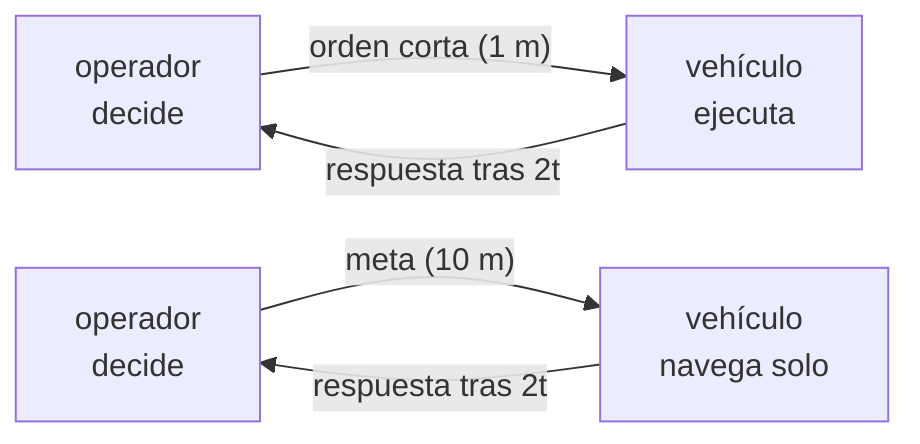

# B98-C03 — Control supervisado y autonomía compartida

<!-- nav:top -->
[🏠 Programa](../../../../README.md) · [📚 Bloque B98](../../../tronco-comun/B98-autonomia-y-teleoperacion-espacial.md) · [← Anterior: B98-C02 — Sistemas de decisión autónomos y máquinas de estados de comportamiento](../B98-C02-sistemas-de-decision-autonomos-y-maquinas-de-estados-de-comportamiento/CLASE.md) · [Siguiente: B98-C04 — Interfaces humano-robot para operación remota →](../B98-C04-interfaces-humano-robot-para-operacion-remota/CLASE.md)
<!-- /nav -->

## 1. Ubicación, nivel y alcance

Clase 3 del bloque B98. Nivel N3. Con retardo de luz, mandar «un metro más» y esperar la respuesta consume la jornada. En el **control supervisado** el operador da metas y el vehículo las ejecuta solo. Aquí calculas el retardo de luz con datos consultados y comparas el tiempo de una misma tarea con «mover y esperar» y con metas supervisadas. Usas [B97](../../../tronco-comun/B97-robotica-y-construccion-extraterrestre.md) solo para la idea de teleoperación con latencia. La tarea y las velocidades son **ilustrativas**.

## 2. Por qué esta clase existe

Ni siempre conviene más autonomía ni siempre más control manual: sin retardo, el manual puede ser más rápido. La decisión central: **¿a partir de qué retardo compensa pasar de órdenes cortas a metas supervisadas, y qué se pierde al hacerlo?**

## 3. Lo que podrás hacer al terminar

1. Calcular el tiempo de luz de una vía con `t = d/c` a partir de las distancias consultadas.
2. Calcular el tiempo de una tarea con «mover y esperar».
3. Calcular el tiempo de la misma tarea con metas supervisadas.
4. Obtener la fracción del tiempo que se pasa esperando la luz.
5. Describir un reparto de funciones entre operador y vehículo con los niveles de automatización.
6. Separar lo consultado (distancias, `c`) de lo ilustrativo (velocidades, tiempos de decisión).

La evidencia es la **comparación de tiempos de una tarea con retardo** del ejercicio 12 (sección 20).

## 4. Con qué llegas y cómo comprobarlo

1. ¿Qué es la velocidad de la luz y en qué unidades se da?
2. ¿Qué es un retardo de ida y vuelta?
3. ¿Qué es un cociente de tiempos?
4. ¿Qué es una meta (waypoint)?
5. ¿Qué es un dato ilustrativo?

<details>
<summary>Ver respuestas</summary>

1. 299 792 458 m/s, exacta por definición del metro. 2. El doble del tiempo de luz de una vía, más el tiempo de proceso. 3. La razón entre dos duraciones; mayor que 1 significa que la del numerador es más larga. 4. Un punto objetivo al que el vehículo se dirige solo. 5. Un valor inventado para el ejemplo, no medido.
</details>

Con cuatro o cinco aciertos, sigue; si no, repasa los prerrequisitos.

## 5. Un caso de contexto y casos de referencia

Recorrer **100 m**. Sin retardo, «mover y esperar» (pasos de 1 m, `v = 0,04 m/s`, 30 s de decisión por orden) tarda 1,53 h y el control supervisado (metas de 10 m, `v = 0,02 m/s`, 120 s por meta) 1,72 h: gana el manual. Con Marte a distancia mínima (luz de una vía 182,1 s) el manual tarda 11,65 h y el supervisado 2,73 h; a distancia máxima (1338,9 s) 75,91 h frente a 9,16 h. Es el **ejemplo conductor**. Distancias y `c` están consultadas; todo lo demás es **ilustrativo**.

## 6. Vocabulario

El **tiempo de luz de una vía** es `t = d/c`. En **mover y esperar** el operador envía una orden corta, espera su efecto (`2t` más proceso) y decide la siguiente. En **control supervisado** el operador da una meta de mayor alcance y el vehículo la ejecuta con autonomía. La **autonomía compartida** reparte funciones entre ambos; una clasificación consultada distingue cuatro clases de función (adquisición y análisis de información, selección de decisión y ejecución de acción) con un continuo de niveles de automatización desde manual hasta autónomo.

## 7. Modelo mental: mandar cartas frente a dar un destino



*Descripción textual:* en el modo manual cada metro exige un ciclo completo orden-respuesta; en el supervisado un ciclo cubre diez metros y el vehículo se encarga del detalle.

Analogía: guiar a alguien por carta, calle a calle, frente a darle la dirección y que use su propio mapa. Límite: el vehículo autónomo necesita percibir peligros y a veces se equivoca o se detiene, lo que aquí solo se refleja en una velocidad menor.

## 8. La explicación, paso a paso

### 8.1 Luz de una vía

`t_min = 54,6 × 10⁹ m / 299 792 458 m/s = 182,1 s = 3,04 min` y `t_max = 401,4 × 10⁹ / 299 792 458 = 1338,9 s = 22,32 min`. Son tiempos de **geometría**: no dependen de la tecnología.

### 8.2 Mover y esperar

`T = N (s/v + 2t + d_op)`, con `N = 100`, `s = 1 m`, `v = 0,04 m/s`, `d_op = 30 s`. Sin retardo: `100 × (25 + 0 + 30) = 5500 s = 1,53 h`. Con `t = 182,1 s`: `100 × (25 + 364,2 + 30) = 41 920 s = 11,65 h`.

### 8.3 Control supervisado

`T = M (S/v_a + 2t + D_op)`, con `M = 10`, `S = 10 m`, `v_a = 0,02 m/s`, `D_op = 120 s`. Sin retardo: `10 × (500 + 120) = 6200 s = 1,72 h`. Con `t = 182,1 s`: `10 × (500 + 364,2 + 120) = 9842 s = 2,73 h`.

### 8.4 Qué cambia y qué no

Sin retardo el manual es un 11 % más rápido (`5500/6200`): la autonomía cuesta velocidad. El supervisado reduce los ciclos de 100 a 10 y la fracción esperando la luz de 86,9 % a 37,0 % (Marte cercano) y de 98,0 % a 81,2 % (Marte lejano). Aun así, a distancia máxima el supervisado dedica el 81 % del tiempo a esperar: más autonomía (metas mayores) reduciría esa fracción.

## 9. Magnitudes, símbolos y unidades

| Símbolo | Qué es | Unidad | Valor / nota |
|---|---|---|---|
| `t` | tiempo de luz de una vía | s | 182,1 (mín.); 1338,9 (máx.) |
| `d` | distancia Tierra–Marte | m | 54,6 × 10⁹ a 401,4 × 10⁹ (consultada) |
| `c` | velocidad de la luz | m/s | 299 792 458 (exacta) |
| `N`, `M` | ciclos orden-respuesta | — | 100 y 10 |
| `v`, `v_a` | velocidad manual y autónoma | m/s | 0,04 y 0,02 (ilustrativas) |
| `d_op`, `D_op` | tiempo de decisión por orden o meta | s | 30 y 120 (ilustrativos) |

## 10. Convenciones y referencias

Distancias mínima y máxima Tierra–Marte de la ficha de Marte de la NASA/NSSDC (consultada 2026-11-10) y `c` de CODATA 2022; `t = d/c` se calcula en el laboratorio. Se usan las distancias extremas de la ficha, no la de una fecha concreta. Tiempo de proceso a bordo y en tierra despreciado; una sola tarea lineal de 100 m. Velocidades, pasos y tiempos de decisión son **ilustrativos**.

## 11. De dónde sale lo que afirmamos

| ID | Fuente | Localizador | Respalda | Estado |
|---|---|---|---|---|
| S1 | NASA/NSSDC, Mars Fact Sheet — https://nssdc.gsfc.nasa.gov/planetary/factsheet/marsfact.html (consultada 2026-11-10) | filas «Minimum/Maximum distance from Earth» | distancia mínima 54,6 × 10⁶ km y máxima 401,4 × 10⁶ km; la ficha no lista el tiempo de luz (se calcula) | Consultada |
| S2 | NIST, CODATA 2022, velocidad de la luz en el vacío — https://physics.nist.gov/cgi-bin/cuu/Value?c (consultada 2026-11-10) | valor y su incertidumbre | `c` = 299 792 458 m/s, exacta | Consultada |
| S3 | Parasuraman, Sheridan y Wickens (2000), «A model for types and levels of human interaction with automation», IEEE Trans. SMC-A 30(3), 286-297, DOI 10.1109/3468.844354 — resumen obtenido por búsqueda web (2026-11-10) | resumen secundario | cuatro clases de función (adquisición y análisis de información, selección de decisión, ejecución de acción) y un continuo de niveles de automatización | Consultada (resumen secundario; no se leyó el artículo) |
| — | Sheridan (1992), «Telerobotics, Automation, and Human Supervisory Control» | — | tratamiento clásico del control supervisado humano | No consultada |
| — | Modelos y leyes de la clase | — | los verifica el laboratorio con una segunda vía | No consultada en una fuente concreta |

Límites: de Parasuraman, Sheridan y Wickens solo se consultó un resumen secundario; los niveles de automatización se citan por su idea general y no se reproduce la escala. La tarea, las velocidades y los tiempos de decisión no se consultaron.

## 12. Cómo ver la comparación

| Magnitud | Valor |
|---|---|
| Luz de una vía, Marte cercano | 182,1 s |
| Mover y esperar (cercano / lejano) | 11,65 h / 75,91 h |
| Supervisado (cercano / lejano) | 2,73 h / 9,16 h |
| Razón manual/supervisado | 0,89 sin retardo; 4,26 y 8,29 con retardo |
| Ciclos | 100 y 10 |

Descripción larga: el manual gana sin retardo y pierde de forma creciente con él; el supervisado reduce los ciclos y, con ello, la fracción de tiempo perdida esperando la luz.

## 13. Ejemplo trabajado: tiempo supervisado con Marte lejano

**Paso 1 · Luz.** `t = 1338,9 s`.

**Paso 2 · Ciclo.** `500 + 2 × 1338,9 + 120 = 3297,8 s`.

**Paso 3 · Tarea.** `10 × 3297,8 = 32 978 s = 9,16 h`.

**Paso 4 · Espera.** `10 × 2677,8 / 32 978 = 81,2 %`.

## 14. Distintas formas de describir el reparto del control

**Por niveles:** de manual a autónomo. **Por función:** quién percibe, decide y actúa. **Por ciclo:** metros por ciclo orden-respuesta. **Por tiempo:** fracción esperando. **Por riesgo:** qué puede hacer el vehículo sin permiso.

## 15. Práctica guiada

**Ejercicio 1 · con los pasos indicados.** Calcula `t` para `d = 54,6 × 10⁹ m`. *Pasos:* divide entre `c`.

<details><summary>Solución comentada</summary>

`182,1 s`.
</details>

**Ejercicio 2 · con una pista.** ¿Cuántos minutos dura el viaje de ida y vuelta a distancia mínima? *Pista:* dobla `t`.

<details><summary>Solución comentada</summary>

`364,2 s = 6,07 min`.
</details>

**Ejercicio 3 · casi autónomo.** ¿Cuántos ciclos hacen falta para 100 m en pasos de 1 m y en metas de 10 m?

<details><summary>Solución comentada</summary>

100 y 10.
</details>

## 16. Práctica autónoma, transferencia e integrador

**Ejercicio 4 · autónomo.** Duración de un ciclo supervisado sin retardo.

<details><summary>Solución comentada</summary>

`500 + 120 = 620 s`.
</details>

**Ejercicio 5 · autónomo.** ¿Qué fracción espera la luz el modo manual con Marte cercano?

<details><summary>Solución comentada</summary>

`100 × 364,2 / 41 920 = 86,9 %`.
</details>

**Ejercicio 6 · autónomo.** ¿Cuánto más lento es el supervisado sin retardo?

<details><summary>Solución comentada</summary>

`6200/5500 = 1,127`: un 12,7 % más.
</details>

**Ejercicio 7 · autónomo.** Con metas de 20 m y Marte cercano, ¿cuánto tarda la tarea?

<details><summary>Solución comentada</summary>

`5 × (1000 + 364,2 + 120) = 7421 s = 2,06 h`.
</details>

**Ejercicio 8 · autónomo.** Si el operador decidiera en 10 s en vez de 30 s, ¿cuál es el manual a retardo cero?

<details><summary>Solución comentada</summary>

`100 × (25 + 10) = 3500 s = 0,97 h`.
</details>

**Ejercicio 9 · transferencia.** **Transferencia.** ¿Por qué pasar a metas mayores no es gratis?

<details><summary>Solución comentada</summary>

El vehículo debe percibir y decidir peligros solo: exige sensores, software verificado y tolerancia al fallo; lo que se ahorra en espera se paga en riesgo.
</details>

**Ejercicio 10 · transferencia.** **Transferencia.** Un colega afirma que a 3 minutos de luz el manual «funciona bien». ¿Qué dato le pedirías?

<details><summary>Solución comentada</summary>

La fracción de tiempo útil: aquí el 87 % se va en esperar, y el cálculo depende de los pasos y de la decisión.
</details>

**Ejercicio 11 · transferencia.** **Transferencia.** ¿Qué cambia si el enlace se pierde durante una meta supervisada?

<details><summary>Solución comentada</summary>

El vehículo debe detenerse o completar la meta de forma segura; se conecta con C05 y C07.
</details>

**Ejercicio 12 · integrador.** **Integrador.** Elabora tu *comparación de tiempos de una tarea con retardo*: tabla para tres retardos, fracción de espera, razón y qué datos son consultados e ilustrativos.

<details><summary>Solución comentada</summary>

Secciones 8.1–8.4 y la salida del laboratorio.
</details>

## 17. Laboratorio: mover y esperar frente a control supervisado

El script [supervisado.py](supervisado.py) calcula el tiempo de luz con las distancias consultadas, el tiempo de la tarea con ambos modos y la fracción de espera (**comprueba** la fórmula cerrada a retardo cero con tolerancia 1e-9 y que el retardo máximo penaliza más al manual).

**Datos:** distancias y `c` **consultadas** (2026-11-10); tarea, velocidades, pasos y tiempos de decisión **ilustrativos**. **Predice antes de ejecutar:** ¿cuál modo gana sin retardo? (el manual, 1,53 h frente a 1,72 h). **Ejecución del 2026-11-10 (Python 3.12.9):**

```text
Python 3.12.9 (biblioteca estandar)
Distancias (ficha de Marte, NASA/NSSDC, consultada 2026-11-10); c exacta (CODATA 2022, NIST)
Tarea SINTETICA: 100 m; manual 0.04 m/s en pasos de 1 m; supervisado 0.02 m/s en metas de 10 m
caso                       t 1 via [s] t 1 via [min]  mover y esperar [h]  supervisado [h]   razon
sin retardo (referencia)           0.0          0.00                 1.53             1.72    0.89
Marte, distancia minima          182.1          3.04                11.65             2.73    4.26
Marte, distancia maxima         1338.9         22.32                75.91             9.16    8.29
Marte, distancia minima: fraccion del tiempo esperando la luz: manual 86.9%, supervisado 37.0%
Marte, distancia maxima: fraccion del tiempo esperando la luz: manual 98.0%, supervisado 81.2%
Ciclos orden-respuesta: manual 100, supervisado 10
Pruebas superadas.
```

```bash
python programa/clases/B98/B98-C03-control-supervisado-y-autonomia-compartida/supervisado.py
```

**Límites:** tarea lineal sin fallos ni pérdida de enlace; proceso despreciado; el supervisado no modela las veces que el vehículo se detiene.

## 18. Errores frecuentes y cómo corregirlos

**Suponer que más autonomía siempre gana.** Sin retardo gana el manual; se corrige con 8.4.

**Usar una distancia fija como si fuera la de hoy.** Se corrige con la sección 10.

**Olvidar el doble de `t`.** Es un viaje de ida y vuelta; se corrige con 8.2.

**Tomar las velocidades ilustrativas por las de un rover real.** Se corrige con la sección 10.

## 19. Cómo sabrás que vas bien

Tras la sección 8: ¿qué razón esperabas con Marte lejano y cuál obtuviste? Si dudas, repasa el ejemplo 13. Tras el laboratorio: ¿qué comprueba? (ver la sección 17).

## 20. Qué entregas y cómo se evalúa

El producto es tu **comparación de tiempos de una tarea con retardo**.

| Criterio | Inicial | En desarrollo | Logrado | Destacado |
|---|---|---|---|---|
| Conceptos | Los confunde | Parciales | Aplica el modelo con sus supuestos | Explica los límites |
| Cálculo | Sin unidades | Con errores | Tablas completas con unidades | Calcula casos nuevos |
| Numérico | Sin comprobar | Un caso | Contraste con una segunda vía | Interpreta las diferencias |
| Fuentes | Sin fuente | Sin fecha | Fuentes con fecha y estado | Declara lo sintético y lo no consultado |
| Límites | No los nombra | Uno | Tres | Discute qué falta del modelo |

**Condiciones críticas (no se compensan con promedio):** rotular velocidades y tiempos de decisión como ilustrativos; no presentar el resultado como tiempos de una misión real; citar solo lo consultado.

## 21. Ética, seguridad y límites

Clase educativa: los modelos son simplificados y sus datos son sintéticos o ilustrativos; ningún resultado describe una misión real ni sustituye a las normas y procedimientos de operaciones.  Accesibilidad: tablas equivalentes a las gráficas, fórmulas en texto, ejercicios sin conexión.

## 22. Para cerrar y seguir

Recorrer 100 m cuesta 11,65 h manualmente con Marte cercano y 2,73 h con metas supervisadas, y 1,53 h frente a 1,72 h sin retardo. Queda una pregunta: ¿qué debe mostrar la pantalla del operador, si lo que ve ya es antiguo?

**Glosario español–inglés.** control supervisado · *supervisory control* · autonomía compartida · *shared autonomy* · mover y esperar · *move-and-wait* · retardo de ida y vuelta · *round-trip delay* · nivel de automatización · *level of automation*.

**Continuidad.** [B98-C04](../B98-C04-interfaces-humano-robot-para-operacion-remota/CLASE.md) estudia las interfaces humano-robot para operación remota.

**Referencias:** ver sección 11.

<!-- nav:bottom -->
---

[← Anterior: B98-C02 — Sistemas de decisión autónomos y máquinas de estados de comportamiento](../B98-C02-sistemas-de-decision-autonomos-y-maquinas-de-estados-de-comportamiento/CLASE.md) · [📚 Bloque B98](../../../tronco-comun/B98-autonomia-y-teleoperacion-espacial.md) · [Siguiente: B98-C04 — Interfaces humano-robot para operación remota →](../B98-C04-interfaces-humano-robot-para-operacion-remota/CLASE.md)
<!-- /nav -->
