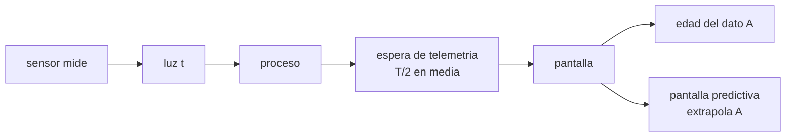

# B98-C04 — Interfaces humano-robot para operación remota

<!-- nav:top -->
[🏠 Programa](../../../../README.md) · [📚 Bloque B98](../../../tronco-comun/B98-autonomia-y-teleoperacion-espacial.md) · [← Anterior: B98-C03 — Control supervisado y autonomía compartida](../B98-C03-control-supervisado-y-autonomia-compartida/CLASE.md) · [Siguiente: B98-C05 — Autonomía de bajo nivel y comportamientos reactivos →](../B98-C05-autonomia-de-bajo-nivel-y-comportamientos-reactivos/CLASE.md)
<!-- /nav -->

## 1. Ubicación, nivel y alcance

Clase 4 del bloque B98. Nivel N3. La pantalla de un operador remoto muestra el pasado: el dato llega con retardo de luz, de proceso y de telemetría. Aquí calculas la **antigüedad del dato** que muestra una interfaz, comparas una pantalla «cruda» con una **predictiva** y reduces una avalancha de alarmas por supresión de dependientes. Usas [B97](../../../tronco-comun/B97-robotica-y-construccion-extraterrestre.md) solo para la teleoperación. Las trazas y las alarmas son **sintéticas**.

## 2. Por qué esta clase existe

Un operador que decide con un dato viejo sin saberlo comete errores; uno que recibe 24 alarmas por 3 fallos no ve la causa. La decisión central: **¿qué debe mostrar la interfaz para que el operador sepa qué tan viejo es lo que ve y qué es lo importante?**

## 3. Lo que podrás hacer al terminar

1. Calcular la antigüedad media del dato mostrado a partir del retardo de luz, el proceso y el periodo de telemetría.
2. Estimar el error de posición de una pantalla cruda.
3. Estimar el error de una pantalla predictiva y contrastarlo con la fórmula `σ_v Δt √n`.
4. Reducir una lista de alarmas suprimiendo las dependientes de una causa raíz activa.
5. Enunciar tres criterios de diseño de una interfaz remota (edad del dato visible, predicción rotulada, alarmas priorizadas).
6. Separar lo consultado (distancias, `c`) de lo sintético (trazas, alarmas).

La evidencia es la **evaluación de una interfaz por antigüedad y carga de alarmas** del ejercicio 12 (sección 20).

## 4. Con qué llegas y cómo comprobarlo

1. ¿Qué es la latencia?
2. ¿Qué es una desviación típica?
3. ¿Qué es una extrapolación?
4. ¿Qué es una causa raíz?
5. ¿Qué es un dato sintético?

<details>
<summary>Ver respuestas</summary>

1. El tiempo entre un evento y su disponibilidad en otro punto. 2. Una medida de dispersión de una magnitud aleatoria. 3. Estimar un valor futuro a partir de una tendencia. 4. El fallo original del que se derivan otros. 5. Un dato generado para el ejemplo, no medido.
</details>

Con cuatro o cinco aciertos, sigue; si no, repasa los prerrequisitos.

## 5. Un caso de contexto y casos de referencia

Una interfaz recibe la posición del rover cada 60 s con 5 s de proceso. Con Marte cercano la **edad media del dato** es `182,1 + 5 + 30 = 217,1 s` y la pantalla cruda se equivoca en `8,81 m` (rms); la predictiva, en `0,23 m`. Con Marte lejano la edad es `1373,9 s` y los errores son `54,80 m` y `0,57 m`. Una cascada sintética de 24 alarmas se reduce a 3 al suprimir las dependientes. Es el **ejemplo conductor**. Distancias y `c` consultadas; el resto **sintético**.

## 6. Vocabulario

La **edad del dato** es el tiempo transcurrido entre que el sensor lo midió y el operador lo ve: `A = t_luz + t_proceso + T_tel/2` (valor medio). Una **pantalla cruda** muestra la última medida; una **pantalla predictiva** la extrapola con el movimiento ordenado y debe rotularse como estimación. Una **alarma dependiente** se deriva de una causa raíz ya activa; la **supresión** la oculta para no saturar. La **conciencia de la situación** es la comprensión del estado actual y su evolución (no se consultó una fuente concreta).

## 7. Modelo mental: mirar una estrella



*Descripción textual:* el dato recorre el retardo de luz, el proceso y la espera del siguiente paquete; la edad es la suma; la predicción compensa lo que se movió el vehículo en ese tiempo.

Analogía: la luz de una estrella que ves es más antigua cuanto más lejos está; el operador mira un rover «de hace A segundos». Límite: la predicción solo es útil si el movimiento ordenado se cumplió; no ve peligros nuevos.

## 8. La explicación, paso a paso

### 8.1 Antigüedad

Con `T_tel = 60 s` y `t_proceso = 5 s`: `A_min = 182,1 + 5 + 30 = 217,1 s` y `A_max = 1338,9 + 5 + 30 = 1373,9 s`.

### 8.2 Pantalla cruda

El rover avanza `v = 0,04 m/s` durante `A`: error medio `v A ≈ 8,7 m` y `≈ 55 m`. El laboratorio usa pasos discretos de 10 s (22 y 137 pasos): `8,81 m` y `54,80 m` (rms).

### 8.3 Pantalla predictiva

Se resta lo ordenado, `v A`; queda la deriva aleatoria de la velocidad (`σ_v = 0,005 m/s`, sintética). La fórmula `σ_v Δt √n` da `0,235 m` (n = 22) y `0,585 m` (n = 137); el Monte Carlo (semilla 98004, 4000 muestras) da `0,233 m` y `0,572 m`: dentro del 5 %. El error predictivo crece con `√n`, no con `n`: pasa de `0,23` a `0,57 m` (×2,45) mientras la edad crece ×6,3.

### 8.4 Alarmas

Tres fallos raíz generan `3 + 21 = 24` alarmas; al suprimir las dependientes de una raíz activa, se muestran 3 (88 % menos). Riesgo: si la raíz se diagnostica mal, se oculta información; la lista suprimida debe poder consultarse.

## 9. Magnitudes, símbolos y unidades

| Símbolo | Qué es | Unidad | Valor / nota |
|---|---|---|---|
| `A` | edad media del dato mostrado | s | 217,1 (mín.); 1373,9 (máx.) |
| `T_tel` | periodo de telemetría | s | 60 (sintético) |
| `σ_v` | deriva aleatoria de la velocidad | m/s | 0,005 (sintética) |
| `Δt` | paso de la traza | s | 10 |
| error crudo | rms de la pantalla sin predicción | m | 8,81; 54,80 |
| error predictivo | rms con predicción | m | 0,233; 0,572 |

## 10. Convenciones y referencias

Distancias mínima y máxima Tierra–Marte de la ficha de Marte de la NASA/NSSDC (consultada 2026-11-10) y `c` de CODATA 2022; `t = d/c` se calcula en el laboratorio. Posición a lo largo de la traza en m; tiempo de operaciones en s. Trazas, ruido, periodo de telemetría y alarmas son **sintéticos** (semilla 98004). La predicción supone que el vehículo cumplió la orden salvo la deriva.

## 11. De dónde sale lo que afirmamos

| ID | Fuente | Localizador | Respalda | Estado |
|---|---|---|---|---|
| S1 | NASA/NSSDC, Mars Fact Sheet — https://nssdc.gsfc.nasa.gov/planetary/factsheet/marsfact.html (consultada 2026-11-10) | filas «Minimum/Maximum distance from Earth» | distancia mínima 54,6 × 10⁶ km y máxima 401,4 × 10⁶ km; la ficha no lista el tiempo de luz (se calcula) | Consultada |
| S2 | NIST, CODATA 2022, velocidad de la luz en el vacío — https://physics.nist.gov/cgi-bin/cuu/Value?c (consultada 2026-11-10) | valor y su incertidumbre | `c` = 299 792 458 m/s, exacta | Consultada |
| S3 | Goodrich y Schultz (2007), «Human-Robot Interaction: A Survey», Foundations and Trends in Human-Computer Interaction 1(3), 203-275, DOI 10.1561/1100000005 — ficha del editor obtenida por búsqueda web (2026-11-10) | ficha bibliográfica y descripción | existencia y alcance de la revisión (tratamiento unificado de la interacción humano-robot) | Consultada (solo ficha; no se leyó el texto) |
| — | Endsley (1995), conciencia de la situación | — | definición y medida de la conciencia de la situación | No consultada |
| — | Modelos y leyes de la clase | — | los verifica el laboratorio con una segunda vía | No consultada en una fuente concreta |

Límites: de Goodrich y Schultz solo se consultó la ficha del editor; no se citan sus conclusiones. Los criterios de diseño de la sección 8 son de la clase, no de esa revisión.

## 12. Cómo ver una interfaz remota

| Magnitud | Valor |
|---|---|
| Edad del dato (cercano / lejano) | 217,1 s / 1373,9 s |
| Error crudo | 8,81 m / 54,80 m |
| Error predictivo | 0,233 m / 0,572 m |
| Fórmula `σ_v Δt √n` | 0,235 m / 0,585 m |
| Alarmas generadas → mostradas | 24 → 3 |

Descripción larga: la pantalla cruda crece con la edad; la predictiva crece solo con la raíz de los pasos y es casi cuarenta veces más precisa con Marte cercano; la supresión reduce la lista a las causas.

## 13. Ejemplo trabajado: el error predictivo con Marte cercano

**Paso 1 · Pasos.** `n = 217,1/10 ≈ 22`.

**Paso 2 · Fórmula.** `σ = 0,005 × 10 × √22 = 0,2345 m`.

**Paso 3 · Monte Carlo.** `0,233 m`; la diferencia con la fórmula es 0,9 %.

**Paso 4 · Cruda.** `0,04 × 220 = 8,8 m`; el cociente cruda/predictiva es `37,8`.

## 14. Distintas formas de mostrar la edad

**Con una cifra:** «dato de hace 3,6 min». **Con una sombra:** posición medida y predicha. **Con color:** más tenue cuanto más viejo. **Con una línea de tiempo:** cuándo se tomó cada dato. Lo esencial es que la edad sea visible y no se infiera.

## 15. Práctica guiada

**Ejercicio 1 · con los pasos indicados.** Calcula `A` con luz 182,1 s, proceso 5 s y telemetría cada 60 s. *Pasos:* suma `T_tel/2 = 30`.

<details><summary>Solución comentada</summary>

`217,1 s`.
</details>

**Ejercicio 2 · con una pista.** ¿Cuánto avanza el rover en 217,1 s a 0,04 m/s? *Pista:* multiplica.

<details><summary>Solución comentada</summary>

`8,68 m`.
</details>

**Ejercicio 3 · casi autónomo.** ¿Por qué el laboratorio da 8,81 m y no 8,68 m?

<details><summary>Solución comentada</summary>

Usa pasos enteros de 10 s (22 pasos = 220 s) en vez de 217,1 s.
</details>

## 16. Práctica autónoma, transferencia e integrador

**Ejercicio 4 · autónomo.** Si la telemetría pasa a cada 30 s, ¿cuánto baja `A` con Marte cercano?

<details><summary>Solución comentada</summary>

`A = 182,1 + 5 + 15 = 202,1 s`: 15 s menos.
</details>

**Ejercicio 5 · autónomo.** Cociente de errores cruda/predictiva con Marte lejano.

<details><summary>Solución comentada</summary>

`54,802/0,572 = 95,8`.
</details>

**Ejercicio 6 · autónomo.** ¿Cuántas alarmas se suprimieron y qué porcentaje?

<details><summary>Solución comentada</summary>

21 de 24: `87,5 %` (88 % en la salida).
</details>

**Ejercicio 7 · autónomo.** Calcula `σ_v Δt √n` para `n = 100`.

<details><summary>Solución comentada</summary>

`0,005 × 10 × 10 = 0,5 m`.
</details>

**Ejercicio 8 · autónomo.** ¿Cuánto crece el error predictivo si la edad se multiplica por 4?

<details><summary>Solución comentada</summary>

Por `√4 = 2`.
</details>

**Ejercicio 9 · transferencia.** **Transferencia.** Una interfaz muestra la posición predicha con el mismo símbolo que la medida. ¿Qué riesgo hay?

<details><summary>Solución comentada</summary>

Que el operador tome una estimación por una medición; debe rotularse y distinguirse visualmente.
</details>

**Ejercicio 10 · transferencia.** **Transferencia.** ¿Qué podría ocultar la supresión de alarmas dependientes?

<details><summary>Solución comentada</summary>

Un fallo real independiente mal clasificado como dependiente; hace falta poder auditar lo suprimido.
</details>

**Ejercicio 11 · transferencia.** **Transferencia.** ¿Cómo evaluarías una interfaz con operadores sin usar datos de una misión?

<details><summary>Solución comentada</summary>

Con escenarios sintéticos rotulados, medidas de tiempo de respuesta y errores, y una lista de comprobación previa a los datos reales.
</details>

**Ejercicio 12 · integrador.** **Integrador.** Elabora tu *evaluación de una interfaz por antigüedad y carga de alarmas*: edad del dato, error crudo y predictivo, reducción de alarmas y tres criterios de diseño con su justificación.

<details><summary>Solución comentada</summary>

Secciones 8.1–8.4 y la salida del laboratorio.
</details>

## 17. Laboratorio: edad del dato, predicción y supresión de alarmas

El script [interfaz.py](interfaz.py) calcula la edad del dato, simula 4000 trayectorias con deriva y compara la pantalla cruda con la predictiva, y genera una cascada de alarmas con supresión de dependientes (**comprueba** error crudo = `vA` (5 %), error predictivo = fórmula (5 %) y menos alarmas mostradas que generadas).

**Datos:** distancias y `c` **consultadas** (2026-11-10); trazas, ruido, periodo de telemetría y alarmas **sintéticos**. **Predice antes de ejecutar:** ¿cuántas alarmas quedarán con supresión total? (una por fallo raíz: 3). **Ejecución del 2026-11-10 (Python 3.12.9):**

```text
Python 3.12.9 (biblioteca estandar)
Distancias: ficha de Marte (NASA/NSSDC, 2026-11-10); c: CODATA 2022 (NIST). Resto SINTETICO, semilla 98004
caso                       t luz [s] edad A [s]  error crudo [m]  error pred. [m]  formula [m]
Marte, distancia minima        182.1      217.1            8.810            0.233        0.235
Marte, distancia maxima       1338.9     1373.9           54.802            0.572        0.585
Alarmas SINTETICAS: 24 generadas, 3 mostradas con supresion de dependientes (88 % menos)
Pruebas superadas.
```

```bash
python programa/clases/B98/B98-C04-interfaces-humano-robot-para-operacion-remota/interfaz.py
```

**Límites:** movimiento unidimensional, deriva gaussiana independiente; la supresión es exacta porque la dependencia es conocida; no hay operadores humanos en el laboratorio.

## 18. Errores frecuentes y cómo corregirlos

**Mostrar el dato sin su edad.** Se corrige con 8.1.

**Presentar la predicción como medida.** Se corrige con 8.3.

**Suprimir alarmas sin poder auditarlas.** Se corrige con 8.4.

**Tomar las trazas sintéticas por telemetría real.** Se corrige con la sección 10.

## 19. Cómo sabrás que vas bien

Tras la sección 8: ¿qué error esperabas de la pantalla predictiva con Marte lejano? Si dudas, repasa el ejemplo 13. Tras el laboratorio: ¿qué comprueba? (ver la sección 17).

## 20. Qué entregas y cómo se evalúa

El producto es tu **evaluación de una interfaz por antigüedad y carga de alarmas**.

| Criterio | Inicial | En desarrollo | Logrado | Destacado |
|---|---|---|---|---|
| Conceptos | Los confunde | Parciales | Aplica el modelo con sus supuestos | Explica los límites |
| Cálculo | Sin unidades | Con errores | Tablas completas con unidades | Calcula casos nuevos |
| Numérico | Sin comprobar | Un caso | Contraste con una segunda vía | Interpreta las diferencias |
| Fuentes | Sin fuente | Sin fecha | Fuentes con fecha y estado | Declara lo sintético y lo no consultado |
| Límites | No los nombra | Uno | Tres | Discute qué falta del modelo |

**Condiciones críticas (no se compensan con promedio):** rotular las trazas y las alarmas como sintéticas; rotular siempre una predicción como estimación; citar solo lo consultado.

## 21. Ética, seguridad y límites

Clase educativa: los modelos son simplificados y sus datos son sintéticos o ilustrativos; ningún resultado describe una misión real ni sustituye a las normas y procedimientos de operaciones.  Accesibilidad: tablas equivalentes a las gráficas, fórmulas en texto, ejercicios sin conexión.

## 22. Para cerrar y seguir

Con Marte cercano la pantalla muestra un rover de hace 217 s; predecir su posición baja el error de 8,81 a 0,23 m, y la supresión reduce 24 alarmas a 3. Queda una pregunta: ¿qué protege al vehículo mientras el operador aún no ve lo que pasa?

**Glosario español–inglés.** edad del dato · *data age* · pantalla predictiva · *predictive display* · alarma dependiente · *dependent alarm* · causa raíz · *root cause* · conciencia de la situación · *situation awareness*.

**Continuidad.** [B98-C05](../B98-C05-autonomia-de-bajo-nivel-y-comportamientos-reactivos/CLASE.md) estudia los reflejos y la autonomía de bajo nivel.

**Referencias:** ver sección 11.

<!-- nav:bottom -->
---

[← Anterior: B98-C03 — Control supervisado y autonomía compartida](../B98-C03-control-supervisado-y-autonomia-compartida/CLASE.md) · [📚 Bloque B98](../../../tronco-comun/B98-autonomia-y-teleoperacion-espacial.md) · [Siguiente: B98-C05 — Autonomía de bajo nivel y comportamientos reactivos →](../B98-C05-autonomia-de-bajo-nivel-y-comportamientos-reactivos/CLASE.md)
<!-- /nav -->
