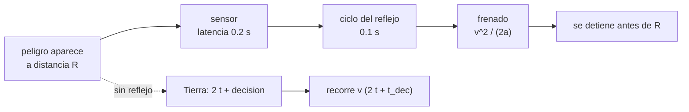

# B98-C05 — Autonomía de bajo nivel y comportamientos reactivos

<!-- nav:top -->
[🏠 Programa](../../../../README.md) · [📚 Bloque B98](../../../tronco-comun/B98-autonomia-y-teleoperacion-espacial.md) · [← Anterior: B98-C04 — Interfaces humano-robot para operación remota](../B98-C04-interfaces-humano-robot-para-operacion-remota/CLASE.md) · [Siguiente: B98-C06 — Simulación de teleoperación con retardo →](../B98-C06-simulacion-de-teleoperacion-con-retardo/CLASE.md)
<!-- /nav -->

## 1. Ubicación, nivel y alcance

Clase 5 del bloque B98. Nivel N3. Con 3 a 22 minutos de luz de una vía, la Tierra no puede frenar al rover a tiempo. Un **reflejo** a bordo sí. Aquí calculas la **distancia de frenado** de un reflejo, la comparas con lo que recorrería el rover esperando a Tierra, hallas la **velocidad máxima admisible** para un alcance de detección dado y evitas que un sensor ruidoso provoque cientos de paradas con **histéresis**. Usas [B98-C02](../B98-C02-sistemas-de-decision-autonomos-y-maquinas-de-estados-de-comportamiento/CLASE.md) para las guardas. El rover y el sensor son **sintéticos**.

## 2. Por qué esta clase existe

Ningún plan, por bueno que sea, protege a un vehículo del peligro que aparece entre dos ciclos de comunicación. La decisión central: **¿qué debe resolver el vehículo por sí mismo y a qué velocidad puede ir para que ese reflejo llegue a tiempo?**

## 3. Lo que podrás hacer al terminar

1. Calcular la distancia de frenado de un reflejo con ciclo, latencia de sensor y desaceleración.
2. Calcular la distancia recorrida si solo puede intervenir la Tierra.
3. Resolver la velocidad máxima admisible para un alcance de detección dado.
4. Verificar la solución cerrada por bisección.
5. Explicar y medir el efecto de la histéresis en un umbral con ruido.
6. Separar lo consultado (distancias, `c`) de lo sintético (rover, sensor).

La evidencia es la **dimensionamiento de un reflejo de parada** del ejercicio 12 (sección 20).

## 4. Con qué llegas y cómo comprobarlo

1. ¿Qué es una desaceleración?
2. ¿Qué es la distancia de frenado?
3. ¿Qué es el ruido de un sensor?
4. ¿Qué es una ecuación cuadrática?
5. ¿Qué es un dato sintético?

<details>
<summary>Ver respuestas</summary>

1. La disminución de la velocidad por unidad de tiempo, en m/s². 2. La que se recorre desde que se decide parar hasta detenerse. 3. La variación aleatoria de la medida alrededor del valor verdadero. 4. Una de la forma `ax² + bx + c = 0`. 5. Un dato generado para el ejemplo, no medido.
</details>

Con cuatro o cinco aciertos, sigue; si no, repasa los prerrequisitos.

## 5. Un caso de contexto y casos de referencia

Un rover a `0,04 m/s` con ciclo de reflejo de 0,1 s y 0,2 s de latencia de sensor frena en `0,0200 m`. Si solo Tierra puede intervenir (viaje de ida y vuelta más 600 s de decisión), recorre `38,6 m` con Marte cercano y `131,1 m` con Marte lejano, 12,9 y 43,7 veces el alcance de 3 m del sensor. Con el reflejo, la velocidad máxima admisible sería `0,745 m/s`. Con un sensor ruidoso, un umbral único provoca 982 cambios en 2000 ciclos; con histéresis, 42. Es el **ejemplo conductor**. Distancias y `c` consultadas; lo demás **sintético**.

## 6. Vocabulario

Un **comportamiento reactivo** responde a lo percibido en cada ciclo sin planificar. Un **reflejo** es un comportamiento reactivo de seguridad (parar, retirarse). La **distancia de frenado** es `d = v τ + v²/(2a)`, con `τ` la suma del ciclo y la latencia del sensor y `a` la desaceleración. La **velocidad máxima admisible** `v_max` es la que hace `d = R`, el alcance de detección. La **histéresis** usa dos umbrales para no conmutar por ruido.

## 7. Modelo mental: el pie en el freno



*Descripción textual:* el peligro se detecta a la distancia R; el reflejo suma latencia, ciclo y frenado y se detiene antes de R; sin reflejo, el vehículo recorre la velocidad por el viaje de ida y vuelta y la decisión.

Analogía: un conductor que frena por reflejo frente a otro que debe llamar por teléfono a alguien que ve la carretera. Límite: aquí la desaceleración es constante y el suelo no influye; en un terreno suelto, `a` cambia.

## 8. La explicación, paso a paso

### 8.1 Distancia de frenado

Con `v = 0,04 m/s`, `τ = 0,3 s`, `a = 0,10 m/s²`: `d = 0,04 × 0,3 + 0,04²/0,2 = 0,012 + 0,008 = 0,0200 m`. A esta velocidad el frenado es casi inmediato; el reflejo tiene un margen enorme frente a los 3 m del sensor.

### 8.2 Sin reflejo

`d = v (2t + t_dec) + v²/(2a)`, con `t_dec = 600 s`. Marte cercano (`t = 182,1 s`): `0,04 × 964,2 + 0,008 = 38,6 m`; Marte lejano (`t = 1338,9 s`): `0,04 × 3277,8 + 0,008 = 131,1 m`. Ambas superan con creces el alcance.

### 8.3 Velocidad máxima

Se resuelve `v²/(2a) + τ v − R = 0`: `v_max = −aτ + √((aτ)² + 2aR) = −0,03 + √(0,0009 + 0,6) = 0,7452 m/s` (la bisección da el mismo valor, diferencia < 1e-9). Si `τ` crece (latencia mayor), `v_max` baja: `0,6810 m/s` con `τ = 1 s` y `0,4220 m/s` con `τ = 5 s`.

### 8.4 Histéresis

Un obstáculo estacionario a 1,0 m medido con ruido (σ = 0,05 m) hace oscilar un umbral único: 982 cambios PARAR/MARCHAR en 2000 ciclos. Con umbrales 0,9 m (parar) y 1,1 m (marchar), 42 cambios: la banda de ±0,1 m es 2σ. Un reflejo que oscila es otro riesgo.

## 9. Magnitudes, símbolos y unidades

| Símbolo | Qué es | Unidad | Valor / nota |
|---|---|---|---|
| `v` | velocidad del rover | m/s | 0,04 (sintética) |
| `τ` | latencia de sensor + ciclo | s | 0,3 |
| `a` | desaceleración | m/s² | 0,10 (sintética) |
| `R` | alcance de detección | m | 3,0 |
| `t` | luz de una vía | s | 182,1; 1338,9 (calculada) |
| `v_max` | velocidad máxima admisible | m/s | 0,7452 |

## 10. Convenciones y referencias

Distancias mínima y máxima Tierra–Marte de la ficha de Marte de la NASA/NSSDC (consultada 2026-11-10) y `c` de CODATA 2022; `t = d/c` se calcula en el laboratorio. Distancia recorrida desde que aparece el peligro, en m. Velocidad, desaceleración, ciclo, latencia, tiempo de decisión (600 s), alcance y ruido (σ = 0,05 m) son **sintéticos** (semilla 98005). Desaceleración constante y obstáculo estacionario.

## 11. De dónde sale lo que afirmamos

| ID | Fuente | Localizador | Respalda | Estado |
|---|---|---|---|---|
| S1 | NASA/NSSDC, Mars Fact Sheet — https://nssdc.gsfc.nasa.gov/planetary/factsheet/marsfact.html (consultada 2026-11-10) | filas «Minimum/Maximum distance from Earth» | distancia mínima 54,6 × 10⁶ km y máxima 401,4 × 10⁶ km; la ficha no lista el tiempo de luz (se calcula) | Consultada |
| S2 | NIST, CODATA 2022, velocidad de la luz en el vacío — https://physics.nist.gov/cgi-bin/cuu/Value?c (consultada 2026-11-10) | valor y su incertidumbre | `c` = 299 792 458 m/s, exacta | Consultada |
| S3 | ECSS-E-ST-70-11C Rev.1, «Space segment operability» (15 octubre 2025) — https://ecss.nl/standard/ecss-e-st-70-11c-rev-1-space-segment-operability-15-october-2025/ (consultada 2026-11-10) | ficha pública de la norma obtenida por búsqueda web | la norma recoge requisitos de operabilidad del segmento espacial que cada misión debe adaptar; no se leyeron sus requisitos | Consultada (solo ficha) |
| — | Gat (1998), arquitecturas de tres capas | — | formulación clásica de comportamientos reactivos en arquitecturas de tres capas | No consultada |
| — | Modelos y leyes de la clase | — | los verifica el laboratorio con una segunda vía | No consultada en una fuente concreta |

Límites: de ECSS-E-ST-70-11C solo se consultó la ficha pública; no se afirma que la norma exija un reflejo concreto. Los parámetros del rover no se consultaron.

## 12. Cómo ver un reflejo

| Magnitud | Valor |
|---|---|
| Distancia de frenado | 0,0200 m |
| Sin reflejo (cercano / lejano) | 38,6 m / 131,1 m |
| `v_max` con `τ = 0,3 s` | 0,7452 m/s |
| `v_max` con `τ = 5 s` | 0,4220 m/s |
| Conmutaciones (único / histéresis) | 982 / 42 |

Descripción larga: el reflejo detiene al rover en centímetros; esperar a Tierra lo deja recorrer decenas o cientos de metros; la velocidad admisible baja al crecer la latencia, y la histéresis elimina más del 95 % de las conmutaciones por ruido.

## 13. Ejemplo trabajado: la distancia sin reflejo con Marte cercano

**Paso 1 · Viaje.** `2t = 364,2 s`.

**Paso 2 · Tiempo de actuación.** `364,2 + 600 = 964,2 s`.

**Paso 3 · Recorrido.** `0,04 × 964,2 = 38,57 m`.

**Paso 4 · Frenado.** `+0,008 m` → `38,6 m`, es decir, `12,9` veces el alcance de 3 m.

## 14. Distintas formas de describir un reflejo

**Por distancia:** `d` frente a `R`. **Por tiempo:** `τ` frente al tiempo disponible. **Por velocidad:** `v_max`. **Por estado:** MARCHAR/PARAR con histéresis. **Por razón:** `d/R`.

## 15. Práctica guiada

**Ejercicio 1 · con los pasos indicados.** Calcula `d` a `v = 0,04 m/s` con `τ = 0,3 s` y `a = 0,1 m/s²`. *Pasos:* suma `vτ` y `v²/(2a)`.

<details><summary>Solución comentada</summary>

`0,012 + 0,008 = 0,020 m`.
</details>

**Ejercicio 2 · con una pista.** Calcula `d` a `v = 0,1 m/s`. *Pista:* el segundo término crece con `v²`.

<details><summary>Solución comentada</summary>

`0,03 + 0,05 = 0,08 m`.
</details>

**Ejercicio 3 · casi autónomo.** ¿Qué término domina a `v = 0,04 m/s`, el de latencia o el de frenado?

<details><summary>Solución comentada</summary>

El de latencia (`0,012` frente a `0,008`).
</details>

## 16. Práctica autónoma, transferencia e integrador

**Ejercicio 4 · autónomo.** Con `τ = 0,6 s`, ¿cuánto vale `d` a `v = 0,04 m/s`?

<details><summary>Solución comentada</summary>

`0,024 + 0,008 = 0,032 m`.
</details>

**Ejercicio 5 · autónomo.** Sin reflejo y sin tiempo de decisión (`t_dec = 0`), ¿qué recorre a Marte cercano?

<details><summary>Solución comentada</summary>

`0,04 × 364,2 + 0,008 = 14,6 m`.
</details>

**Ejercicio 6 · autónomo.** Calcula `v_max` para `R = 1 m` con `τ = 0,3 s` y `a = 0,1`.

<details><summary>Solución comentada</summary>

`−0,03 + √(0,0009 + 0,2) = 0,4182 m/s`.
</details>

**Ejercicio 7 · autónomo.** ¿Cuántas veces menos conmuta el umbral con histéresis?

<details><summary>Solución comentada</summary>

`982/42 = 23,4`.
</details>

**Ejercicio 8 · autónomo.** ¿Por qué la banda de histéresis debe ser mayor que `σ`?

<details><summary>Solución comentada</summary>

Para que el ruido no cruce ambos umbrales entre ciclos; aquí la banda es 2σ.
</details>

**Ejercicio 9 · transferencia.** **Transferencia.** El alcance de detección baja de 3 m a 1 m por polvo. ¿Qué haces con la velocidad?

<details><summary>Solución comentada</summary>

Bajar `v` por debajo de `v_max(R = 1 m) = 0,42 m/s` en este modelo y añadir margen; el reflejo siempre debe seguir cumpliendo `d ≤ R`.
</details>

**Ejercicio 10 · transferencia.** **Transferencia.** Un colega propone suprimir el reflejo porque «hay un operador». ¿Qué le respondes?

<details><summary>Solución comentada</summary>

Con 3 a 22 min de luz el operador no puede actuar a tiempo: 38,6 a 131,1 m recorridos en el modelo.
</details>

**Ejercicio 11 · transferencia.** **Transferencia.** ¿Qué riesgo tiene un reflejo demasiado sensible?

<details><summary>Solución comentada</summary>

Paradas innecesarias que consumen tiempo y energía; la histéresis y el diseño de umbrales equilibran sensibilidad y falsas alarmas.
</details>

**Ejercicio 12 · integrador.** **Integrador.** Elabora tu *dimensionamiento de un reflejo de parada*: `d`, `v_max` para tres latencias, comparación con la intervención desde Tierra y diseño de histéresis con su justificación.

<details><summary>Solución comentada</summary>

Secciones 8.1–8.4 y la salida del laboratorio.
</details>

## 17. Laboratorio: reflejo de parada, velocidad máxima e histéresis

El script [reflejo.py](reflejo.py) calcula la distancia de frenado, la distancia sin reflejo con los retardos de luz, la velocidad máxima por fórmula y por bisección, y cuenta las conmutaciones con y sin histéresis (**comprueba** `d < R`, diferencia fórmula-bisección < 1e-9 y menos de una décima parte de conmutaciones con histéresis).

**Datos:** distancias y `c` **consultadas** (2026-11-10); rover, sensor, ruido y tiempos **sintéticos**. **Predice antes de ejecutar:** ¿recorre el rover más de 3 m esperando a Tierra? (sí: 38,6 m con Marte cercano). **Ejecución del 2026-11-10 (Python 3.12.9):**

```text
Python 3.12.9 (biblioteca estandar)
Distancias: ficha de Marte (NASA/NSSDC, 2026-11-10); c: CODATA 2022 (NIST). Resto SINTETICO, semilla 98005
Reflejo a bordo (v = 0.04 m/s, tau = 0.3 s, a = 0.1 m/s2): distancia de frenado = 0.0200 m (alcance 3.0 m)
Marte, distancia minima: t luz 182.1 s; sin reflejo recorre 38.6 m antes de parar (12.9 veces el alcance)
Marte, distancia maxima: t luz 1338.9 s; sin reflejo recorre 131.1 m antes de parar (43.7 veces el alcance)
Velocidad maxima admisible con reflejo para alcance 3.0 m: 0.7452 m/s (biseccion 0.7452 m/s)
  tau =  0.3 s -> v_max = 0.7452 m/s
  tau =  1.0 s -> v_max = 0.6810 m/s
  tau =  5.0 s -> v_max = 0.4220 m/s
Conmutaciones PARAR/MARCHAR en 2000 ciclos con sensor ruidoso: umbral unico 982, con histeresis 42
Pruebas superadas.
```

```bash
python programa/clases/B98/B98-C05-autonomia-de-bajo-nivel-y-comportamientos-reactivos/reflejo.py
```

**Límites:** desaceleración constante, obstáculo único estacionario, ruido gaussiano independiente; sin dinámica de terreno ni fallos del propio reflejo.

## 18. Errores frecuentes y cómo corregirlos

**Confiar en Tierra para frenar.** Se corrige con 8.2.

**Ignorar la latencia del sensor.** Se corrige con 8.3.

**Usar un umbral único con ruido.** Se corrige con 8.4.

**Tomar los parámetros del rover por los de uno real.** Se corrige con la sección 10.

## 19. Cómo sabrás que vas bien

Tras la sección 8: ¿qué distancia esperabas sin reflejo? Si dudas, repasa el ejemplo 13. Tras el laboratorio: ¿qué comprueba? (ver la sección 17).

## 20. Qué entregas y cómo se evalúa

El producto es tu **dimensionamiento de un reflejo de parada**.

| Criterio | Inicial | En desarrollo | Logrado | Destacado |
|---|---|---|---|---|
| Conceptos | Los confunde | Parciales | Aplica el modelo con sus supuestos | Explica los límites |
| Cálculo | Sin unidades | Con errores | Tablas completas con unidades | Calcula casos nuevos |
| Numérico | Sin comprobar | Un caso | Contraste con una segunda vía | Interpreta las diferencias |
| Fuentes | Sin fuente | Sin fecha | Fuentes con fecha y estado | Declara lo sintético y lo no consultado |
| Límites | No los nombra | Uno | Tres | Discute qué falta del modelo |

**Condiciones críticas (no se compensan con promedio):** rotular el rover y el sensor como sintéticos; no sustituir un reflejo por la intervención de Tierra; citar solo lo consultado.

## 21. Ética, seguridad y límites

Clase educativa: los modelos son simplificados y sus datos son sintéticos o ilustrativos; ningún resultado describe una misión real ni sustituye a las normas y procedimientos de operaciones.  Accesibilidad: tablas equivalentes a las gráficas, fórmulas en texto, ejercicios sin conexión.

## 22. Para cerrar y seguir

Un reflejo frena al rover en 0,02 m; esperar a Tierra lo deja recorrer entre 38,6 y 131,1 m. Queda una pregunta: ¿cómo se prueba todo esto con retardo y pérdida de paquetes antes de volar?

**Glosario español–inglés.** comportamiento reactivo · *reactive behavior* · distancia de frenado · *stopping distance* · histéresis · *hysteresis* · alcance de detección · *detection range* · reflejo · *reflex*.

**Continuidad.** [B98-C06](../B98-C06-simulacion-de-teleoperacion-con-retardo/CLASE.md) simula la teleoperación con retardo y pérdida de paquetes.

**Referencias:** ver sección 11.

<!-- nav:bottom -->
---

[← Anterior: B98-C04 — Interfaces humano-robot para operación remota](../B98-C04-interfaces-humano-robot-para-operacion-remota/CLASE.md) · [📚 Bloque B98](../../../tronco-comun/B98-autonomia-y-teleoperacion-espacial.md) · [Siguiente: B98-C06 — Simulación de teleoperación con retardo →](../B98-C06-simulacion-de-teleoperacion-con-retardo/CLASE.md)
<!-- /nav -->
