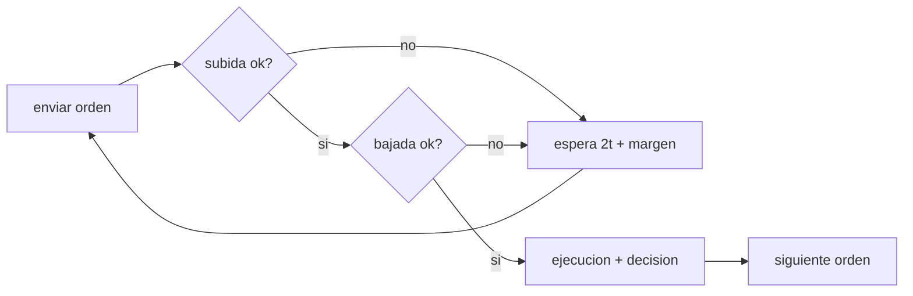

# B98-C06 — Simulación de teleoperación con retardo

<!-- nav:top -->
[🏠 Programa](../../../../README.md) · [📚 Bloque B98](../../../tronco-comun/B98-autonomia-y-teleoperacion-espacial.md) · [← Anterior: B98-C05 — Autonomía de bajo nivel y comportamientos reactivos](../B98-C05-autonomia-de-bajo-nivel-y-comportamientos-reactivos/CLASE.md) · [Siguiente: B98-C07 — Arquitectura de autonomía a bordo (percepción-decisión-acción) →](../B98-C07-arquitectura-de-autonomia-a-bordo-percepcion-decision-accion/CLASE.md)
<!-- /nav -->

## 1. Ubicación, nivel y alcance

Clase 6 del bloque B98. Nivel N3. Antes de operar con retardo se simula. Aquí construyes una simulación Monte Carlo de una campaña de 10 órdenes con retardo de luz y pérdida de paquetes con retransmisión, comparas su media con una fórmula analítica y reportas **media, mediana y percentil 95**. Usas [B96](../../../tronco-comun/B96-control-y-operacion-de-misiones-espaciales.md) solo para la idea de simulación de una jornada de control. El enlace y las órdenes son **sintéticos**.

## 2. Por qué esta clase existe

Un promedio oculta la cola: una campaña que «normalmente» dura 8,7 h puede tardar 10,2 h una de cada veinte veces. La decisión central: **¿qué duración debe prometerse a la misión, la media o un percentil, y cómo se comprueba que la simulación es correcta?**

## 3. Lo que podrás hacer al terminar

1. Modelar una orden con subida, bajada, temporizador y retransmisión.
2. Obtener por fórmula la duración esperada de una campaña con pérdida de paquetes.
3. Simular 4000 campañas con semilla fija y calcular media, mediana y percentil 95.
4. Comparar la simulación con la fórmula y cuantificar la diferencia.
5. Explicar por qué la cola crece más que la media con la pérdida.
6. Separar lo consultado (distancias, `c`) de lo sintético (pérdida, tiempos).

La evidencia es la **informe de una campaña simulada con su incertidumbre** del ejercicio 12 (sección 20).

## 4. Con qué llegas y cómo comprobarlo

1. ¿Qué es una probabilidad de pérdida?
2. ¿Qué es un percentil 95?
3. ¿Qué es una simulación Monte Carlo?
4. ¿Qué es una retransmisión?
5. ¿Qué es un dato sintético?

<details>
<summary>Ver respuestas</summary>

1. La fracción de mensajes que no llegan. 2. El valor por debajo del cual queda el 95 % de las muestras. 3. Repetir un experimento aleatorio muchas veces con una semilla fija. 4. Reenviar un mensaje tras vencer un temporizador sin confirmación. 5. Un dato generado para el ejemplo, no medido.
</details>

Con cuatro o cinco aciertos, sigue; si no, repasa los prerrequisitos.

## 5. Un caso de contexto y casos de referencia

Una campaña de 10 órdenes con Marte cercano (luz de una vía 182,1 s) dura `1,51 h` sin pérdidas. Con `p = 0,20` por trayecto, la media sube a `2,13 h` y el percentil 95 a `2,72 h`. Con Marte lejano (1338,9 s) pasa de `7,94 h` a `12,16 h` de media y `16,21 h` en el percentil 95. La fórmula analítica coincide con la simulación a menos de 0,25 %. Es el **ejemplo conductor**. Distancias y `c` consultadas; el resto **sintético**.

## 6. Vocabulario

Cada orden viaja por **subida** y su respuesta por **bajada**; cada trayecto se pierde con probabilidad `p`. La orden tiene éxito con `q = (1−p)²`. Un intento fallido cuesta `T_to = 2t + margen` (se espera el temporizador y se reenvía); uno con éxito, `T_ok = 2t + ejecución + decisión`. La **esperanza** por orden es `E = T_ok + (1/q − 1) T_to`. El **percentil 95** deja por encima el 5 % de las campañas.

## 7. Modelo mental: repetir el viaje hasta que llegue la carta



*Descripción textual:* cada orden se reenvía hasta que subida y bajada llegan; los intentos fallidos cuestan el temporizador y el éxito cuesta ejecución y decisión.

Analogía: enviar cartas certificadas por barco; si se pierde una, se espera el plazo y se reenvía. Límite: aquí las pérdidas son independientes y de probabilidad constante; en un enlace real se agrupan en ráfagas.

## 8. La explicación, paso a paso

### 8.1 Sin pérdidas

`T_ok = 2 × 182,1 + 120 + 60 = 544,2 s`; 10 órdenes dan `5442 s = 1,51 h`. A distancia máxima `T_ok = 2857,8 s` y la campaña `28 578 s = 7,94 h`.

### 8.2 Con pérdidas: fórmula

Con `p = 0,20`, `q = 0,64` y `1/q = 1,5625` intentos en media. Marte cercano: `T_to = 364,2 + 30 = 394,2 s`; `E = 544,2 + 0,5625 × 394,2 = 765,9 s` por orden y `7659 s = 2,13 h` por campaña. Marte lejano con `p = 0,05`: `q = 0,9025`, `E = 2857,8 + 0,108 × 2707,8 = 3150,3 s`, o `8,75 h`.

### 8.3 Monte Carlo

Con 4000 campañas por caso y semilla 98006, las medias difieren de la fórmula en `0,00 %` (sin pérdidas, donde no hay azar), `0,02 %`, `0,25 %`, `0,21 %` y `0,09 %`: todas bajo el límite de 1,5 % impuesto.

### 8.4 La cola

La media sube un 41 % con `p = 0,20` (Marte cercano) pero el percentil 95 sube un 80 % (`2,72/1,51`). Con Marte lejano, de `7,94 h` a `16,21 h` en el percentil 95 (×2,04). Prometer la media es prometer incumplir una de cada dos veces; un plan serio fija el percentil que acepta.

## 9. Magnitudes, símbolos y unidades

| Símbolo | Qué es | Unidad | Valor / nota |
|---|---|---|---|
| `t` | luz de una vía | s | 182,1; 1338,9 (calculada) |
| `p` | probabilidad de pérdida por trayecto | — | 0; 0,05; 0,20 (sintética) |
| `q` | éxito de una orden | — | `(1−p)²` |
| `T_ok` | coste de un intento con éxito | s | 544,2 (cercano) |
| `T_to` | coste de un intento fallido | s | 394,2 (cercano) |
| `N` | órdenes por campaña | — | 10 |

## 10. Convenciones y referencias

Distancias mínima y máxima Tierra–Marte de la ficha de Marte de la NASA/NSSDC (consultada 2026-11-10) y `c` de CODATA 2022; `t = d/c` se calcula en el laboratorio. Tiempo de operaciones en s desde la primera orden. Ejecución 120 s, decisión 60 s, margen 30 s, pérdida independiente, 10 órdenes por campaña y 4000 campañas son **sintéticos** (semilla 98006).

## 11. De dónde sale lo que afirmamos

| ID | Fuente | Localizador | Respalda | Estado |
|---|---|---|---|---|
| S1 | NASA/NSSDC, Mars Fact Sheet — https://nssdc.gsfc.nasa.gov/planetary/factsheet/marsfact.html (consultada 2026-11-10) | filas «Minimum/Maximum distance from Earth» | distancia mínima 54,6 × 10⁶ km y máxima 401,4 × 10⁶ km; la ficha no lista el tiempo de luz (se calcula) | Consultada |
| S2 | NIST, CODATA 2022, velocidad de la luz en el vacío — https://physics.nist.gov/cgi-bin/cuu/Value?c (consultada 2026-11-10) | valor y su incertidumbre | `c` = 299 792 458 m/s, exacta | Consultada |
| — | Modelos y leyes de la clase | — | los verifica el laboratorio con una segunda vía | No consultada en una fuente concreta |

Límites: ningún parámetro del enlace se consultó; la pérdida independiente no representa los desvanecimientos de un enlace real. El método (Monte Carlo y esperanza geométrica) es estándar y se verifica con una segunda vía.

## 12. Cómo ver una campaña simulada

| Magnitud | Valor |
|---|---|
| Sin pérdidas (cercano / lejano) | 1,51 h / 7,94 h |
| `p = 0,20`, media (cercano) | 2,13 h |
| `p = 0,20`, percentil 95 (cercano) | 2,72 h |
| `p = 0,20`, percentil 95 (lejano) | 16,21 h |
| Diferencia máxima con la fórmula | 0,25 % |

Descripción larga: la pérdida desplaza la media y estira la cola; la simulación y la fórmula coinciden, y el percentil 95 es la cifra para prometer.

## 13. Ejemplo trabajado: la esperanza con Marte lejano y 5 % de pérdida

**Paso 1 · Éxito.** `q = 0,95² = 0,9025`.

**Paso 2 · Intentos extra.** `1/q − 1 = 0,108`.

**Paso 3 · Por orden.** `2857,8 + 0,108 × 2707,8 = 3150,3 s`.

**Paso 4 · Campaña.** `10 × 3150,3 = 31 503 s = 8,75 h`; el Monte Carlo da 8,73 h.

## 14. Distintas formas de reportar una campaña

**Con la media:** `8,73 h`. **Con la mediana:** `8,69 h`. **Con el percentil 95:** `10,20 h`. **Con la fórmula:** `8,75 h`. **Con un histograma:** frecuencia de duraciones. Se reporta la fórmula y la simulación juntas.

## 15. Práctica guiada

**Ejercicio 1 · con los pasos indicados.** Calcula `q` para `p = 0,05`. *Pasos:* `(1−p)²`.

<details><summary>Solución comentada</summary>

`0,9025`.
</details>

**Ejercicio 2 · con una pista.** ¿Cuántos intentos en media con `p = 0,20`? *Pista:* `1/q`.

<details><summary>Solución comentada</summary>

`1/0,64 = 1,5625`.
</details>

**Ejercicio 3 · casi autónomo.** Calcula `T_ok` con Marte cercano.

<details><summary>Solución comentada</summary>

`364,2 + 120 + 60 = 544,2 s`.
</details>

## 16. Práctica autónoma, transferencia e integrador

**Ejercicio 4 · autónomo.** Calcula `T_to` con Marte lejano.

<details><summary>Solución comentada</summary>

`2677,8 + 30 = 2707,8 s`.
</details>

**Ejercicio 5 · autónomo.** ¿Cuánto sube la media con `p = 0,20` respecto de sin pérdidas, Marte lejano?

<details><summary>Solución comentada</summary>

`12,16/7,94 = 1,53`: un 53 %.
</details>

**Ejercicio 6 · autónomo.** ¿Cuánto vale el percentil 95 frente a la media, `p = 0,20`, Marte lejano?

<details><summary>Solución comentada</summary>

`16,21/12,16 = 1,33`.
</details>

**Ejercicio 7 · autónomo.** Con `p = 0`, ¿por qué la desviación entre simulación y fórmula es 0?

<details><summary>Solución comentada</summary>

No hay azar: todas las campañas duran lo mismo.
</details>

**Ejercicio 8 · autónomo.** Si el margen del temporizador baja a 10 s, ¿qué cambia en `T_to` cercano?

<details><summary>Solución comentada</summary>

`364,2 + 10 = 374,2 s` (20 s menos por fallo).
</details>

**Ejercicio 9 · transferencia.** **Transferencia.** ¿Qué percentil exigirías para una operación crítica con ventana fija?

<details><summary>Solución comentada</summary>

Uno alto (95 % o 99 %), con justificación de riesgo; la media sola infringe la ventana la mitad de las veces.
</details>

**Ejercicio 10 · transferencia.** **Transferencia.** Las pérdidas reales llegan en ráfagas. ¿Cómo cambia la cola?

<details><summary>Solución comentada</summary>

Se hace más pesada: varios fallos seguidos alargan campañas; el modelo independiente la subestima.
</details>

**Ejercicio 11 · transferencia.** **Transferencia.** ¿Cómo validarías esta simulación con datos reales de un enlace?

<details><summary>Solución comentada</summary>

Compararía la distribución de duraciones y de pérdidas con registros del enlace (no consultados aquí) y ajustaría el modelo de pérdida.
</details>

**Ejercicio 12 · integrador.** **Integrador.** Elabora tu *informe de una campaña simulada con su incertidumbre*: parámetros, media, mediana, percentil 95, fórmula y diferencia, y qué datos son consultados y sintéticos.

<details><summary>Solución comentada</summary>

Secciones 8.1–8.4 y la salida del laboratorio.
</details>

## 17. Laboratorio: campaña de 10 órdenes con retardo y pérdida de paquetes

El script [simula_retardo.py](simula_retardo.py) simula 4000 campañas por caso con semilla 98006 y compara la media con la fórmula (**comprueba** diferencia < 1,5 % y exactitud con `p = 0`).

**Datos:** distancias y `c` **consultadas** (2026-11-10); pérdida, ejecución, decisión y margen **sintéticos**. **Predice antes de ejecutar:** ¿qué diferencia espera entre simulación y fórmula con `p = 0`? (nula). **Ejecución del 2026-11-10 (Python 3.12.9):**

```text
Python 3.12.9 (biblioteca estandar)
Distancias: ficha de Marte (NASA/NSSDC, 2026-11-10); c: CODATA 2022 (NIST). Resto SINTETICO, semilla 98006
10 ordenes por campana, 4000 campanas por caso
caso                         p  media [h]  p50 [h]  p95 [h]  formula [h]    dif.
Marte, dist. minima       0.00       1.51     1.51     1.51         1.51   0.00%
Marte, dist. minima       0.05       1.63     1.62     1.84         1.63   0.02%
Marte, dist. minima       0.20       2.13     2.06     2.72         2.13   0.25%
Marte, dist. maxima       0.00       7.94     7.94     7.94         7.94   0.00%
Marte, dist. maxima       0.05       8.73     8.69    10.20         8.75   0.21%
Marte, dist. maxima       0.20      12.16    11.70    16.21        12.17   0.09%
Pruebas superadas.
```

```bash
python programa/clases/B98/B98-C06-simulacion-de-teleoperacion-con-retardo/simula_retardo.py
```

**Límites:** pérdidas independientes, sin ráfagas ni orden de llegada; una sola orden en vuelo; sin variación del retardo durante la campaña.

## 18. Errores frecuentes y cómo corregirlos

**Reportar solo la media.** Se corrige con 8.4.

**Olvidar el temporizador en los intentos fallidos.** Se corrige con 8.2.

**Dar por válida una simulación sin contrastarla.** Se corrige con 8.3.

**Tomar los parámetros sintéticos por los de un enlace real.** Se corrige con la sección 10.

## 19. Cómo sabrás que vas bien

Tras la sección 8: ¿qué percentil 95 esperabas con `p = 0,05` y cuál obtuviste? Si dudas, repasa el ejemplo 13. Tras el laboratorio: ¿qué comprueba? (ver la sección 17).

## 20. Qué entregas y cómo se evalúa

El producto es tu **informe de una campaña simulada con su incertidumbre**.

| Criterio | Inicial | En desarrollo | Logrado | Destacado |
|---|---|---|---|---|
| Conceptos | Los confunde | Parciales | Aplica el modelo con sus supuestos | Explica los límites |
| Cálculo | Sin unidades | Con errores | Tablas completas con unidades | Calcula casos nuevos |
| Numérico | Sin comprobar | Un caso | Contraste con una segunda vía | Interpreta las diferencias |
| Fuentes | Sin fuente | Sin fecha | Fuentes con fecha y estado | Declara lo sintético y lo no consultado |
| Límites | No los nombra | Uno | Tres | Discute qué falta del modelo |

**Condiciones críticas (no se compensan con promedio):** rotular los parámetros del enlace como sintéticos; no presentar una simulación como operación real; citar solo lo consultado.

## 21. Ética, seguridad y límites

Clase educativa: los modelos son simplificados y sus datos son sintéticos o ilustrativos; ningún resultado describe una misión real ni sustituye a las normas y procedimientos de operaciones.  Accesibilidad: tablas equivalentes a las gráficas, fórmulas en texto, ejercicios sin conexión.

## 22. Para cerrar y seguir

Una campaña de 10 órdenes dura 1,51 h sin pérdidas y, con 20 % de pérdida y Marte cercano, 2,13 h de media y 2,72 h en el percentil 95. Queda una pregunta: ¿cómo se organiza el software de a bordo para sostener todo esto?

**Glosario español–inglés.** pérdida de paquetes · *packet loss* · retransmisión · *retransmission* · percentil · *percentile* · Monte Carlo · *Monte Carlo* · temporizador · *timeout*.

**Continuidad.** [B98-C07](../B98-C07-arquitectura-de-autonomia-a-bordo-percepcion-decision-accion/CLASE.md) estudia la arquitectura de autonomía a bordo.

**Referencias:** ver sección 11.

<!-- nav:bottom -->
---

[← Anterior: B98-C05 — Autonomía de bajo nivel y comportamientos reactivos](../B98-C05-autonomia-de-bajo-nivel-y-comportamientos-reactivos/CLASE.md) · [📚 Bloque B98](../../../tronco-comun/B98-autonomia-y-teleoperacion-espacial.md) · [Siguiente: B98-C07 — Arquitectura de autonomía a bordo (percepción-decisión-acción) →](../B98-C07-arquitectura-de-autonomia-a-bordo-percepcion-decision-accion/CLASE.md)
<!-- /nav -->
