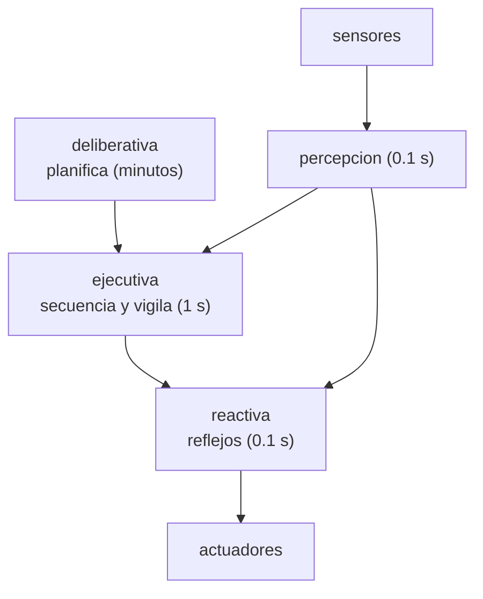

# B98-C07 — Arquitectura de autonomía a bordo (percepción-decisión-acción)

<!-- nav:top -->
[🏠 Programa](../../../../README.md) · [📚 Bloque B98](../../../tronco-comun/B98-autonomia-y-teleoperacion-espacial.md) · [← Anterior: B98-C06 — Simulación de teleoperación con retardo](../B98-C06-simulacion-de-teleoperacion-con-retardo/CLASE.md) · [Siguiente: B98-C08 — Protocolos de relevo de control entre operadores →](../B98-C08-protocolos-de-relevo-de-control-entre-operadores/CLASE.md)
<!-- /nav -->

## 1. Ubicación, nivel y alcance

Clase 7 del bloque B98. Nivel N3. La autonomía a bordo es software con capas: una **reactiva** (rápida, simple), una **ejecutiva** (secuencia y vigila) y una **deliberativa** (planifica, lenta). Aquí verificas el presupuesto de tiempos de un conjunto de tareas periódicas con la cota de utilización y el análisis exacto de tiempo de respuesta, y calculas la probabilidad de que el planificador llegue tarde. Usas [B83](../../../tronco-comun/B83-ingenieria-de-sistemas-y-diseno-de-misiones.md) solo para la idea de arquitectura de sistema. Las tareas son **sintéticas**.

## 2. Por qué esta clase existe

Una arquitectura sin presupuesto de tiempos puede parecer correcta hasta que una tarea lenta retrasa un reflejo. La decisión central: **¿cada capa cumple sus plazos aunque las demás consuman su peor caso, y qué pasa cuando el planificador tarda más de lo previsto?**

## 3. Lo que podrás hacer al terminar

1. Describir las capas percepción-decisión-acción y su ritmo.
2. Calcular la utilización de un conjunto de tareas periódicas y compararla con la cota de Liu–Layland.
3. Calcular el tiempo de respuesta exacto de cada tarea por punto fijo.
4. Acotar la latencia de percepción a reflejo y compararla con un presupuesto.
5. Estimar la probabilidad de que el planificador exceda su plazo con una distribución lognormal.
6. Rotular lo sintético y lo no consultado en una arquitectura.

La evidencia es la **presupuesto de tiempos de una arquitectura de tres capas** del ejercicio 12 (sección 20).

## 4. Con qué llegas y cómo comprobarlo

1. ¿Qué es una tarea periódica?
2. ¿Qué es un plazo?
3. ¿Qué es la utilización?
4. ¿Qué es una distribución lognormal?
5. ¿Qué es un dato sintético?

<details>
<summary>Ver respuestas</summary>

1. Una que se ejecuta cada cierto periodo, con un tiempo de cálculo máximo. 2. El instante límite para terminar una tarea. 3. La suma de tiempo de cálculo dividido por el periodo, `Σ C/T`. 4. Una distribución cuyo logaritmo es normal; modela tiempos positivos con cola larga. 5. Un dato generado para el ejemplo, no medido.
</details>

Con cuatro o cinco aciertos, sigue; si no, repasa los prerrequisitos.

## 5. Un caso de contexto y casos de referencia

Cuatro tareas periódicas (percepción, reflejo, ejecutivo y telemetría) tienen una utilización de `0,500` frente a una cota de `0,757`. Sus tiempos de respuesta en el peor caso son `0,020`, `0,030`, `0,240` y `0,370 s`, todos menores que su periodo. La latencia peor caso de percepción a reflejo es `0,050 s` (presupuesto 0,5 s). El planificador, con mediana de 45 s y σ log 0,5, excede 120 s con probabilidad `0,0249` (Monte Carlo `0,0244`). Es el **ejemplo conductor**. Todo **sintético**.

## 6. Vocabulario

La **capa reactiva** (reflejos) responde al ritmo del sensor; la **ejecutiva** interpreta el plan y vigila su ejecución; la **deliberativa** planifica. El **Remote Agent** (consultado, solo el resumen) combina planificación con restricciones, ejecución multihilo y reconfiguración basada en modelos para controlar una nave a bordo. La **cota de Liu–Layland** `n(2^(1/n) − 1)` es una condición **suficiente** de planificabilidad con prioridades por tasa. El **tiempo de respuesta** `R_i = C_i + Σ_j ⌈R_i/T_j⌉ C_j` (j de mayor prioridad) es exacto.

## 7. Modelo mental: una cocina con tres cocineros



*Descripción textual:* el planificador lento fija los objetivos; la ejecutiva los convierte en acciones y vigila; la reactiva actúa sobre los actuadores con lo percibido y puede interrumpir.

Analogía: el chef planifica el menú, el jefe de sala coordina los platos y el cocinero apaga el fuego si algo se quema: ritmos distintos, una cocina. Límite: en software hay recursos compartidos y plazos que se miden, no se supone.

## 8. La explicación, paso a paso

### 8.1 Capas y ritmos

Reactiva: 10 Hz (periodo 0,1 s). Ejecutiva: 1 Hz. Deliberativa: tiempos de minutos, fuera del bucle periódico. La relación entre ritmos (10:1 y 600:1 aproximadamente) es una decisión de diseño.

### 8.2 Utilización

`U = 0,020/0,1 + 0,010/0,1 + 0,150/1 + 0,100/2 = 0,2 + 0,1 + 0,15 + 0,05 = 0,500`. Para `n = 4`, la cota es `4(2^(1/4) − 1) = 0,757`; `U ≤ 0,757` garantiza planificabilidad. Si `U` la superara, no se concluiría que falla: la cota es solo suficiente.

### 8.3 Tiempo de respuesta exacto

Con prioridad por tasa: percepción `R = 0,020 s`; reflejo `R = 0,010 + ⌈R/0,1⌉ 0,020 = 0,030 s`; ejecutivo `R = 0,240 s`; telemetría `R = 0,370 s`. Las holguras (periodo menos respuesta) son `0,080`, `0,070`, `0,760` y `1,630 s`. La latencia de percepción a reflejo se acota por `0,020 + 0,030 = 0,050 s` frente a 0,5 s; hasta el ejecutivo, `0,020 + 1,0 + 0,240 = 1,260 s` porque hay que esperar su periodo.

### 8.4 El planificador

Con tiempo lognormal (mediana 45 s, σ log 0,5), `P(T > 120 s) = ½ erfc( (ln 120 − ln 45) / (0,5 √2) ) = 0,0249`; el Monte Carlo (20 000 muestras, semilla 98007) da `0,0244`. Un 2,5 % de los planes llegaría tarde: hace falta un **plan por defecto** (seguir con el anterior o quedarse en modo seguro).

## 9. Magnitudes, símbolos y unidades

| Símbolo | Qué es | Unidad | Valor / nota |
|---|---|---|---|
| `C` | tiempo de cálculo en el peor caso | s | 0,010 a 0,150 |
| `T` | periodo = plazo | s | 0,1 a 2,0 |
| `U` | utilización | — | 0,500 |
| cota `n(2^(1/n) − 1)` | condición suficiente | — | 0,757 (n = 4) |
| `R` | tiempo de respuesta | s | 0,020 a 0,370 |
| `P(T > 120)` | probabilidad de plan tardío | — | 0,0249 |

## 10. Convenciones y referencias

Tiempo de reloj de a bordo en s. Tareas independientes, plazo igual al periodo, prioridades por tasa, sin interrupciones ni bloqueos entre ellas y sin coste de cambio de contexto. Todos los tiempos son **sintéticos**; el planificador se modela con una distribución inventada (semilla 98007).

## 11. De dónde sale lo que afirmamos

| ID | Fuente | Localizador | Respalda | Estado |
|---|---|---|---|---|
| S1 | Muscettola, Nayak, Pell y Williams (1998), «Remote Agent: To Boldly Go Where No AI System Has Gone Before», Artificial Intelligence 103(1-2), 5-48 — https://groups.csail.mit.edu/mers/old-site/abstracts/aij98-abstract.html (consultada 2026-11-10) | resumen y datos de publicación | arquitectura con planificación y programación temporal con restricciones, ejecución multihilo y reconfiguración basada en modelos, para el control a bordo de Deep Space One | Consultada (solo resumen) |
| S2 | Colledanchise y Ögren, «Behavior Trees in Robotics and AI: An Introduction» (arXiv 1709.00084; libro CRC Press, 2018) — https://arxiv.org/abs/1709.00084 (consultada 2026-11-10) | resumen | los árboles de comportamiento son modulares y reactivos y generalizan estructuras de conmutación anteriores | Consultada (solo resumen) |
| S3 | ECSS-E-ST-70-11C Rev.1, «Space segment operability» (15 octubre 2025) — https://ecss.nl/standard/ecss-e-st-70-11c-rev-1-space-segment-operability-15-october-2025/ (consultada 2026-11-10) | ficha pública de la norma obtenida por búsqueda web | la norma recoge requisitos de operabilidad del segmento espacial que cada misión debe adaptar; no se leyeron sus requisitos | Consultada (solo ficha) |
| — | Gat (1998), arquitecturas de tres capas | — | origen y definición de las arquitecturas de tres capas | No consultada |
| — | ECSS-E-ST-70-41C (PUS, servicios de utilización de paquetes) | — | servicios estandarizados para órdenes, eventos y modos del vehículo | No consultada |
| — | Modelos y leyes de la clase | — | los verifica el laboratorio con una segunda vía | No consultada en una fuente concreta |

Límites: del Remote Agent y de los árboles de comportamiento solo se consultaron los resúmenes; de la norma ECSS, solo la ficha. La cota de Liu–Layland y el análisis de tiempo de respuesta son resultados estándar de planificación de tiempo real que se verifican con el laboratorio, no con una fuente consultada.

## 12. Cómo ver el presupuesto de tiempos

| Magnitud | Valor |
|---|---|
| Utilización / cota | 0,500 / 0,757 |
| Respuesta del reflejo | 0,030 s (periodo 0,1 s) |
| Latencia percepción → reflejo | 0,050 s (presupuesto 0,5 s) |
| Latencia hasta el ejecutivo | 1,260 s |
| P(planificador > 120 s) | 0,0249 (MC 0,0244) |

Descripción larga: todas las tareas cumplen con holgura; el reflejo reacciona en 50 ms; la capa deliberativa es la fuente de incertidumbre, con un 2,5 % de planes tardíos.

## 13. Ejemplo trabajado: el tiempo de respuesta del ejecutivo

**Paso 1 · Mayores prioridades.** Percepción (0,020 s cada 0,1 s) y reflejo (0,010 s cada 0,1 s).

**Paso 2 · Iteración.** `R = 0,150 → 0,150 + 2 × 0,030 = 0,210 → 0,150 + 3 × 0,030 = 0,240 → 0,240` (se mantiene).

**Paso 3 · Holgura.** `1,0 − 0,240 = 0,760 s`.

## 14. Distintas formas de describir una arquitectura

**Por capas:** reactiva, ejecutiva, deliberativa. **Por flujo:** percepción → decisión → acción. **Por tiempo:** periodos, utilización y respuestas. **Por falla:** qué ocurre si una capa no responde. **Por interfaz:** qué dato pasa entre capas.

## 15. Práctica guiada

**Ejercicio 1 · con los pasos indicados.** Calcula `U` de las cuatro tareas. *Pasos:* suma `C/T`.

<details><summary>Solución comentada</summary>

`0,2 + 0,1 + 0,15 + 0,05 = 0,500`.
</details>

**Ejercicio 2 · con una pista.** Calcula la cota para `n = 3`. *Pista:* `3(2^(1/3) − 1)`.

<details><summary>Solución comentada</summary>

`0,780`.
</details>

**Ejercicio 3 · casi autónomo.** ¿Qué dice `U = 0,5 ≤ 0,757`?

<details><summary>Solución comentada</summary>

Que el conjunto es planificable con prioridad por tasa (condición suficiente).
</details>

## 16. Práctica autónoma, transferencia e integrador

**Ejercicio 4 · autónomo.** Añades una tarea `C = 0,05 s`, `T = 0,5 s`. ¿Cuánto vale `U`?

<details><summary>Solución comentada</summary>

`0,5 + 0,1 = 0,600`; cota con `n = 5`: `0,743`; sigue siendo menor.
</details>

**Ejercicio 5 · autónomo.** ¿Qué holgura tiene el reflejo?

<details><summary>Solución comentada</summary>

`0,1 − 0,030 = 0,070 s`.
</details>

**Ejercicio 6 · autónomo.** ¿Por qué la latencia hasta el ejecutivo suma 1,0 s?

<details><summary>Solución comentada</summary>

Hay que esperar hasta su siguiente periodo.
</details>

**Ejercicio 7 · autónomo.** Con `P(T > 120) = 0,0249`, ¿cuántos de 1000 planes llegan tarde en media?

<details><summary>Solución comentada</summary>

Unos `25`.
</details>

**Ejercicio 8 · autónomo.** ¿Qué ocurre si la cota se supera, `U = 0,8`?

<details><summary>Solución comentada</summary>

No se concluye nada: el análisis de respuesta exacto decide.
</details>

**Ejercicio 9 · transferencia.** **Transferencia.** El planificador tarda más de lo previsto y el rover debe moverse. ¿Qué haces?

<details><summary>Solución comentada</summary>

Plan por defecto: continuar el plan anterior o detenerse en modo seguro; el reflejo y el ejecutivo siguen funcionando.
</details>

**Ejercicio 10 · transferencia.** **Transferencia.** ¿Por qué no basta que `U` sea baja?

<details><summary>Solución comentada</summary>

Los plazos dependen de la interferencia y del orden de prioridad; el análisis de respuesta lo comprueba.
</details>

**Ejercicio 11 · transferencia.** **Transferencia.** ¿Cómo se verificaría la arquitectura con medidas reales de tiempo?

<details><summary>Solución comentada</summary>

Midiendo `C` en el peor caso en el hardware y repitiendo los análisis; aquí los `C` son sintéticos.
</details>

**Ejercicio 12 · integrador.** **Integrador.** Elabora tu *presupuesto de tiempos de una arquitectura de tres capas*: tabla de tareas, utilización, respuestas, latencias y qué pasa si el planificador tarda de más.

<details><summary>Solución comentada</summary>

Secciones 8.1–8.4 y la salida del laboratorio.
</details>

## 17. Laboratorio: presupuesto de tiempos de tres capas

El script [tres_capas.py](tres_capas.py) calcula la utilización, la cota de Liu–Layland, el tiempo de respuesta de cada tarea por punto fijo y la probabilidad de plan tardío por Monte Carlo y por fórmula (**comprueba** `R ≤ T`, `U ≤` cota, latencia reflejo ≤ 0,5 s y concordancia Monte Carlo–fórmula < 0,005).

**Datos:** todo **sintético**: tiempos de cálculo, periodos, presupuesto y distribución del planificador; no hay datos consultados en este laboratorio. **Predice antes de ejecutar:** ¿cumple el conjunto la cota de utilización? (sí: 0,500 ≤ 0,757). **Ejecución del 2026-11-10 (Python 3.12.9):**

```text
Python 3.12.9 (biblioteca estandar)
DATOS SINTETICOS; semilla 98007
Utilizacion U = 0.5000; cota de Liu-Layland para n = 4: 0.7568 (cumple)
tarea          C [s]   T [s]    R [s]  holgura [s]
percepcion     0.020   0.100    0.020        0.080
reflejo        0.010   0.100    0.030        0.070
ejecutivo      0.150   1.000    0.240        0.760
telemetria     0.100   2.000    0.370        1.630
Latencia peor caso percepcion -> reflejo (R_p + R_r, acotada por las dos respuestas): 0.050 s (presupuesto 0.5 s)
Latencia peor caso hasta el ejecutivo, incluyendo el periodo de muestreo: 1.260 s
Planificador: P(tiempo > 120 s) Monte Carlo = 0.0244; formula lognormal = 0.0249
Pruebas superadas.
```

```bash
python programa/clases/B98/B98-C07-arquitectura-de-autonomia-a-bordo-percepcion-decision-accion/tres_capas.py
```

**Límites:** sin bloqueos, sin cambios de contexto, plazo igual al periodo, planificador fuera del bucle; una distribución inventada para la capa deliberativa.

## 18. Errores frecuentes y cómo corregirlos

**Confundir la cota con una condición necesaria.** Se corrige con 8.2.

**Olvidar esperar el periodo de la capa siguiente.** Se corrige con 8.3.

**Suponer que el planificador siempre termina a tiempo.** Se corrige con 8.4.

**Tomar los tiempos sintéticos por los de un procesador real.** Se corrige con la sección 10.

## 19. Cómo sabrás que vas bien

Tras la sección 8: ¿qué respuesta esperabas del reflejo y cuál obtuviste? Si dudas, repasa el ejemplo 13. Tras el laboratorio: ¿qué comprueba? (ver la sección 17).

## 20. Qué entregas y cómo se evalúa

El producto es tu **presupuesto de tiempos de una arquitectura de tres capas**.

| Criterio | Inicial | En desarrollo | Logrado | Destacado |
|---|---|---|---|---|
| Conceptos | Los confunde | Parciales | Aplica el modelo con sus supuestos | Explica los límites |
| Cálculo | Sin unidades | Con errores | Tablas completas con unidades | Calcula casos nuevos |
| Numérico | Sin comprobar | Un caso | Contraste con una segunda vía | Interpreta las diferencias |
| Fuentes | Sin fuente | Sin fecha | Fuentes con fecha y estado | Declara lo sintético y lo no consultado |
| Límites | No los nombra | Uno | Tres | Discute qué falta del modelo |

**Condiciones críticas (no se compensan con promedio):** rotular las tareas y los tiempos como sintéticos; no presentar la arquitectura como la de una misión real; citar solo lo consultado.

## 21. Ética, seguridad y límites

Clase educativa: los modelos son simplificados y sus datos son sintéticos o ilustrativos; ningún resultado describe una misión real ni sustituye a las normas y procedimientos de operaciones.  Accesibilidad: tablas equivalentes a las gráficas, fórmulas en texto, ejercicios sin conexión.

## 22. Para cerrar y seguir

Cuatro tareas con `U = 0,500` cumplen sus plazos, el reflejo reacciona en 50 ms y el planificador llega tarde en el 2,5 % de los casos. Queda una pregunta: cuando el control pasa de una persona a otra, ¿quién manda en cada instante?

**Glosario español–inglés.** capa reactiva · *reactive layer* · ejecutivo · *executive* · capa deliberativa · *deliberative layer* · tiempo de respuesta · *response time* · prioridad por tasa · *rate-monotonic priority*.

**Continuidad.** [B98-C08](../B98-C08-protocolos-de-relevo-de-control-entre-operadores/CLASE.md) estudia los protocolos de relevo de control entre operadores.

**Referencias:** ver sección 11.

<!-- nav:bottom -->
---

[← Anterior: B98-C06 — Simulación de teleoperación con retardo](../B98-C06-simulacion-de-teleoperacion-con-retardo/CLASE.md) · [📚 Bloque B98](../../../tronco-comun/B98-autonomia-y-teleoperacion-espacial.md) · [Siguiente: B98-C08 — Protocolos de relevo de control entre operadores →](../B98-C08-protocolos-de-relevo-de-control-entre-operadores/CLASE.md)
<!-- /nav -->
