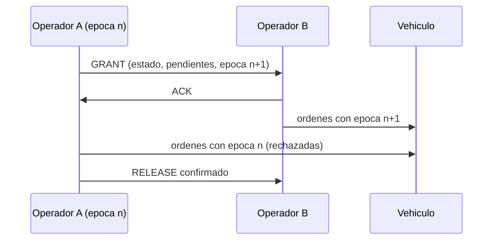

# B98-C08 — Protocolos de relevo de control entre operadores

<!-- nav:top -->
[🏠 Programa](../../../../README.md) · [📚 Bloque B98](../../../tronco-comun/B98-autonomia-y-teleoperacion-espacial.md) · [← Anterior: B98-C07 — Arquitectura de autonomía a bordo (percepción-decisión-acción)](../B98-C07-arquitectura-de-autonomia-a-bordo-percepcion-decision-accion/CLASE.md) · [Siguiente: B99-C01 — Odometría visual →](../../B99/B99-C01-odometria-visual/CLASE.md)
<!-- /nav -->

## 1. Ubicación, nivel y alcance

Clase 8 del bloque B98. Nivel N3. Un robot lo controla una persona a la vez, pero los turnos acaban y el control pasa a otra persona, a otro centro o de la tripulación a la Tierra. Aquí comparas tres protocolos de relevo con mensajes que pueden perderse, mides los **huecos de autoridad** (nadie comanda) y los **solapamientos** (dos comandan) y verificas que una **época de autoridad** (*fencing*) evita las órdenes en conflicto. Usas [B96](../../../tronco-comun/B96-control-y-operacion-de-misiones-espaciales.md) solo para la idea de turno de operaciones. Los protocolos y las pérdidas son **sintéticos**.

## 2. Por qué esta clase existe

Los relevos fallan en los bordes: un «es tuyo» que no llega deja el vehículo sin dueño, y un «lo sigo yo» sin confirmar deja a dos operadores dando órdenes. La decisión central: **¿cómo se garantiza que siempre hay exactamente un operador con autoridad, o que las órdenes de uno antiguo no se acepten?**

## 3. Lo que podrás hacer al terminar

1. Definir hueco de autoridad y solapamiento.
2. Describir un relevo en tres pasos con confirmación (GRANT, ACK, RELEASE).
3. Simular 10 000 relevos con pérdida de mensajes y contar huecos, solapamientos y conflictos.
4. Explicar cómo la época de autoridad convierte órdenes en conflicto en órdenes rechazadas.
5. Contrastar el solapamiento medio con la esperanza teórica por mensaje.
6. Separar lo sintético (red, pérdida) de lo no consultado (procedimientos reales).

La evidencia es la **protocolo de relevo con sus invariantes** del ejercicio 12 (sección 20).

## 4. Con qué llegas y cómo comprobarlo

1. ¿Qué es una probabilidad de pérdida?
2. ¿Qué es una confirmación (ACK)?
3. ¿Qué es una época o contador de versión?
4. ¿Qué es un invariante?
5. ¿Qué es un dato sintético?

<details>
<summary>Ver respuestas</summary>

1. La fracción de mensajes que no llegan. 2. Un mensaje que acusa recibo de otro. 3. Un número que crece con cada traspaso de autoridad. 4. Una propiedad que debe cumplirse siempre. 5. Un dato generado para el ejemplo, no medido.
</details>

Con cuatro o cinco aciertos, sigue; si no, repasa los prerrequisitos.

## 5. Un caso de contexto y casos de referencia

Con 15 % de pérdida y 10 000 relevos (semilla 98008): el protocolo **ingenuo** («es tuyo» sin confirmar) deja a `1475` relevos sin autoridad (hueco medio `44,25 s`). El **confirmado** elimina los huecos pero produce `1507` relevos con solapamiento y `3512` órdenes en conflicto. El **confirmado con época** mantiene cero huecos y cero conflictos: `3554` órdenes antiguas se rechazan. Es el **ejemplo conductor**. Todo **sintético**.

## 6. Vocabulario

Un **hueco de autoridad** es un intervalo en el que nadie puede comandar. Un **solapamiento** es un intervalo en el que dos comandan. Un **relevo confirmado** retiene la autoridad en A hasta que B confirma. La **época** es un número que crece en cada traspaso y que acompaña a cada orden; el vehículo rechaza las de época menor que la mayor vista (*fencing*). Un **relevo estructurado** incluye el estado del vehículo, los comandos pendientes y las anomalías abiertas (no se modela el contenido del briefing).

## 7. Modelo mental: pasar el testigo en una carrera de relevos



*Descripción textual:* A concede la autoridad con un GRANT y sigue comandando hasta recibir el ACK; B comanda con la época nueva, y el vehículo rechaza las órdenes de A con la época vieja.

Analogía: en una carrera de relevos el testigo se entrega en una zona marcada; si el compañero no lo agarra, sigue en tu mano. Límite: aquí hay un solo vehículo y mensajes que se pierden, no atletas que se ven.

## 8. La explicación, paso a paso

### 8.1 Ingenuo

A anuncia y deja de comandar. Si el mensaje se pierde (probabilidad `p = 0,15`), nadie comanda hasta que A lo advierte 300 s después. Fracción con hueco: `1475/10 000 = 0,1475 ≈ p`; hueco medio `0,15 × 300 = 45 s` (44,25 s medidos).

### 8.2 Confirmado

A sigue comandando hasta recibir el ACK; B empieza al recibir el GRANT. No hay huecos, pero entre el inicio de B y la llegada del ACK a A hay solapamiento. Con retransmisión cada 10 s, el tiempo de entrega de un mensaje tiene esperanza `p/(1−p) × 10 s = 1,765 s`; se miden `1,756 s`. Con una orden cada 5 s por operador, hay `3512` órdenes en conflicto en 10 000 relevos (`0,35` por relevo).

### 8.3 Con época

Cada orden lleva su época; el vehículo acepta solo la mayor vista. Las `3554` órdenes que llegarían de A tras el comienzo de B se **rechazan**; los conflictos aceptados pasan a 0. El solapamiento sigue existiendo (1503 relevos) pero es inofensivo.

### 8.4 Lo que no se simula

El **contenido** del relevo (estado del vehículo, anomalías abiertas, pendientes, quién habló con quién) decide si B entiende lo que recibe; esa parte es humana y se aborda con listas de comprobación y confirmación verbal. El modelo no la mide.

## 9. Magnitudes, símbolos y unidades

| Símbolo | Qué es | Unidad | Valor / nota |
|---|---|---|---|
| `p` | probabilidad de pérdida de un mensaje | — | 0,15 (sintética) |
| retransmisión | intervalo | s | 10 |
| detección | tiempo para advertir un hueco | s | 300 |
| hueco medio | tiempo sin autoridad por relevo | s | 44,25 (ingenuo) |
| solape medio | tiempo con dos comandantes | s | 1,756 |
| conflictos | órdenes aceptadas de un emisor antiguo | — | 3512 sin época; 0 con época |

## 10. Convenciones y referencias

Tiempo de operaciones en s. Pérdida independiente por mensaje, retransmisión periódica, 1 orden por operador cada 5 s mientras comanda y 10 000 relevos por protocolo; todo **sintético** (semilla 98008). El vehículo es un único receptor que ve las órdenes en el mismo orden en que se emiten (sin retardo ni reordenamiento).

## 11. De dónde sale lo que afirmamos

| ID | Fuente | Localizador | Respalda | Estado |
|---|---|---|---|---|
| S1 | Parasuraman, Sheridan y Wickens (2000), «A model for types and levels of human interaction with automation», IEEE Trans. SMC-A 30(3), 286-297, DOI 10.1109/3468.844354 — resumen obtenido por búsqueda web (2026-11-10) | resumen secundario | cuatro clases de función (adquisición y análisis de información, selección de decisión, ejecución de acción) y un continuo de niveles de automatización | Consultada (resumen secundario; no se leyó el artículo) |
| S2 | ECSS-E-ST-70-11C Rev.1, «Space segment operability» (15 octubre 2025) — https://ecss.nl/standard/ecss-e-st-70-11c-rev-1-space-segment-operability-15-october-2025/ (consultada 2026-11-10) | ficha pública de la norma obtenida por búsqueda web | la norma recoge requisitos de operabilidad del segmento espacial que cada misión debe adaptar; no se leyeron sus requisitos | Consultada (solo ficha) |
| — | Procedimientos de relevo de turno y traspaso de comando de agencias espaciales | — | listas, tiempos y reglas reales de relevo en operaciones | No consultada |
| — | Modelos y leyes de la clase | — | los verifica el laboratorio con una segunda vía | No consultada en una fuente concreta |

Límites: de Parasuraman, Sheridan y Wickens solo se consultó un resumen secundario (reparto de funciones entre humano y automatismo); no se afirma nada sobre relevos. La técnica de época o *fencing* es una relación estándar de sistemas distribuidos que se verifica con el laboratorio y no se consultó en una fuente concreta.

## 12. Cómo ver un relevo

| Magnitud | Valor |
|---|---|
| Relevos con hueco (ingenuo) | 1475 de 10 000 |
| Relevos con solapamiento (confirmado) | 1507 |
| Órdenes en conflicto (sin época / con época) | 3512 / 0 |
| Órdenes rechazadas con época | 3554 |
| Solape medio / teórico | 1,756 s / 1,765 s |

Descripción larga: el protocolo ingenuo pierde la autoridad una de cada siete veces; confirmar elimina los huecos pero crea solapamientos; la época los neutraliza.

## 13. Ejemplo trabajado: el solapamiento esperado por mensaje

**Paso 1 · Pérdida.** `p = 0,15`.

**Paso 2 · Reintentos esperados.** `p/(1−p) = 0,1765`.

**Paso 3 · Tiempo.** `0,1765 × 10 s = 1,765 s`.

**Paso 4 · Comparación.** El laboratorio mide `1,756 s`; la diferencia es `0,009 s`.

## 14. Distintas formas de describir un relevo

**Por mensajes:** GRANT, ACK, RELEASE. **Por estado:** quién tiene la autoridad. **Por invariante:** nunca dos aceptados, nunca ninguno por mucho tiempo. **Por registro:** épocas y horas. **Por contenido:** lista de comprobación del estado entregado.

## 15. Práctica guiada

**Ejercicio 1 · con los pasos indicados.** Calcula el hueco medio del ingenuo con `p = 0,15`. *Pasos:* `p × 300 s`.

<details><summary>Solución comentada</summary>

`45 s`.
</details>

**Ejercicio 2 · con una pista.** ¿Cuál es la esperanza de reenvíos con `p = 0,3`? *Pista:* `p/(1−p)`.

<details><summary>Solución comentada</summary>

`0,3/0,7 = 0,4286`; con retransmisión de 10 s, `4,29 s`.
</details>

**Ejercicio 3 · casi autónomo.** ¿Por qué el confirmado no tiene huecos?

<details><summary>Solución comentada</summary>

Porque A conserva la autoridad hasta recibir el ACK.
</details>

## 16. Práctica autónoma, transferencia e integrador

**Ejercicio 4 · autónomo.** ¿Cuántas órdenes en conflicto hubo por relevo sin época?

<details><summary>Solución comentada</summary>

`3512/10 000 = 0,351`.
</details>

**Ejercicio 5 · autónomo.** ¿Qué le pasa a esas órdenes con época?

<details><summary>Solución comentada</summary>

Se rechazan: `3554` en la simulación.
</details>

**Ejercicio 6 · autónomo.** ¿Por qué el solapamiento no desaparece con época?

<details><summary>Solución comentada</summary>

Los dos pueden emitir; lo que cambia es que el vehículo ignora al antiguo.
</details>

**Ejercicio 7 · autónomo.** Con `p = 0,3`, ¿qué fracción de relevos ingenuos sufre hueco?

<details><summary>Solución comentada</summary>

Alrededor del `30 %` (igual a `p`).
</details>

**Ejercicio 8 · autónomo.** ¿Qué hace falta para evitar un hueco si el GRANT se pierde en el confirmado?

<details><summary>Solución comentada</summary>

Retransmitirlo hasta recibir el ACK; A sigue al mando mientras tanto.
</details>

**Ejercicio 9 · transferencia.** **Transferencia.** Un relevo entre tripulación y Tierra tiene retardo de varios minutos. ¿Qué cambia?

<details><summary>Solución comentada</summary>

El ACK tarda `2t`: el solapamiento crece; la época o una ventana de silencio acordada evitan conflictos.
</details>

**Ejercicio 10 · transferencia.** **Transferencia.** ¿Qué debe incluir el contenido de un relevo?

<details><summary>Solución comentada</summary>

Estado actual, órdenes pendientes, anomalías abiertas, restricciones y quién es el siguiente contacto; es la parte humana que el modelo no mide.
</details>

**Ejercicio 11 · transferencia.** **Transferencia.** ¿Qué haces si el nuevo operador no confirma?

<details><summary>Solución comentada</summary>

A conserva la autoridad; se reintenta, se avisa por otro canal y se define un plazo tras el que se aborta el relevo.
</details>

**Ejercicio 12 · integrador.** **Integrador.** Elabora tu *protocolo de relevo con sus invariantes*: mensajes, estados, invariantes, qué pasa si falla un mensaje y qué medirías para validarlo.

<details><summary>Solución comentada</summary>

Secciones 8.1–8.4 y la salida del laboratorio.
</details>

## 17. Laboratorio: relevo ingenuo, confirmado y con época

El script [relevo.py](relevo.py) simula 10 000 relevos con pérdida de mensajes y retransmisión, cuenta huecos, solapamientos, conflictos y rechazos, y contrasta el solapamiento medio con la esperanza teórica (**comprueba** fracción con hueco ≈ `p`, cero huecos y cero conflictos con época, y solape medio a 0,1 s de la teoría).

**Datos:** todo **sintético**: pérdida, retransmisión, detección y cadencia de órdenes; no hay datos consultados en este laboratorio. **Predice antes de ejecutar:** ¿cuántas órdenes en conflicto acepta el protocolo con época? (0). **Ejecución del 2026-11-10 (Python 3.12.9):**

```text
Python 3.12.9 (biblioteca estandar)
DATOS SINTETICOS: p de perdida 0.15, retransmision cada 10 s, 10000 relevos por protocolo, semilla 98008
protocolo               relevos con hueco  hueco medio [s]  relevos con solape  ordenes en conflicto  rechazadas
NAIVE                                1475            44.25                   0                     0           0
CONFIRMADO                              0             0.00                1507                  3512           0
CONFIRMADO + EPOCA                      0             0.00                1503                     0        3554
Fraccion con hueco (NAIVE): 0.1475; p = 0.15
Solape medio CONFIRMADO: 1.756 s; esperanza teorica por mensaje = 1.765 s
Pruebas superadas.
```

```bash
python programa/clases/B98/B98-C08-protocolos-de-relevo-de-control-entre-operadores/relevo.py
```

**Límites:** un solo vehículo y un solo canal; sin retardo de luz ni reordenamiento; sin el contenido humano del relevo.

## 18. Errores frecuentes y cómo corregirlos

**Soltar la autoridad antes de la confirmación.** Se corrige con 8.1 y 8.2.

**Creer que el solapamiento siempre es un error.** Con época es inofensivo; se corrige con 8.3.

**Medir solo el protocolo y no el contenido.** Se corrige con 8.4.

**Tomar las probabilidades sintéticas por las de una operación real.** Se corrige con la sección 10.

## 19. Cómo sabrás que vas bien

Tras la sección 8: ¿cuántas órdenes en conflicto esperabas con época? Si dudas, repasa el ejemplo 13. Tras el laboratorio: ¿qué comprueba? (ver la sección 17).

## 20. Qué entregas y cómo se evalúa

El producto es tu **protocolo de relevo con sus invariantes**.

| Criterio | Inicial | En desarrollo | Logrado | Destacado |
|---|---|---|---|---|
| Conceptos | Los confunde | Parciales | Aplica el modelo con sus supuestos | Explica los límites |
| Cálculo | Sin unidades | Con errores | Tablas completas con unidades | Calcula casos nuevos |
| Numérico | Sin comprobar | Un caso | Contraste con una segunda vía | Interpreta las diferencias |
| Fuentes | Sin fuente | Sin fecha | Fuentes con fecha y estado | Declara lo sintético y lo no consultado |
| Límites | No los nombra | Uno | Tres | Discute qué falta del modelo |

**Condiciones críticas (no se compensan con promedio):** rotular la red y las pérdidas como sintéticas; no presentar el protocolo como el de una agencia; citar solo lo consultado.

## 21. Ética, seguridad y límites

Clase educativa: los modelos son simplificados y sus datos son sintéticos o ilustrativos; ningún resultado describe una misión real ni sustituye a las normas y procedimientos de operaciones. El protocolo es un modelo didáctico: un relevo real en operaciones tripuladas debe seguir los procedimientos aprobados de la organización. Accesibilidad: tablas equivalentes a las gráficas, fórmulas en texto, ejercicios sin conexión.

## 22. Para cerrar y seguir

Con 15 % de pérdida, el relevo ingenuo deja 1475 relevos sin autoridad; el confirmado con época no deja ninguno y no acepta ninguna orden en conflicto. Con esto termina el bloque B98: del plan a bordo al traspaso entre operadores, el hilo ha sido quién decide en cada instante y con qué retardo.

**Glosario español–inglés.** hueco de autoridad · *authority gap* · solapamiento · *overlap* · época · *epoch* · relevo · *handover* · confirmación · *acknowledgement*.

**Continuidad.** Último ejercicio del bloque B98. La clase siguiente del programa abre [B99](../../../tronco-comun/B99-localizacion-y-mapeo-robotico.md).

**Referencias:** ver sección 11.

<!-- nav:bottom -->
---

[← Anterior: B98-C07 — Arquitectura de autonomía a bordo (percepción-decisión-acción)](../B98-C07-arquitectura-de-autonomia-a-bordo-percepcion-decision-accion/CLASE.md) · [📚 Bloque B98](../../../tronco-comun/B98-autonomia-y-teleoperacion-espacial.md) · [Siguiente: B99-C01 — Odometría visual →](../../B99/B99-C01-odometria-visual/CLASE.md)
<!-- /nav -->
