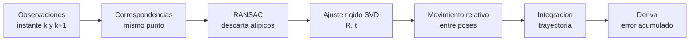

# B99-C01 — Odometría visual

<!-- nav:top -->
[🏠 Programa](../../../../README.md) · [📚 Bloque B99](../../../tronco-comun/B99-localizacion-y-mapeo-robotico.md) · [← Anterior: B98-C08 — Protocolos de relevo de control entre operadores](../../B98/B98-C08-protocolos-de-relevo-de-control-entre-operadores/CLASE.md) · [Siguiente: B99-C02 — Detección y descriptores de características →](../B99-C02-deteccion-y-descriptores-de-caracteristicas/CLASE.md)
<!-- /nav -->

## 1. Ubicación, nivel y alcance

Clase 1 del bloque B99. Nivel N3. Un rover en Marte no tiene GPS: sus ruedas patinan en la arena y su estimación de movimiento por ruedas se degrada. La **odometría visual** estima el movimiento propio del vehículo comparando lo que ve en instantes consecutivos (F6). Aquí la reduces a su núcleo geométrico en 2D: dos observaciones del mismo conjunto de puntos de referencia, un **ajuste de cuerpo rígido** que da el movimiento entre ambas, **RANSAC** para descartar correspondencias erróneas y la **integración** de los movimientos para medir cuánta **deriva** se acumula. Todos los datos son **sintéticos**: no son imágenes ni datos de un rover.

## 2. Por qué esta clase existe

Una trayectoria se obtiene sumando movimientos pequeños, y cada uno trae un error; esos errores no se corrigen solos. La decisión central: **¿con qué calidad de correspondencias y de medida puedo confiar en la odometría, y cuándo necesito corregirla con cierres de bucle (C04)?**

## 3. Lo que podrás hacer al terminar

1. Estimar el movimiento relativo entre dos conjuntos de puntos con el ajuste de Kabsch por SVD.
2. Comprobar que, sin ruido, el ajuste recupera el movimiento exacto.
3. Rechazar correspondencias erróneas con RANSAC y medir su efecto sobre la deriva.
4. Integrar movimientos relativos en una trayectoria y medir el error de posición final.
5. Expresar la deriva como porcentaje de la distancia recorrida y relacionarla con el ruido de medida.
6. Separar lo consultado (qué es la odometría visual y por qué deriva) de lo sintético.

La evidencia es la **ficha de deriva de una trayectoria estimada** del ejercicio 12 (sección 20).

## 4. Con qué llegas y cómo comprobarlo

1. ¿Qué es una transformación rígida en 2D y cuántos parámetros tiene?
2. ¿Qué hace la descomposición en valores singulares (SVD) de una matriz?
3. ¿Qué es un valor atípico (outlier)?
4. ¿Qué es un marco de referencia del cuerpo?
5. ¿Qué es una comprobación independiente?

<details>
<summary>Ver respuestas</summary>

1. Un giro y un desplazamiento; tres parámetros (`θ`, `tx`, `ty`). 2. La factoriza como `U Σ Vᵀ`; permite hallar la rotación que mejor alinea dos nubes de puntos. 3. Un dato que no sigue el modelo, por ejemplo una correspondencia errónea. 4. Un sistema de ejes fijo al robot; aquí `x` apunta hacia adelante. 5. Calcular lo mismo por otra vía y comparar.
</details>

Con cuatro o cinco aciertos, sigue; si no, repasa los prerrequisitos.

## 5. Un caso de contexto y casos de referencia

Un robot recorre un lazo cuadrado de 80 m en pasos de 0,5 m (160 pasos). En cada paso observa, en su propio marco, los puntos de referencia a menos de 8 m, con ruido de 2 cm. Con 20 % de correspondencias erróneas y sin RANSAC, la pose final queda a **7,06 m** del origen (8,82 % del recorrido); con RANSAC, a **0,23 m** (0,29 %). Sin ruido ni atípicos el error es del orden de `10⁻¹⁴ m`. Los datos son **sintéticos**.

## 6. Vocabulario

**Odometría visual:** estimación del movimiento propio a partir de imágenes (F6). **Correspondencia:** par de observaciones del mismo punto en dos instantes. **Ajuste de cuerpo rígido:** transformación `(R, t)` que mejor lleva un conjunto al otro. **RANSAC:** ajusta con muestras mínimas aleatorias y se queda con el modelo de más inliers. **Inlier / atípico:** correspondencia consistente / inconsistente con el modelo. **Deriva:** error acumulado al integrar movimientos (F6). **Marco del cuerpo:** ejes fijos al robot.

## 7. Modelo mental: del par de observaciones a la trayectoria



*Descripción textual:* de las observaciones de dos instantes se forman correspondencias; RANSAC descarta las erróneas; el ajuste por SVD da el movimiento relativo; la integración de esos movimientos da la trayectoria, cuyo error crece con cada paso.

Analogía: caminar con los ojos cerrados contando pasos: cada paso tiene un error pequeño y, al sumarlos, terminas lejos del destino. Límite: aquí el error de cada paso es aleatorio y de media cero, y la odometría real también tiene sesgos (por ejemplo, de escala).

## 8. La explicación, paso a paso

### 8.1 Qué dicen las fuentes

Scaramuzza y Fraundorfer (F6) definen la odometría visual (VO) como la estimación del egomovimiento de un agente usando solo las imágenes de una o varias cámaras, por analogía con la odometría de ruedas. Señalan que, como el camino se calcula pose tras pose, los errores de cada movimiento se acumulan y hacen que la trayectoria estimada se aleje de la real (deriva), y que una forma de reducirla es la optimización local sobre las últimas `m` poses (ajuste de haces en ventana). Describen RANSAC como el esquema habitual de rechazo de atípicos en el paso de estimación del movimiento. Cadena et al. (F1) sitúan la odometría dentro del problema más amplio de SLAM. De F6 solo se consultaron la introducción y las secciones sobre RANSAC y deriva; el resto del tutorial no.

### 8.2 Ajuste de cuerpo rígido

Dadas dos nubes de puntos `P` (instante `k`) y `Q` (instante `k+1`), ambas en el marco del cuerpo, se busca `Q ≈ R P + t`. Se restan los centroides `μ_P`, `μ_Q`, se forma `H = Σ (p − μ_P)(q − μ_Q)ᵀ`, se calcula `H = U Σ Vᵀ` y `R = V diag(1, det(V Uᵀ)) Uᵀ`, `t = μ_Q − R μ_P`. El movimiento del cuerpo es la pose inversa: el robot se movió `−Rᵀ t` y giró `−θ`. Esta relación es estándar y la comprueba el laboratorio (el trabajo original de Horn y Umeyama no se consultó). Sin ruido el error de posición es `1,15×10⁻¹⁴ m`.

### 8.3 RANSAC

Se eligen 2 correspondencias al azar (basta para fijar un movimiento 2D rígido), se ajusta `(R, t)`, se cuentan los inliers (error `< 0,10 m`) y tras 60 hipótesis se reajusta con los inliers de la mejor. Con una fracción `ε` de atípicos, la probabilidad de que una muestra de 2 puntos sea limpia es `(1 − ε)²`: con `ε = 0,2` es 0,64 y con 60 hipótesis la probabilidad de no obtener ninguna limpia es `0,36⁶⁰ ≈ 10⁻²⁷`.

### 8.4 Integración y deriva

La pose absoluta es la composición `x_{k+1} = x_k ⊕ u_k` de los movimientos relativos. El error de cada `u_k` se arrastra a todas las poses siguientes, y un error de giro desplaza todo lo que viene después, como un brazo de palanca. La **deriva** se expresa como el error de posición final entre la distancia recorrida: en la tabla de la sección 17, 0,18 % con ruido de 2 cm sin atípicos y 3,70 % con ruido de 10 cm y 20 % de atípicos.

## 9. Magnitudes, símbolos y unidades

| Símbolo | Qué es | Unidad | Valor / nota |
|---|---|---|---|
| `P`, `Q` | puntos en el marco del cuerpo en `k` y `k+1` | m | 300 puntos de referencia, alcance 8 m |
| `R`, `t` | rotación y traslación del ajuste | —, m | `Q ≈ R P + t` |
| `σ` | desviación típica del ruido de medida | m | 0,02; 0,05; 0,10 |
| `ε` | fracción de correspondencias erróneas | — | 0 o 0,2 |
| deriva | error de posición final / distancia recorrida | % | 0,18 a 8,82 |

## 10. Convenciones y referencias

Mundo 2D; poses `(x, y, θ)` con `θ` antihorario; marco del cuerpo con `x` hacia adelante; unidades m y rad. Umbral de inlier de RANSAC 0,10 m, 60 hipótesis. Tolerancia: sin ruido el error máximo de posición debe ser `< 10⁻⁹ m`. Los 300 puntos, el lazo, el alcance de 8 m, los ruidos y los atípicos son **sintéticos** (semilla 11; 6 corridas por configuración). La asociación entre observaciones se da por identificador, no se calcula a partir de imágenes (eso es C02).

## 11. De dónde sale lo que afirmamos

| ID | Fuente | Localizador | Respalda | Estado |
|---|---|---|---|---|
| F6 | Scaramuzza y Fraundorfer, Visual Odometry Part I: The First 30 Years and Fundamentals, IEEE Robotics & Automation Magazine — PDF https://rpg.ifi.uzh.ch/docs/VO_Part_I_Scaramuzza.pdf (consultada 2026-11-10 con PyMuPDF) | introducción y secciones sobre RANSAC y deriva | definición de odometría visual (estimar el egomovimiento solo con cámaras), uso de RANSAC para rechazar atípicos, acumulación de errores (deriva) y reducción con ajuste de haces en ventana | Consultada (año no verificado en el texto extraído) |
| F1 | Cadena, Carlone, Carrillo, Latif, Scaramuzza, Neira, Reid y Leonard, Past, Present, and Future of Simultaneous Localization and Mapping: Towards the Robust-Perception Age, IEEE Transactions on Robotics 32(6), 2016 — https://arxiv.org/abs/1606.05830 (consultada 2026-11-10) | página de arXiv (resumen) | SLAM: construir un mapa del entorno estimando a la vez la posición del robot; la revisión trata robustez, escalabilidad, representaciones métricas y semánticas y si SLAM está resuelto | Consultada (solo el resumen; no el texto completo) |
| — | Horn (1987) y Umeyama (1991) sobre el ajuste de cuerpo rígido por SVD | — | el laboratorio verifica el ajuste con casos exactos | No consultada |
| — | Fischler y Bolles (1981) sobre RANSAC | — | el laboratorio mide su efecto | No consultada |
| — | Rublee et al. (2011) sobre ORB y los trabajos de odometría visual de los rovers de Marte | — | no se consultaron | No consultada |

Límites: de F6 y F1 se consultó solo lo indicado; los números de las tablas provienen del laboratorio sintético y no de esas fuentes.

## 12. Cómo ver los resultados

| Configuración (media de 6 corridas) | Deriva final | % del recorrido |
|---|---|---|
| `σ = 0,02`, sin atípicos, sin RANSAC | 0,146 m | 0,18 |
| `σ = 0,02`, 20 % atípicos, sin RANSAC | 7,057 m | 8,82 |
| `σ = 0,02`, 20 % atípicos, con RANSAC | 0,229 m | 0,29 |
| `σ = 0,05`, 20 % atípicos, con RANSAC | 0,898 m | 1,12 |
| `σ = 0,10`, 20 % atípicos, con RANSAC | 2,962 m | 3,70 |

Descripción larga: la deriva crece con el ruido (de 0,29 % a 3,70 %) y los inliers disponibles bajan de 41,6 a 11,7 por paso porque el umbral fijo de 0,10 m rechaza cada vez más puntos buenos.

## 13. Ejemplo trabajado: la deriva de un paso con giro

**Paso 1 · Un error de giro.** Un error de `0,005 rad` en un paso, a 40 m del origen, desplaza la posición `40 × 0,005 = 0,20 m` lateralmente.
**Paso 2 · Acumulación.** Si cada uno de 160 pasos aporta un error de giro aleatorio de `0,005 rad`, el giro acumulado tiene desviación `0,005 √160 = 0,063 rad` al final.
**Paso 3 · Efecto en posición.** A 40 m de distancia, `40 × 0,063 ≈ 2,5 m`.
**Paso 4 · Comparación.** En el laboratorio de C03, con ese ruido, la odometría sola termina a 1,74 m en un caso: del orden de lo previsto.
**Paso 5 · Conclusión.** La deriva en posición está dominada por el error de giro, no por el de traslación.

## 14. Distintas formas de describir el problema

**Por geometría:** ajuste `(R, t)` entre nubes de puntos (esta clase). **Por haces de rayos:** minimizar el error de reproyección en imagen (F6, ajuste de haces; no se desarrolla aquí). **Por optimización global:** corregir la trayectoria completa con restricciones (C03). Un mismo movimiento se estima con las tres.

## 15. Práctica guiada

**Ejercicio 1 · con los pasos indicados.** Dos puntos `P₁ = (0, 0)`, `P₂ = (2, 0)` se observan en `k+1` como `Q₁ = (1, 1)`, `Q₂ = (3, 1)`. Halla `R` y `t`. *Pasos:* vector entre puntos, ángulo, traslación.

<details><summary>Solución comentada</summary>

El vector `P₂ − P₁ = (2, 0)` y `Q₂ − Q₁ = (2, 0)`: no hay giro, `R = I`. `t = Q₁ − P₁ = (1, 1)`.
</details>

**Ejercicio 2 · con una pista.** Con el resultado anterior, ¿cuánto se movió el robot? *Pista:* el movimiento del cuerpo es la inversa de la transformación de los puntos.

<details><summary>Solución comentada</summary>

El robot se movió `−Rᵀ t = (−1, −1)`: los puntos parecen moverse `(+1, +1)` porque el robot se desplazó `(−1, −1)` en su propio marco.
</details>

**Ejercicio 3 · casi autónomo.** Con una fracción de atípicos `ε = 0,3` y muestras de 2 puntos, ¿cuántas hipótesis hacen falta para que la probabilidad de no hallar una muestra limpia sea `< 10⁻³`?

<details><summary>Solución comentada</summary>

Una muestra es limpia con `0,7² = 0,49`. Se pide `0,51ⁿ < 10⁻³`: `n > ln(10⁻³)/ln(0,51) = 10,3`; bastan 11 hipótesis.
</details>

## 16. Práctica autónoma, transferencia e integrador

**Ejercicio 4 · autónomo.** Si el ruido de medida se duplica, ¿cómo cambia, cualitativamente, el número de inliers con umbral fijo?

<details><summary>Solución comentada</summary>

Disminuye: más puntos buenos quedan fuera del umbral (tabla: 41,6 inliers con `σ = 0,02`, 27,1 con 0,05 y 11,7 con 0,10).
</details>

**Ejercicio 5 · autónomo.** ¿Por qué la deriva se expresa en porcentaje de la distancia recorrida?

<details><summary>Solución comentada</summary>

Porque el error acumulado crece con la distancia; el cociente permite comparar recorridos de distinta longitud y estimadores distintos.
</details>

**Ejercicio 6 · autónomo.** Un robot mueve 0,5 m por paso y comete un error de giro de `0,002 rad` en cada uno, siempre con el mismo signo. ¿Qué forma tiene la trayectoria?

<details><summary>Solución comentada</summary>

Un arco de radio `0,5/0,002 = 250 m`: el sesgo constante curva el camino; el ruido de media cero no lo curva, lo dispersa.
</details>

**Ejercicio 7 · autónomo.** Calcula el error de posición tras 160 pasos si hay un error de escala de 1 % (cada paso mide 0,505 m en lugar de 0,5 m) en línea recta.

<details><summary>Solución comentada</summary>

`160 × 0,005 = 0,8 m`.
</details>

**Ejercicio 8 · autónomo.** ¿Por qué usar 2 puntos como muestra mínima en 2D y no 3?

<details><summary>Solución comentada</summary>

Un movimiento rígido 2D tiene 3 parámetros y cada punto da 2 ecuaciones; con 2 puntos hay 4 ecuaciones, más que suficiente; menos puntos por muestra aumentan la probabilidad de muestras limpias.
</details>

**Ejercicio 9 · transferencia.** **Transferencia.** Un colega afirma que su sistema tiene «0,3 % de deriva en Marte» tras ejecutar este laboratorio. ¿Es válido?

<details><summary>Solución comentada</summary>

No: los datos son sintéticos, 2D y con ruido gaussiano; la deriva real depende del terreno, la luz y el sensor, y no se consultó ningún dato de rover.
</details>

**Ejercicio 10 · transferencia.** **Transferencia.** En una zona de arena fina el rover patina y la odometría de ruedas falla. ¿Qué ventaja da la odometría visual y qué riesgo conserva?

<details><summary>Solución comentada</summary>

Mide el movimiento real respecto del suelo (no el giro de las ruedas); conserva la deriva y falla si hay pocas características o poca luz (C07).
</details>

**Ejercicio 11 · transferencia.** **Transferencia.** Si 50 % de las correspondencias son atípicas y se usan muestras de 2 puntos, ¿qué probabilidad tiene una muestra de ser limpia y cuántas hipótesis dan una probabilidad de fallo `< 10⁻⁶`?

<details><summary>Solución comentada</summary>

`0,5² = 0,25`; `0,75ⁿ < 10⁻⁶` → `n > ln(10⁻⁶)/ln(0,75) = 48,02`; 49 hipótesis.
</details>

**Ejercicio 12 · integrador.** **Integrador.** Elabora tu *ficha de deriva de una trayectoria estimada*: tabla de configuraciones (ruido, atípicos, RANSAC), deriva en metros y en porcentaje, curva de acumulación y lista de qué es consultado, no consultado y sintético.

<details><summary>Solución comentada</summary>

Secciones 8.2–8.4, la tabla de la sección 12 y la salida del laboratorio.
</details>

## 17. Laboratorio: ajuste rígido, RANSAC y deriva

El script [odometria_visual.py](odometria_visual.py) genera 300 puntos de referencia y un lazo de 80 m, observa los puntos desde cada pose con ruido y atípicos, estima el movimiento con el ajuste de Kabsch (con y sin RANSAC), integra y mide la deriva; **comprueba** que sin ruido el error es `< 10⁻⁹ m`, que RANSAC reduce a menos de la mitad la deriva con 20 % de atípicos y que más ruido da más deriva. Usa la biblioteca común [b99_comun.py](../b99_comun.py).

**Datos:** puntos, lazo, ruido y atípicos **sintéticos** (semilla 11 y semillas 100–105). **Predice antes de ejecutar:** ¿qué pasa con la deriva si se quita RANSAC con 20 % de atípicos? (crece más de 20 veces). Ejecución del 2026-11-10 (Python 3.12.9, numpy 2.4.4):

```text
Python 3.12.9 | numpy 2.4.4
Datos SINTETICOS: 300 puntos de referencia, alcance 8 m, lazo cuadrado de 80 m de perimetro, semilla 11
Recorrido verdadero: 160 pasos, 80.0 m; la pose final vuelve al origen
Sin ruido ni atipicos: error maximo de posicion = 1.15e-14 m
sigma[m]  atipicos  RANSAC  deriva_final[m]  deriva[% de recorrido]  inliers_medios
   0.02        0%      no            0.146                   0.18            52.0
   0.02       20%      no            7.057                   8.82            52.0
   0.02       20%      si            0.229                   0.29            41.6
   0.05       20%      si            0.898                   1.12            27.1
   0.10       20%      si            2.962                   3.70            11.7
Deriva acumulada en una corrida (sigma = 0.05 m, 20 % atipicos, RANSAC):
  tras  40 pasos ( 20.0 m): error = 0.416 m
  tras  80 pasos ( 40.0 m): error = 0.596 m
  tras 120 pasos ( 60.0 m): error = 1.481 m
  tras 160 pasos ( 80.0 m): error = 1.407 m
Pruebas superadas.
```

```bash
python programa/clases/B99/B99-C01-odometria-visual/odometria_visual.py
```

**Límites:** 2D, asociación dada por identificador (no se calculan características), ruido gaussiano, sin sesgo de escala, 6 corridas por configuración (la tabla es una media, no una distribución).

## 18. Errores frecuentes y cómo corregirlos

**Confundir deriva con error de una medida.** La deriva es el efecto acumulado de muchas medidas (8.4).

**Usar mínimos cuadrados con atípicos.** Un solo par erróneo desplaza el ajuste; usa RANSAC (8.3).

**Presentar la deriva sintética como la de un rover.** Revisa la sección 10.

## 19. Cómo sabrás que vas bien

Tras la sección 8: ¿por qué un error de giro pesa más que uno de traslación? Si dudas, repasa el paso 3 de la sección 13. Tras el laboratorio: ¿qué pasa con los inliers cuando sube el ruido? (ver sección 17).

## 20. Qué entregas y cómo se evalúa

El producto es tu **ficha de deriva de una trayectoria estimada** (ejercicio 12).

| Criterio | Inicial | En desarrollo | Logrado | Destacado |
|---|---|---|---|---|
| Conceptos | Los confunde | Parciales | Explica el método y su dominio | Explica los límites y las alternativas |
| Cálculo | Sin unidades | Con errores | Resultados con unidades y comprobados | Resuelve casos nuevos |
| Numérico | Sin comprobar | Un caso | Verifica con una comprobación independiente en varios casos | Interpreta las diferencias y los fallos |
| Fuentes | Sin fuente | Sin fecha | Fuentes con fecha y estado | Declara lo sintético y lo no consultado |
| Límites | No los nombra | Uno | Tres | Discute qué falta del modelo |

**Condiciones críticas (no se compensan con promedio):** rotular los datos como sintéticos; verificar cada resultado con una comprobación independiente; citar solo lo consultado.

## 21. Ética, seguridad y límites

Clase educativa: los datos son sintéticos y el método está simplificado; no sustituye la validación con datos reales ni la revisión de especialistas antes de usar odometría en un vehículo. Accesibilidad: tablas equivalentes a las gráficas, fórmulas en texto, ejercicios sin conexión.

## 22. Para cerrar y seguir

Con ruido de 2 cm y 20 % de correspondencias erróneas, RANSAC reduce la deriva de 8,82 % a 0,29 % del recorrido; con ruido de 10 cm sube a 3,70 %. Queda una pregunta: ¿de dónde salen las correspondencias que aquí dimos por identificador?

**Glosario español–inglés.** odometría visual · *visual odometry*; deriva · *drift*; correspondencia · *correspondence*; valor atípico · *outlier*; ajuste de cuerpo rígido · *rigid-body fit*; marco del cuerpo · *body frame*.

**Continuidad.** [B99-C02](../B99-C02-deteccion-y-descriptores-de-caracteristicas/CLASE.md) trata cómo se detectan y describen las características que producen esas correspondencias.

**Referencias:** ver sección 11.

<!-- nav:bottom -->
---

[← Anterior: B98-C08 — Protocolos de relevo de control entre operadores](../../B98/B98-C08-protocolos-de-relevo-de-control-entre-operadores/CLASE.md) · [📚 Bloque B99](../../../tronco-comun/B99-localizacion-y-mapeo-robotico.md) · [Siguiente: B99-C02 — Detección y descriptores de características →](../B99-C02-deteccion-y-descriptores-de-caracteristicas/CLASE.md)
<!-- /nav -->
