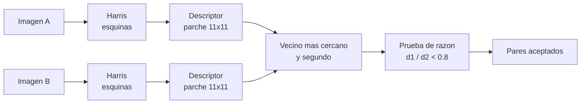

# B99-C02 — Detección y descriptores de características

<!-- nav:top -->
[🏠 Programa](../../../../README.md) · [📚 Bloque B99](../../../tronco-comun/B99-localizacion-y-mapeo-robotico.md) · [← Anterior: B99-C01 — Odometría visual](../B99-C01-odometria-visual/CLASE.md) · [Siguiente: B99-C03 — SLAM basado en grafos de poses →](../B99-C03-slam-basado-en-grafos-de-poses/CLASE.md)
<!-- /nav -->

## 1. Ubicación, nivel y alcance

Clase 2 del bloque B99. Nivel N3. La odometría visual (C01) necesita saber qué punto de una imagen es el mismo punto en otra. Eso se logra detectando **características locales** (esquinas), describiéndolas con un vector y **emparejándolas** por similitud. Aquí implementas un detector de **Harris**, un **descriptor de parche** normalizado y la **prueba de razón de distancias** descrita por Lowe (F3), y mides su precisión contra una verdad exacta. Todas las imágenes son **sintéticas**; el detector y el descriptor son versiones simples, no SIFT ni ORB.

## 2. Por qué esta clase existe

Una esquina de una roca puede verse distinta cuando cambian el brillo, el ruido o el punto de vista, y dos rocas parecidas se confunden. La decisión central: **¿qué puntos conviene usar, cómo se describen y cuándo se acepta un emparejamiento?**

## 3. Lo que podrás hacer al terminar

1. Detectar esquinas con el criterio de Harris y medir su repetibilidad entre dos vistas.
2. Construir un descriptor de parche de media cero y norma uno.
3. Emparejar por vecino más cercano y aplicar la prueba de razón de distancias.
4. Calcular precisión y exhaustividad de un emparejamiento contra una verdad conocida.
5. Explicar por qué el descriptor tolera cambios de brillo pero no una rotación.
6. Separar lo consultado (las etapas de SIFT y la razón 0,8 de Lowe) de lo sintético.

La evidencia es la **curva de precisión y exhaustividad de emparejamiento** del ejercicio 12 (sección 20).

## 4. Con qué llegas y cómo comprobarlo

1. ¿Qué es el gradiente de una imagen?
2. ¿Qué es la correlación normalizada de media cero?
3. ¿Qué miden precisión y exhaustividad?
4. ¿Qué es una matriz simétrica de `2×2` y qué son sus autovalores?
5. ¿Qué es una verdad terreno (ground truth)?

<details>
<summary>Ver respuestas</summary>

1. El vector de variación de intensidad en `x` e `y`; es grande en bordes y esquinas. 2. El producto escalar de dos parches tras restar su media y dividir por su norma; vale 1 si coinciden salvo ganancia y sesgo. 3. Precisión: fracción de lo aceptado que es correcto; exhaustividad: fracción de lo correcto que se aceptó. 4. Una matriz igual a su transpuesta; sus autovalores dan las curvaturas principales. 5. El valor correcto conocido con el que se compara un resultado.
</details>

Con cuatro o cinco aciertos, sigue; si no, repasa los prerrequisitos.

## 5. Un caso de contexto y casos de referencia

Dos recortes de 160×160 px de un mismo mundo sintético, desplazados `(−5, +7)` px y con ruido de 2 niveles: el detector halla 83 puntos en A y 86 en B; **99,51 %** de los de A se repiten en B, y con razón 0,8 se aceptan 50,8 pares de los cuales **97,24 %** son correctos. Sin prueba de razón se aceptan 82,0 pares y la precisión baja a **69,99 %**. Los datos son **sintéticos**.

## 6. Vocabulario

**Característica local:** punto distintivo de una imagen y su entorno. **Esquina:** punto donde la intensidad varía en dos direcciones. **Tensor de estructura:** matriz `M` de productos de gradientes promediados en una ventana. **Descriptor:** vector que resume el parche alrededor del punto. **Razón de distancias:** distancia al vecino más cercano entre la del segundo más cercano (F3). **Repetibilidad:** fracción de puntos de una imagen que se detectan también en la otra. **Precisión y exhaustividad:** ver sección 4.

## 7. Modelo mental: detectar, describir, emparejar



*Descripción textual:* cada imagen produce esquinas y un descriptor por esquina; se busca para cada descriptor de A el vecino más cercano y el segundo más cercano en B, y solo se acepta el par si el primero es claramente mejor que el segundo.

Analogía: reconocer a una persona en dos fotos: si hay una sola que se le parece, es ella; si hay dos igual de parecidas, mejor no apostar. Límite: aquí la «semejanza» es una distancia entre vectores de 121 números, no una impresión.

## 8. La explicación, paso a paso

### 8.1 Qué dicen las fuentes

Lowe (F3) describe SIFT en cuatro etapas: extremos en el espacio de escala con diferencias de gaussianas, localización de puntos clave, asignación de orientación y descriptor a partir de gradientes locales. Para emparejar, compara la distancia al vecino más cercano con la del segundo más cercano; con una base de 40 000 puntos y un umbral de 0,8 reporta que se eliminan el 90 % de los falsos emparejamientos y se descartan menos del 5 % de los correctos. ORB-SLAM (F7) usa el mismo conjunto de características para seguimiento, mapeo, relocalización y cierre de bucles. De F3 se consultaron el resumen, la sección 7 y la figura 11; no se consultó el artículo original de Harris y Stephens ni el de ORB.

### 8.2 Detector de Harris

Se suaviza la imagen, se calculan los gradientes `I_x`, `I_y` y el tensor `M = G_σ ∗ [[I_x², I_x I_y],[I_x I_y, I_y²]]`. La respuesta es `R = det(M) − k·tr(M)²` con `k = 0,05` (valor del laboratorio). `R` grande y positivo indica esquina (dos autovalores grandes); negativo, borde; pequeño, zona plana. Se suprimen los no máximos en `5×5` y se conservan hasta 150 puntos.

### 8.3 Descriptor y emparejamiento

El descriptor es el parche `11×11` alrededor del punto, restándole su media y dividiéndolo por su norma: es invariante a `I → g I + b` (ganancia y sesgo de brillo). La distancia euclídea entre dos descriptores unitarios es `√(2 − 2ρ)`, con `ρ` la correlación. Para cada descriptor de A se toman los dos vecinos más cercanos `d₁ ≤ d₂` en B y se acepta si `d₁/d₂ < τ`.

### 8.4 Qué mide cada número

Un par es **correcto** si el punto de B cae a `≤ 2 px` de la posición verdadera (el desplazamiento exacto). Precisión `= correctos/aceptados`; exhaustividad `= correctos/(puntos de A repetidos en B)`. Con ruido 6 y razón 0,8, el laboratorio da precisión 94,70 % y exhaustividad 50,46 %: aceptar menos pares da más precisión y menos exhaustividad.

### 8.5 Un límite visible

El parche no está orientado: si B se gira 90°, el detector sigue hallando las esquinas (repetibilidad 100 %) pero los emparejamientos fallan (precisión 0 %). Lowe (F3) resuelve esto asignando a cada punto una orientación dominante y describiendo el parche respecto de ella; aquí no se implementa.

## 9. Magnitudes, símbolos y unidades

| Símbolo | Qué es | Unidad | Valor / nota |
|---|---|---|---|
| `I(r, c)` | intensidad de la imagen | niveles 0–255 | recortes de 160×160 px |
| `σ` | ruido gaussiano de la imagen | niveles | 0; 2; 6; 12 |
| `M`, `R` | tensor de estructura y respuesta de Harris | — | `k = 0,05` |
| `τ` | umbral de la razón de distancias | — | 0,6; 0,8; sin prueba |
| `d₁`, `d₂` | distancias al 1.º y 2.º vecino | — | descriptores unitarios |
| tolerancia | error admitido de posición | px | 2 |

## 10. Convenciones y referencias

Imagen 2D; eje de filas hacia abajo; unidades px y niveles de intensidad 0–255. Desplazamiento verdadero de B respecto de A: `(−5, +7)` px (el punto `(r, c)` de A está en `(r − 5, c + 7)` de B). Tolerancias: sin ruido la repetibilidad debe ser `> 99,9 %`; la precisión con `τ = 0,8` debe ser `> 95 %`. El mundo, el ruido y el desplazamiento son **sintéticos** (semilla 5; promedios de 5 semillas). No es SIFT, ORB ni un detector de imágenes reales.

## 11. De dónde sale lo que afirmamos

| ID | Fuente | Localizador | Respalda | Estado |
|---|---|---|---|---|
| F3 | Lowe, Distinctive Image Features from Scale-Invariant Keypoints, International Journal of Computer Vision, 2004 — PDF https://www.cs.ubc.ca/~lowe/papers/ijcv04.pdf (consultada 2026-11-10 con PyMuPDF) | resumen, sección 7 y figura 11 | cuatro etapas (extremos en espacio de escala, localización, orientación, descriptor); la razón distancia al vecino más cercano / segundo más cercano; con umbral 0.8 se eliminan 90 % de los falsos emparejamientos y se descartan menos de 5 % de los correctos (base de 40 000 puntos) | Consultada |
| F7 | Mur-Artal, Montiel y Tardós, ORB-SLAM: a Versatile and Accurate Monocular SLAM System, IEEE Transactions on Robotics, 2015 (DOI 10.1109/TRO.2015.2463671) — PDF https://arxiv.org/pdf/1502.00956 (consultada 2026-11-10 con PyMuPDF) | resumen | las mismas características sirven para seguimiento, mapeo, relocalización y cierre de bucles | Consultada (resumen e introducción) |
| — | Harris y Stephens (1988) sobre el detector de esquinas | — | el laboratorio verifica la repetibilidad con una verdad exacta | No consultada |
| — | Rublee et al. (2011) sobre ORB y los trabajos de odometría visual de los rovers de Marte | — | no se consultaron | No consultada |

Límites: de F3 no se consultó el desarrollo completo de SIFT; las cifras de la sección 12 son del laboratorio sintético, no de F3 (la razón 0,8 y el 90 %/5 % sí son de F3).

## 12. Cómo ver los resultados

| Ruido `σ` | Razón `τ` | Pares | Precisión | Exhaustividad | Repetibilidad |
|---|---|---|---|---|---|
| 2 | 0,6 | 47,8 | 97,95 % | 58,80 % | 99,51 % |
| 2 | 0,8 | 50,8 | 97,24 % | 62,05 % | 99,51 % |
| 2 | sin prueba | 82,0 | 69,99 % | 72,10 % | 99,51 % |
| 6 | 0,6 | 32,4 | 95,16 % | 39,21 % | 98,01 % |
| 6 | 0,8 | 41,8 | 94,70 % | 50,46 % | 98,01 % |
| 6 | sin prueba | 82,0 | 62,42 % | 65,28 % | 98,01 % |
| 12 | 0,6 | 10,2 | 96,33 % | 12,99 % | 94,98 % |
| 12 | 0,8 | 23,8 | 85,81 % | 27,12 % | 94,98 % |
| 12 | sin prueba | 81,4 | 49,15 % | 53,14 % | 94,98 % |

Descripción larga: con la prueba de razón la precisión es siempre mayor, y con más ruido bajan los pares aceptados (de 50,8 a 23,8 con `τ = 0,8`).

## 13. Ejemplo trabajado: Harris y razón de distancias con números

**Paso 1 · Esquina frente a borde.** Con `k = 0,05`: `M = diag(4, 4)` da `R = 16 − 0,05·64 = 12,8` (esquina); `M = diag(9, 0,1)` da `R = 0,9 − 0,05·82,81 = −3,24` (borde).
**Paso 2 · Distancias.** Un descriptor tiene `d₁ = 0,30` y `d₂ = 0,50`: razón 0,60, se acepta con `τ = 0,8`. Otro tiene `d₁ = 0,45`, `d₂ = 0,50`: razón 0,90, se rechaza.
**Paso 3 · Correlación.** `d = √(2 − 2ρ)`: `d = 0,30` equivale a `ρ = 0,955`.
**Paso 4 · Resultado.** En el laboratorio con `σ = 6`, el filtro elimina el 49 % de los pares (de 82,0 a 41,8) y sube la precisión de 62,42 % a 94,70 %.

## 14. Distintas formas de describir el problema

**Por esquinas (esta clase):** puntos con dos direcciones de gradiente. **Por manchas:** extremos de diferencias de gaussianas en el espacio de escala (SIFT, F3). **Por descriptores binarios:** comparaciones de intensidad (familia ORB; no se desarrolla ni se consultó el artículo original). Todas buscan lo mismo: puntos que se detectan en ambas vistas y se describen de forma estable.

## 15. Práctica guiada

**Ejercicio 1 · con los pasos indicados.** Calcula `R` de Harris para `M = diag(4, 1)` con `k = 0,05`. *Pasos:* determinante, traza, fórmula.

<details><summary>Solución comentada</summary>

`det = 4`, `tr = 5`: `R = 4 − 0,05·25 = 2,75`; positivo, esquina débil.
</details>

**Ejercicio 2 · con una pista.** Un parche `p` y otro `q = 2p + 10`. ¿Cuánto vale su correlación normalizada de media cero? *Pista:* el descriptor resta la media y normaliza.

<details><summary>Solución comentada</summary>

`1`: la ganancia 2 y el sesgo 10 desaparecen al restar la media y dividir por la norma.
</details>

**Ejercicio 3 · casi autónomo.** Con `τ = 0,8`, ¿se aceptan pares con `(d₁, d₂) = (0,2; 0,3)` y `(0,4; 0,45)`?

<details><summary>Solución comentada</summary>

`0,2/0,3 = 0,67` se acepta; `0,4/0,45 = 0,89` se rechaza.
</details>

## 16. Práctica autónoma, transferencia e integrador

**Ejercicio 4 · autónomo.** Con `σ = 6`, ¿cuántos puntos de precisión se ganan al pasar de «sin prueba» a `τ = 0,8` y cuántos pares se pierden?

<details><summary>Solución comentada</summary>

`94,70 − 62,42 = 32,3` puntos; de 82,0 a 41,8 pares: 40,2 pares menos.
</details>

**Ejercicio 5 · autónomo.** ¿Por qué baja la exhaustividad cuando `τ` pasa de 0,8 a 0,6?

<details><summary>Solución comentada</summary>

Porque se aceptan menos pares: solo los muy distintivos (con `σ = 6`: 39,21 % frente a 50,46 %).
</details>

**Ejercicio 6 · autónomo.** ¿Qué pasa con el descriptor si el parche es perfectamente constante?

<details><summary>Solución comentada</summary>

La norma tras restar la media es 0 y la división falla; sin textura no hay descriptor útil (por eso el laboratorio suma `10⁻¹²` al denominador).
</details>

**Ejercicio 7 · autónomo.** Propón un arreglo para que el descriptor tolere una rotación de 90° y justifícalo con F3.

<details><summary>Solución comentada</summary>

Asignar a cada punto una orientación dominante a partir de los gradientes y describir el parche respecto de ella (etapa 3 de SIFT, F3).
</details>

**Ejercicio 8 · autónomo.** En el caso sin ruido hubo 83 pares con 98 % de precisión. ¿Cuántos son correctos?

<details><summary>Solución comentada</summary>

`0,98 × 83 ≈ 81`.
</details>

**Ejercicio 9 · transferencia.** **Transferencia.** Un colega afirma que «el detector acierta 99,5 % en Marte». ¿Es válido?

<details><summary>Solución comentada</summary>

No: el 99,51 % es repetibilidad en una imagen sintética con desplazamiento puro y ruido gaussiano; no se consultaron imágenes de ninguna misión.
</details>

**Ejercicio 10 · transferencia.** **Transferencia.** En un campo de ondulaciones (ripples) casi idénticas, ¿cómo afecta la prueba de razón?

<details><summary>Solución comentada</summary>

Muchos descriptores tienen `d₁ ≈ d₂`, la razón se acerca a 1 y se rechazan: se pierden pares, pero se evitan falsos (compromiso entre exhaustividad y precisión).
</details>

**Ejercicio 11 · transferencia.** **Transferencia.** Lowe (F3) reporta 90 % de falsos eliminados con `τ = 0,8` en su base de 40 000 puntos. ¿Puedes concluir que aquí ocurre lo mismo?

<details><summary>Solución comentada</summary>

No: el laboratorio usa otros datos y otro descriptor; solo coincide la dirección del efecto (la precisión sube), no las cifras.
</details>

**Ejercicio 12 · integrador.** **Integrador.** Elabora tu *curva de precisión y exhaustividad de emparejamiento*: tabla por ruido y razón, caso sin ruido, caso con cambio de brillo, caso con rotación y lista de qué es consultado, no consultado y sintético.

<details><summary>Solución comentada</summary>

Sección 12 y la salida del laboratorio.
</details>

## 17. Laboratorio: Harris, descriptor de parche y razón de distancias

El script [caracteristicas.py](caracteristicas.py) genera un mundo sintético y dos recortes con un desplazamiento conocido, detecta esquinas de Harris, las describe con un parche normalizado, empareja con y sin prueba de razón y mide repetibilidad, precisión y exhaustividad; **comprueba** que sin ruido la repetibilidad es `> 99,9 %`, que la prueba de razón sube la precisión, que más ruido no la mejora, que el cambio de brillo se tolera y que la rotación de 90° rompe el descriptor. Usa la biblioteca común [b99_comun.py](../b99_comun.py).

**Datos:** imagen, ruido y desplazamiento **sintéticos** (semilla 5). **Predice antes de ejecutar:** ¿cuál será la repetibilidad sin ruido? (100 %). Ejecución del 2026-11-10 (Python 3.12.9, numpy 2.4.4):

```text
Python 3.12.9 | numpy 2.4.4
Datos SINTETICOS: imagen de 200x200 px, recorte A y recorte B desplazado (fila -5, columna +7), semilla 5
Sin ruido: puntos A = 83, B = 86, repetibilidad = 100%, emparejamientos = 83, precision = 98%, exhaustividad = 100%
sigma[niv]  razon   n_pares  precision  exhaustividad  repetibilidad
      2.0        0.60     47.8     97.95%         58.80%         99.51%
      2.0        0.80     50.8     97.24%         62.05%         99.51%
      2.0  sin prueba     82.0     69.99%         72.10%         99.51%
      6.0        0.60     32.4     95.16%         39.21%         98.01%
      6.0        0.80     41.8     94.70%         50.46%         98.01%
      6.0  sin prueba     82.0     62.42%         65.28%         98.01%
     12.0        0.60     10.2     96.33%         12.99%         94.98%
     12.0        0.80     23.8     85.81%         27.12%         94.98%
     12.0  sin prueba     81.4     49.15%         53.14%         94.98%
Cambio de brillo (ganancia 1.4, sesgo -30): precision = 94% frente a 94% sin cambio
Imagen B girada 90 grados: repetibilidad = 100%, pares = 15, precision = 0% (el parche no es invariante a la rotacion)
Pruebas superadas.
```

```bash
python programa/clases/B99/B99-C02-deteccion-y-descriptores-de-caracteristicas/caracteristicas.py
```

**Límites:** descriptor sin orientación ni escala, desplazamiento puro sin rotación ni escala reales, ruido gaussiano, una sola imagen de base (promedios de 5 semillas de ruido); no es SIFT ni ORB.

## 18. Errores frecuentes y cómo corregirlos

**Confundir repetibilidad con precisión de emparejamiento.** La primera es del detector; la segunda, del par detector–descriptor–regla (8.4).

**Aceptar todos los vecinos más cercanos.** Sin prueba de razón la precisión cae (sección 12).

**Presentar la tasa sintética como la de una cámara real.** Revisa la sección 10.

## 19. Cómo sabrás que vas bien

Tras la sección 8: ¿qué le pasa a la precisión al estrechar `τ` y qué le pasa a la exhaustividad? Si dudas, repasa el ejercicio 5. Tras el laboratorio: ¿por qué falla la rotación de 90° aunque el detector funcione? (ver sección 17).

## 20. Qué entregas y cómo se evalúa

El producto es tu **curva de precisión y exhaustividad de emparejamiento** (ejercicio 12).

| Criterio | Inicial | En desarrollo | Logrado | Destacado |
|---|---|---|---|---|
| Conceptos | Los confunde | Parciales | Explica el método y su dominio | Explica los límites y las alternativas |
| Cálculo | Sin unidades | Con errores | Resultados con unidades y comprobados | Resuelve casos nuevos |
| Numérico | Sin comprobar | Un caso | Verifica con una comprobación independiente en varios casos | Interpreta las diferencias y los fallos |
| Fuentes | Sin fuente | Sin fecha | Fuentes con fecha y estado | Declara lo sintético y lo no consultado |
| Límites | No los nombra | Uno | Tres | Discute qué falta del modelo |

**Condiciones críticas (no se compensan con promedio):** rotular los datos como sintéticos; verificar cada resultado con una comprobación independiente; citar solo lo consultado.

## 21. Ética, seguridad y límites

Clase educativa: el detector y el descriptor están simplificados y las imágenes son sintéticas; no sustituyen la validación con imágenes reales ni con la biblioteca que use el proyecto. Accesibilidad: tablas equivalentes a las gráficas, fórmulas en texto, ejercicios sin conexión.

## 22. Para cerrar y seguir

Con ruido moderado, el detector repite 98 % de sus esquinas y la prueba de razón lleva la precisión de 62,42 % a 94,70 %; el descriptor no sobrevive a una rotación. Queda una pregunta: una vez que hay correspondencias y movimientos relativos, ¿cómo se fusionan todos en un único mapa?

**Glosario español–inglés.** característica local · *local feature*; esquina · *corner*; descriptor · *descriptor*; prueba de razón · *ratio test*; repetibilidad · *repeatability*; precisión · *precision*; exhaustividad · *recall*.

**Continuidad.** [B99-C03](../B99-C03-slam-basado-en-grafos-de-poses/CLASE.md) plantea el SLAM como un grafo de poses que se optimiza.

**Referencias:** ver sección 11.

<!-- nav:bottom -->
---

[← Anterior: B99-C01 — Odometría visual](../B99-C01-odometria-visual/CLASE.md) · [📚 Bloque B99](../../../tronco-comun/B99-localizacion-y-mapeo-robotico.md) · [Siguiente: B99-C03 — SLAM basado en grafos de poses →](../B99-C03-slam-basado-en-grafos-de-poses/CLASE.md)
<!-- /nav -->
