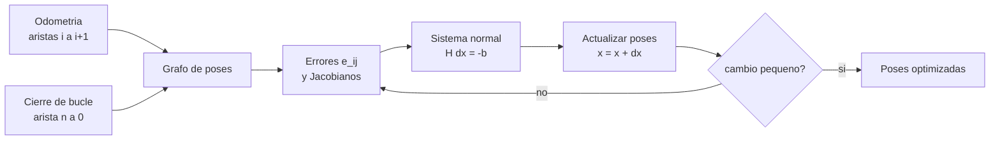

# B99-C03 — SLAM basado en grafos de poses

<!-- nav:top -->
[🏠 Programa](../../../../README.md) · [📚 Bloque B99](../../../tronco-comun/B99-localizacion-y-mapeo-robotico.md) · [← Anterior: B99-C02 — Detección y descriptores de características](../B99-C02-deteccion-y-descriptores-de-caracteristicas/CLASE.md) · [Siguiente: B99-C04 — Cierre de bucles y consistencia global →](../B99-C04-cierre-de-bucles-y-consistencia-global/CLASE.md)
<!-- /nav -->

## 1. Ubicación, nivel y alcance

Clase 3 del bloque B99. Nivel N3. Las estimaciones de movimiento (C01) se acumulan con deriva. El **SLAM basado en grafos** las guarda como un **grafo**: cada **nodo** es una pose del robot y cada **arista** es una restricción (una medida de movimiento relativo con su incertidumbre). Optimizar el grafo encuentra las poses que mejor satisfacen todas las restricciones a la vez (F4). Aquí construyes el grafo de un lazo de 80 m, derivas el error de arista y su Jacobiano, lo resuelves con **Gauss–Newton** y verificas el resultado. Todos los datos son **sintéticos**.

## 2. Por qué esta clase existe

Sumar movimientos da una trayectoria que no cierra el lazo; una medida de cierre de bucle dice que la pose final es la inicial. La decisión central: **¿cómo repartir el desacuerdo entre cientos de poses de modo coherente con la incertidumbre de cada medida?**

## 3. Lo que podrás hacer al terminar

1. Plantear el grafo de poses con nodos, aristas, medidas e información.
2. Escribir el error de arista `e_ij` y su Jacobiano analítico, y comprobarlo con diferencias finitas.
3. Resolver con Gauss–Newton y leer la caída del `χ²`.
4. Verificar que, sin ruido, el óptimo es la verdad y que, con ruido consistente, `χ² ≈ grados de libertad`.
5. Explicar por qué sin cierre de bucle la optimización no cambia nada.
6. Separar lo consultado (la formulación de F4) de lo sintético.

La evidencia es la **grafo de poses optimizado con su ATE** del ejercicio 12 (sección 20).

## 4. Con qué llegas y cómo comprobarlo

1. ¿Qué es una matriz de información?
2. ¿Qué es el método de Gauss–Newton?
3. ¿Qué es un Jacobiano?
4. ¿Cómo se compone una pose `(x, y, θ)` con otra?
5. ¿Qué es el `χ²` de un ajuste?

<details>
<summary>Ver respuestas</summary>

1. La inversa de la covarianza; pondera cada componente del error por su certeza. 2. Minimiza una suma de cuadrados linealizando el error en torno de la estimación y resolviendo el sistema normal. 3. La matriz de derivadas parciales del error respecto de las incógnitas. 4. `a ⊕ b = a_xy + R(a_θ) b_xy`, `a_θ + b_θ`. 5. La suma `eᵀ Ω e` de los errores ponderados; para un modelo consistente vale, en media, los grados de libertad.
</details>

Con cuatro o cinco aciertos, sigue; si no, repasa los prerrequisitos.

## 5. Un caso de contexto y casos de referencia

Lazo cuadrado de 80 m con 161 poses, ruido de odometría de 2 cm y 0,005 rad por paso y una arista de cierre entre la última pose y la primera. La odometría sola termina a **1,741 m** del origen (ATE 0,576 m); tras optimizar, a **0,028 m** (ATE 0,172 m), con el `χ²` cayendo de 7 603,3 a 4,2 en dos iteraciones. Con 50 semillas, el `χ²` final medio es **2,77** frente a 3 grados de libertad. Los datos son **sintéticos**.

## 6. Vocabulario

**Grafo de poses:** nodos = poses, aristas = restricciones relativas (F4). **Medida `z_ij`:** pose relativa medida entre `i` y `j`. **Información `Ω_ij`:** inversa de la covarianza de la medida. **Error de arista `e_ij`:** diferencia entre la medida y la predicción `x_i⁻¹ ⊕ x_j`. **Gauss–Newton:** iteración que linealiza y resuelve `H Δx = −b`. **Ancla:** pose fija que elimina la libertad de colocar el grafo en cualquier lugar. **ATE:** error absoluto de trayectoria (C06).

## 7. Modelo mental: de las restricciones al mapa



*Descripción textual:* la odometría y el cierre de bucle forman aristas del grafo; se calculan los errores y sus Jacobianos, se resuelve el sistema normal, se actualizan las poses y se repite hasta que el cambio es pequeño.

Analogía: una red de resortes entre clavos: cada resorte tira para cumplir su medida y la posición final de los clavos es el equilibrio. Límite: aquí los resortes tienen rigideces distintas (la información) y se linealizan en cada iteración.

## 8. La explicación, paso a paso

### 8.1 Qué dicen las fuentes

Grisetti et al. (F4) formulan el SLAM como un grafo: los nodos son las poses `x_i`, una arista `(i, j)` lleva una medida virtual `z_ij` (la transformación que hace coincidir las observaciones de `i` y de `j`) con su matriz de información `Ω_ij`, y el error `e_ij(x_i, x_j)` es la diferencia entre la medida y la predicha. Se minimiza la suma de los errores ponderados con Gauss–Newton o Levenberg–Marquardt, linealizando el error con su Jacobiano; los sistemas son dispersos y se resuelven con factorizaciones dispersas. Un cierre de bucle añade una arista entre poses distantes en el tiempo. Cadena et al. (F1) sitúan esta formulación como la estándar de SLAM. De F4 se consultaron la formulación y la minimización; no se leyó la parte de aplicaciones completa.

### 8.2 Error y Jacobiano

Con `R_i = R(θ_i)`: `e_ij = ( R_iᵀ (t_j − t_i) − z_xy ,  wrap(θ_j − θ_i − z_θ) )`. Las derivadas son `∂e_xy/∂t_i = −R_iᵀ`, `∂e_xy/∂θ_i = (dR_iᵀ/dθ)(t_j − t_i)`, `∂e_xy/∂t_j = R_iᵀ`, `∂e_θ/∂θ_i = −1`, `∂e_θ/∂θ_j = +1`. El laboratorio las compara con diferencias finitas centradas: diferencia máxima `1,23×10⁻⁹`.

### 8.3 Gauss–Newton

Con `J` el Jacobiano de todas las aristas: `H = Σ Jᵀ Ω J`, `b = Σ Jᵀ Ω e` y `Δx = −H⁻¹ b`; se actualiza `x ← x + Δx` y se repite. Se fija la primera pose (ancla); sin ella `H` es singular, porque el coste no cambia al mover todo el grafo rígidamente. En el laboratorio se resuelve un sistema denso de `480 × 480`.

### 8.4 Comprobaciones

(i) Sin ruido y partiendo de una estimación perturbada, el `χ²` cae de `1,9×10⁵` a `6,6×10⁻²⁶` en 5 iteraciones y el error máximo es `4×10⁻¹⁵ m`. (ii) Con ruido consistente con `Ω`, el `χ²` esperado en el óptimo son los **grados de libertad**: `3 · 161 aristas − 3 · 160 incógnitas = 3`; con 50 semillas el promedio es 2,77. (iii) Sin la arista de cierre, la cadena de odometría ya cumple todas sus restricciones (`χ² ≈ 0`) y no se mueve nada.

## 9. Magnitudes, símbolos y unidades

| Símbolo | Qué es | Unidad | Valor / nota |
|---|---|---|---|
| `x_i` | pose `(x, y, θ)` del nodo `i` | m, m, rad | 161 nodos |
| `z_ij` | pose relativa medida | m, m, rad | paso 0,5 m |
| `Ω_ij` | información de la medida | m⁻², rad⁻² | `diag(1/σ_t², 1/σ_t², 1/σ_r²)` |
| `σ_t`, `σ_r` | ruido de odometría por paso | m, rad | 0,02; 0,005 |
| `χ²` | suma `eᵀ Ω e` | — | 3 grados de libertad |
| ATE | error absoluto de trayectoria tras alinear | m | 0,576 → 0,172 |

## 10. Convenciones y referencias

Mundo 2D; poses `(x, y, θ)`; ángulos con `wrap` a `[−π, π)`; unidades m y rad. Se fija la pose 0. Tolerancias: Jacobiano analítico frente a numérico `< 10⁻⁶`; sin ruido, error máximo `< 10⁻⁵ m`; `χ²` medio dentro de `±1,3` de los grados de libertad. El lazo y el ruido son **sintéticos** (semillas 1, 2, 3 y 1000–1049). El ATE se calcula como en C06.

## 11. De dónde sale lo que afirmamos

| ID | Fuente | Localizador | Respalda | Estado |
|---|---|---|---|---|
| F4 | Grisetti, Kümmerle, Stachniss y Burgard, A Tutorial on Graph-Based SLAM — PDF https://ais.informatik.uni-freiburg.de/publications/papers/grisetti10titsmag.pdf (consultada 2026-11-10 con PyMuPDF) | secciones de formulación y de minimización del error | nodos = poses; aristas con medida `z_ij` y matriz de información `Ω_ij`; error `e_ij`; minimización por Gauss–Newton o Levenberg–Marquardt con linealizaciones locales; cierre de bucle añade una arista | Consultada (revista y año no verificados en el texto extraído) |
| F1 | Cadena, Carlone, Carrillo, Latif, Scaramuzza, Neira, Reid y Leonard, Past, Present, and Future of Simultaneous Localization and Mapping: Towards the Robust-Perception Age, IEEE Transactions on Robotics 32(6), 2016 — https://arxiv.org/abs/1606.05830 (consultada 2026-11-10) | resumen | el SLAM se formula como estimación del mapa y de la posición del robot; la revisión trata la robustez y las representaciones | Consultada (solo el resumen; no el texto completo) |
| — | Huber (1964) y la teoría de M-estimadores | — | el laboratorio mide su efecto | No consultada |

Límites: F4 se consultó en la formulación y la minimización; las cifras de las secciones 5 y 12 son del laboratorio sintético.

## 12. Cómo ver los resultados

| Magnitud | Valor |
|---|---|
| Diferencia Jacobiano analítico / numérico | `1,23×10⁻⁹` |
| Error de la pose final, odometría sola | 1,741 m |
| ATE, odometría sola | 0,576 m |
| `χ²` por iteración (0 a 3) | 7 603,3 → 18,6 → 4,2 → 4,2 |
| Error de la pose final, optimizado | 0,028 m |
| ATE, optimizado | 0,172 m |
| `χ²` final medio de 50 semillas | 2,77 (grados de libertad 3) |
| ATE medio de 50 semillas | 0,309 m → 0,122 m |

Descripción larga: el cierre de bucle reduce el error de la pose final en un factor 60, pero el ATE solo baja a 0,17 m, porque el error se reparte a lo largo de toda la trayectoria.

## 13. Ejemplo trabajado: un error de arista con números

**Paso 1 · Datos.** `x_i = (0, 0, 0)`, `x_j = (1, 0,1, 0,05)`, medida `z = (1, 0, 0)`.
**Paso 2 · Error.** `R_i = I`: `e = (1 − 1, 0,1 − 0, 0,05 − 0) = (0; 0,1; 0,05)`.
**Paso 3 · Información.** `Ω = diag(2 500; 2 500; 40 000)` (`σ_t = 0,02`, `σ_r = 0,005`).
**Paso 4 · Coste.** `χ² = 0,1² × 2 500 + 0,05² × 40 000 = 25 + 100 = 125`.
**Paso 5 · Lectura.** La discrepancia de giro (0,05 rad = 10 σ) pesa 4 veces más que la de posición (5 σ).

## 14. Distintas formas de describir el problema

**Por filtros:** estimar solo la pose actual y el mapa con un filtro (no se desarrolla). **Por grafo:** guardar todas las poses y optimizar (esta clase). **Por ajuste de haces:** añadir los puntos del mapa como nodos (F6; no se desarrolla). Todos estiman lo mismo con distinta cantidad de memoria y de cálculo.

## 15. Práctica guiada

**Ejercicio 1 · con los pasos indicados.** Con `x_i = (0, 0, 0)`, `x_j = (1, 0,1, 0,05)` y `z = (1, 0, 0)`, calcula el error de arista y su `χ²` con `σ_t = 0,02` y `σ_r = 0,005`. *Pasos:* error, información, suma.

<details><summary>Solución comentada</summary>

`e = (0; 0,1; 0,05)`; `χ² = 25 + 100 = 125`.
</details>

**Ejercicio 2 · con una pista.** Con `x_i = (1, 1, π/2)`, `x_j = (1, 2, π/2)` y `z = (1, 0, 0)`, ¿cuánto vale `e`? *Pista:* `R_iᵀ` lleva el desplazamiento al marco de `i`.

<details><summary>Solución comentada</summary>

`R_iᵀ (0, 1) = (1, 0)`, que coincide con `z_xy`; `e = (0, 0, 0)`: el robot avanzó 1 m hacia adelante, que apunta al norte.
</details>

**Ejercicio 3 · casi autónomo.** Si se añaden dos aristas de cierre de bucle al grafo de 161 poses y 160 de odometría, ¿cuántos grados de libertad tiene el ajuste?

<details><summary>Solución comentada</summary>

`3 · 162 − 3 · 160 = 6`.
</details>

## 16. Práctica autónoma, transferencia e integrador

**Ejercicio 4 · autónomo.** ¿De qué tamaño es `H` para 100 poses con la primera fija?

<details><summary>Solución comentada</summary>

`3 · 99 = 297`, es decir, `297 × 297`.
</details>

**Ejercicio 5 · autónomo.** ¿Por qué se fija la primera pose?

<details><summary>Solución comentada</summary>

El coste no cambia al mover o girar todo el grafo; sin ancla `H` es singular y la solución no es única.
</details>

**Ejercicio 6 · autónomo.** Si `σ_t` del cierre de bucle se duplica (0,04 m), ¿cómo cambia su información en `x`?

<details><summary>Solución comentada</summary>

Se divide por 4: de 2 500 a 625 m⁻²; la arista pesa menos.
</details>

**Ejercicio 7 · autónomo.** El `χ²` cayó de 7 603,3 a 18,6 y a 4,2 y se quedó en 4,2. ¿Qué dice esto del problema?

<details><summary>Solución comentada</summary>

Casi lineal cerca del óptimo: Gauss–Newton converge en 2–3 iteraciones; el `χ²` final es cercano a los 3 grados de libertad.
</details>

**Ejercicio 8 · autónomo.** Sin cierre de bucle, ¿por qué el `χ²` inicial es `≈ 5×10⁻²⁵`?

<details><summary>Solución comentada</summary>

Porque las poses iniciales salen de integrar las propias medidas: todas las aristas se cumplen exactamente.
</details>

**Ejercicio 9 · transferencia.** **Transferencia.** Un colega dice que «el grafo reduce el error a 2,8 cm en un rover». ¿Es válido?

<details><summary>Solución comentada</summary>

No: es un valor de la pose final en un lazo sintético con ruido gaussiano y un cierre de bucle perfecto; no se consultó ningún dato de rover.
</details>

**Ejercicio 10 · transferencia.** **Transferencia.** El rover patina y su odometría tiene un sesgo del 3 % en la distancia. ¿Qué verías en el `χ²`?

<details><summary>Solución comentada</summary>

Un `χ²` mucho mayor que los grados de libertad: el modelo de ruido (media cero) no describe el sesgo; hay que modelarlo o corregirlo.
</details>

**Ejercicio 11 · transferencia.** **Transferencia.** Con 100 000 poses, ¿sirve el solver denso del laboratorio?

<details><summary>Solución comentada</summary>

No: costaría del orden de `(3n)³` operaciones y memoria de `(3n)²`; F4 recurre a factorizaciones dispersas aprovechando la estructura del problema.
</details>

**Ejercicio 12 · integrador.** **Integrador.** Elabora tu *grafo de poses optimizado con su ATE*: aristas e información, comprobación del Jacobiano, `χ²` por iteración, ATE antes y después, `χ²` medio frente a los grados de libertad y lista de qué es consultado, no consultado y sintético.

<details><summary>Solución comentada</summary>

Secciones 8.2–8.4, la tabla de la sección 12 y la salida del laboratorio.
</details>

## 17. Laboratorio: Gauss–Newton sobre un grafo de poses

El script [grafo_de_poses.py](grafo_de_poses.py) construye el grafo de un lazo sintético de 161 poses, calcula el error de arista y su Jacobiano analítico y los resuelve con Gauss–Newton con la primera pose fija; **comprueba** el Jacobiano contra diferencias finitas, que sin ruido el óptimo es la verdad, que el `χ²` no crece entre iteraciones, que el ATE baja con el cierre de bucle y que el `χ²` medio de 50 semillas está dentro de `±1,3` de los grados de libertad. Usa la biblioteca común [b99_comun.py](../b99_comun.py).

**Datos:** lazo, ruido y cierre de bucle **sintéticos** (semillas 1, 2, 3 y 1000–1049). **Predice antes de ejecutar:** ¿en cuántas iteraciones se estabiliza el `χ²`? (en 2 o 3). Ejecución del 2026-11-10 (Python 3.12.9, numpy 2.4.4):

```text
Python 3.12.9 | numpy 2.4.4
Datos SINTETICOS: lazo cuadrado de 80 m, 161 poses, odometria sigma_t = 0.02 m, sigma_r = 0.005 rad
Jacobiano analitico frente a diferencias finitas (50 aristas al azar): diferencia maxima = 1.23e-09
Sin ruido, partiendo de una estimacion perturbada: chi2 1.921e+05 -> 6.635e-26 en 5 iteraciones; error maximo = 3.97e-15 m
Odometria sola: error de la pose final = 1.741 m ; ATE = 0.576 m
Iteracion -> chi2: 0: 7603.3 ; 1: 18.6 ; 2: 4.2 ; 3: 4.2 ; 4: 4.2 ; 5: 4.2
Grafo optimizado: error de la pose final = 0.028 m ; ATE = 0.172 m
Sin arista de cierre: chi2 inicial = 5.15e-25 ; cambio maximo de las poses = 2.84e-14 (la cadena ya es consistente consigo misma)
50 semillas: chi2 final medio = 2.77 (grados de libertad = 3) ; ATE medio odometria = 0.309 m -> optimizado = 0.122 m
Pruebas superadas.
```

```bash
python programa/clases/B99/B99-C03-slam-basado-en-grafos-de-poses/grafo_de_poses.py
```

**Límites:** 2D, ruido gaussiano consistente con `Ω`, un único cierre de bucle sin falsos, asociación dada, solver denso (no escala a miles de poses) y sin parametrización de rotaciones en 3D.

## 18. Errores frecuentes y cómo corregirlos

**Olvidar fijar una pose.** Sin ancla `H` es singular (8.3).

**Olvidar normalizar los ángulos.** `wrap` evita saltos de `2π` en el error (8.2).

**Interpretar un `χ²` bajo como un mapa correcto.** Solo dice que las restricciones se cumplen; si son falsas el mapa es incorrecto (C04).

## 19. Cómo sabrás que vas bien

Tras la sección 8: ¿cuántos grados de libertad hay con 3 cierres de bucle? Si dudas, repasa el ejercicio 3. Tras el laboratorio: ¿por qué el `χ²` sin cierre de bucle es casi cero? (ver sección 17).

## 20. Qué entregas y cómo se evalúa

El producto es tu **grafo de poses optimizado con su ATE** (ejercicio 12).

| Criterio | Inicial | En desarrollo | Logrado | Destacado |
|---|---|---|---|---|
| Conceptos | Los confunde | Parciales | Explica el método y su dominio | Explica los límites y las alternativas |
| Cálculo | Sin unidades | Con errores | Resultados con unidades y comprobados | Resuelve casos nuevos |
| Numérico | Sin comprobar | Un caso | Verifica con una comprobación independiente en varios casos | Interpreta las diferencias y los fallos |
| Fuentes | Sin fuente | Sin fecha | Fuentes con fecha y estado | Declara lo sintético y lo no consultado |
| Límites | No los nombra | Uno | Tres | Discute qué falta del modelo |

**Condiciones críticas (no se compensan con promedio):** rotular los datos como sintéticos; verificar cada resultado con una comprobación independiente; citar solo lo consultado.

## 21. Ética, seguridad y límites

Clase educativa: el grafo es 2D y sintético; no sustituye la validación de un sistema de SLAM con datos reales ni su revisión por especialistas. Accesibilidad: tablas equivalentes a las gráficas, fórmulas en texto, ejercicios sin conexión.

## 22. Para cerrar y seguir

El cierre de bucle reduce el error de la pose final de 1,741 a 0,028 m y el ATE de 0,576 a 0,172 m, y con ruido consistente el `χ²` final promedia 2,77 para 3 grados de libertad. Queda una pregunta: ¿cómo saber que la arista de cierre es verdadera?

**Glosario español–inglés.** grafo de poses · *pose graph*; arista · *edge*; matriz de información · *information matrix*; Gauss–Newton · *Gauss–Newton*; ancla · *anchor/gauge fix*; cierre de bucle · *loop closure*.

**Continuidad.** [B99-C04](../B99-C04-cierre-de-bucles-y-consistencia-global/CLASE.md) trata el reconocimiento de lugares y la verificación de los cierres de bucle.

**Referencias:** ver sección 11.

<!-- nav:bottom -->
---

[← Anterior: B99-C02 — Detección y descriptores de características](../B99-C02-deteccion-y-descriptores-de-caracteristicas/CLASE.md) · [📚 Bloque B99](../../../tronco-comun/B99-localizacion-y-mapeo-robotico.md) · [Siguiente: B99-C04 — Cierre de bucles y consistencia global →](../B99-C04-cierre-de-bucles-y-consistencia-global/CLASE.md)
<!-- /nav -->
