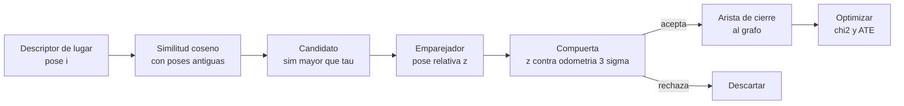

# B99-C04 — Cierre de bucles y consistencia global

<!-- nav:top -->
[🏠 Programa](../../../../README.md) · [📚 Bloque B99](../../../tronco-comun/B99-localizacion-y-mapeo-robotico.md) · [← Anterior: B99-C03 — SLAM basado en grafos de poses](../B99-C03-slam-basado-en-grafos-de-poses/CLASE.md) · [Siguiente: B99-C05 — Mapas de ocupación y rejillas de elevación →](../B99-C05-mapas-de-ocupacion-y-rejillas-de-elevacion/CLASE.md)
<!-- /nav -->

## 1. Ubicación, nivel y alcance

Clase 4 del bloque B99. Nivel N3. Un **cierre de bucle** ocurre cuando el robot reconoce un lugar ya visitado; la arista que se añade al grafo (C03) corrige de golpe la deriva acumulada. Pero un cierre **falso** (dos lugares distintos que se parecen) puede arruinar el mapa. Aquí construyes un reconocedor de lugares con descriptores sintéticos, mides su precisión y exhaustividad, añades una **verificación geométrica** y comparas el error del mapa con cuatro políticas. Todos los datos son **sintéticos**.

## 2. Por qué esta clase existe

Aceptar un cierre verdadero reduce el error; aceptar uno falso lo multiplica. La decisión central: **¿con qué umbral y con qué prueba geométrica acepto un cierre de bucle?**

## 3. Lo que podrás hacer al terminar

1. Calcular similitud coseno entre descriptores de lugar y seleccionar candidatos con exclusión temporal.
2. Medir precisión y exhaustividad de los cierres de bucle para varios umbrales.
3. Plantear una compuerta geométrica con la covarianza creciente de la odometría.
4. Cuantificar con el ATE el daño de un cierre falso y la protección de la compuerta.
5. Explicar por qué el `χ²` del grafo sirve de alarma de inconsistencia.
6. Separar lo consultado (ORB-SLAM y el tutorial de grafos sobre cierres de bucle) de lo sintético.

La evidencia es la **tabla de decisión de cierres de bucle** del ejercicio 12 (sección 20).

## 4. Con qué llegas y cómo comprobarlo

1. ¿Qué es la similitud coseno?
2. ¿Qué es el aliasing perceptual?
3. ¿Qué es una compuerta (gating) estadística?
4. ¿Por qué crece la incertidumbre de la odometría con los pasos?
5. ¿Qué es el `χ²` de un grafo?

<details>
<summary>Ver respuestas</summary>

1. El producto escalar de dos vectores unitarios; vale 1 si apuntan igual y 0 si son ortogonales. 2. Que lugares distintos produzcan observaciones casi iguales. 3. Un umbral en unidades de desviación típica para aceptar solo lo consistente con el modelo. 4. Los errores se suman; la desviación crece como la raíz del número de pasos, y el giro la amplifica con la distancia. 5. La suma de errores ponderados de las aristas (C03).
</details>

Con cuatro o cinco aciertos, sigue; si no, repasa los prerrequisitos.

## 5. Un caso de contexto y casos de referencia

Dos vueltas a un cuadrado de 80 m (321 poses). Con umbral de similitud 0,4 el reconocedor propone 166 cierres: 159 verdaderos y **7 falsos** (aliasing). Al añadir todos al grafo el ATE pasa de 0,933 m (odometría sola) a **9,954 m**; con solo los verdaderos baja a **0,098 m**; con compuerta geométrica queda en **0,099 m**. Los datos son **sintéticos**.

## 6. Vocabulario

**Cierre de bucle:** restricción entre dos poses del mismo lugar (F4, F7). **Descriptor de lugar:** vector que resume lo observado en una pose. **Aliasing perceptual:** lugares distintos con descriptor parecido. **Verificación geométrica:** comprobar que la pose relativa medida es compatible con la odometría. **Compuerta:** umbral `3σ` sobre la discrepancia. **Relocalización:** recuperar la pose tras perderla (F7). **Falso positivo:** cierre aceptado que no es verdadero.

## 7. Modelo mental: reconocer, verificar, optimizar



*Descripción textual:* cada pose compara su descriptor con los de poses antiguas; si la similitud supera el umbral, un emparejador mide la pose relativa; la compuerta compara esa medida con lo que predice la odometría y solo entonces se añade la arista y se optimiza.

Analogía: reconocer una calle por su aspecto: dos calles de casas idénticas se confunden, pero el cuentakilómetros te dice que no pueden ser la misma porque estás a 20 km. Límite: si el cuentakilómetros tiene una deriva grande, ya no es un buen testigo.

## 8. La explicación, paso a paso

### 8.1 Qué dicen las fuentes

El tutorial de grafos (F4) describe que, cuando el robot reentra en una zona conocida, el algoritmo busca coincidencias entre la observación actual y las pasadas y, si una tiene éxito, añade al grafo una arista con la transformación relativa que hace coincidir ambas; comparar con todas las observaciones sería ineficiente y propenso a errores. ORB-SLAM (F7) incluye en su resumen el cierre de bucles de línea base amplia y la relocalización con las mismas características que el seguimiento. Cadena et al. (F1) tratan la robustez ante asociaciones erróneas como uno de los problemas abiertos. De F4, F7 y F1 se consultó solo lo señalado.

### 8.2 Reconocimiento de lugares

Cada pose tiene un descriptor de 64 componentes (vector base único por lugar más ruido). La similitud coseno entre dos poses del mismo lugar tiene mediana 0,80; entre lugares distintos, 0,00; entre los lugares con aliasing (30 y 110), 0,76. Se excluyen las 30 poses más recientes (siempre se parecen a la actual). Para cada pose se toma el mejor candidato anterior y se acepta si la similitud supera `τ`.

### 8.3 Compuerta geométrica

El emparejador devuelve la pose relativa `z` de `j` visto desde `i`. La odometría predice `x_i⁻¹ ⊕ x_j`. Se acepta si la discrepancia de posición es `< 3σ_pos` y la de giro `< 3σ_θ`, con `σ_θ = σ_r √k` y `σ_pos = σ_t √k + σ_r √k · (0,125 k)`, donde `k = |i − j|` pasos y `0,125 k` m es una palanca heurística de la deriva por giro (propuesta del laboratorio, no de una norma). Para `k = 80` resulta `σ_pos = 0,63 m` y una tolerancia de `1,9 m`; el cierre falso 30–110 dista 22,4 m en la odometría y se rechaza.

### 8.4 El daño de un cierre falso

Un cierre falso afirma que dos poses lejanas coinciden; la optimización deforma el mapa para cumplirlo. En el laboratorio, con 7 cierres falsos entre 166, el `χ²` final salta de 431 a 225 787 y el ATE de 0,098 a 9,954 m (101 veces). El `χ²` enorme es una alarma de inconsistencia.

## 9. Magnitudes, símbolos y unidades

| Símbolo | Qué es | Unidad | Valor / nota |
|---|---|---|---|
| `S_ij` | similitud coseno entre descriptores | — | 0,80 mismo lugar |
| `τ` | umbral de similitud | — | 0,40 a 0,85 |
| `k` | separación en pasos entre las poses | — | ≥ 30 |
| `σ_pos`, `σ_θ` | incertidumbre predicha por la odometría | m, rad | 0,63 m a `k = 80` |
| ATE | error absoluto de trayectoria | m | 0,098 a 9,954 |

## 10. Convenciones y referencias

Mundo 2D; poses `(x, y, θ)`, m y rad; ruido de odometría `σ_t = 0,02 m`, `σ_r = 0,005 rad` por paso. Un candidato es **verdadero** si las dos poses distan `160 ± 2` pasos (la misma ubicación en la otra vuelta). La medida del emparejador es la pose real con ruido (0,02 m; 0,005 rad) para un cierre verdadero y una pose casi coincidente para un falso. Los descriptores, el aliasing, la compuerta y los ruidos son **sintéticos** (semilla 21).

## 11. De dónde sale lo que afirmamos

| ID | Fuente | Localizador | Respalda | Estado |
|---|---|---|---|---|
| F4 | Grisetti, Kümmerle, Stachniss y Burgard, A Tutorial on Graph-Based SLAM — PDF https://ais.informatik.uni-freiburg.de/publications/papers/grisetti10titsmag.pdf (consultada 2026-11-10 con PyMuPDF) | secciones de formulación y de minimización del error | nodos = poses; aristas con medida `z_ij` y matriz de información `Ω_ij`; error `e_ij`; minimización por Gauss–Newton o Levenberg–Marquardt con linealizaciones locales; cierre de bucle añade una arista | Consultada (revista y año no verificados en el texto extraído) |
| F7 | Mur-Artal, Montiel y Tardós, ORB-SLAM: a Versatile and Accurate Monocular SLAM System, IEEE Transactions on Robotics, 2015 (DOI 10.1109/TRO.2015.2463671) — PDF https://arxiv.org/pdf/1502.00956 (consultada 2026-11-10 con PyMuPDF) | resumen e introducción | sistema basado en características que usa las mismas para seguimiento, mapeo, relocalización y cierre de bucles; cierre de bucles de línea base amplia | Consultada (resumen e introducción) |
| F1 | Cadena, Carlone, Carrillo, Latif, Scaramuzza, Neira, Reid y Leonard, Past, Present, and Future of Simultaneous Localization and Mapping: Towards the Robust-Perception Age, IEEE Transactions on Robotics 32(6), 2016 — https://arxiv.org/abs/1606.05830 (consultada 2026-11-10) | resumen | la robustez ante asociaciones erróneas y la escalabilidad son temas centrales de la revisión | Consultada (solo el resumen; no el texto completo) |
| — | Rublee et al. (2011) sobre ORB y los trabajos de odometría visual de los rovers de Marte | — | no se consultaron | No consultada |

Límites: de F4, F7 y F1 no se leyó el texto completo; las cifras provienen del laboratorio sintético, no de esas fuentes.

## 12. Cómo ver los resultados

| Umbral `τ` | Candidatos | Verdaderos | Falsos | Precisión | Exhaustividad |
|---|---|---|---|---|---|
| 0,40 | 166 | 159 | 7 | 96 % | 99 % |
| 0,55 | 164 | 159 | 5 | 97 % | 99 % |
| 0,70 | 162 | 158 | 4 | 98 % | 98 % |
| 0,85 | 17 | 17 | 0 | 100 % | 11 % |

| Política (`τ = 0,4`) | Aristas de bucle | `χ²` final | ATE |
|---|---|---|---|
| Solo odometría | 0 | — | 0,933 m |
| Oráculo (solo verdaderos) | 159 | 431,3 | 0,098 m |
| Todos los candidatos | 166 | 225 787,1 | 9,954 m |
| Compuerta geométrica | 160 (6 falsos rechazados) | 432,4 | 0,099 m |

Descripción larga: subir el umbral mejora la precisión pero derrumba la exhaustividad (11 % con 0,85 porque la similitud verdadera es 0,80); la compuerta recupera el ATE del oráculo aun con umbral permisivo, pero deja pasar 1 de los 7 falsos.

## 13. Ejemplo trabajado: la compuerta con números

**Paso 1 · Candidato falso.** El descriptor dice que las poses 30 y 110 coinciden (`S = 0,76 > 0,4`) y el emparejador devuelve `z ≈ (0, 0, 0)`.
**Paso 2 · Predicción.** La odometría las ubica a `√((15−5)² + 20²) = 22,4 m`.
**Paso 3 · Tolerancia.** `k = 80`: `σ_pos = 8,94·0,02 + 8,94·0,005·10 = 0,63 m`; `3σ = 1,9 m`.
**Paso 4 · Decisión.** `22,4 m > 1,9 m`: se rechaza.
**Paso 5 · Contraste.** Un cierre verdadero (poses 30 y 190, `k = 160`) tiene una discrepancia del orden del error de la odometría (ATE 0,933 m en esta corrida) frente a una tolerancia de 4,6 m: se acepta.

## 14. Distintas formas de describir el problema

**Por apariencia:** similitud de descriptores (esta clase). **Por geometría:** coherencia con la odometría (compuerta). **Por consistencia global:** el `χ²` del grafo y su cambio al añadir la arista. Un cierre sólido supera las tres.

## 15. Práctica guiada

**Ejercicio 1 · con los pasos indicados.** Con `τ = 0,7`: 162 candidatos, 158 verdaderos y 161 cierres posibles. Calcula precisión y exhaustividad. *Pasos:* cociente 1, cociente 2.

<details><summary>Solución comentada</summary>

Precisión `158/162 = 97,5 %`; exhaustividad `158/161 = 98,1 %`.
</details>

**Ejercicio 2 · con una pista.** Si dos lugares comparten 0,9 de su vector base y un mismo lugar da similitud 0,80, ¿qué similitud esperas entre los lugares con aliasing? *Pista:* multiplica.

<details><summary>Solución comentada</summary>

Aproximadamente `0,9 × 0,80 = 0,72`; el laboratorio midió 0,76 para el par 30–110.
</details>

**Ejercicio 3 · casi autónomo.** Calcula la tolerancia `3σ_pos` de la compuerta para `k = 160`.

<details><summary>Solución comentada</summary>

`σ_pos = 12,65·0,02 + 12,65·0,005·20 = 0,253 + 1,265 = 1,52 m`; `3σ = 4,6 m`.
</details>

## 16. Práctica autónoma, transferencia e integrador

**Ejercicio 4 · autónomo.** ¿Por qué con `τ = 0,85` la exhaustividad cae a 11 %?

<details><summary>Solución comentada</summary>

Porque la similitud típica de un mismo lugar es 0,80: casi todos los cierres verdaderos quedan bajo el umbral.
</details>

**Ejercicio 5 · autónomo.** ¿Por qué se excluyen las 30 poses más recientes al buscar candidatos?

<details><summary>Solución comentada</summary>

Poses consecutivas siempre se parecen; serían «cierres» triviales que no corrigen deriva.
</details>

**Ejercicio 6 · autónomo.** El `χ²` pasó de 431 a 225 787 con los falsos. ¿Cuántas veces mayor es y qué indica?

<details><summary>Solución comentada</summary>

`225 787/431 ≈ 524` veces; indica inconsistencia entre aristas y es una alarma.
</details>

**Ejercicio 7 · autónomo.** ¿Cuántas veces empeora el ATE al aceptar todos los candidatos frente al oráculo?

<details><summary>Solución comentada</summary>

`9,954/0,098 ≈ 101` veces.
</details>

**Ejercicio 8 · autónomo.** Con `k = 40` calcula `σ_pos` de la compuerta.

<details><summary>Solución comentada</summary>

`σ_pos = 6,32·0,02 + 6,32·0,005·5 = 0,126 + 0,158 = 0,28 m`.
</details>

**Ejercicio 9 · transferencia.** **Transferencia.** Un colega dice que «la compuerta elimina todos los cierres falsos». ¿Es válido?

<details><summary>Solución comentada</summary>

No: en este laboratorio dejó pasar 1 de 7 y los datos son sintéticos.
</details>

**Ejercicio 10 · transferencia.** **Transferencia.** Un falso cierre es geométricamente consistente con una odometría que ha derivado mucho. ¿Qué haces?

<details><summary>Solución comentada</summary>

Pide más evidencia (varias observaciones consecutivas coherentes), usa ponderación robusta (C07) y vigila el `χ²` tras añadir la arista.
</details>

**Ejercicio 11 · transferencia.** **Transferencia.** En una llanura lunar casi sin rasgos todos los descriptores se parecen. ¿Qué le pasa a la precisión del reconocimiento?

<details><summary>Solución comentada</summary>

Aumenta el aliasing: la precisión baja a cualquier umbral y la geometría pasa a ser la única defensa.
</details>

**Ejercicio 12 · integrador.** **Integrador.** Elabora tu *tabla de decisión de cierres de bucle*: barrido de umbrales, compuerta con su fórmula, comparación de políticas por ATE y `χ²`, y lista de qué es consultado, no consultado y sintético.

<details><summary>Solución comentada</summary>

Sección 12 y la salida del laboratorio.
</details>

## 17. Laboratorio: reconocimiento de lugares, compuerta geométrica y daño de un cierre falso

El script [cierre_de_bucles.py](cierre_de_bucles.py) genera dos vueltas a un cuadrado con descriptores de lugar sintéticos (con tres pares con aliasing), propone cierres de bucle por similitud coseno con exclusión temporal, mide precisión y exhaustividad, aplica una compuerta geométrica y optimiza el grafo (Gauss–Newton de C03) con cuatro políticas; **comprueba** que los cierres verdaderos reducen el ATE, que los falsos lo empeoran y que la compuerta lo protege. Usa la biblioteca común [b99_comun.py](../b99_comun.py).

**Datos:** trayectoria, descriptores, aliasing y ruidos **sintéticos** (semillas 21 y 77). **Predice antes de ejecutar:** ¿cuántas veces empeora el ATE si se aceptan todos los candidatos? (más de 50). Ejecución del 2026-11-10 (Python 3.12.9, numpy 2.4.4):

```text
Python 3.12.9 | numpy 2.4.4
Datos SINTETICOS: 2 vueltas a un cuadrado de 80 m, 321 poses, descriptores de 64 componentes, semilla 21
Similitud coseno: mismo lugar (mediana) = 0.80 ; lugares con aliasing 30-110 = 0.76 ; lugares distintos (mediana) = 0.00
umbral  candidatos  verdaderos  falsos  precision  exhaustividad
  0.40         166         159       7        96%            99%
  0.55         164         159       5        97%            99%
  0.70         162         158       4        98%            98%
  0.85          17          17       0       100%            11%

Politicas con umbral de reconocimiento 0.4 (permisivo); ATE de la odometria sola = 0.933 m
politica               aristas_de_bucle  falsos_rechazados  chi2_final       ATE [m]
solo odometria                        0                  0          0.0         0.933
oraculo (solo verdaderos)            159                  0        431.3         0.098
todos los candidatos                166                  0     225787.1         9.954
compuerta geometrica                160                  6        432.4         0.099
Pruebas superadas.
```

```bash
python programa/clases/B99/B99-C04-cierre-de-bucles-y-consistencia-global/cierre_de_bucles.py
```

**Límites:** 2D, descriptores sintéticos (no vienen de imágenes), emparejador idealizado, un solo tipo de falso (coincidencia forzada), una sola semilla de grafo; la compuerta es heurística y no se calibró con datos reales.

## 18. Errores frecuentes y cómo corregirlos

**Elegir el umbral solo por precisión.** Con 0,85 la precisión es 100 % pero se pierde el 89 % de los cierres (sección 12).

**Aceptar cierres sin verificación geométrica.** El ATE se multiplicó por 101 (8.4).

**Creer que la compuerta es infalible.** Dejó pasar 1 de 7 falsos; revisa la sección 11.

## 19. Cómo sabrás que vas bien

Tras la sección 8: ¿por qué un cierre falso puede arruinar un mapa que antes iba bien? Si dudas, repasa la sección 8.4. Tras el laboratorio: ¿qué política tiene menor ATE sin conocer la verdad? (ver sección 17).

## 20. Qué entregas y cómo se evalúa

El producto es tu **tabla de decisión de cierres de bucle** (ejercicio 12).

| Criterio | Inicial | En desarrollo | Logrado | Destacado |
|---|---|---|---|---|
| Conceptos | Los confunde | Parciales | Explica el método y su dominio | Explica los límites y las alternativas |
| Cálculo | Sin unidades | Con errores | Resultados con unidades y comprobados | Resuelve casos nuevos |
| Numérico | Sin comprobar | Un caso | Verifica con una comprobación independiente en varios casos | Interpreta las diferencias y los fallos |
| Fuentes | Sin fuente | Sin fecha | Fuentes con fecha y estado | Declara lo sintético y lo no consultado |
| Límites | No los nombra | Uno | Tres | Discute qué falta del modelo |

**Condiciones críticas (no se compensan con promedio):** rotular los datos como sintéticos; verificar cada resultado con una comprobación independiente; citar solo lo consultado.

## 21. Ética, seguridad y límites

Clase educativa: los descriptores y el emparejador son sintéticos; un cierre falso en un vehículo real puede llevarlo a una pose errónea. No sustituye la validación de un sistema de navegación ni la revisión de especialistas. Accesibilidad: tablas equivalentes a las gráficas, fórmulas en texto, ejercicios sin conexión.

## 22. Para cerrar y seguir

Con umbral permisivo hay 7 cierres falsos entre 166; sin compuerta el ATE sube de 0,098 a 9,954 m y con ella queda en 0,099 m. Queda una pregunta: una vez que el mapa es consistente, ¿en qué forma se guarda para navegar?

**Glosario español–inglés.** cierre de bucle · *loop closure*; reconocimiento de lugares · *place recognition*; aliasing perceptual · *perceptual aliasing*; compuerta · *gating*; falso positivo · *false positive*; relocalización · *relocalization*.

**Continuidad.** [B99-C05](../B99-C05-mapas-de-ocupacion-y-rejillas-de-elevacion/CLASE.md) trata las rejillas de ocupación y de elevación que usa la navegación.

**Referencias:** ver sección 11.

<!-- nav:bottom -->
---

[← Anterior: B99-C03 — SLAM basado en grafos de poses](../B99-C03-slam-basado-en-grafos-de-poses/CLASE.md) · [📚 Bloque B99](../../../tronco-comun/B99-localizacion-y-mapeo-robotico.md) · [Siguiente: B99-C05 — Mapas de ocupación y rejillas de elevación →](../B99-C05-mapas-de-ocupacion-y-rejillas-de-elevacion/CLASE.md)
<!-- /nav -->
