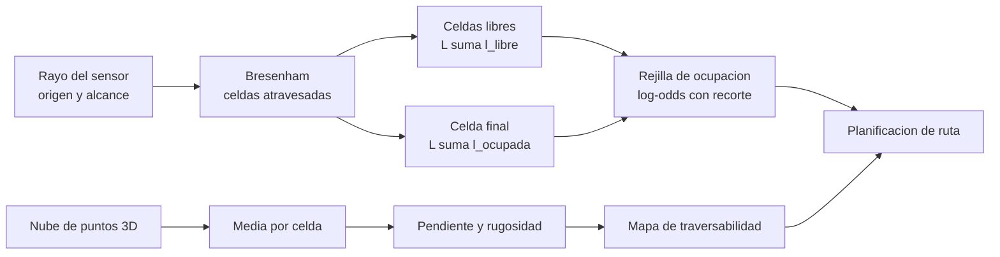

# B99-C05 — Mapas de ocupación y rejillas de elevación

<!-- nav:top -->
[🏠 Programa](../../../../README.md) · [📚 Bloque B99](../../../tronco-comun/B99-localizacion-y-mapeo-robotico.md) · [← Anterior: B99-C04 — Cierre de bucles y consistencia global](../B99-C04-cierre-de-bucles-y-consistencia-global/CLASE.md) · [Siguiente: B99-C06 — Evaluación de deriva y error de trayectoria →](../B99-C06-evaluacion-de-deriva-y-error-de-trayectoria/CLASE.md)
<!-- /nav -->

## 1. Ubicación, nivel y alcance

Clase 5 del bloque B99. Nivel N3. Con las poses estimadas (C03, C04) el robot necesita un **mapa** para decidir por dónde pasar. Dos representaciones son habituales: la **rejilla de ocupación**, que guarda en cada celda la probabilidad de estar ocupada (con celdas libres, ocupadas y desconocidas), y la **rejilla de elevación**, que guarda una altura por celda y de ella deriva pendiente y rugosidad. Aquí construyes ambas con datos **sintéticos**: una sala con obstáculos medida con un sensor de rayos y un terreno inclinado con una roca medido con una nube de puntos.

## 2. Por qué esta clase existe

Un mapa útil para navegar distingue lo ocupado, lo libre y lo que no se sabe, y dice si el terreno es pisable. La decisión central: **¿cómo fusionar medidas ruidosas en cada celda y qué umbrales de pendiente y rugosidad declaran un terreno traversable?**

## 3. Lo que podrás hacer al terminar

1. Actualizar una rejilla de ocupación en log-odds con trazado de rayos (Bresenham).
2. Comprobar que la suma de log-odds equivale al producto de Bayes.
3. Aplicar la política de recorte y ver por qué acelera la adaptación.
4. Construir una rejilla de elevación y calcular pendiente y rugosidad por celda.
5. Marcar celdas traversables con umbrales y evaluar qué se detecta y qué no.
6. Separar lo consultado (log-odds, recorte y mapas 2.5D en OctoMap) de lo sintético.

La evidencia es la **mapa de ocupación y de traversabilidad sintéticos** del ejercicio 12 (sección 20).

## 4. Con qué llegas y cómo comprobarlo

1. ¿Qué son las probabilidades `p` y los log-odds `L = ln(p/(1−p))`?
2. ¿Qué es la regla de Bayes para actualizar una probabilidad con una medida?
3. ¿Qué es un algoritmo de Bresenham?
4. ¿Qué es la pendiente de una superficie `z(x, y)`?
5. ¿Qué es la desviación típica de la media de `n` datos?

<details>
<summary>Ver respuestas</summary>

1. `p` es la probabilidad; `L` la transforma en un número que se suma; `p = 0,5` es `L = 0`. 2. Se multiplica por la verosimilitud y se normaliza. 3. Uno que recorre las celdas que atraviesa un segmento en una rejilla. 4. `atan √((∂z/∂x)² + (∂z/∂y)²)`. 5. `σ/√n`.
</details>

Con cuatro o cinco aciertos, sigue; si no, repasa los prerrequisitos.

## 5. Un caso de contexto y casos de referencia

Una sala de 20×20 m con rejilla de 0,25 m (6 400 celdas) se observa desde 8 poses con 360 rayos de 10 m cada una: la cobertura sube de 31 % a **97 %**, con **97,7 %** de exactitud en las celdas observadas. En un terreno de 8° con una roca de 0,4 m, la rejilla de elevación de 0,5 m recupera la pendiente en **7,98°** y declara no traversables 8 de las 12 celdas de la roca. Los datos son **sintéticos**.

## 6. Vocabulario

**Rejilla de ocupación:** malla de celdas con probabilidad de estar ocupadas (F5). **Log-odds:** `L = ln(p/(1−p))`; la actualización es una suma (F5). **Recorte (clamping):** límites `l_min`, `l_max` que mantienen la capacidad de cambiar de opinión (F5). **Rejilla de elevación (2.5D):** un valor de altura por celda (F5). **Rugosidad:** dispersión de la altura respecto de un plano local. **Traversable:** celda que cumple los umbrales de pendiente y rugosidad. **Desconocida:** celda sin ninguna observación.

## 7. Modelo mental: de las medidas a las celdas



*Descripción textual:* cada rayo marca libres las celdas que atraviesa y ocupada la última; las sumas en log-odds forman la rejilla de ocupación; en paralelo, la nube de puntos 3D da una altura media por celda, de la que salen pendiente, rugosidad y traversabilidad; ambos mapas alimentan la planificación.

Analogía: dibujar un plano a ciegas con un bastón: cada golpe pinta «pared» y cada barrido, «libre»; con varios golpes la certeza crece. Límite: aquí el bastón tiene ruido y puede errar de celda, y el plano nunca llega a certeza absoluta gracias al recorte.

## 8. La explicación, paso a paso

### 8.1 Qué dicen las fuentes

Hornung et al. (F5) estiman la ocupación de cada celda con una actualización probabilística y la escriben en **log-odds**, `L(n | z_{1:t}) = L(n | z_{1:t−1}) + L(n | z_t)`, con `L(n) = log(P(n)/(1 − P(n)))`: la actualización pasa de un producto a una suma y los valores se pueden almacenar en log-odds. Para que el mapa se adapte a cambios proponen una política de **recorte** que limita `L` entre `l_min` y `l_max`. Describen además que, si se pueden hacer supuestos sobre la zona, bastan mapas 2.5D con una altura por celda (mapas de elevación). De F5 se consultó la sección de estimación de ocupación y la de trabajos relacionados; no se consultó el desarrollo del árbol octal. Cadena et al. (F1) enumeran las representaciones métricas de mapa como tema de SLAM; solo se leyó el resumen.

### 8.2 Ocupación en log-odds

Modelo de sensor (sintético): `p(ocupada | golpe) = 0,7` → `l_ocup = ln(7/3) = +0,847`; `p(ocupada | paso del rayo) = 0,4` → `l_libre = ln(4/6) = −0,405`. Límites `l_min = −2`, `l_max = 3,5` (elegidos para el laboratorio). Cada rayo se traza con Bresenham: las celdas atravesadas suman `l_libre` y la celda del golpe suma `l_ocup`. Una celda con `p > 0,5` se declara ocupada; con `p < 0,5`, libre; si nunca se tocó, desconocida. Tras 8 observaciones sintéticas (5 golpes, 3 pasos) el producto de Bayes y la suma de log-odds dan el mismo `p = 0,953473694661` (diferencia `0`).

### 8.3 Recorte

Sin recorte, tras 20 golpes `L = 16,9` y harían falta 42 pasos libres para volver a `L = 0`; con recorte `L = 3,5` y bastan 9. Así una puerta que se abre o una roca que se mueve se corrigen rápido.

### 8.4 Exactitud y sus límites

De las 6 227 celdas observadas, 97,7 % se clasifican bien; 418 celdas ocupadas verdaderas se hallan, **139 son falsas ocupadas** (25 % de las ocupadas declaradas) y 5 ocupadas se pierden. Las falsas ocupadas vienen del ruido de rango (0,05 m, un quinto de celda) que coloca el golpe en la celda vecina.

### 8.5 Rejilla de elevación

La nube (40 000 puntos con ruido vertical de 0,03 m) se reparte en celdas de 0,5 m (100 puntos por celda). La media por celda tiene error `σ/√n = 0,30 cm` esperado y 0,33 cm medido. La pendiente es `atan |∇z|` con el gradiente de las medias (media en terreno liso 7,98° frente a 8,00°). La rugosidad es la desviación típica del residuo de las medias de una ventana `3×3` respecto de su plano ajustado. Con umbrales de 15° y 5 cm (sintéticos) se declara traversable 96 % del interior; la roca (pendiente máxima 22,9°) queda no traversable en 8 de sus 12 celdas, por pendiente y no por rugosidad (rugosidad máxima 4,9 cm).

## 9. Magnitudes, símbolos y unidades

| Símbolo | Qué es | Unidad | Valor / nota |
|---|---|---|---|
| `L` | log-odds de una celda | — | −2 a 3,5 |
| `l_ocup`, `l_libre` | incremento por golpe / por paso | — | +0,847 / −0,405 |
| `res` | tamaño de celda | m | 0,25 (ocupación); 0,5 (elevación) |
| `σ_r` | ruido de rango | m | 0,05 |
| pendiente | `atan |∇z|` | grados | 8,00 (verdad) |
| rugosidad | desviación del residuo local | m | < 0,05 (umbral) |

## 10. Convenciones y referencias

Mapa 2D de 20×20 m y terreno de 10×10 m; ejes `x` (columna) e `y` (fila) en m; unidades m y grados. Rayos de 360 por pose y 10 m de alcance; poses sintéticas fijas. Tolerancias: Bayes frente a log-odds `< 10⁻¹²`; error de la media `< 1,5 σ/√n`; pendiente `±0,5°`. Sala, obstáculos, terreno, roca, modelo de sensor y umbrales son **sintéticos** (semilla 31); no corresponden a ningún terreno real.

## 11. De dónde sale lo que afirmamos

| ID | Fuente | Localizador | Respalda | Estado |
|---|---|---|---|---|
| F5 | Hornung, Wurm, Bennewitz, Stachniss y Burgard, OctoMap: An Efficient Probabilistic 3D Mapping Framework Based on Octrees, Autonomous Robots, 2013 — PDF https://www.arminhornung.de/Research/pub/hornung13auro.pdf (consultada 2026-11-10 con PyMuPDF) | sección de estimación de ocupación y sección de trabajos relacionados | actualización de ocupación en log-odds (suma en lugar de producto), política de recorte entre `l_min` y `l_max`, mapas de elevación 2.5D con un valor por celda y su límite (una sola superficie) | Consultada |
| F1 | Cadena, Carlone, Carrillo, Latif, Scaramuzza, Neira, Reid y Leonard, Past, Present, and Future of Simultaneous Localization and Mapping: Towards the Robust-Perception Age, IEEE Transactions on Robotics 32(6), 2016 — https://arxiv.org/abs/1606.05830 (consultada 2026-11-10) | resumen | las representaciones métricas de mapa son parte del problema de SLAM que revisa el artículo | Consultada (solo el resumen; no el texto completo) |
| — | Bresenham (1965) y Elfes (1989) sobre rejillas de ocupación | — | el laboratorio verifica la equivalencia con Bayes | No consultada |

Límites: de F5 no se consultó el árbol octal ni sus resultados; los valores de `p`, `l_min`, `l_max` y los umbrales de traversabilidad no vienen de F5 sino del laboratorio.

## 12. Cómo ver los resultados

| Magnitud | Valor |
|---|---|
| Cobertura tras 1 a 8 poses | 31 %, 57 %, 77 %, 85 %, 97 %, 97 %, 97 %, 97 % |
| Celdas observadas / desconocidas | 6 227 / 173 |
| Exactitud de las celdas observadas | 97,7 % |
| Ocupadas verdaderas / falsas / perdidas | 418 / 139 / 5 |
| Error de la media de elevación (medido / `σ/√n`) | 0,33 cm / 0,30 cm |
| Pendiente media sin roca | 7,98° |
| Traversable en el interior | 96 % |
| Celdas de la roca no traversables | 8 de 12 |

Descripción larga: las primeras 5 poses cubren casi todo el mapa; las siguientes no añaden cobertura porque el resto está tapado por obstáculos.

## 13. Ejemplo trabajado: log-odds con tres golpes y un paso

**Paso 1 · Incrementos.** `l_ocup = ln(0,7/0,3) = 0,847`; `l_libre = ln(0,4/0,6) = −0,405`.
**Paso 2 · Suma.** Dos golpes y un paso: `L = 2·0,847 − 0,405 = 1,289`.
**Paso 3 · Probabilidad.** `p = 1/(1 + e^{−1,289}) = 0,784`.
**Paso 4 · Comprobación con Bayes.** `0,7` tras el 1.º golpe; `0,7·0,7/(0,7·0,7 + 0,3·0,3) = 0,845` tras el 2.º; `0,845·0,4/(0,845·0,4 + 0,155·0,6) = 0,784` tras el paso. Coinciden.
**Paso 5 · Lectura.** La celda es ocupada (`p > 0,5`) con certeza moderada.

## 14. Distintas formas de describir el problema

**Por celdas de ocupación:** probabilidad de ocupado/libre/desconocido (esta clase). **Por alturas:** una elevación por celda (2.5D, esta clase). **Por voxels en árbol octal:** volumen 3D eficiente (F5; no se desarrolla). La elección depende de si el entorno cabe en una sola superficie.

## 15. Práctica guiada

**Ejercicio 1 · con los pasos indicados.** Calcula `L` y `p` de una celda tras dos golpes y un paso con el modelo de la sección 8.2. *Pasos:* incrementos, suma, logística.

<details><summary>Solución comentada</summary>

`L = 2·0,847 − 0,405 = 1,289`; `p = 1/(1 + e^{−1,289}) = 0,784`.
</details>

**Ejercicio 2 · con una pista.** Comprueba con Bayes la probabilidad tras dos golpes (ambos con `p = 0,7`). *Pista:* `p₂ = p₁ p_m/(p₁ p_m + (1−p₁)(1−p_m))`.

<details><summary>Solución comentada</summary>

`0,49/(0,49 + 0,09) = 0,845`; con log-odds `L = 1,695` → `0,845`.
</details>

**Ejercicio 3 · casi autónomo.** Con `l_max = 3,5`, ¿cuántos pasos libres hacen falta para declarar libre una celda saturada?

<details><summary>Solución comentada</summary>

`3,5/0,405 = 8,6`: 9 pasos.
</details>

## 16. Práctica autónoma, transferencia e integrador

**Ejercicio 4 · autónomo.** Si la celda baja de 0,25 a 0,10 m, ¿cuántas celdas tendría la sala de 20×20 m?

<details><summary>Solución comentada</summary>

`200×200 = 40 000`, 6,25 veces más.
</details>

**Ejercicio 5 · autónomo.** ¿Qué altura sube una pendiente de 8° en una celda de 0,5 m?

<details><summary>Solución comentada</summary>

`0,5 · tan 8° = 0,070 m`.
</details>

**Ejercicio 6 · autónomo.** ¿Cuál es el error esperado de la media de elevación con 400 puntos por celda y `σ = 0,03 m`?

<details><summary>Solución comentada</summary>

`0,03/√400 = 0,0015 m = 0,15 cm`.
</details>

**Ejercicio 7 · autónomo.** Hay 557 celdas declaradas ocupadas, 139 falsas. ¿Qué fracción es falsa y qué lo causa?

<details><summary>Solución comentada</summary>

`139/557 = 25 %`; el ruido de rango de 0,05 m coloca golpes en celdas vecinas.
</details>

**Ejercicio 8 · autónomo.** La roca tiene rugosidad máxima 4,9 cm y el umbral es 5 cm. ¿Por qué queda no traversable?

<details><summary>Solución comentada</summary>

Por pendiente: el máximo de 22,9° supera los 15°.
</details>

**Ejercicio 9 · transferencia.** **Transferencia.** Un colega afirma que «el mapa tiene 97,7 % de exactitud en la Luna». ¿Es válido?

<details><summary>Solución comentada</summary>

No: es una sala sintética con ruido gaussiano y geometría conocida; no se consultaron datos lunares ni de misión.
</details>

**Ejercicio 10 · transferencia.** **Transferencia.** Un acantilado con un voladizo, ¿cabe en una rejilla de elevación?

<details><summary>Solución comentada</summary>

No: la 2.5D guarda una altura por celda y no puede representar dos superficies en la misma celda; F5 señala que bastan si se pueden hacer supuestos sobre la zona.
</details>

**Ejercicio 11 · transferencia.** **Transferencia.** El polvo levantado por el rover aparece como obstáculo durante unos segundos. ¿Cómo ayuda el recorte?

<details><summary>Solución comentada</summary>

Limita `L`, de modo que unos pocos pasos libres lo borran; sin recorte tardaría decenas de pasos.
</details>

**Ejercicio 12 · integrador.** **Integrador.** Elabora tu *mapa de ocupación y de traversabilidad sintéticos*: modelo de sensor, cobertura, exactitud con sus falsas ocupadas, error de la media y pendiente de la elevación, umbrales y celdas no traversables, y lista de qué es consultado, no consultado y sintético.

<details><summary>Solución comentada</summary>

Sección 12 y la salida del laboratorio.
</details>

## 17. Laboratorio: ocupación en log-odds y elevación con traversabilidad

El script [mapas.py](mapas.py) traza 360 rayos desde 8 poses en una sala sintética, actualiza una rejilla en log-odds con recorte, la compara con Bayes y la evalúa contra la verdad, y construye una rejilla de elevación con pendiente y rugosidad; **comprueba** la equivalencia con Bayes (`< 10⁻¹²`), la exactitud (`> 93 %`), el error de la media (`< 1,5 σ/√n`), la pendiente (`±0,5°`) y que la roca queda marcada y el terreno liso no. Usa la biblioteca común [b99_comun.py](../b99_comun.py).

**Datos:** sala, poses, ruido de rango, terreno, roca y umbrales **sintéticos** (semilla 31). **Predice antes de ejecutar:** ¿qué cobertura tendrá la rejilla tras 5 poses? (cerca de 97 %). Ejecución del 2026-11-10 (Python 3.12.9, numpy 2.4.4):

```text
Python 3.12.9 | numpy 2.4.4
Datos SINTETICOS: sala de 20 x 20 m, celdas de 0.25 m, 8 poses de sensor; terreno de 10 x 10 m con 40 000 puntos
Cobertura de la rejilla tras cada pose: 31% 57% 77% 85% 97% 97% 97% 97%
Bayes en probabilidad: 0.953473694661 ; suma en log-odds: 0.953473694661 ; diferencia = 0.0e+00
Celdas: 6400; observadas = 6227 (97%); desconocidas = 173
Celdas observadas: exactitud = 97.7%; ocupadas verdaderas halladas = 418; falsas ocupadas = 139; ocupadas perdidas = 5
Tras 20 golpes: sin recorte L = 16.9, necesita 42 pasos libres para volver a 0; con recorte L = 3.5, necesita 9
Puntos por celda (media) = 100; error rms de la media en celdas planas = 0.33 cm (sigma/sqrt(n) = 0.30 cm)
Pendiente media en terreno sin roca = 7.98 grados (verdad: 8.00)
Traversables (pendiente < 15 grados y rugosidad < 5 cm): 96% del interior; pendiente maxima = 22.9 grados; rugosidad maxima = 4.9 cm
Celdas de la roca (radio 0.9 m) no traversables = 8 de 12; celdas lejanas no traversables = 0
Pruebas superadas.
```

```bash
python programa/clases/B99/B99-C05-mapas-de-ocupacion-y-rejillas-de-elevacion/mapas.py
```

**Límites:** mapa 2D, sensor ideal sin falsos retornos ni dinámica, poses conocidas (sin error de localización), modelo de sensor y umbrales arbitrarios, una sola semilla.

## 18. Errores frecuentes y cómo corregirlos

**Confundir «libre» con «desconocido».** Una celda sin observar tiene `L = 0`, no es libre (8.2).

**Suponer que la rejilla de elevación sirve para cualquier entorno.** Solo si hay una superficie por celda (8.1).

**Usar umbrales sintéticos como si fueran los de un rover.** Revisa la sección 10.

## 19. Cómo sabrás que vas bien

Tras la sección 8: ¿por qué sumar log-odds equivale a multiplicar probabilidades? Si dudas, repasa el ejercicio 2. Tras el laboratorio: ¿qué causa las celdas falsas ocupadas? (ver sección 17).

## 20. Qué entregas y cómo se evalúa

El producto es tu **mapa de ocupación y de traversabilidad sintéticos** (ejercicio 12).

| Criterio | Inicial | En desarrollo | Logrado | Destacado |
|---|---|---|---|---|
| Conceptos | Los confunde | Parciales | Explica el método y su dominio | Explica los límites y las alternativas |
| Cálculo | Sin unidades | Con errores | Resultados con unidades y comprobados | Resuelve casos nuevos |
| Numérico | Sin comprobar | Un caso | Verifica con una comprobación independiente en varios casos | Interpreta las diferencias y los fallos |
| Fuentes | Sin fuente | Sin fecha | Fuentes con fecha y estado | Declara lo sintético y lo no consultado |
| Límites | No los nombra | Uno | Tres | Discute qué falta del modelo |

**Condiciones críticas (no se compensan con promedio):** rotular los datos como sintéticos; verificar cada resultado con una comprobación independiente; citar solo lo consultado.

## 21. Ética, seguridad y límites

Clase educativa: los umbrales de pendiente y rugosidad son de ejemplo; los límites de un vehículo real los fija su diseño y su plan de operaciones. No sustituye la validación del mapa de navegación ni la revisión de especialistas. Accesibilidad: tablas equivalentes a las gráficas, fórmulas en texto, ejercicios sin conexión.

## 22. Para cerrar y seguir

La rejilla de 0,25 m alcanza 97,7 % de exactitud con 25 % de falsas ocupadas por el ruido de rango, y la rejilla de elevación recupera la pendiente en 7,98° y marca la roca por su pendiente. Queda una pregunta: ¿cómo se mide con rigor qué tan buena es una trayectoria estimada?

**Glosario español–inglés.** rejilla de ocupación · *occupancy grid*; log-odds · *log-odds*; recorte · *clamping*; rejilla de elevación · *elevation map*; traversabilidad · *traversability*; rugosidad · *roughness*.

**Continuidad.** [B99-C06](../B99-C06-evaluacion-de-deriva-y-error-de-trayectoria/CLASE.md) define el error absoluto y relativo de trayectoria.

**Referencias:** ver sección 11.

<!-- nav:bottom -->
---

[← Anterior: B99-C04 — Cierre de bucles y consistencia global](../B99-C04-cierre-de-bucles-y-consistencia-global/CLASE.md) · [📚 Bloque B99](../../../tronco-comun/B99-localizacion-y-mapeo-robotico.md) · [Siguiente: B99-C06 — Evaluación de deriva y error de trayectoria →](../B99-C06-evaluacion-de-deriva-y-error-de-trayectoria/CLASE.md)
<!-- /nav -->
