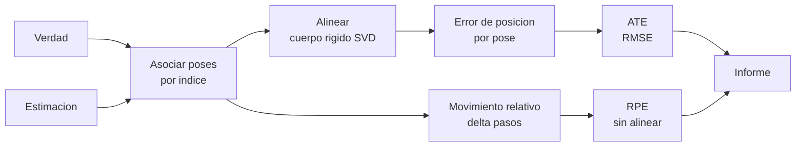

# B99-C06 — Evaluación de deriva y error de trayectoria

<!-- nav:top -->
[🏠 Programa](../../../../README.md) · [📚 Bloque B99](../../../tronco-comun/B99-localizacion-y-mapeo-robotico.md) · [← Anterior: B99-C05 — Mapas de ocupación y rejillas de elevación](../B99-C05-mapas-de-ocupacion-y-rejillas-de-elevacion/CLASE.md) · [Siguiente: B99-C07 — Robustez del mapeo ante entornos degradados →](../B99-C07-robustez-del-mapeo-ante-entornos-degradados/CLASE.md)
<!-- /nav -->

## 1. Ubicación, nivel y alcance

Clase 6 del bloque B99. Nivel N3. Una trayectoria estimada no vale nada sin una medida de su error. Las dos métricas habituales en la evaluación de SLAM y odometría son el **error absoluto de trayectoria (ATE)**, que compara posiciones tras alinear la estimación con la verdad, y el **error relativo de pose (RPE)**, que compara movimientos entre poses separadas por una ventana (F2). Aquí las implementas, las verificas con casos analíticos y comparas dos estimadores sobre un lazo **sintético**: la odometría sola y el grafo optimizado de C03.

## 2. Por qué esta clase existe

«Mi robot deriva poco» no es una afirmación comprobable. La decisión central: **¿qué métrica, con qué alineación y con qué ventana, describe el error que importa para la tarea?**

## 3. Lo que podrás hacer al terminar

1. Alinear una trayectoria con la verdad por cuerpo rígido (SVD) y calcular el ATE.
2. Calcular el RPE de traslación y de rotación para una ventana dada.
3. Verificar las métricas con casos analíticos (identidad, movimiento rígido, error de escala).
4. Expresar la deriva como porcentaje del recorrido y medir cómo crece con la distancia.
5. Interpretar qué corrige un cierre de bucle según el ATE y el RPE.
6. Separar lo consultado (la definición de las herramientas de evaluación de F2) de lo sintético.

La evidencia es la **informe ATE/RPE de dos estimadores** del ejercicio 12 (sección 20).

## 4. Con qué llegas y cómo comprobarlo

1. ¿Qué es el RMSE?
2. ¿Por qué hay que alinear dos trayectorias antes de compararlas?
3. ¿Qué es una transformación rígida y qué la conserva?
4. ¿Qué es la deriva?
5. ¿Qué es una comprobación analítica?

<details>
<summary>Ver respuestas</summary>

1. La raíz del promedio de los errores al cuadrado. 2. Cada una está en su propio marco de referencia; sin alinear, un desplazamiento global se contaría como error. 3. Giro más traslación; conserva distancias y ángulos. 4. El error que se acumula al integrar movimientos (C01). 5. Un caso con solución exacta con el que se compara el resultado numérico.
</details>

Con cuatro o cinco aciertos, sigue; si no, repasa los prerrequisitos.

## 5. Un caso de contexto y casos de referencia

En el lazo de 80 m con un sesgo de giro de 0,001 rad por paso, la odometría sola da **ATE 0,199 m**, un error final de 0,597 m (**0,75 %** del recorrido) y un RPE de 40 pasos de 0,267 m; el grafo con cierre de bucle da ATE **0,102 m** y error final **0,014 m** (0,02 %), con **el mismo** RPE de traslación de 1 paso (0,0287 m) y de 40 pasos (0,267 m). Los datos son **sintéticos**.

## 6. Vocabulario

**ATE:** RMSE de la traslación tras alinear la estimación con la verdad por cuerpo rígido (F2). **RPE:** error del movimiento relativo entre pares de poses separados por una ventana (F2). **Alineación:** hallar el giro y la traslación que mejor superponen ambas trayectorias (SVD). **Ventana (delta):** separación, en pasos, entre las dos poses del RPE. **Deriva:** error acumulado. **Error final:** distancia entre la pose final estimada y la verdadera.

## 7. Modelo mental: alinear, restar, resumir



*Descripción textual:* las poses estimadas y verdaderas se asocian; para el ATE se alinean y se promedia el error de posición; para el RPE no hace falta alinear: se comparan los movimientos relativos entre poses separadas por una ventana; el informe junta ambos.

Analogía: comparar la ruta que dibujó un caminante con la del mapa: el ATE superpone los dos dibujos y mide cuánto se separan; el RPE compara cuánto giró y avanzó entre dos esquinas. Límite: el ATE penaliza por igual un error al inicio y al final, aunque su efecto en la navegación no lo sea.

## 8. La explicación, paso a paso

### 8.1 Qué dicen las fuentes

Las herramientas de evaluación del conjunto TUM RGB-D (F2) describen el **ATE** así: se asocian las poses estimadas con las verdaderas por marca de tiempo, se alinean ambas trayectorias mediante la descomposición en valores singulares, se calcula la diferencia de cada par y se informa, por defecto, el RMSE del error de traslación en metros. Para el **RPE** se mide el error del movimiento relativo entre pares de poses, y la opción de ventana fija permite comparar cada pose con otra posterior a una separación dada (en segundos, metros, radianes o cuadros), útil para estimar la deriva. La página no escribe las fórmulas del RMSE ni del RPE; las que siguen son las del laboratorio. Cadena et al. (F1) citan la evaluación y la robustez como parte de las cuestiones abiertas de SLAM (solo se leyó el resumen).

### 8.2 ATE

Con poses estimadas `p̂_i` y verdaderas `p_i`: se halla `(R, t)` que minimiza `Σ ‖R p̂_i + t − p_i‖²` (Kabsch por SVD, sin escala), y `ATE = √(1/N Σ ‖R p̂_i + t − p_i‖²)`. Mide la consistencia global y depende de la alineación elegida.

### 8.3 RPE

Para cada par `(i, i + Δ)`: `E_i = (Q_i⁻¹ Q_{i+Δ})⁻¹ (P_i⁻¹ P_{i+Δ})`, con `Q` verdadera y `P` estimada; se toman el RMSE de la parte de traslación y el de la de rotación. No necesita alineación y es invariante a una transformación rígida global.

### 8.4 Comprobaciones analíticas

(i) Trayectoria idéntica: ATE `3,3×10⁻¹⁵ m`. (ii) La misma trayectoria movida rígidamente (giro 0,7 rad, traslado 13 m): el error sin alinear es 8,63 m, pero el ATE alineado es `1,3×10⁻¹⁴ m` y el RPE `3,9×10⁻¹⁵ m` y `0 rad`. (iii) Recta de `N = 100` puntos con paso `d = 0,5 m` y error de escala `s = 1,02`: tras alinear (el giro es nulo), el residuo es `(s − 1)(x_i − x̄)` y `ATE = |s − 1| d √((N² − 1)/12) = 0,288661 m`; el laboratorio da `0,288661 m`. El RPE de un paso es `|s − 1| d = 0,0100 m`.

### 8.5 Lo que cada métrica ve

El cierre de bucle baja el ATE (0,199 → 0,102 m) y el error final (0,597 → 0,014 m), pero no cambia el RPE de 1 ni de 40 pasos (0,0287 y 0,267 m): corrige el error global, no el local. Por eso un robot que navega con un mapa local depende del RPE, y uno que construye un mapa global, del ATE. Un sesgo de giro de 0,002 rad por paso aparece directamente en el RPE de rotación (0,0020 rad) y, acumulado, curva la recta: ATE 0,966 m en 80 m.

### 8.6 La deriva crece más que linealmente

Con 30 semillas por longitud, el ATE medio de rectas sintéticas es 0,108; 0,254; 0,689 y 1,563 m para 40, 80, 160 y 320 m. La pendiente log–log es 1,30 (1 sería lineal): el error de giro hace palanca sobre la distancia (C01).

## 9. Magnitudes, símbolos y unidades

| Símbolo | Qué es | Unidad | Valor / nota |
|---|---|---|---|
| `p̂_i`, `p_i` | posición estimada y verdadera | m | 161 poses |
| `R`, `t` | alineación de cuerpo rígido | —, m | SVD |
| ATE | RMSE de la traslación tras alinear | m | 0,199 y 0,102 |
| RPE | RMSE del movimiento relativo | m, rad | 0,0287 m (1 paso); 0,267 m (40 pasos) |
| `Δ` | ventana del RPE | pasos (0,5 m cada uno) | 1 y 40 |
| deriva | error final / recorrido | % | 0,75 y 0,02 |

## 10. Convenciones y referencias

Mundo 2D; poses `(x, y, θ)`; unidades m y rad; asociación por índice (las trayectorias tienen el mismo número de poses). Alineación de cuerpo rígido sin escala (la función admite escala, pero el laboratorio no la usa). Tolerancias: casos analíticos `< 10⁻⁹`; la pendiente log–log debe ser `> 1`. Lazos y rectas, ruido (`σ_t = 0,02 m`, `σ_r = 0,005 rad`) y sesgo son **sintéticos** (semillas 61 y 900–929). Los valores de ruido y de sesgo no provienen de F2.

## 11. De dónde sale lo que afirmamos

| ID | Fuente | Localizador | Respalda | Estado |
|---|---|---|---|---|
| F2 | Herramientas de evaluación del conjunto de datos TUM RGB-D (Computer Vision Group, TUM) — https://cvg.cit.tum.de/data/datasets/rgbd-dataset/tools (consultada 2026-11-10) | descripción de las herramientas de ATE y RPE | ATE: asocia poses por marca de tiempo, alinea ambas trayectorias por SVD y da el RMSE del error de traslación; RPE: error del movimiento relativo entre pares (ventana fija `--fixed_delta`) útil para estimar la deriva | Consultada (la página no escribe las fórmulas del RMSE) |
| F1 | Cadena, Carlone, Carrillo, Latif, Scaramuzza, Neira, Reid y Leonard, Past, Present, and Future of Simultaneous Localization and Mapping: Towards the Robust-Perception Age, IEEE Transactions on Robotics 32(6), 2016 — https://arxiv.org/abs/1606.05830 (consultada 2026-11-10) | resumen | la evaluación y la robustez de SLAM se discuten como cuestiones abiertas | Consultada (solo el resumen; no el texto completo) |
| — | Horn (1987) y Umeyama (1991) sobre el ajuste de cuerpo rígido por SVD | — | el laboratorio verifica el ajuste con casos exactos | No consultada |

Límites: F2 describe las herramientas, no da fórmulas; las expresiones de 8.2 y 8.3 son las del laboratorio y se verifican con los casos de 8.4.

## 12. Cómo ver los resultados

| Estimador | ATE | RPE 1 paso | RPE 40 pasos | RPE 40 giro | Error final | Deriva |
|---|---|---|---|---|---|---|
| Odometría sola | 0,199 m | 0,0287 m | 0,267 m | 0,0176 rad | 0,597 m | 0,75 % |
| Grafo con bucle | 0,102 m | 0,0287 m | 0,267 m | 0,0156 rad | 0,014 m | 0,02 % |

| Recorrido | ATE medio (30 semillas) |
|---|---|
| 40 m | 0,108 m |
| 80 m | 0,254 m |
| 160 m | 0,689 m |
| 320 m | 1,563 m |

Descripción larga: el grafo reduce el ATE a la mitad y el error final unas 43 veces (0,597 → 0,014 m), pero deja igual el RPE; el ATE de rectas crece con exponente 1,30.

## 13. Ejemplo trabajado: ATE de un error de escala

**Paso 1 · Datos.** Recta de `N = 100` puntos con `d = 0,5 m`; la estimación tiene escala `s = 1,02`.
**Paso 2 · Alineación.** El giro es nulo; la traslación centra ambas rectas.
**Paso 3 · Residuo.** `(s − 1)(x_i − x̄)`, con `x_i − x̄` desde `−24,75` hasta `+24,75 m`.
**Paso 4 · ATE.** `0,02 · 0,5 · √((10 000 − 1)/12) = 0,01 · 28,87 = 0,2887 m`.
**Paso 5 · RPE.** Cada paso mide `0,51` en lugar de `0,50`: `RPE = 0,0100 m`.

## 14. Distintas formas de describir el problema

**Por posición global:** ATE (esta clase). **Por movimiento local:** RPE con distintas ventanas (esta clase). **Por deriva:** error final entre distancia recorrida. Un buen informe da las tres y dice la ventana y la alineación usadas.

## 15. Práctica guiada

**Ejercicio 1 · con los pasos indicados.** Calcula el ATE de una recta de `N = 100` puntos, `d = 0,5 m` y error de escala 2 %. *Pasos:* `|s−1|`, `√((N²−1)/12)`, producto.

<details><summary>Solución comentada</summary>

`0,02 · 0,5 · 28,87 = 0,2887 m`.
</details>

**Ejercicio 2 · con una pista.** ¿Cuánto vale el RPE de 1 paso en ese caso? *Pista:* cada paso mide `s·d`.

<details><summary>Solución comentada</summary>

`|s − 1| d = 0,02 · 0,5 = 0,0100 m`.
</details>

**Ejercicio 3 · casi autónomo.** Calcula el ATE de la misma recta con error de escala de 1 % y `N = 200` puntos.

<details><summary>Solución comentada</summary>

`0,01 · 0,5 · √((40 000 − 1)/12) = 0,005 · 57,74 = 0,289 m`.
</details>

## 16. Práctica autónoma, transferencia e integrador

**Ejercicio 4 · autónomo.** Expresa como porcentaje del recorrido el error final de la odometría sola (0,597 m en 80 m).

<details><summary>Solución comentada</summary>

`0,597/80 = 0,75 %`.
</details>

**Ejercicio 5 · autónomo.** Con exponente 1,30, predice el ATE a 320 m a partir de 0,689 m a 160 m.

<details><summary>Solución comentada</summary>

`0,689 · 2^{1,30} = 0,689 · 2,46 = 1,70 m`; el laboratorio da 1,563 m (la ley de potencia es aproximada).
</details>

**Ejercicio 6 · autónomo.** ¿Por qué el RPE de 1 paso es igual en ambos estimadores?

<details><summary>Solución comentada</summary>

El cierre de bucle corrige el error acumulado a gran escala; el movimiento entre poses vecinas queda casi como lo midió la odometría.
</details>

**Ejercicio 7 · autónomo.** La verdad movida rígidamente tiene error sin alinear 8,63 m. ¿Cuánto es su ATE y su RPE?

<details><summary>Solución comentada</summary>

ATE `≈ 10⁻¹⁴ m` y RPE `≈ 0`: ambas métricas ignoran la transformación rígida global.
</details>

**Ejercicio 8 · autónomo.** Un sesgo de giro de 0,002 rad por paso, ¿cuántos grados suma tras 160 pasos?

<details><summary>Solución comentada</summary>

`0,002 · 160 = 0,32 rad = 18,3°`.
</details>

**Ejercicio 9 · transferencia.** **Transferencia.** Un colega dice «mi ATE es 0,1 m, el tuyo 0,2 m, así que el mío es mejor». ¿Qué falta comprobar?

<details><summary>Solución comentada</summary>

Que ambos usen la misma trayectoria, la misma alineación (con o sin escala), la misma asociación y el mismo recorrido; el ATE crece con la distancia.
</details>

**Ejercicio 10 · transferencia.** **Transferencia.** Un rover planifica con un mapa local de 20 m. ¿Qué métrica le importa más?

<details><summary>Solución comentada</summary>

El RPE con ventana de 20 m (consistencia local), no el ATE global.
</details>

**Ejercicio 11 · transferencia.** **Transferencia.** Una cámara monocular no mide la escala. ¿Qué cambia en la alineación?

<details><summary>Solución comentada</summary>

Hay que alinear también la escala (similaridad); el laboratorio admite escala, pero F2 no detalla esa opción y no se consultó la referencia original.
</details>

**Ejercicio 12 · integrador.** **Integrador.** Elabora tu *informe ATE/RPE de dos estimadores*: casos analíticos, tabla de ATE/RPE/deriva, crecimiento con la distancia y lista de qué es consultado, no consultado y sintético.

<details><summary>Solución comentada</summary>

Sección 12 y la salida del laboratorio.
</details>

## 17. Laboratorio: ATE, RPE y deriva con casos analíticos

El script [ate_rpe.py](ate_rpe.py) implementa la alineación por SVD, el ATE y el RPE, los verifica con casos exactos (identidad, movimiento rígido, error de escala sobre una recta), compara la odometría sola con el grafo optimizado de C03, mide cómo crece el ATE con la distancia con 30 semillas y verifica que el RPE de rotación iguala un sesgo conocido; **comprueba** cada uno. Usa la biblioteca común [b99_comun.py](../b99_comun.py).

**Datos:** lazos, rectas, ruido y sesgos **sintéticos** (semillas 61 y 900–929). **Predice antes de ejecutar:** ¿cambia el RPE de 1 paso con el cierre de bucle? (no). Ejecución del 2026-11-10 (Python 3.12.9, numpy 2.4.4):

```text
Python 3.12.9 | numpy 2.4.4
Datos SINTETICOS: lazo cuadrado de 80 m (161 poses) y rectas de paso 0.5 m, semillas fijas
Trayectoria identica: ATE = 3.3e-15 m
Verdad movida rigidamente (giro 0.7 rad, traslado 13 m): error sin alinear = 8.63 m ; ATE alineado = 1.3e-14 m ; RPE = 3.9e-15 m, 0.0e+00 rad
Recta de 100 puntos con error de escala 2 %: ATE = 0.288661 m (teoria 0.288661) ; RPE(1 paso) = 0.010000 m (teoria 0.010000)

Lazo de 80 m con sesgo de giro de 0.001 rad por paso; la pose final verdadera vuelve al origen
estimador            ATE[m]  RPE(1 paso)[m]  RPE(40 pasos)[m]  RPE(40) rot[rad]  error final[m]  deriva[% de recorrido]
odometria sola       0.199          0.0287             0.267            0.0176           0.597                    0.75
grafo con bucle      0.102          0.0287             0.267            0.0156           0.014                    0.02
El RPE de 1 paso apenas cambia (0.0287 frente a 0.0287 m): el cierre corrige el error global, no el local

pasos  distancia[m]  ATE medio[m]
   80            40         0.108
  160            80         0.254
  320           160         0.689
  640           320         1.563
Pendiente log-log del ATE frente a la distancia = 1.30 (1 = lineal)
Sesgo de giro de 0.002 rad por paso en una recta de 80 m: ATE = 0.966 m ; RPE rotacion (1 paso) = 0.0020 rad (= sesgo)
Pruebas superadas.
```

```bash
python programa/clases/B99/B99-C06-evaluacion-de-deriva-y-error-de-trayectoria/ate_rpe.py
```

**Límites:** 2D, asociación por índice, alineación sin escala, ruido gaussiano y sesgo constante, un solo lazo; no se probó con trayectorias reales ni se comparó con la herramienta de F2.

## 18. Errores frecuentes y cómo corregirlos

**Comparar ATE de recorridos de distinta longitud.** El ATE crece con la distancia (8.6).

**Olvidar la alineación.** Sin alinear, un desplazamiento global se cuenta como error (8.4).

**Creer que ATE bajo implica RPE bajo.** El grafo bajó el ATE sin cambiar el RPE (8.5).

## 19. Cómo sabrás que vas bien

Tras la sección 8: ¿qué métrica ignora una transformación rígida global y cuál depende de la alineación? Si dudas, repasa el ejercicio 7. Tras el laboratorio: ¿por qué el cierre de bucle no cambia el RPE? (ver sección 17).

## 20. Qué entregas y cómo se evalúa

El producto es tu **informe ATE/RPE de dos estimadores** (ejercicio 12).

| Criterio | Inicial | En desarrollo | Logrado | Destacado |
|---|---|---|---|---|
| Conceptos | Los confunde | Parciales | Explica el método y su dominio | Explica los límites y las alternativas |
| Cálculo | Sin unidades | Con errores | Resultados con unidades y comprobados | Resuelve casos nuevos |
| Numérico | Sin comprobar | Un caso | Verifica con una comprobación independiente en varios casos | Interpreta las diferencias y los fallos |
| Fuentes | Sin fuente | Sin fecha | Fuentes con fecha y estado | Declara lo sintético y lo no consultado |
| Límites | No los nombra | Uno | Tres | Discute qué falta del modelo |

**Condiciones críticas (no se compensan con promedio):** rotular los datos como sintéticos; verificar cada resultado con una comprobación independiente; citar solo lo consultado.

## 21. Ética, seguridad y límites

Clase educativa: las trayectorias son sintéticas; los criterios de aceptación de un vehículo real los fija su documento de requisitos. No sustituye la validación con datos de campo ni la revisión de especialistas. Accesibilidad: tablas equivalentes a las gráficas, fórmulas en texto, ejercicios sin conexión.

## 22. Para cerrar y seguir

El grafo con cierre de bucle reduce el ATE de 0,199 a 0,102 m y el error final de 0,597 a 0,014 m sin cambiar el RPE, y el ATE de rectas sintéticas crece con exponente 1,30. Queda una pregunta: ¿qué le pasa a todo esto cuando el entorno se degrada: poca textura, polvo, cambios de luz?

**Glosario español–inglés.** error absoluto de trayectoria · *absolute trajectory error (ATE)*; error relativo de pose · *relative pose error (RPE)*; alineación · *alignment*; ventana · *delta/window*; deriva · *drift*.

**Continuidad.** [B99-C07](../B99-C07-robustez-del-mapeo-ante-entornos-degradados/CLASE.md) estudia la robustez del mapeo cuando el entorno se degrada.

**Referencias:** ver sección 11.

<!-- nav:bottom -->
---

[← Anterior: B99-C05 — Mapas de ocupación y rejillas de elevación](../B99-C05-mapas-de-ocupacion-y-rejillas-de-elevacion/CLASE.md) · [📚 Bloque B99](../../../tronco-comun/B99-localizacion-y-mapeo-robotico.md) · [Siguiente: B99-C07 — Robustez del mapeo ante entornos degradados →](../B99-C07-robustez-del-mapeo-ante-entornos-degradados/CLASE.md)
<!-- /nav -->
