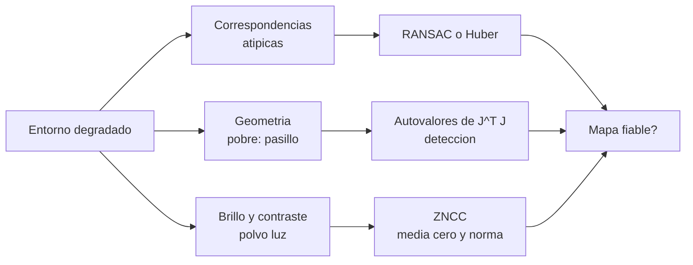

# B99-C07 — Robustez del mapeo ante entornos degradados

<!-- nav:top -->
[🏠 Programa](../../../../README.md) · [📚 Bloque B99](../../../tronco-comun/B99-localizacion-y-mapeo-robotico.md) · [← Anterior: B99-C06 — Evaluación de deriva y error de trayectoria](../B99-C06-evaluacion-de-deriva-y-error-de-trayectoria/CLASE.md) · [Siguiente: B100-C01 — Gestión de inventario de materias primas y piezas →](../../../tronco-comun/B100-logistica-y-cadena-de-suministro-extraterrestre.md#b100-c01)
<!-- /nav -->

## 1. Ubicación, nivel y alcance

Clase 7 del bloque B99. Nivel N3. En la superficie de la Luna o de Marte el mapeo se degrada: hay texturas pobres, polvo, sombras duras y pasillos de roca sin rasgos. Tres cosas pueden fallar: **las correspondencias** (más valores atípicos), **la geometría** (el entorno no determina el movimiento) y **el brillo** (la luz cambia entre vistas). Aquí comparas estimadores robustos (mínimos cuadrados, **Huber** y **RANSAC**) frente a atípicos, detectas la **degeneración** de un pasillo con los autovalores de la información y mides cómo la normalización del descriptor protege de los cambios de iluminación. Todos los datos son **sintéticos**.

## 2. Por qué esta clase existe

Un estimador que funciona en el laboratorio puede fallar sin avisar cuando el entorno empeora. La decisión central: **¿qué estimador usar, cómo detectar que el entorno no determina el movimiento y cuándo dejar de confiar en el mapa?**

## 3. Lo que podrás hacer al terminar

1. Comparar mínimos cuadrados, Huber (IRLS) y RANSAC con una fracción creciente de atípicos.
2. Calcular la información `JᵀJ` de un ajuste punto-a-línea y leer sus autovalores.
3. Detectar la degeneración de un pasillo recto y su dirección indeterminada.
4. Comparar SSD y correlación normalizada de media cero bajo cambios de ganancia y sesgo de brillo y con poco contraste.
5. Decidir, con una tabla, cuándo el estimador o el sensor dejan de ser fiables.
6. Separar lo consultado (robustez en SLAM y RANSAC en odometría) de lo sintético.

La evidencia es la **tabla de robustez frente a atípicos y degeneración** del ejercicio 12 (sección 20).

## 4. Con qué llegas y cómo comprobarlo

1. ¿Qué es un estimador robusto?
2. ¿Qué es la función de Huber?
3. ¿Qué son los autovalores de una matriz simétrica y qué dicen de `JᵀJ`?
4. ¿Qué es una restricción punto-a-línea?
5. ¿Qué es la correlación normalizada de media cero?

<details>
<summary>Ver respuestas</summary>

1. Uno que limita la influencia de los datos atípicos. 2. Cuadrática para errores pequeños y lineal para grandes: pondera `δ/|r|` cuando `|r| > δ`. 3. Su tamaño mide cuánta información hay en cada dirección; uno nulo indica una dirección no determinada. 4. Un error medido a lo largo de la normal a una línea (pared). 5. Correlación tras restar la media y normalizar (C02).
</details>

Con cuatro o cinco aciertos, sigue; si no, repasa los prerrequisitos.

## 5. Un caso de contexto y casos de referencia

Con 60 puntos y 30 % de correspondencias atípicas, el error de traslación es **0,606 m** con mínimos cuadrados, **0,009 m** con Huber y **0,0067 m** con RANSAC. En un pasillo recto de 20 m el autovalor mínimo de `JᵀJ` es **0** y la dirección débil es la traslación a lo largo del pasillo `(1, 0, 0)`; en una esquina en L es 9,89 y la razón de condición es 64,2. Con ganancia 1,5 y sesgo +25, el acierto de emparejamiento a contraste 10 es **4 %** con SSD y **100 %** con ZNCC. Los datos son **sintéticos**.

## 6. Vocabulario

**Atípico:** dato que no sigue el modelo. **Huber / IRLS:** pesos `w = min(1, δ/|r|)` reajustados iterativamente (la teoría de M-estimadores no se consultó). **RANSAC:** ajuste con muestras mínimas aleatorias y recuento de inliers (F6). **Degeneración:** entorno que no determina alguna dirección del movimiento. **Información `JᵀJ`:** matriz cuyos autovalores miden la certeza por dirección. **SSD:** suma de diferencias al cuadrado. **ZNCC:** correlación normalizada de media cero. **Contraste:** desviación típica de la intensidad de un parche.

## 7. Modelo mental: tres modos de fallo y sus defensas



*Descripción textual:* un entorno degradado produce correspondencias atípicas, geometría insuficiente o cambios de brillo y contraste; cada modo de fallo tiene una defensa (estimador robusto, detección por autovalores, descriptor normalizado) y de ellas depende si el mapa sigue siendo fiable.

Analogía: caminar en niebla por un pasillo largo: ves las paredes (sabes cuánto te desvías a los lados) pero no sabes cuánto avanzaste a lo largo. Límite: aquí la niebla es matemática: una dirección con información cero.

## 8. La explicación, paso a paso

### 8.1 Qué dicen las fuentes

Scaramuzza y Fraundorfer (F6) presentan RANSAC como el esquema habitual de rechazo de atípicos en la estimación del movimiento visual y mencionan los trucos para acelerarlo. Cadena et al. (F1) incluyen la robustez y la escalabilidad entre los temas de la revisión de SLAM. ORB-SLAM (F7) señala en su resumen que el sistema es robusto a «motion clutter» severo y que incluye relocalización tras fallos de seguimiento. De F6, F1 y F7 se consultó solo lo indicado; no se consultaron los trabajos de odometría visual de los rovers de Marte ni la teoría de M-estimadores.

### 8.2 Estimadores frente a atípicos

Se registran 60 puntos (transformación verdadera: 0,10 rad y `(0,5; −0,3) m`, ruido 0,02 m) con una fracción `ε` de correspondencias reemplazadas por puntos al azar. **Mínimos cuadrados (LS)** da error 0,0047 m sin atípicos, 0,244 m con 10 %, 0,606 m con 30 % y 0,948 m con 50 %. **Huber (IRLS, `δ = 0,05 m`, 30 iteraciones)** da 0,0060; 0,0090 y 0,0134 m. **RANSAC (60 hipótesis, umbral 0,08 m)** da 0,0053; 0,0067 y 0,0077 m. Un solo atípico basta para sesgar LS; los dos robustos casi no se afectan, y RANSAC aguanta mejor el 50 %.

### 8.3 Degeneración por autovalores

Con restricciones punto-a-línea, cada punto `p` con normal `n` aporta la fila `J = [n_x, n_y, n · (−p_y, p_x)]` y la información es `JᵀJ`. En un pasillo recto (dos paredes paralelas) todas las normales son `(0, ±1)`: la traslación a lo largo del pasillo no tiene ninguna restricción y el autovalor mínimo es `0` (autovalores `0; 40,5; 21 590`). En una esquina en L hay normales en dos direcciones y los autovalores son `9,89; 40,0; 634,7` (razón de condición 64,2). Un autovalor casi nulo es la señal de que el ajuste no determina el movimiento en esa dirección; hay que complementarlo con otro sensor (por ejemplo, la odometría de ruedas o inercial).

### 8.4 Iluminación y poca textura

Con cambio de ganancia `g` y sesgo `b` (`I → gI + b`) la ZNCC no cambia, y la SSD sí. En el laboratorio (100 parches de `11×11`, ruido de 4 niveles): a contraste 40 y sin cambio ambos aciertan 100 %; con `g = 1,5` y `b = 25` la SSD baja a 80 % y a 4 % con contraste 10, mientras la ZNCC mantiene 100 %. Pero con contraste 1 (señal menor que el ruido) la ZNCC ya no basta: 55 % sin cambio de luz y 90 % con `g = 1,5` (la ganancia amplifica la señal respecto del ruido fijo). La normalización protege de la luz, no de la falta de señal.

## 9. Magnitudes, símbolos y unidades

| Símbolo | Qué es | Unidad | Valor / nota |
|---|---|---|---|
| `ε` | fracción de atípicos | — | 0 a 0,5 |
| `δ` | umbral de Huber | m | 0,05 |
| error de traslación | `‖t̂ − t‖` | m | 0,0047 a 0,948 |
| `λ_min` | autovalor mínimo de `JᵀJ` | — | 0 (pasillo); 9,89 (esquina) |
| `g`, `b` | ganancia y sesgo de brillo | —, niveles | 1,5; 25 |
| contraste | desviación típica del parche | niveles | 40; 10; 2; 1 |

## 10. Convenciones y referencias

Mundo 2D; unidades m, rad y niveles 0–255. Transformación verdadera `(0,10 rad; 0,5 m; −0,3 m)`; ruido de puntos 0,02 m; ruido de parche 4 niveles. Tolerancias: sin atípicos los tres estimadores a `< 2 cm`; el pasillo debe dar `λ_min < 10⁻⁹ λ_max`; la dirección débil del pasillo es `(1, 0, 0)` a `10⁻⁶`. Puntos, atípicos, pasillo, esquina, parches y ruidos son **sintéticos** (semillas 88 y 700–729; promedios de 30 casos en el registro y de 10 en el emparejamiento).

## 11. De dónde sale lo que afirmamos

| ID | Fuente | Localizador | Respalda | Estado |
|---|---|---|---|---|
| F6 | Scaramuzza y Fraundorfer, Visual Odometry Part I: The First 30 Years and Fundamentals, IEEE Robotics & Automation Magazine — PDF https://rpg.ifi.uzh.ch/docs/VO_Part_I_Scaramuzza.pdf (consultada 2026-11-10 con PyMuPDF) | introducción y secciones sobre RANSAC y deriva | definición de odometría visual (estimar el egomovimiento solo con cámaras), uso de RANSAC para rechazar atípicos, acumulación de errores (deriva) y reducción con ajuste de haces en ventana | Consultada (año no verificado en el texto extraído) |
| F1 | Cadena, Carlone, Carrillo, Latif, Scaramuzza, Neira, Reid y Leonard, Past, Present, and Future of Simultaneous Localization and Mapping: Towards the Robust-Perception Age, IEEE Transactions on Robotics 32(6), 2016 — https://arxiv.org/abs/1606.05830 (consultada 2026-11-10) | resumen | robustez y escalabilidad del SLAM a largo plazo | Consultada (solo el resumen; no el texto completo) |
| F7 | Mur-Artal, Montiel y Tardós, ORB-SLAM: a Versatile and Accurate Monocular SLAM System, IEEE Transactions on Robotics, 2015 (DOI 10.1109/TRO.2015.2463671) — PDF https://arxiv.org/pdf/1502.00956 (consultada 2026-11-10 con PyMuPDF) | resumen | robustez a «motion clutter» severo, relocalización tras pérdida de seguimiento y cierre de bucles | Consultada (resumen e introducción) |
| — | Huber (1964) y la teoría de M-estimadores | — | el laboratorio mide su efecto | No consultada |
| — | Rublee et al. (2011) sobre ORB y los trabajos de odometría visual de los rovers de Marte | — | no se consultaron | No consultada |

Límites: ninguna fuente consultada da las cifras de esta clase; el desempeño de Huber y RANSAC es del laboratorio sintético y no se contrastó con datos de misión.

## 12. Cómo ver los resultados

| Atípicos | Estimador | Error de traslación | Error de giro |
|---|---|---|---|
| 0 % | LS / Huber / RANSAC | 0,0047 m (los tres) | 0,0004 rad |
| 10 % | LS | 0,2444 m | 0,0242 rad |
| 10 % | Huber | 0,0060 m | 0,0004 rad |
| 10 % | RANSAC | 0,0053 m | 0,0004 rad |
| 30 % | LS | 0,6058 m | 0,0535 rad |
| 30 % | Huber | 0,0090 m | 0,0009 rad |
| 30 % | RANSAC | 0,0067 m | 0,0007 rad |
| 50 % | LS | 0,9475 m | 0,1134 rad |
| 50 % | Huber | 0,0134 m | 0,0017 rad |
| 50 % | RANSAC | 0,0077 m | 0,0008 rad |

| Entorno | Autovalores de `JᵀJ` | Dirección débil `(dx, dy, dθ)` |
|---|---|---|
| Pasillo recto | 0; 40,5; 21 590 | `(+1,00; 0; 0)` |
| Esquina en L | 9,89; 40,0; 634,7 | `(+0,87; −0,43; +0,22)` |

| Contraste | Ganancia | Sesgo | Acierto SSD | Acierto ZNCC |
|---|---|---|---|---|
| 40 | 1,0 | 0 | 100 % | 100 % |
| 40 | 1,5 | 25 | 80 % | 100 % |
| 10 | 1,5 | 25 | 4 % | 100 % |
| 2 | 1,5 | 25 | 2 % | 100 % |
| 1 | 1,0 | 0 | 8 % | 55 % |
| 1 | 1,5 | 25 | 1 % | 90 % |

Descripción larga: LS se degrada de 0,24 a 0,95 m al subir los atípicos; Huber y RANSAC se mantienen bajo 1,4 cm; el pasillo tiene un autovalor nulo en la dirección `x`; ZNCC supera a SSD ante cambios de luz hasta que el contraste cae por debajo del ruido.

## 13. Ejemplo trabajado: un peso de Huber y una probabilidad de RANSAC

**Paso 1 · Peso de Huber.** Con `δ = 0,05 m`: un residuo `r = 0,03` pesa 1; uno de `r = 0,20` pesa `0,05/0,20 = 0,25`; uno de `r = 2` pesa `0,025`.
**Paso 2 · Muestra limpia de RANSAC.** Con `ε = 0,5` y muestras de 2 puntos: `(1 − 0,5)² = 0,25`.
**Paso 3 · Hipótesis necesarias.** Para fallar con probabilidad `< 10⁻³`: `0,75ⁿ < 10⁻³` → `n > 24,0`: 25 hipótesis (el laboratorio usa 60).
**Paso 4 · Degeneración.** Pasillo: un punto `(p_x, ±1,5)` con normal `(0, ∓1)` aporta `J = [0, ∓1, ∓p_x]`: la primera columna (dirección `x`) es nula para todos los puntos; `λ_min = 0`.
**Paso 5 · Conclusión.** El ajuste no puede estimar el avance a lo largo del pasillo; hay que detectarlo y apoyarse en otro sensor.

## 14. Distintas formas de describir el problema

**Por estimador:** LS, Huber, RANSAC (esta clase). **Por observabilidad:** autovalores de la información. **Por descriptor:** normalización frente a cambios de luz. Un sistema robusto combina las tres: estimador robusto, detección de degeneración y descriptores estables.

## 15. Práctica guiada

**Ejercicio 1 · con los pasos indicados.** Con `δ = 0,05 m`, calcula el peso de Huber de un residuo de 0,20 m. *Pasos:* comparar con `δ`, cociente.

<details><summary>Solución comentada</summary>

`0,20 > 0,05`: `w = 0,05/0,20 = 0,25`.
</details>

**Ejercicio 2 · con una pista.** Con 50 % de atípicos y muestras de 2 puntos, ¿cuántas hipótesis hacen falta para que la probabilidad de no hallar una muestra limpia sea `< 10⁻³`? *Pista:* `0,75ⁿ`.

<details><summary>Solución comentada</summary>

`n > ln(10⁻³)/ln(0,75) = 24,0`: 25 hipótesis.
</details>

**Ejercicio 3 · casi autónomo.** ¿Cuántas veces mayor es el error de LS que el de RANSAC con 30 % de atípicos?

<details><summary>Solución comentada</summary>

`0,6058/0,0067 ≈ 90` veces.
</details>

## 16. Práctica autónoma, transferencia e integrador

**Ejercicio 4 · autónomo.** ¿Qué dirección no determina un pasillo recto y por qué?

<details><summary>Solución comentada</summary>

La traslación a lo largo del pasillo: todas las normales de las paredes son perpendiculares a ella y no aportan restricción.
</details>

**Ejercicio 5 · autónomo.** Si en el pasillo aparece una puerta transversal con puntos de normal `(1, 0)`, ¿qué le pasa a `λ_min`?

<details><summary>Solución comentada</summary>

Deja de ser cero: hay restricciones a lo largo de `x`.
</details>

**Ejercicio 6 · autónomo.** Con contraste 40, `g = 1,5` y `b = 25`, ¿cuál es la diferencia de acierto entre ZNCC y SSD?

<details><summary>Solución comentada</summary>

`100 % − 80 % = 20` puntos.
</details>

**Ejercicio 7 · autónomo.** ¿Por qué con contraste 1 la ZNCC acierta más con `g = 1,5` (90 %) que con `g = 1` (55 %)?

<details><summary>Solución comentada</summary>

La ganancia amplifica la señal de 1 a 1,5 niveles mientras el ruido sigue siendo de 4: mejora la relación señal/ruido.
</details>

**Ejercicio 8 · autónomo.** En un entorno de simetría circular (puntos de un círculo con normales radiales), ¿qué dirección queda sin información?

<details><summary>Solución comentada</summary>

El giro alrededor del centro: `n · (−p_y, p_x) = 0` para `p` paralelo a `n`, por lo que la columna de `dθ` es nula.
</details>

**Ejercicio 9 · transferencia.** **Transferencia.** Un colega afirma que «RANSAC resuelve el mapeo en polvo». ¿Es válido?

<details><summary>Solución comentada</summary>

No: RANSAC rechaza correspondencias erróneas, pero no crea información: si el polvo borra el contraste (caso de contraste 1) no hay correspondencias que rescatar.
</details>

**Ejercicio 10 · transferencia.** **Transferencia.** Con 50 % de atípicos Huber dio 0,0134 m y RANSAC 0,0077 m. ¿Concluyes que RANSAC es siempre mejor?

<details><summary>Solución comentada</summary>

No: es un caso sintético con una inicialización por LS para Huber; RANSAC cuesta más cómputo y depende del azar; la conclusión no se generaliza.
</details>

**Ejercicio 11 · transferencia.** **Transferencia.** ¿Qué haría un robot que detecta `λ_min ≈ 0` en un cañón estrecho?

<details><summary>Solución comentada</summary>

Marcar la estimación como degenerada en esa dirección, bajar la confianza del mapeo y apoyarse en otro sensor o detenerse según su política de seguridad.
</details>

**Ejercicio 12 · integrador.** **Integrador.** Elabora tu *tabla de robustez frente a atípicos y degeneración*: errores por estimador y fracción de atípicos, autovalores de pasillo y esquina, tasas de emparejamiento por contraste y luz, y lista de qué es consultado, no consultado y sintético.

<details><summary>Solución comentada</summary>

Sección 12 y la salida del laboratorio.
</details>

## 17. Laboratorio: estimadores robustos, degeneración y descriptor normalizado

El script [robustez.py](robustez.py) compara LS, Huber (IRLS) y RANSAC con 0 a 50 % de atípicos, calcula los autovalores de `JᵀJ` de un pasillo y de una esquina, y mide el acierto de emparejamiento de parches con SSD y ZNCC bajo cambios de luz y poco contraste; **comprueba** que sin atípicos los tres coinciden, que LS es peor que RANSAC (más de 5 veces con 30 %), que el pasillo tiene `λ_min ≈ 0` en la dirección `x` y la esquina no, y que ZNCC supera a SSD con cambios de luz. Usa la biblioteca común [b99_comun.py](../b99_comun.py).

**Datos:** puntos, atípicos, pasillo, esquina y parches **sintéticos** (semillas 88 y 700–729). **Predice antes de ejecutar:** ¿qué autovalor mínimo tendrá el pasillo? (cero). Ejecución del 2026-11-10 (Python 3.12.9, numpy 2.4.4):

```text
Python 3.12.9 | numpy 2.4.4
Datos SINTETICOS: 60 puntos en 10 x 10 m, transformacion verdadera (0.10 rad, 0.5 m, -0.3 m), ruido 0.02 m
atipicos  estimador   error de traslacion [m]   error de giro [rad]
      0%  LS                          0.0047                0.0004
      0%  Huber                       0.0047                0.0004
      0%  RANSAC                      0.0047                0.0004
     10%  LS                          0.2444                0.0242
     10%  Huber                       0.0060                0.0004
     10%  RANSAC                      0.0053                0.0004
     30%  LS                          0.6058                0.0535
     30%  Huber                       0.0090                0.0009
     30%  RANSAC                      0.0067                0.0007
     50%  LS                          0.9475                0.1134
     50%  Huber                       0.0134                0.0017
     50%  RANSAC                      0.0077                0.0008

pasillo recto (2 paredes)  autovalores de J^T J = 0.000e+00, 4.053e+01, 2.159e+04 ; direccion debil = (+1.00, +0.00, +0.00) en (dx, dy, dtheta)
esquina en L               autovalores de J^T J = 9.887e+00, 4.000e+01, 6.347e+02 ; direccion debil = (+0.87, -0.43, +0.22) en (dx, dy, dtheta)
Razon de condicion: pasillo = infinita (autovalor minimo nulo) ; esquina = 64.2

contraste  ganancia  sesgo  acierto SSD  acierto ZNCC
       40       1.0      0         100%          100%
       40       1.5     25          80%          100%
       10       1.5     25           4%          100%
        2       1.5     25           2%          100%
        1       1.0      0           8%           55%
        1       1.5     25           1%           90%
Pruebas superadas.
```

```bash
python programa/clases/B99/B99-C07-robustez-del-mapeo-ante-entornos-degradados/robustez.py
```

**Límites:** 2D, atípicos uniformes (otros patrones de falso emparejamiento pueden dar resultados distintos), ruido gaussiano, parches sintéticos (no imágenes reales), un solo valor de `δ` y de umbral de RANSAC sin ajustar.

## 18. Errores frecuentes y cómo corregirlos

**Usar mínimos cuadrados con correspondencias dudosas.** LS pasa de 0,5 cm a 24 cm con 10 % de atípicos (8.2).

**Creer que un `χ²` bueno garantiza observabilidad.** En un pasillo el `χ²` puede ser bajo y la dirección `x` seguir indeterminada (8.3).

**Confiar en ZNCC cuando el contraste es menor que el ruido.** A contraste 1 el acierto cae a 55 % (8.4).

## 19. Cómo sabrás que vas bien

Tras la sección 8: ¿qué dirección queda indeterminada en un pasillo? Si dudas, repasa el ejercicio 4. Tras el laboratorio: ¿por qué la ZNCC no basta a contraste 1? (ver sección 17).

## 20. Qué entregas y cómo se evalúa

El producto es tu **tabla de robustez frente a atípicos y degeneración** (ejercicio 12).

| Criterio | Inicial | En desarrollo | Logrado | Destacado |
|---|---|---|---|---|
| Conceptos | Los confunde | Parciales | Explica el método y su dominio | Explica los límites y las alternativas |
| Cálculo | Sin unidades | Con errores | Resultados con unidades y comprobados | Resuelve casos nuevos |
| Numérico | Sin comprobar | Un caso | Verifica con una comprobación independiente en varios casos | Interpreta las diferencias y los fallos |
| Fuentes | Sin fuente | Sin fecha | Fuentes con fecha y estado | Declara lo sintético y lo no consultado |
| Límites | No los nombra | Uno | Tres | Discute qué falta del modelo |

**Condiciones críticas (no se compensan con promedio):** rotular los datos como sintéticos; verificar cada resultado con una comprobación independiente; citar solo lo consultado.

## 21. Ética, seguridad y límites

Clase educativa: los valores son sintéticos; en un vehículo real, la detección de degeneración y la política de pérdida de confianza forman parte de su análisis de seguridad y no se deciden con un laboratorio. Accesibilidad: tablas equivalentes a las gráficas, fórmulas en texto, ejercicios sin conexión.

## 22. Para cerrar y seguir

Con 30 % de atípicos LS tiene un error de 0,606 m frente a 0,0067 m de RANSAC; un pasillo recto tiene `λ_min = 0` y la ZNCC mantiene 100 % de acierto ante la luz hasta que el contraste cae bajo el ruido. Con esta clase se cierra el bloque: sabes estimar el movimiento, fusionarlo en un mapa, medir su error y saber cuándo no fiarte de él.

**Glosario español–inglés.** atípico · *outlier*; estimador robusto · *robust estimator*; degeneración · *degeneracy*; información · *information matrix*; contraste · *contrast*; correlación normalizada · *zero-mean normalized cross-correlation (ZNCC)*.

**Continuidad.** cierra el bloque; el siguiente bloque del área es B100.

**Referencias:** ver sección 11.

<!-- nav:bottom -->
---

[← Anterior: B99-C06 — Evaluación de deriva y error de trayectoria](../B99-C06-evaluacion-de-deriva-y-error-de-trayectoria/CLASE.md) · [📚 Bloque B99](../../../tronco-comun/B99-localizacion-y-mapeo-robotico.md) · [Siguiente: B100-C01 — Gestión de inventario de materias primas y piezas →](../../../tronco-comun/B100-logistica-y-cadena-de-suministro-extraterrestre.md#b100-c01)
<!-- /nav -->
