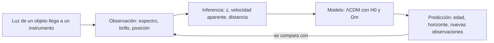

# B01-C01 — Naturaleza del universo

> **Borrador piloto del estándar `clase-profunda-cientifica`.** Contiene las 22 funciones, pero **no ha tenido revisión humana disciplinar**. El catálogo mantiene esta clase en **E0**; este documento **no cuenta** como clase redactada, verificada ni validada (reglas de `AGENTS.md`).

[🏠 Programa](../../../README.md) · [📚 Bloque B01](../../tronco-comun/B01-el-universo-y-el-pensamiento-cientifico.md) · [Siguiente: B01-C02 →](../../tronco-comun/B01-el-universo-y-el-pensamiento-cientifico.md#b01-c02)

[🧪 Laboratorio](laboratorio_edad_y_horizonte.py) · [📝 Ficha editorial](FICHA_EDITORIAL.md)

## 1. Ubicación, nivel y alcance

- **Dónde estás:** Área A01 · Bloque B01 · clase 1 de 20 (`B01-C01`).
- **Nivel:** parte de N0 (descubrimiento) y llega a N1 (fundamentos, con cálculo elemental y análisis de error).
- **Qué abarca:** qué es el universo y qué parte podemos observar; cómo separar lo observado de lo inferido y de lo modelado.
- **Qué no abarca:** la historia de la cosmología (B02), la relatividad (bloques de física) ni la derivación de las ecuaciones del modelo.

## 2. Propósito y decisión central

**Necesidad.** Cualquier afirmación cosmológica («el universo tiene 13,8 mil millones de años», «mide 93 mil millones de años luz») circula sin que se sepa qué se midió y qué se supuso.

**Decisión central.** *¿Qué puedo afirmar sobre el universo y con qué evidencia?* La clase enseña a separar **observación**, **inferencia** y **modelo**, y a acompañar cada cifra con unidad, incertidumbre y límite.

**Por qué tiene lugar propio.** Fija el marco de lectura de las 19 clases siguientes del bloque; sin él, B01-C02 (escalas) y B01-C16 (expansión) se aprenden como datos sueltos.

## 3. Resultados observables

Al terminar podrás:

1. Clasificar afirmaciones sobre el universo como observación, inferencia o resultado de modelo, justificando cada clasificación.
2. Calcular el tiempo que tarda la luz en recorrer una distancia y convertir entre metros, unidades astronómicas, años luz y parsecs.
3. Estimar una distancia con la ley de Hubble y una edad con `1/H₀`, propagando la incertidumbre.
4. Distinguir *universo* de *universo observable* y explicar por qué no hay un «centro» de expansión.
5. Ejecutar un cálculo reproducible (laboratorio) y comprobarlo contra un caso analítico.
6. Nombrar un límite de validez de cada método usado.

Evidencia: la **ficha de escala y edad** (sección 20).

## 4. Prerrequisitos y diagnóstico

No se exigen conocimientos de astronomía. Se necesita notación científica, regla de tres y despejar una ecuación simple.

| # | Pregunta diagnóstica | Respuesta esperada |
|---|---|---|
| D1 | Escribe 384 400 km en metros y en notación científica | 3,844 × 10⁸ m |
| D2 | Si un tren va a 80 km/h, ¿cuánto tarda en 200 km? | 2,5 h |
| D3 | ¿Qué significa «±» en 67,4 ± 0,5? | El valor se estima en ese intervalo; 0,5 es la incertidumbre |
| D4 | Despeja `d` en `v = H·d` | `d = v / H` |
| D5 | ¿Cuántos segundos tiene un año de 365,25 días? | 31 557 600 s |

**Recuperación.** Con ≤ 3 aciertos, repasa primero B03 (matemática elemental) antes de los ejercicios 4 a 12. Con 4 o 5, continúa.

## 5. Contexto científico

Dos equipos miden la rapidez actual de expansión, la **constante de Hubble** `H₀`, y obtienen valores distintos: la colaboración Planck, a partir del fondo cósmico de microondas y el modelo ΛCDM, publica `H₀ = 67,4 ± 0,5 km/s/Mpc`; el equipo SH0ES, a partir de distancias locales, `H₀ = 73,04 ± 1,04 km/s/Mpc` (fuentes S1 y S2). La discrepancia se conoce como *tensión de Hubble* y sigue abierta. Es un caso veraz para esta clase: muestra que una cifra cosmológica es un **resultado con método e incertidumbre**, no un dato fijo.

**Frontera de aplicación.** La clase usa el modelo ΛCDM plano como herramienta didáctica; no decide cuál medición es correcta ni sustituye a la literatura especializada.

## 6. Vocabulario y definiciones operacionales

| Término | Sencilla | Operacional |
|---|---|---|
| Universo | Todo el espacio, la materia, la energía y el tiempo | Objeto de estudio de la cosmología; su extensión total es desconocida |
| Universo observable | La parte de la que ha podido llegarnos luz | Región cuyo radio comóvil hoy es el *horizonte de partículas* (≈ 46 Gly en ΛCDM, calculado en el laboratorio) |
| Observación | Lo que un instrumento registra | Dato con instrumento, fecha y calibración (p. ej. longitud de onda de una línea) |
| Inferencia | Lo que se concluye a partir de datos | Conclusión que usa un método o supuesto adicional (p. ej. velocidad a partir de `z`) |
| Modelo | Representación simplificada con reglas | Conjunto de ecuaciones y parámetros con dominio de validez (p. ej. ΛCDM) |
| Desplazamiento al rojo `z` | Cuánto se estira la luz | `z = (λ_obs − λ_emit) / λ_emit` |
| Constante de Hubble `H₀` | Rapidez actual de expansión por distancia | Cociente `v/d` a distancias cosmológicas pequeñas, en km/s/Mpc |
| Incertidumbre | Qué tan bien conocemos un valor | Intervalo declarado asociado a una medida o resultado |

Distinguir cercanos: *universo* ≠ *universo observable*; *distancia propia* (en un instante) ≠ *distancia comóvil* (que sigue la expansión) ≠ *distancia recorrida por la luz*.

## 7. Modelo mental

**Descripción textual (accesible).** Cinco cajas en cadena: la luz llega, se registra una observación, se hacen inferencias, se aplica un modelo y se obtienen predicciones; una flecha devuelve las predicciones a la observación para contrastarlas. Cada paso añade supuestos y por eso añade incertidumbre.

Relaciones causales: **expansión** del espacio aumenta las distancias entre galaxias lejanas sin un centro; la luz en tránsito se **estira**, lo que mide `z`; la edad depende de cómo cambió la rapidez de expansión (contenido del universo).

## 8. Desarrollo progresivo

1. **Intuición.** Mirar lejos es mirar al pasado: la luz tarda en llegar. Del Sol recibimos luz de hace ~8 min; de Andrómeda, de hace ~2,5 millones de años.
2. **Mecanismo.** Las galaxias lejanas muestran líneas espectrales corridas hacia el rojo; en promedio, mientras más lejos, mayor `z`. Para `z` pequeño, `v ≈ c·z` y `v = H₀·d` (ley de Hubble).
3. **Cuantificación.** Si hoy la expansión es `H₀`, el tiempo `1/H₀` (*tiempo de Hubble*) da una escala de edad. La edad real exige integrar la historia de expansión del modelo (laboratorio).
4. **Límites.** `v = H₀·d` falla para objetos ligados gravitacionalmente (Andrómeda se acerca a la Vía Láctea) y `v = c·z` falla para `z` grandes. Todo valor de `H₀` hereda la incertidumbre del método.

## 9. Magnitudes, símbolos y unidades

| Símbolo | Magnitud | Unidad | Valor o nota |
|---|---|---|---|
| `c` | velocidad de la luz en el vacío | m/s | 299 792 458 (exacto, SI) |
| `au` | unidad astronómica | m | 149 597 870 700 (exacto, IAU 2012) |
| `ly` | año luz = `c` × 1 año juliano | m | ≈ 9,4607 × 10¹⁵ |
| `pc` | parsec | m | ≈ 3,0857 × 10¹⁶ (1 pc ≈ 3,2616 ly) |
| `Mpc` | megaparsec = 10⁶ pc | km | ≈ 3,0857 × 10¹⁹ |
| `z` | desplazamiento al rojo | adimensional | — |
| `v` | velocidad de recesión aparente | km/s | `≈ c·z` si `z ≪ 1` |
| `d` | distancia | Mpc | — |
| `H₀` | constante de Hubble | km/s/Mpc | 67,4 ± 0,5 (S1); 73,04 ± 1,04 (S2) |
| `Ωm` | fracción de materia hoy | adimensional | 0,315 ± 0,007 (S1, base-ΛCDM) |
| `t_H` | tiempo de Hubble `1/H₀` | Gyr (10⁹ años) | 977,8 / `H₀` si `H₀` en km/s/Mpc |

Año juliano = 365,25 d = 31 557 600 s. Todo símbolo se define aquí antes de usarse.

## 10. Referencias y convenciones

- **Época:** hoy (`z = 0`). **Escala temporal:** tiempo cósmico desde el inicio de la expansión en ΛCDM.
- **Marco:** distancias *comóviles* para el horizonte; *propias* hoy para la ley de Hubble. La línea de visión es radial.
- **Signo:** `z > 0` es corrimiento al rojo (alejamiento aparente); `z < 0` al azul.
- **Cuidado:** el `z` cosmológico se debe al estiramiento del espacio, no a un efecto Doppler de movimiento a través del espacio; `v = c·z` es solo una aproximación didáctica para `z ≪ 1`.
- **Unidades:** SI; excepciones astronómicas (ly, pc, Mpc, Gyr) justificadas por escala.

## 11. Evidencia y fuentes

| ID | Fuente | Localizador | Respalda | Estado de verificación |
|---|---|---|---|---|
| S1 | Planck Collaboration (Aghanim, N. et al.), *Planck 2018 results. VI. Cosmological parameters*, A&A 641, A6 (2020) | DOI 10.1051/0004-6361/201833910 · arXiv:1807.06209 | `H₀ = 67,4 ± 0,5`; `Ωm = 0,315 ± 0,007` (base-ΛCDM) | Resumen consultado el 2026-11-05. **No** se leyó el artículo completo; la edad no se toma de aquí, se calcula |
| S2 | Riess, A. G. et al., *A Comprehensive Measurement of the Local Value of the Hubble Constant with 1 km/s/Mpc Uncertainty…* (2022) | DOI 10.3847/2041-8213/ac5c5b · arXiv:2112.04510 | `H₀ = 73,04 ± 1,04` | Resumen consultado el 2026-11-05 |
| S3 | BIPM, *The International System of Units (SI): Defining constants* | https://www.bipm.org/en/measurement-units/si-defining-constants | `c = 299 792 458 m/s` exacta | Página consultada el 2026-11-05. Falta citar la edición de la *SI Brochure* (9.ª ed., 2019) con sección |
| S4 | IAU, Resolución B2 de 2012, *Re-définition de l'unité astronomique de longueur* | https://www.iau.org/Iau/Publications/List-of-Resolutions.aspx | `au` exacta (149 597 870 700 m) | Título de la resolución confirmado el 2026-11-05 en la lista de la IAU; **el valor no se leyó en el texto de la resolución** (PDF no accesible) y la definición de parsec (IAU 2015) **no se consultó** |
| S5 | Hubble, E., *A relation between distance and radial velocity among extra-galactic nebulae*, PNAS 15, 168 (1929) | DOI 10.1073/pnas.15.3.168 | Relación histórica distancia–velocidad | El sitio del editor devolvió acceso denegado el 2026-11-05: **cita no verificada**; solo uso histórico |

Límite: ninguna fuente respalda aquí la afirmación de que ΛCDM sea la descripción definitiva del universo. Licencias: se citan resultados y se parafrasea; no se reproduce texto ni figuras.

## 12. Visualización accesible

**Figura 1** (sección 7): diagrama de flujo con descripción textual.

**Figura 2 — Escalas de longitud (tabla equivalente, escala logarítmica).**

| Objeto | Distancia (m) | Orden de magnitud (log₁₀) |
|---|---|---|
| Tierra–Luna | 3,844 × 10⁸ | 8,6 |
| Tierra–Sol | 1,496 × 10¹¹ | 11,2 |
| Próxima Centauri | ≈ 4,02 × 10¹⁶ | 16,6 |
| Andrómeda | ≈ 2,4 × 10²² | 22,4 |
| Horizonte observable (ΛCDM) | ≈ 4,4 × 10²⁶ | 26,6 |

Si se dibuja, usar eje logarítmico rotulado, paleta apta para daltonismo y marcadores distintos por forma, no solo color. Descripción larga: cada fila es unas 5 a 6 veces mayor en exponente que la anterior; la escala cosmológica excede la humana en unos 26 órdenes de magnitud.

## 13. Ejemplo trabajado: edad de Hubble con `H₀ = 70 km/s/Mpc`

**Datos (estimados):** `H₀ = 70 km/s/Mpc`. **Supuesto:** expansión uniforme (solo para dimensionar).

1. `1 Mpc = 3,0857 × 10¹⁹ km`, entonces `H₀ = 70 km/s / 3,0857 × 10¹⁹ km = 2,268 × 10⁻¹⁸ s⁻¹`.
2. `t_H = 1/H₀ = 4,408 × 10¹⁷ s`.
3. En años: `4,408 × 10¹⁷ s / 3,1558 × 10⁷ s/año = 1,397 × 10¹⁰ años = 13,97 Gyr`.
4. **Comprobación dimensional:** `1/(s⁻¹) = s`. ✓. **Atajo:** `977,8 / 70 = 13,97`. ✓
5. **Sentido físico:** es la misma escala que la edad modelada (13,8 Gyr en el laboratorio con `H₀ = 67,4`), pero no es igual: la expansión no fue uniforme.
6. **Incertidumbre:** con `H₀ = 67,4 ± 0,5`, `t_H = 14,51 ± 0,11 Gyr` (`δt = t·δH/H`).

## 14. Comparación de métodos

| Método | Qué entrega | Ventaja | Deja de valer cuando |
|---|---|---|---|
| `t_H = 1/H₀` | Escala de edad | Una línea, sin modelo | Se quiere una edad precisa: ignora la historia de expansión |
| Integral ΛCDM plano | Edad y horizonte | Usa `Ωm`, `H₀`; reproducible | El modelo es inadecuado o hay curvatura/parámetros muy distintos |
| `d = v/H₀` con `v = c·z` | Distancia aproximada | Rápido | `z` no es pequeño o el objeto está ligado a un grupo |
| Distancias locales (escalera de distancias) | `H₀` local | Independiente del modelo cosmológico | Sistemáticos de calibración (origen de la tensión) |

## 15. Práctica guiada (apoyos decrecientes)

**Ejercicio 1 — con pasos.** ¿Cuánto tarda la luz del Sol (1 au) y de la Luna (384 400 km) en llegar a la Tierra?
*Pasos:* `t = d/c`; Sol: `1,495978707 × 10¹¹ m / 2,99792458 × 10⁸ m/s = 499,0 s = 8,32 min`; Luna: `3,844 × 10⁸ / 2,998 × 10⁸ = 1,282 s`.
*Comentario:* ves el Sol como era hace ~8 min; la Luna, hace ~1,3 s. Unidades coherentes: m y m/s.

**Ejercicio 2 — con pista.** Próxima Centauri está a 4,2465 ly. ¿Distancia en metros, en parsecs y tiempo de la luz?
*Pista:* multiplica por 9,4607 × 10¹⁵ m/ly.
*Solución:* `4,2465 × 9,4607 × 10¹⁵ = 4,017 × 10¹⁶ m`; `4,2465 / 3,2616 = 1,302 pc`; la luz tarda 4,2465 años por definición de año luz.

**Ejercicio 3 — casi autónomo.** Andrómeda está a ≈ 2,5 × 10⁶ ly. Calcula su distancia en metros y explica por qué **no** corresponde aplicar `d = v/H₀`.
*Solución:* `2,5 × 10⁶ × 9,4607 × 10¹⁵ = 2,37 × 10²² m`. Está ligada gravitacionalmente al Grupo Local y se acerca a nosotros (corrimiento al azul), así que su movimiento no sigue la expansión.

## 16. Práctica autónoma, transferencia e integrador

**Ejercicio 4.** Una galaxia se aleja a 3000 km/s. Estima su distancia con `H₀ = 67,4`, `70` y `73,04` km/s/Mpc y comenta la dispersión.
*Solución:* `44,5`, `42,9` y `41,1 Mpc`. Dispersión ≈ 3,4 Mpc (≈ 8 %): la incertidumbre de `H₀` se traslada a la distancia. En años luz (×3,2616 Mly/Mpc): ≈ 140 Mly para 70.

**Ejercicio 5.** Calcula `t_H` para `67,4 ± 0,5` y `73,04 ± 1,04` y su diferencia relativa de `H₀` en unidades de incertidumbre combinada.
*Solución:* `t_H = 14,51 ± 0,11` y `13,39 ± 0,19 Gyr`. Diferencia de `H₀`: `5,64`; incertidumbre combinada `√(0,5² + 1,04²) = 1,15`; cociente ≈ 4,9. *Advertencia:* es un cálculo simplificado que supone errores independientes y gaussianos; no sustituye al análisis de los artículos.

**Ejercicio 6.** Clasifica como observación (O), inferencia (I), resultado de modelo (M) o afirmación no sustentada (N), justificando: (a) «el espectro de la galaxia muestra Hα en 662,9 nm»; (b) «la galaxia se aleja a ≈ 3000 km/s»; (c) «el universo tiene 13,8 Gyr»; (d) «el universo se expande desde un punto central»; (e) «el universo es espacialmente plano».
*Solución:* (a) O: dato espectral con instrumento. (b) I: usa `z` y la aproximación `v ≈ cz`. (c) M: sale de ΛCDM con parámetros ajustados. (d) N: el modelo no tiene centro; la expansión ocurre en todo punto. (e) I/M: se deduce dentro del modelo con incertidumbre, no se observa directamente.

**Ejercicio 7.** Con el resultado del laboratorio (`D_c = 46,13 Gly`), calcula el radio en metros, su cociente con el radio terrestre (6,371 × 10⁶ m) y el diámetro en Gly.
*Solución:* `46,13 × 10⁹ × 9,4607 × 10¹⁵ = 4,36 × 10²⁶ m`; cociente `6,85 × 10¹⁹`; diámetro `92,3 Gly`.

**Ejercicio 8.** Una línea Hα (656,3 nm en reposo) se observa con `z = 0,01`. Halla la longitud de onda observada y `v ≈ cz`. Explica por qué para `z = 1` no se puede decir simplemente que la galaxia va a la velocidad de la luz.
*Solución:* `656,3 × 1,01 = 662,9 nm`; `v ≈ 3,0 × 10³ km/s`. Para `z = 1`, `λ_obs = 1312,6 nm`; `v = cz` daría `c` y la relación no es válida, porque `z` cosmológico mide estiramiento del espacio y no un Doppler a través del espacio.

**Ejercicio 9 (transferencia).** Un compañero dice: «si todo se aleja, nosotros estamos en el centro». Usa el modelo de la superficie de un globo para responder y señala una limitación del modelo.
*Solución:* en el globo, desde cualquier punto los demás se alejan y ninguno es centro. Limitación: el globo tiene un «interior» y un «exterior» que el universo no necesita; el modelo muestra las distancias, no la geometría completa.

**Ejercicio 10 (transferencia).** Compara `t_H` con la edad ΛCDM (`H₀ = 70`, `Ωm = 0,3`) y con un universo solo de materia (edad `2/(3H₀)`). Ejecuta el laboratorio y explica el orden de las tres cifras.
*Solución:* `t_H = 13,97 Gyr`; ΛCDM ≈ 13,46 Gyr; solo materia = 9,31 Gyr. La desaceleración inicial acorta la edad respecto de `t_H` y la aceleración tardía la alarga; la cercanía numérica entre 13,97 y 13,46 es casi una coincidencia de estos parámetros. Para decidir entre modelos hacen falta observaciones independientes (p. ej. edades estelares), tema de B17 y B19.

**Ejercicio 11 (transferencia).** Una nota dice «el universo mide 93 000 millones de años luz de diámetro, pero tiene 13 800 millones de años: imposible». Evalúa la afirmación.
*Solución:* 93 Gly ≈ `2 × 46`, es el diámetro *comóvil* del universo observable hoy. No es imposible: la luz viajó 13,8 Gyr, pero el espacio se expandió durante el trayecto; nada supera `c` localmente. Distancia recorrida por la luz ≠ distancia comóvil actual al origen.

**Ejercicio 12 (integrador).** Elabora la *ficha de escala y edad* (sección 20) para un objeto a tu elección con distancia publicada: tiempo de luz, conversión de unidades, clasificación O/I/M de tres afirmaciones, una estimación de `H₀`-dependencia con incertidumbre y un límite. Incluye una ejecución del laboratorio con una pequeña variación de parámetros y explica qué cambia.
*Solución modelo:* la ficha de Próxima Centauri o Andrómeda con los pasos de los ejercicios 2–3; se acepta cualquier objeto si todas las cifras llevan unidad, fuente y límite.

## 17. Laboratorio, observación o simulación

- **Objetivo:** calcular edad y horizonte en un ΛCDM plano y comprobar el código contra un caso analítico.
- **Datos:** parámetros **estimados** publicados (S1, S2); salidas **simuladas**; ningún dato observado se procesa directamente.
- **Código:** [laboratorio_edad_y_horizonte.py](laboratorio_edad_y_horizonte.py). **Versiones registradas:** Python 3.12.9, NumPy 2.4.4, SciPy 1.17.1.
- **Modelo y supuestos:** universo plano, `Ωr = 9,2 × 10⁻⁵`, constante cosmológica; fórmulas en la cabecera del script.
- **Validación:** Einstein–de Sitter (`Ωm = 1`): edad `2/(3H₀)` y horizonte `2c/H₀`, tolerancia relativa `10⁻⁴`; el script falla si no se cumple.
- **Resultados (ejecución del 2026-11-05):**

| `H₀` (km/s/Mpc) | `Ωm` | Edad (Gyr) | `D_c` (Gly) |
|---|---|---|---|
| 67,40 | 0,315 | 13,791 | 46,13 |
| 73,04 | 0,315 | 12,726 | 42,57 |
| 70,00 | 0,300 | 13,461 | 45,28 |

- **Lectura:** al subir `H₀` con `Ωm` fijo, el universo resulta más joven y más pequeño. La segunda fila **no** es un resultado de SH0ES, sino el efecto de usar su `H₀` en este modelo con `Ωm` de Planck: mezcla parámetros de dos mediciones. Es didáctico, no cosmología.
- **Límites:** no es un ajuste a datos; no incluye neutrinos masivos ni curvatura; no usar como cálculo de investigación.
- **Seguridad:** sin riesgos físicos. Si se amplía con observación real, nunca mirar al Sol sin filtro certificado.

Ejecución: `python programa/pilotos/B01-C01-naturaleza-del-universo/laboratorio_edad_y_horizonte.py` (requiere `numpy` y `scipy`).

## 18. Errores frecuentes y recuperación

| Error | Por qué ocurre | Cómo detectarlo | Recuperación |
|---|---|---|---|
| Confundir año luz con unidad de tiempo | El nombre incluye «año» | La respuesta tiene años donde debía haber metros | Repetir Ej. 2 convirtiendo siempre a metros |
| Creer en un «centro» del universo | Imagen de explosión | Dibuja un punto de origen | Ej. 9 con el globo; luego pedir contraejemplo |
| Aplicar `v = H₀d` a Andrómeda | Se generaliza la ley | Velocidad positiva para objeto que se acerca | Ej. 3; repasar «objetos ligados» |
| Usar `v = cz` con `z` grande | Fórmula memorizada | `v ≥ c` | Ej. 8, parte final |
| Dar cifras sin unidad ni incertidumbre | Se copia de un titular | Valor desnudo en la ficha | Reescribir con unidad, `±` y fuente |

## 19. Evaluación formativa

| Punto | Pregunta | Decisión según la respuesta |
|---|---|---|
| Tras §6 | ¿Qué diferencia hay entre universo y universo observable? | Si falla, releer §6 y hacer Ej. 6 antes de seguir |
| Tras §13 | ¿Por qué `t_H` no es exactamente la edad? | Si falla, hacer Ej. 10 con apoyo |
| Tras §15 | ¿Todas tus respuestas llevan unidad? | Si no, repetir Ej. 1–2 |
| Tras §17 | ¿Qué prueba valida el script? | Si no lo sabes, leer la cabecera del código |
| Final | ¿Qué parte de tu ficha es observación, cuál inferencia, cuál modelo? | Si hay confusión, rehacer Ej. 6 |

## 20. Evidencia de aprendizaje y rúbrica

**Producto archivable:** *ficha de escala y edad* (1–2 páginas) más salida del laboratorio, con la primera versión, la retroalimentación y los cambios (portafolio).

| Criterio | Inicial | En desarrollo | Logrado | Destacado |
|---|---|---|---|---|
| Unidades y conversiones | Errores frecuentes | Algún error corregido | Todas correctas | Además verifica dimensionalmente |
| Clasificación O/I/M | Confunde | Acierta la mayoría | Acierta y justifica | Detecta supuestos ocultos |
| Incertidumbre | Ausente | Cita pero no propaga | Propaga y comenta | Compara con la tensión de Hubble |
| Reproducibilidad | No ejecuta | Ejecuta sin validar | Ejecuta y valida con EdS | Variación documentada de parámetros |
| Fuentes y límites | Sin fuente | Fuente sin límite | Fuente con límite | Distingue verificado de pendiente |

**Condiciones críticas (no se compensan con promedio):** (1) no presentar una cifra simulada como observada; (2) no afirmar que ΛCDM esté demostrado; (3) citar solo fuentes realmente consultadas.

## 21. Seguridad, ética, accesibilidad y límites profesionales

- **Honestidad científica:** diferenciar datos observados, estimados y simulados; no resolver la tensión de Hubble por preferencia.
- **Pluralidad cultural:** esta clase presenta la cosmología científica. Las cosmovisiones indígenas y culturales se estudian en B02 como saberes propios, sin tratarlas como error ni confundirlas con ciencia moderna.
- **Uso de IA:** el borrador fue asistido por IA y requiere revisión humana antes de usarse con estudiantes.
- **Accesibilidad:** matemáticas escritas también en texto; diagrama con descripción; tablas en lugar de figuras; sin dependencia de color; ejercicios realizables sin conectividad.
- **Límites profesionales:** material educativo; no sirve para investigación, datación ni certificación.

## 22. Cierre y continuidad

**Síntesis.** Mirar lejos es mirar al pasado; las cifras cosmológicas son resultados con método, unidad e incertidumbre. Se distingue lo observado de lo inferido y de lo modelado, y toda estimación declara un límite.

**Preguntas abiertas.** ¿Por qué difieren las mediciones de `H₀`? ¿Qué extensión tiene el universo más allá del observable?

**Glosario ES–EN.** universo observable · *observable universe*; desplazamiento al rojo · *redshift*; constante de Hubble · *Hubble constant*; tiempo de Hubble · *Hubble time*; año luz · *light-year*; horizonte de partículas · *particle horizon*; incertidumbre · *uncertainty*.

**Continuidad.** B01-C02 reutiliza la capacidad de **convertir unidades y expresar un orden de magnitud con su incertidumbre** para construir la escalera de escalas desde la Tierra al cosmos observable. B01-C16 retomará la **clasificación O/I/M** aplicada a la expansión.

**Referencias:** ver sección 11. S4 y S5 deben verificarse en su texto completo antes de pasar a E2; S1 y S2 requieren lectura de las secciones citadas.

---

[← Anterior: inicio del bloque](../../tronco-comun/B01-el-universo-y-el-pensamiento-cientifico.md) · [📚 Bloque B01](../../tronco-comun/B01-el-universo-y-el-pensamiento-cientifico.md) · [Siguiente: B01-C02 — Escalas desde la Tierra al cosmos observable →](../../tronco-comun/B01-el-universo-y-el-pensamiento-cientifico.md#b01-c02)
