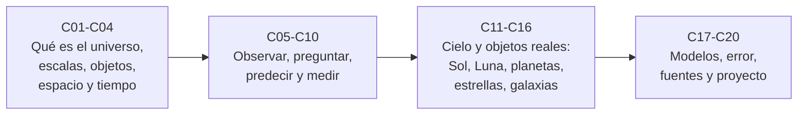

# B01 — El universo y el pensamiento científico

**Programa:** Programa Integral de Astronomía, Astrofísica, Ciencias Espaciales e Ingeniería Aeroespacial
**Área:** A01 — Alfabetización científica, astronómica y tecnológica
**Nivel:** N0 → N1 (descubrimiento y fundamentos) · **Clases:** 20 · **Carga:** por calibrar con el uso
**Estado:** guía pedagógica del bloque (resumen de qué se aprende en cada clase). Las clases enlazadas en la tabla ya están redactadas; el resto son resúmenes de especificación. Todas conservan el estado E0 en el catálogo hasta registrar revisión disciplinar.

## 🎯 Propósito del bloque

Es la puerta de entrada al programa. Enseña a **mirar el universo como lo hace la ciencia**: qué existe, a qué escala, cómo lo sabemos y con qué confianza. No exige conocimientos previos; prepara el lenguaje de medida, evidencia y modelo que usan los 63 bloques siguientes.

## 📚 Al terminar el bloque podrás

1. Describir el universo y sus escalas, desde la Tierra hasta el cosmos observable, con unidades correctas.
2. Distinguir **observación**, **inferencia** y **modelo** en cualquier afirmación astronómica.
3. Formular preguntas investigables y predicciones que puedan fallar.
4. Medir, estimar errores y reportar incertidumbre de forma elemental.
5. Evaluar fuentes y detectar desinformación espacial.
6. Completar un proyecto de observación inicial con evidencia revisable.

## 🧭 Secuencia del bloque

**Descripción textual.** Cuatro tramos encadenados: marco general (C01–C04), método de observación y medida (C05–C10), recorrido por objetos y fenómenos observables (C11–C16) y cierre con modelos, incertidumbre, fuentes y proyecto (C17–C20).

## 🗂️ Las 20 clases en resumen

**Navegación:** cada clase desarrollada enlaza a la anterior, a la siguiente y a este bloque; mientras una clase siga en E0, su enlace lleva a su fila en esta tabla.

Los resúmenes son la **especificación pedagógica propuesta** (nivel E1 parcial, pendiente de revisión). La columna «Evidencia» indica el producto que demostrará el aprendizaje.

### Tramo 1 · Marco general

| ID | Clase | Qué se aprende | Evidencia |
|---|---|---|---|
| [B01-C01](../clases/B01/B01-C01-naturaleza-del-universo/CLASE.md) | Naturaleza del universo | Qué es el universo y el universo observable; separar observación, inferencia y modelo con cifras reales (edad, expansión). | Ficha de escala y edad |
| [B01-C02](../clases/B01/B01-C02-escalas-desde-la-tierra-al-cosmos-observable/CLASE.md) | Escalas desde la Tierra al cosmos observable | Órdenes de magnitud y notación científica; recorrer 26 órdenes de magnitud con unidades de longitud. | Escalera de escalas con conversiones |
| [B01-C03](../clases/B01/B01-C03-objetos-celestes-y-sus-diferencias/CLASE.md) | Objetos celestes y sus diferencias | Criterios para distinguir planeta, estrella, galaxia, nebulosa y cúmulo; qué los define y cómo se observan. | Clasificación justificada de objetos |
| [B01-C04](../clases/B01/B01-C04-espacio-y-tiempo-en-ciencia/CLASE.md) | Espacio y tiempo en ciencia | Cómo se miden posición y tiempo; sistemas de referencia y escalas temporales básicas. | Registro de tiempo y posición con referencia declarada |

### Tramo 2 · Observar, preguntar y medir

| ID | Clase | Qué se aprende | Evidencia |
|---|---|---|---|
| [B01-C05](../clases/B01/B01-C05-observacion-frente-a-interpretacion/CLASE.md) | Observación frente a interpretación | Qué es un dato y qué es una lectura de ese dato; ejemplos donde la interpretación cambió. | Tabla de afirmaciones O/I/M |
| [B01-C06](../clases/B01/B01-C06-preguntas-investigables-en-astronomia/CLASE.md) | Preguntas investigables en astronomía | Convertir curiosidad en preguntas que pueden responderse con datos accesibles. | Banco de preguntas con criterio de viabilidad |
| [B01-C07](../clases/B01/B01-C07-hipotesis-y-predicciones-falsables/CLASE.md) | Hipótesis y predicciones falsables | Formular una hipótesis, derivar una predicción y decir qué resultado la refutaría. | Hipótesis con predicción y criterio de refutación |
| [B01-C08](../clases/B01/B01-C08-mediciones-y-unidades-astronomicas/CLASE.md) | Mediciones y unidades astronómicas | Unidades SI y astronómicas (au, ly, pc); conversión y análisis dimensional. | Hoja de conversiones verificada |
| [B01-C09](../clases/B01/B01-C09-luz-como-fuente-de-informacion/CLASE.md) | Luz como fuente de información | Qué información trae la luz: dirección, brillo, color y espectro; límites de lo que revela. | Interpretación de un espectro sencillo |
| [B01-C10](../clases/B01/B01-C10-limitaciones-de-los-sentidos-humanos/CLASE.md) | Limitaciones de los sentidos humanos | Qué no vemos (rango espectral, brillo, resolución) y por qué se usan instrumentos. | Comparación sentido–instrumento |

### Tramo 3 · El cielo y sus objetos

| ID | Clase | Qué se aprende | Evidencia |
|---|---|---|---|
| [B01-C11](../clases/B01/B01-C11-movimiento-aparente-del-sol-y-las-estrellas/CLASE.md) | Movimiento aparente del Sol y las estrellas | Rotación terrestre, horizonte, culminación y estaciones desde un lugar concreto. | Registro de trayectorias con fecha y lugar |
| [B01-C12](../clases/B01/B01-C12-fases-lunares-y-ciclos-celestes/CLASE.md) | Fases lunares y ciclos celestes | Geometría Sol–Tierra–Luna, fases, eclipses y calendarios como ciclos medibles. | Predicción de una fase y su comprobación |
| [B01-C13](../clases/B01/B01-C13-sistema-solar-como-sistema-fisico/CLASE.md) | Sistema solar como sistema físico | Componentes, escalas y leyes que lo organizan; modelo a escala. | Modelo a escala con tabla de datos |
| [B01-C14](../clases/B01/B01-C14-estrellas-y-sus-principales-propiedades/CLASE.md) | Estrellas y sus principales propiedades | Brillo, color, temperatura, tamaño y distancia; cómo se relacionan. | Comparación de estrellas con datos publicados |
| [B01-C15](../clases/B01/B01-C15-galaxias-y-agrupaciones-cosmicas/CLASE.md) | Galaxias y agrupaciones cósmicas | Tipos de galaxias, grupos y cúmulos; estructura a gran escala como observación. | Ficha de una galaxia y su entorno |
| [B01-C16](../clases/B01/B01-C16-expansion-del-universo-como-observacion/CLASE.md) | Expansión del universo como observación | Corrimiento al rojo, ley de Hubble y por qué no hay centro; incertidumbre en H₀. | Estimación de distancia o edad con error |

### Tramo 4 · Modelos, error, fuentes y proyecto

| ID | Clase | Qué se aprende | Evidencia |
|---|---|---|---|
| B01-C17 | Construcción de modelos científicos | Un modelo como simplificación con dominio de validez; contrastar modelo y dato. | Modelo simple con su límite declarado |
| B01-C18 | Incertidumbre y errores elementales | Error aleatorio y sistemático, cifras significativas y propagación simple. | Reporte de medición con incertidumbre |
| B01-C19 | Fuentes confiables y desinformación espacial | Jerarquía de fuentes, detección de afirmaciones sin respaldo y verificación de titulares. | Informe de verificación de una noticia |
| B01-C20 | Proyecto de observación científica inicial | Integrar pregunta, hipótesis, medición, incertidumbre y fuentes en una observación real. | Proyecto con bitácora, datos y conclusión acotada |

## 🧵 Hilos que atraviesan el bloque

- **Escala:** C02, C13–C16 retoman los órdenes de magnitud de C01.
- **Método:** C05–C07 y C17 construyen el ciclo pregunta → hipótesis → predicción → modelo.
- **Evidencia:** C08, C18 y C19 enseñan unidad, error y fuente, que se reutilizan en el proyecto C20.

## 📝 Evaluación del bloque (propuesta, por calibrar)

- Fichas y ejercicios por clase, con retroalimentación y recuperación con evidencia distinta.
- Portafolio: primera versión, retroalimentación y cambio.
- Proyecto C20 con rúbrica publicada antes; las condiciones críticas (no presentar lo simulado como observado, citar solo lo consultado) no se compensan con promedio.

## ⚠️ Seguridad y límites

Cualquier observación del Sol exige filtros certificados y supervisión; el bloque es educativo y no sustituye orientación profesional. Las cosmovisiones culturales se estudian en B02 como saberes propios.

## Fuentes de orientación preliminar

- **[NASA-DATA]** [NASA Science Data](https://science.data.nasa.gov/) — Portal general de datos y servicios científicos.
- **[IAU]** [International Astronomical Union: resolutions](https://www.iau.org/Iau/Publications/List-of-Resolutions.aspx) — Nomenclatura, tiempos, sistemas de referencia y recomendaciones científicas.
- **[ESO]** [European Southern Observatory](https://www.eso.org/) — Observatorios ópticos, instrumentación y astronomía profesional.
- **[ADS]** [NASA Astrophysics Data System](https://ui.adsabs.harvard.edu/) — Índice bibliográfico de literatura astronómica y física.

> La asociación de estas fuentes es orientativa por bloque. No significa que cada afirmación de una futura clase esté respaldada todavía. Comprobar documentos, versiones y licencias antes de desarrollar contenido.

[🏠 Volver al programa](../../README.md) · [➡️ B02 — Historia, arqueoastronomía y culturas del cielo](./B02-historia-arqueoastronomia-y-culturas-del-cielo.md)
